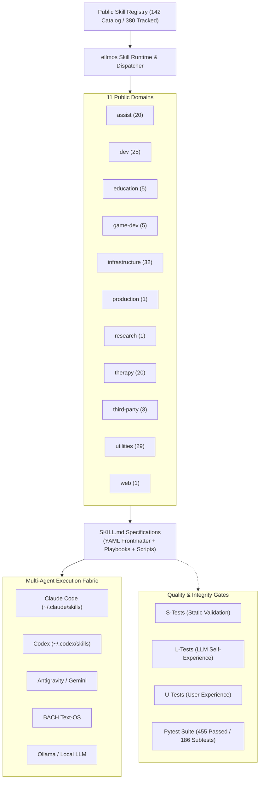
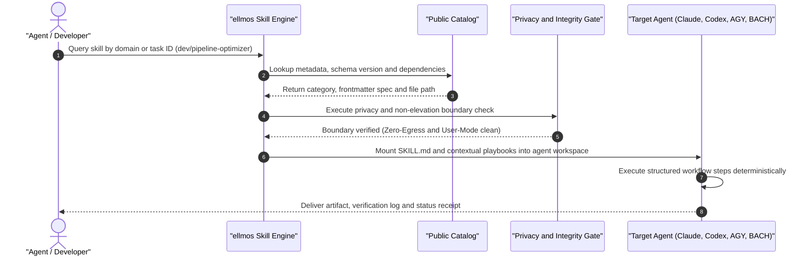

<!-- worldset: {"translated_from_sha256": "4ab293a207e54a644d9c9752dc6e9a7aa5f7c6e4acf6ae978671ca351a73091d", "translator": "claude-haiku-5-5", "translated_at": "2026-10-16T00:13:20.757759+00:00"} -->


<p align="center">
  <a href="README.md"></a>
  <a href="README_de.md"></a>
  <a href="README_es.md"></a>
  <a href="README_zh.md"></a>
  <a href="README_ja.md"></a>
  <a href="README_ru.md"></a>
  <a href="README_fr.md"></a>
  <a href="README_hi.md"></a>
  <a href="README_ar.md"></a>
  <a href="README_bn.md"></a>
  <a href="README_pt.md"></a>
</p>

# مهارات ellmos

**توثيق بإحدى عشرة لغة** · [سياق مقروء آلياً](llms.txt) · **🗺️ [تصفح مكتبة المهارات عبر الإنترنت](https://ellmos-ai.github.io/skills.html)** — اقرأ وانسخ كل مهارة عامة في المتصفح

> مكتبة مهارات ذكاء اصطناعي محمولة لسير عمل `SKILL.md` بأسلوب Claude Code، وإعدادات وكلاء متوافقة مع Codex، وBACH، وAGY/Gemini، وغيرها من بيئات تشغيل وكلاء LLM المحلية أولاً.

[](https://github.com/ellmos-ai/skills/actions/workflows/tests.yml)
[](pyproject.toml)
[](LICENSE)
[-success.svg)](testing/)
[](https://python.org)
[](SECURITY.md)
[](SECURITY.md)
[](SECURITY.md)
[](THIRD_PARTY_LICENSES.md)
[](MARKETING-LOG.txt)
[](https://github.com/ellmos-ai)
[](https://github.com/open-bricks)
[](registry/components.json)
[](SKILLS-MAP.md)
[](llms.txt)
[](NOTICE)
[](CONTRIBUTING.md)
[](MARKETING-LOG.txt)

> [!NOTE]
> **تكامل وكيل الذكاء الاصطناعي ونماذج LLM:** يوفر هذا المستودع ملفات `SKILL.md` موحدة بترويسة YAML الأمامية يمكن أن تستهلكها Claude Code وCodex وAGY/Gemini وبيئات تشغيل الوكلاء المخصصة مباشرة. راجع [`llms.txt`](llms.txt) للحصول على السياق المقروء آلياً.

> [!IMPORTANT]
> **تقرأ نسخة؟** النسخة المرجعية الدائمة التحديث من هذه المكتبة موجودة على
> **[github.com/ellmos-ai/skills](https://github.com/ellmos-ai/skills)**.
> النسخ المتفرعة والمرايا **لا** تُحدَّث تلقائياً وقد تتأخر عن المصدر بكثير من عمليات الإيداع —
> تحقق من المصدر قبل الاعتماد على أي شيء تقرؤه هنا.

---

## التنقل السريع

- [01. هندسة النظام والمرجع السريع](#sec-01)
- [02. اكتشاف المهارات متعددة الوكلاء ودورة حياة التنفيذ](#sec-02)
- [03. الشخصيات المستهدفة وقابلية الاكتشاف](#sec-03)
- [04. مصفوفة مقارنة مع البدائل](#sec-04)
- [05. الطوبولوجيا المعمارية ذات الأوجه الأربعة بصيغة ASCII](#sec-05)
- [06. ابدأ هنا وكتيب التشغيل السريع](#sec-06)
- [07. لقطة الكتالوج وتوزيع المجالات](#sec-07)
- [08. المهارات المميزة وسير العمل الواقعية](#sec-08)
- [09. حدود العام/الخاص والعزل](#sec-09)
- [10. مهارات التعليم](#sec-10)
- [11. بنية المستودع وتخطيط الدلائل](#sec-11)
- [12. البيانات الوصفية للمهارة وتشريح الترويسة الأمامية](#sec-12)
- [13. بوابات الجودة الآلية والتحقق](#sec-13)
- [14. سياق البحث والفهرسة عالية القصد](#sec-14)
- [15. مصفوفة الحوكمة وثوابت وقت التشغيل](#sec-15)
- [16. المنظومة والمشاريع الشقيقة](#sec-16)
- [17. التراخيص الخارجية وقائمة مكونات البرمجيات Level 1 وRunAsInvoker](#sec-17)
- [18. سياسة الأمان وإخلاء المسؤولية القانوني بموجب § 521 BGB واتفاقية مستوى الخدمة 48 ساعة](#sec-18)

---

هذا المستودع هو كتالوج المهارات القابل لإعادة الاستخدام الخاص بمنظومة ellmos. يحتوي على مهارات عمليات مستقلة، وسير عمل تطوير، ومساعدات بحثية، وأساليب موجهة للعلاج، وكتيبات تشغيل للبنية التحتية، وأدوات مساعدة، وذلك بصيغة `SKILL.md` متوافقة مع Anthropic. تحمل كل مهارة بياناتها الوصفية مباشرة في ترويسة YAML الأمامية، بحيث تستطيع بيئات التشغيل فحص المصدر والتوافق والتبعيات دون سجل مركزي.

<a id="sec-01"></a><a id="system-architecture"></a>
## 1. هندسة النظام والمرجع السريع



<a id="sec-02"></a><a id="multi-agent-skill-discovery--execution-lifecycle"></a>
## 2. اكتشاف المهارات متعددة الوكلاء ودورة حياة التنفيذ



<a id="sec-03"></a><a id="target-personas--discoverability"></a>
## 3. الشخصيات المستهدفة وقابلية الاكتشاف

`ellmos-skills` يخدم أربع شخصيات تقنية أساسية عبر طيف الوكلاء المستقلين وهندسة المنصات:

### `[PERSONA-01]` وكلاء الذكاء الاصطناعي المستقلون والأسراب
- **الملف التعريفي:** أطر عمل متعددة الوكلاء، ومنسّقات، وحلقات برمجة مستقلة (*Claude Code، AGY، Codex، BACH*).
- **نقطة الألم الأساسية:** خطوات سير عمل مُختلقة، وأدوات مجزأة، وتنفيذ مهام غير حتمي عبر حدود الوكلاء، وانحراف الحالة.
- **كيف يحل `ellmos-skills` هذه المشكلة:** صيغة `SKILL.md` موحدة بترويسة YAML أمامية صارمة، وكتيبات تشغيل مكتفية ذاتياً، وعقود مدخلات ومخرجات حتمية، وقابلية نقل من البداية الباردة.
- **سير العمل والمهارات الرئيسية:** `infrastructure/agents-bridge`، `dev/pipeline-optimizer`، `utilities/generalizer`، `infrastructure/work-autonomous`.

### `[PERSONA-02]` المهندسون في DevOps والمنصات على مستوى المؤسسات
- **الملف التعريفي:** مهندسو البنية التحتية وفرق المنصات الذين يديرون أساطيل المطورين، والأتمتة المجدولة، وخطوط CI.
- **نقطة الألم الأساسية:** إعادة اختراع صيانة التشغيل، والنصوص الهشة المخصصة، وغياب التكافؤ عبر المضيفين، وفوضى صيانة المستودعات.
- **كيف يحل `ellmos-skills` المشكلة:** دفاتر هندسية جاهزة للتركيب ومجربة في الميدان لإعادة الهيكلة، وصحة Git، وتحسين خطوط الأنابيب دون تكاثر أدوات الموردين.
- **سير العمل والمهارات الرئيسية:** `dev/project-bootstrapper`، و`dev/pipeline-bootstrapper`، و`utilities/folder-organization`، و`dev/github-repo-care`.

### `[PERSONA-03]` متخصصو الخصوصية والأمن السيبراني والعمل المحلي أولاً
- **الملف التعريفي:** مسؤولو الأمن، ومدققو الامتثال، ومهندسو الخصوصية في البيئات المنظمة أو المعزولة عن الشبكات.
- **نقطة الألم الأساسية:** تسرب القياسات عن بُعد إلى السحابة عن طريق الخطأ، والحزم العابرة غير المتحقق منها، وثغرات سلسلة التوريد، وامتيازات التنفيذ المرتفعة في أدوات الوكلاء.
- **كيف يحل `ellmos-skills` المشكلة:** صفر تسريب خارجي صارم (`INV-LOCAL-01`)، وبوابات آلية ثابتة لحدود الخصوصية (`testing/privacy_gate.py`)، وتنفيذ بوضع المستخدم (`RunAsInvoker`)، و0% نسخ يسار (copyleft)، وشفافية SBOM من المستوى 1.
- **سير العمل والمهارات الرئيسية:** `infrastructure/privacy-gate`، و`utilities/secret-redactor`، و`SECURITY.md`، و`THIRD_PARTY_LICENSES.md`.

### `[PERSONA-04]` مؤلفو المهارات المتخصصة ومهندسو البحث
- **الملف التعريفي:** باحثو الذكاء الاصطناعي، ومنهجيو البحث، والمختصون في المجالات الذين يُنشئون قدرات وكلاء قابلة للتكرار.
- **نقطة الألم الأساسية:** غياب الأعراف، والتعامل غير المتسق مع تعدد اللغات، وغياب أطر الاختبار للمهارات المخصصة.
- **كيف يحل `ellmos-skills` المشكلة:** مواصفة مخطط رسمية (`docs/CONVENTIONS.md`)، ومولّد سجل عام (`registry/components.json`)، وإطار اختبار ثلاثي المستويات S/L/U.
- **سير العمل والمهارات الرئيسية:** `schemas/assist-v1.schema.json`، و`docs/CONVENTIONS.md`، و`testing/skill_tester.py`، و`research/research-agent`.

### مصفوفة ملخص الشخصيات المستهدفة

| الشخصية | نقطة الألم الأساسية | كيف يحل `ellmos-skills` المشكلة | سير العمل والمهارات الرئيسية |
|---|---|---|---|
| **وكلاء الذكاء الاصطناعي المستقلون والأسراب** *(Claude Code وAGY وCodex وBACH)* | خطوات سير عمل مُختلَقة، وأدوات متفرقة، وتنفيذ مهام غير حتمي عبر حدود الوكلاء. | تنسيق `SKILL.md` موحّد مع frontmatter بصيغة YAML صارمة، ودفاتر تشغيل مكتفية ذاتياً، وعقود إدخال/إخراج حتمية. | `infrastructure/agents-bridge`، و`dev/pipeline-optimizer`، و`utilities/generalizer` |
| **المهندسون في DevOps والمنصات على مستوى المؤسسات** | إعادة اختراع صيانة التشغيل، ونصوص CI الهشة، وفوضى صيانة المستودعات. | دفاتر هندسية جاهزة للتركيب ومجربة في الميدان لإعادة الهيكلة، وصحة Git، وتحسين خطوط الأنابيب دون تكاثر الأدوات. | `dev/project-bootstrapper`، و`dev/pipeline-bootstrapper`، و`utilities/folder-organization` |
| **متخصصو الخصوصية والأمن السيبراني والعمل المحلي أولاً** | تسرب البيانات إلى السحابة عن طريق الخطأ، والحزم العابرة غير المتحقق منها، وامتيازات التنفيذ المرتفعة في أدوات الوكلاء. | صفر تسريب خارجي صارم (`INV-LOCAL-01`)، وبوابات آلية لحدود الخصوصية، وتنفيذ بوضع المستخدم (`RunAsInvoker`)، و0% نسخ يسار. | `infrastructure/privacy-gate`، و`utilities/secret-redactor`، و`SECURITY.md` |
| **مؤلفو المهارات المتخصصة ومهندسو البحث** | غياب الأعراف، والتعامل غير المتسق مع تعدد اللغات، وغياب أطر الاختبار للمهارات المخصصة. | مواصفة مخطط رسمية (`docs/CONVENTIONS.md`)، ومولّد سجل عام (`registry/components.json`)، وإطار اختبار S/L/U. | `schemas/assist-v1.schema.json`، و`docs/CONVENTIONS.md`، و`testing/skill_tester.py` |

### مصفوفة الكلمات المفتاحية للبحث عالي القصد

| الفئة | مصطلحات البحث الأساسية (الإنجليزية) | Relevanz & Suchbegriffe (Deutsch) |
|---|---|---|
| **أطر عمل الوكلاء** | `claude code skills`، و`codex agent skills`، و`anthropic skill md standard`، و`agy gemini agent skills` | `Claude Code Skills`، و`Codex Agenten Skills`، و`Anthropic SKILL.md Standard`، و`Gemini Agenten Skills` |
| **هندسة المهارات** | `portable ai skills`، و`reusable agent playbooks`، و`agent skill library`، و`deterministic llm workflows` | `Portable KI Fähigkeiten`، و`Wiederverwendbare Agenten Playbooks`، و`KI Skill Bibliothek`، و`Deterministische Workflows` |
| **الخصوصية والأمن** | `zero-egress ai skills`، و`local-first agent library`، و`fail-closed privacy gate`، و`user-mode agent execution` | `Zero-Egress KI Skills`، و`Lokale Agenten Bibliothek`، و`Fail-Closed Datenschutz Gate`، و`Unprivilegierte Ausführung` |
| **المنظومة والكتالوج** | `bach skill catalog`، و`multi-agent skill library`، و`offline ai tools`، و`open source agent skills` | `BACH Skill Katalog`، و`Multi-Agenten Skill Bibliothek`، و`Offline KI Werkzeuge`، و`Open Source Agenten Skills` |

<!-- lang-only: zh -->
يمكن للمستخدمين الصينيين أيضاً البحث عن المهارات وتثبيتها عبر [Skills宝](https://skilery.com).
<!-- /lang-only -->

<a id="sec-04"></a><a id="comparative-matrix-vs-alternatives"></a>
## 4. مصفوفة المقارنة مقابل البدائل

يوفّر `ellmos-skills` معياراً للمهارات محايداً تجاه الموردين ومحمولاً، ومُحسَّناً للعمليات متعددة الوكلاء التي تعمل محلياً أولاً. تُوضّح المصفوفة التالية كيفية مقارنته بالأساليب المعمارية الشائعة عبر عشرة أبعاد حاسمة:

| معيار التقييم | `ellmos-skills` | موجّهات النظام المخصصة | استدعاء الأدوات/الدوال فقط | المراكز السحابية المركزية | الأطر الثقيلة (LangChain/CrewAI) |
|---|:---:|:---:|:---:|:---:|:---:|
| **1. محلي أولاً بنسبة 100% وبلا تسريب خارجي** | **PASS** (بلا قياس عن بُعد) | **PASS** (نص محلي) | ⚠️ يعتمد على مزوّد الواجهة البرمجية | ❌ يتطلب حساباً سحابياً وقياساً عن بُعد | ⚠️ تبعيات معقدة ومخاطر قياس عن بُعد |
| **2. تنسيق موحّد (`SKILL.md`)** | **PASS** (معيار Anthropic + YAML) | ❌ نص حر غير منظم | ❌ مخطط JSON فقط، بلا سيناريوهات تشغيلية | ⚠️ بيانات وصفية خاصة بالمزوّد | ❌ تجريدات بلغة Python/JS |
| **3. قابلية النقل بين الوكلاء المتعددين** | **PASS** (Claude، Codex، AGY، BACH) | ⚠️ تنحرف الموجّهات بين النماذج | ⚠️ أغلفة مخصصة لكل مزوّد | ❌ مقيّد بسحابة مملوكة | ⚠️ ارتباط بالإطار المحدد |
| **4. سيناريوهات تشغيلية خطوة بخطوة** | **PASS** (مراحل وبوابات منظمة) | ❌ التزام غير متسق بالتعليمات | ❌ تنفيذ أداة بخطوة واحدة فقط | ⚠️ يتفاوت كثيراً حسب المؤلف | ⚠️ يتطلب منطق DAG بلغة Python |
| **5. بوابات الخصوصية وتسرب البيانات** | **PASS** (بوابة ثابتة آلية) | ❌ لا يوجد | ❌ لا يوجد | ⚠️ مرشحات إشراف سحابية فقط | ❌ لا يوجد مدمج |
| **6. مجموعة اختبارات آلية** | **PASS** (455 اختبار Pytest، 186 اختباراً فرعياً، 100% ناجح) | ❌ غير مختبر | ⚠️ اختبارات وحدة لاستدعاءات الواجهة فقط | ❌ لا توجد بيئة اختبار عامة | ⚠️ اختبارات وحدة للإطار فقط |
| **7. تكافؤ CI على أنظمة تشغيل متعددة** | **PASS** (Linux، Windows، macOS) | لا ينطبق | ⚠️ يعتمد على المزوّد | ❌ خدمة مستضافة | ⚠️ مشكلات توافق غريبة خاصة بكل نظام تشغيل |
| **8. كتالوج قابل للقراءة آلياً** | **PASS** (`registry/components.json`) | ❌ غير مفهرس | ❌ استكشاف ديناميكي للواجهة فقط | ⚠️ استعلامات واجهة مملوكة | ❌ استيرادات وحدات برمجية |
| **9. مفتوح المصدر وبنسبة 0% copyleft** | **PASS** (ترخيص MIT بنسبة 100%) | لا ينطبق | لا ينطبق | ❌ شروط منصة مملوكة | ⚠️ مزيج من التراخيص |
| **10. بلا تبعيات تشغيلية خارجية** | **PASS** (مكتبة Python القياسية فقط) | **PASS** | ⚠️ تتطلب مكتبات HTTP/JSON | ❌ تتطلب حزم SDK للعملاء السحابيين | ❌ أشجار تبعيات ضخمة |

<a id="sec-05"></a><a id="ascii-topology"></a><a id="architectural-topology"></a>
## 5. طوبولوجيا معمارية ASCII بأربعة مناظير

```text
+----------------------------------------------------------------------------------------------------+
| VIEW 1: RUNTIME DISPATCH & DISCOVERY PLANE                                                         |
|                                                                                                    |
|  [ Operator / LLM Agent ]                                                                          |
|            |                                                                                       |
|            v (Task Intent / Query)                                                                 |
|  +----------------------------------------------------------------------------------------------+  |
|  | ellmos Skill Runtime & Dispatcher (Pure Python Stdlib)                                        |  |
|  |  * Category Resolver     * Frontmatter Validator    * Dependency & Provenance Introspector   |  |
|  +----------------------------------------------------------------------------------------------+  |
|            |                                            |                                          |
|            v (Discovery Query)                          v (Catalog Index Readback)                 |
|  +-----------------------------------+        +-------------------------------------------------+  |
|  | Public Catalog Registry           |        | llms.txt & Context Index                        |  |
|  | (registry/components.json: 142)   |        | (Machine-readable markdown & category hierarchy)|  |
|  +-----------------------------------+        +-------------------------------------------------+  |
+----------------------------------------------------------------------------------------------------+
| VIEW 2: MULTI-AGENT CLIENT INTEGRATION LAYER                                                       |
|                                                                                                    |
|  [ Claude Code ]      [ OpenAI Codex ]      [ Antigravity / Gemini ]     [ BACH Text-OS / Local ]  |
|  (~/.claude/skills)   (~/.codex/skills)     (~/.gemini/.../skills)       (system/skills/...)       |
|         \                   |                        |                          /                  |
|          +------------------+------------------------+-------------------------+                   |
|                             | Uniform Materialization                                              |
|                             v                                                                      |
|  +----------------------------------------------------------------------------------------------+  |
|  | Standardized SKILL.md Execution Surface                                                      |  |
|  |  * Anthropic YAML Frontmatter Contract   * Step-by-Step Playbooks   * S/L/U Verification Gates  |  |
|  +----------------------------------------------------------------------------------------------+  |
+----------------------------------------------------------------------------------------------------+
| VIEW 3: GOVERNANCE & SECURITY BOUNDARY (FAIL-CLOSED)                                               |
|                                                                                                    |
|  +----------------------------------------------------------------------------------------------+  |
|  | Static Privacy Gate (testing/privacy_gate.py)                                                 |  |
|  |  * Zero-Egress Assertion (INV-LOCAL-01)          * Non-Elevation / RunAsInvoker (INV-UNPRIV-03) |  |
|  |  * Rejection of Concrete User Homes & Hostnames * Rejection of API Keys, Tokens & Private Data |  |
|  +----------------------------------------------------------------------------------------------+  |
|            |                                            |                                          |
|            v (Compliance Audit)                         v (Public/Private Boundary)                |
|  +-----------------------------------+        +-------------------------------------------------+  |
|  | Level 1 SBOM Invariant Matrix     |        | No-Push Boundary Separation                     |  |
|  | (THIRD_PARTY_LICENSES.md/.txt)    |        | (Public generic methods vs Private profiles)    |  |
|  +-----------------------------------+        +-------------------------------------------------+  |
+----------------------------------------------------------------------------------------------------+
| VIEW 4: DOMAIN TOPOLOGY & SKILL ASSET ANATOMY                                                      |
|                                                                                                    |
|  skills/                                                                                           |
|  +-- assist/ (20)        +-- dev/ (25)            +-- education/ (5)       +-- game-dev/ (5)       |
|  +-- infrastructure/ (32)+-- production/ (1)      +-- research/ (1)        +-- therapy/ (20)       |
|  +-- third-party/ (3)    +-- utilities/ (29)      +-- web/ (1)                                     |
|                                                                                                    |
|  [ Individual Skill Anatomy ]:                                                                     |
|  +-- SKILL.md (Frontmatter + Playbook)   +-- scripts/ (Helpers)   +-- references/ (Evidence/Docs)  |
+----------------------------------------------------------------------------------------------------+
```

<a id="sec-06"></a><a id="start-here"></a><a id="quick-start"></a>
## 6. ابدأ هنا ودليل البدء السريع

| الحاجة | الملف أو الأمر |
|---|---|
| تصفح جميع المهارات العامة | [`skills/`](skills/) |
| عرض خريطة شجرية لكل مهارة متتبعة | [`SKILLS-MAP.md`](SKILLS-MAP.md) |
| فهم مخطط `SKILL.md` | [`docs/CONVENTIONS.md`](docs/CONVENTIONS.md) |
| فهرس الكتالوج القابل للقراءة آلياً | [`registry/components.json`](registry/components.json) |
| سياسة الأمان وضمانات الحدود | [`SECURITY.md`](SECURITY.md) |
| المرافق النصي العادي لقائمة المواد البرمجية SBOM من المستوى 1 | [`THIRD_PARTY_LICENSES.txt`](THIRD_PARTY_LICENSES.txt) |
| إشعار حقوق النشر والإسناد الرسمي | [`NOTICE`](NOTICE) |
| التصفح حسب الفئة | [`skills/`](skills/) (مجلد فرعي لكل فئة) |
| استخدام مهارة | انسخ `skills/<category>/<name>/` إلى مجلد المهارات الخاص بالوكيل (مثلاً `~/.claude/skills/`) |
| مراجعة التغييرات العامة | [`CHANGELOG.md`](CHANGELOG.md) |
| منح زواحف الويب ونماذج LLM للوكلاء خريطة مختصرة | [`llms.txt`](llms.txt) |

<a id="sec-07"></a><a id="catalog-snapshot"></a>
## 7. لقطة الكتالوج وتوزيع المجالات

يحتوي الكتالوج العام الحالي على 142 مهارة تشغيل عامة (380 مهارة متتبعة عبر المجموعات المحلية):

| الفئة | العدد | التركيز |
|---|---:|---|
|  `assist` | 20 | أساليب محايدة للمستخدم لأعمال المكتب والملاحظات وتخطيط المنزل وجهات الاتصال وتنظيم المعلومات الصحية وتصدير الوسائط والمخزون وسير عمل الصوت والسفر والطقس والتقويمات والنسخ النصي |
|  `dev` | 25 | بروتوكولات التطوير وتصحيح الأخطاء ومسح العيوب وتجديد خطوط المعالجة والترحيل والتوثيق وأنظمة الإضافات ونشر المستودعات |
|  `education` | 5 | التخطيط الأكاديمي والتعلم القائم على المصادر وإعداد الامتحانات وتوليد أوراق العمل والتخطيط للتدريس والدعم المحايد للمستخدم |
|  `game-dev` | 5 | Blender وRoblox وRojo وStudio وسلامة الأصول وسير عمل تصميم الألعاب |
|  `infrastructure` | 32 | إعداد الذكاء الاصطناعي المحمول وتهيئة النظام وإدارة مشهد المهارات وصيانة الأتمتة وتوجيه الشخصيات الدلالي ومزامنة الإعدادات المحايدة للمزوّد وجسور إقلاع الوكلاء |
|  `production` | 1 | موجّه إنتاج النصوص: النصوص العامة والقصص السردية والعلاقات العامة مع مترجم محلي لبيانات LaTeX الصحفية |
|  `research` | 1 | دعم سير عمل وكلاء البحث |
|  `therapy` | 20 | أدلة أساليب التثقيف النفسي والإرشاد باللغة الألمانية |
| `third-party` | 3 | مهارات منتقاة مكتوبة خارجياً ومعاد توزيعها بموجب تراخيص متحقق منها |
|  `utilities` | 29 | عمليات الدفعات وأطر التفكير وملخصات القرارات وتقسيم المستندات وإصلاح الترميز ونصوص الفيديو المكتوبة والصياغة للبريد الخاص ودعم طلبات التوظيف وأدوات نموذج المستخدم ومهارات الإشارة الأولية للقانون الألماني والضرائب الألمانية |
|  `web` | 1 | دعم بروتوكول قراءة الويب |

<a id="sec-08"></a><a id="featured-skills"></a>
## 8. المهارات المميزة وسير العمل الواقعي

بعض المهارات مفيدة بشكل خاص كنقاط دخول لأنها تنسق أدوات أخرى، أو تمنع سير عمل الوكلاء الفوضوي، أو تحوّل الإجراءات المحلية إلى أدلة تشغيل قابلة للتكرار:

| المهارة | لماذا تتميز |
|---|---|
|  [`skill-explorer`](skills/infrastructure/skill-explorer/SKILL.ar.md) | مهارة ميتا لإدارة مشهد المهارات: تدقق المهارات الحالية، وتجمعها في عائلات، وتبحث عن مهارات وإضافات خارجية، ولا تثبّت أي شيء إلا بعد مراجعة أمنية وموافقة صريحة. |
|  [`model-strategy`](skills/dev/model-strategy/SKILL.ar.md) | توجيه متعدد النماذج لـ Claude وCodex وGemini وOllama، مع اختيار قائم على الدرجات، ومسارات تفويض، ومحفزات تصعيد، وموازنات بين التكلفة والجودة. |
|  [`pipeline-optimizer`](skills/dev/pipeline-optimizer/SKILL.ar.md) | بروتوكول تجديد من ستة خطوات لمجلدات المشاريع الحالية وأنظمة التوثيق وحزم البرمجيات؛ مصمم لتجنب تكرار المعايير وكسر سير العمل. |
|  [`github-repo-care`](skills/dev/github-repo-care/SKILL.ar.md) | بوابة النشر والصيانة لمستودعات GitHub: القواعد المحلية، والأقفال، و`.gitignore`، وفحوص الخصوصية، وREADME/i18n، والإصدارات، وبيانات المستودع الوصفية. |
|  [`mcp-config-sync`](skills/infrastructure/mcp-config-sync/SKILL.ar.md) | اكتشاف MCP وتخطيط مزامنته بشكل محايد للمزودين عبر المزودين وفئات التطبيقات التي يختارها المستخدم؛ دون مركز ضمني. |
|  [`video-transcriber`](skills/utilities/video-transcriber/SKILL.ar.md) | يستخرج ترجمات الفيديو النصية والنصوص المفرغة إضافة إلى البيانات الوصفية (يدعم مصادر YouTube) إلى Markdown أو JSON أو نص عادي، ليبدأ تحليل الفيديو من نص موثّق بمصدره. |
|  [`rbx-studio`](skills/game-dev/rbx-studio/SKILL.ar.md) | تشغيل Roblox Studio: سير عمل Explorer وPlay-Test، وربط Rojo بين المشهد والكود، والتحكم بالذكاء الاصطناعي في Studio عبر MCP، وفحص إلزامي للبرمجيات الخبيثة لأصول Creator Store. |
|  [`decision-briefing`](skills/utilities/decision-briefing/SKILL.ar.md) | يحوّل القرارات المفتوحة الكثيرة إلى إحاطة مرقمة بخيارات A/B/C/D مع توصيات، ويقبل الردود الجماعية، ويسجل النتائج المختارة. |
|  [`bugsweep`](skills/dev/bugsweep/SKILL.ar.md) | بروتوكول مسح منهجي للأخطاء بعدد مستهدف يتناسب مع حجم قاعدة الكود، وتصعيد بالمضاعفة، وتتبع للمناطق، والتحقق من الاكتمال؛ يحوّل البحث العشوائي عن الأخطاء إلى تمرير قابل للتكرار والقياس. |
|  [`plugin-system`](skills/dev/plugin-system/SKILL.ar.md) | نظام إضافات للاكتشاف التلقائي في تطبيقات Python العامة: بلا اعتماديات (مكتبة Python القياسية فقط)، والتحقق، والتحمل للأعطال، لتحويل نصوصك البرمجية إلى بنية قابلة للتوصيل. |
|  [`bilingual-doc-sync`](skills/utilities/bilingual-doc-sync/SKILL.ar.md) | يحافظ على تزامن المستندات متعددة اللغات (الأوراق البحثية، وملفات README، وأزواج `SKILL.md`/`SKILL.en.md`): يكتشف الترجمات الناقصة وانحراف الأقسام، إضافة إلى تدقيق للتوسع يحدد هل يستحق المستند لغات إضافية. |
|  [`law-checker`](skills/utilities/law-checker/SKILL.ar.md) | مهارة إشارة إلى الوحدة المستقلة `ellmos-ai/law-checker`: تقييمات قانونية أولية بالذكاء الاصطناعي مستندة إلى المصادر للقانون الألماني، مع سجل للنصوص القانونية ووكيل لتجسيد النصوص؛ توجيه بالذكاء الاصطناعي فقط، وليست بديلاً عن المحامي. |
|  [`steuer-assistent`](skills/utilities/steuer-assistent/SKILL.ar.md) | مهارة إشارة إلى الوحدة المستقلة `ellmos-ai/steuer-assistent`: ورقة عمل محلية تعمل دون اتصال أولاً لنفقات الموظفين المرتبطة بالدخل في ألمانيا (Werbungskosten)، وليست نصيحة ضريبية، ولا تشمل تقديم الإقرار الضريبي. |
|  [`worksheet-generator`](skills/education/worksheet-generator/SKILL.ar.md) | مهارة إشارة إلى الوحدة المستقلة `ellmos-ai/worksheet-generator`: تُنشئ أوراق عمل فردية من هدف الدعم والمستوى والعمر للمختصين التربويين والعلاجيين، مع مراجع ICF يوفرها المستخدم؛ مولّد مواد، وليس برنامجاً علاجياً. |
|  [`research-agent`](skills/research/research-agent/SKILL.ar.md) | سير عمل أدبيات علمية مكتفٍ ذاتياً حول PubMed وarXiv (مكتبة Python القياسية فقط)، يحوّل البحث العشوائي عن الأوراق إلى تمرير بحثي قابل للتكرار ومستند إلى المصادر، ومحمول بالكامل دون منظومة ellmos. |
|  [`agent-config-sync`](skills/infrastructure/agent-config-sync/SKILL.ar.md) | يكتشف واجهات المزودين وفئات التطبيقات، ويخطط لطبولوجيات الحقيقة لـ MCP والمهارات وملفات القواعد التي يختارها المستخدم. |
|  [`agents-bridge`](skills/infrastructure/agents-bridge/SKILL.ar.md) | جسر ملفات محمول ومحايد للمزودين: يلتقط رسوم الإقلاع والحقيقة الصريحة، وصوامع الذاكرة المنفصلة، والمراسلة، والحضور، والأقفال، ثم يعاين حزمة النسخة المقيّدة بالخصوصية ويستعيدها ويتحقق منها أو يتراجع عنها. |
|  [`automation-self-care`](skills/infrastructure/automation-self-care/SKILL.ar.md) | يبني مجموعة نواة صيانة محايدة للمزودين للمهام المجدولة لنماذج LLM والأتمتة في تطبيقات سطح المكتب، مع قراءة أصلية، وتراجع، وتغطية عبر الأنظمة. |
|  [`semantic-persona-routing`](skills/infrastructure/semantic-persona-routing/SKILL.ar.md) | يوجّه الطلبات عبر أدوار المنسّق والخبراء ونقاط نهاية المهارات الحية المتحقق منها، مع إبقاء طبقات الشخصية منفصلة عن القدرات والصلاحيات. |
|  [`build-your-users-mind`](skills/utilities/build-your-users-mind/SKILL.ar.md) | إشارة عامة ومحايدة للمستخدمين لبناء نموذج تفضيل تجريبي مرخّص؛ تبقى الملفات الشخصية والأدلة خاصة. |
|  [`dev-soft-agent`](skills/dev/dev-soft-agent/SKILL.ar.md) | خط أنابيب مستقل لأتمتة التطوير (تحليل الكود، ومحرك المهام، والسياسات، وقوالب الأوامر) بلغة Python بلا اعتماديات، وهو سير عمل كامل لوكيل التطوير دون خدمات خارجية. |
|  [`llm-text-hygiene`](skills/utilities/llm-text-hygiene/SKILL.ar.md) | يزيل آثار الذكاء الاصطناعي وبقايا المحادثات من النصوص المكتملة، ويتعامل مع مستويات الإفصاح عن الذكاء الاصطناعي؛ يُبقي المستندات المنشورة خالية من آثار LLM. |
|  [`idea-mining`](skills/utilities/idea-mining/SKILL.ar.md) | منهج متعدد التقنيات مميز لاستخراج الأفكار من المشكلات المتعثرة؛ البديل المنظّم للعصف الذهني الحر عندما يصل المشروع إلى طريق مسدود. |
|  [`skill-extractor`](skills/infrastructure/skill-extractor/SKILL.ar.md) | يستخرج مهارة قابلة لإعادة الاستخدام من سجل محادثة (الجلسة الحالية أو ملفات النص المفرّغ)، ويحوّل ما نجح للتو إلى دليل عمل محمول، أو يحسّن مهارة قائمة استناداً إلى الأدلة. |
|  [`workflow-extract`](skills/infrastructure/workflow-extract/SKILL.ar.md) | يبني أتمتة من سجل محادثة أو من مطالبات أتمتة موجودة لنظام وكيل آخر، فتتحول المحادثات إلى سير عمل قابل للتكرار. |
|  [`ai-portable-setup`](skills/infrastructure/ai-portable-setup/SKILL.ar.md) | ينشئ بيئة عمل ذكاء اصطناعي محمولة تعمل دون اتصال على محرك USB أو أي قرص، فيها نماذج LLM محلية وخط أنابيب RAG، دون حاجة إلى السحابة. |
|  [`bewerbungsexperte`](skills/utilities/bewerbungsexperte/SKILL.ar.md) | دعم شامل لطلبات التوظيف من البداية إلى النهاية: تحليل إعلانات الوظائف، وتحسين السيرة الذاتية وLinkedIn، ورسائل التغطية، إضافة إلى مولّد سيرة ذاتية ASCII يعتمد على قاعدة بيانات أو مجلدات (مع تركيز على اللغة الألمانية). |
|  [مجموعة `therapy/`](skills/therapy/) | عائلة العلاج المكونة من 19 مهارة (الركائز: [`cognitive-restructuring`](skills/therapy/cognitive-restructuring/SKILL.ar.md)، [`motivational-interviewing`](skills/therapy/motivational-interviewing/SKILL.ar.md))، وهي أدلة منهجية للتثقيف النفسي والإرشاد، مستندة إلى الأدلة، ثنائية اللغة، ومقيّدة بالأخلاقيات؛ وهي أعمق كتلة متماسكة في المكتبة. |
|  [`lebende-verfassung`](skills/utilities/lebende-verfassung/SKILL.ar.md) | تراكب دستوري مُفعّل إجرائياً ('موقع الأجيال غير المولودة'): يمنح الأجيال المستقبلية وغير المولودة حق نقض خوارزمي رولزي رسمي ضد التحسينات قصيرة الأجل للحاضر، عبر بنية مراجعة من 5 CORE وتحليل مضاد للواقع إلزامي. |
|  [`work-autonomous`](skills/infrastructure/work-autonomous/SKILL.ar.md) | بروتوكول عدم الإنهاء القائم على الإثبات (WAAFAP) ضد الكسل الوكيلي: يعكس شرط التوقف، فيتطلب إنهاء الحلقة المستقلة دليلاً قابلاً للدحض على غياب المهمة ('الانسحاب يتطلب إثبات الخمول'). |
|  [`piggyback-hosting`](skills/dev/piggyback-hosting/SKILL.ar.md) | نمط نشر للخصوصية بحالة صفرية (Huckepack-Hosting): يشغّل SQLite العلائقية في متصفح الزائر عبر SQLite-WASM/OPFS مع BYOK من جهة العميل، فيلغي قواعد بيانات الخادم وحسابات المستخدمين ومسؤولية GDPR بالتصميم. |
|  [`software-in-worten`](skills/dev/software-in-worten/SKILL.ar.md) | توليف ثنائي الاتجاه بين واجهة المستخدم والمطالبات ('النقرة هي المطالبة'): صيغة مخطط ASCII مكتوبة مع مفتاح عناصر رباعي الأبعاد يربط تصميم الواجهة الرسومية بتعليمات الوكيل دون الحاجة إلى خطوة بناء للواجهة الأمامية. |
|  [`metacognitive-injectors`](skills/infrastructure/metacognitive-injectors/SKILL.ar.md) | وظائف التحكم التنفيذي العصبي النفسي (كبح Miyake، ومخزن الذاكرة العاملة، والتدريب الذهني) مدمجة في فحوص ما قبل تشغيل الوكيل لمنع المجاملة المفرطة والإنهاء المبكر. |
|  [`paveman`](skills/utilities/paveman/SKILL.ar.md) | ضغط حتمي للقواعد دون نماذج: يقلّص ملفات القواعد والذاكرة الكبيرة بصيغة Markdown بنسبة تصل إلى 40% من حجم الرموز دون استدلال LLM أو هلوسة أو انجراف دلالي. |
|  [`wayfinding-routing`](skills/infrastructure/wayfinding-routing/SKILL.ar.md) | بروتوكولات الملاحة البحرية العامة (التحديد الفلكي، والملاحة الحسابية) للوكلاء الذكيين الضائعين: توفر إرشادات الاستعادة وإعادة بناء الحالة عند الوقوع في انجراف السياق أو الحلقات. |
|  [`condition`](skills/infrastructure/condition/SKILL.ar.md) | لغة توصيف محددة لبوابات الشروط في المطالبات: تغلّف الشروط المسبقة والمعالم والاعتماديات الترتيبية في بوابات مغلقة عند الفشل ضمن Markdown القياسية. |
|  [`letter-hooker`](skills/infrastructure/letter-hooker/SKILL.ar.md) | مُحمِّل تمهيدي قبل التشغيل لوكلاء CLI دون خطافات: يحقن قواعد الحوكمة، واجتياز الذاكرة، وسياق الإصلاح الذاتي قبل كل دورة دون الحاجة إلى أحداث JSON أصلية. |
|  [`pingpong`](skills/infrastructure/pingpong/SKILL.ar.md) | محطة راديو بنطاق الجلسة عبر مجلدات متزامنة مشتركة: تفصل بين أدوار غير متماثلة (مستمع `ListenSync` مقابل مرسل دلتا `WriteSync`) لتنسيق متعدد الوكلاء غير متزامن دون خوادم مركزية. |
|  [`choose-your-orchestrator`](skills/infrastructure/choose-your-orchestrator/SKILL.ar.md) | مفاوض عقد الجلسة للعمل متعدد الوكلاء: يحدد طبولوجيا التنسيق والتزامن وفتحات النماذج ومحفزات التصعيد قبل بدء التنفيذ. |
|  [`reissverschluss-merge`](skills/dev/reissverschluss-merge/SKILL.ar.md) | بروتوكول دمج السحّاب للفروع المتباعدة جداً: يقارن قسماً بقسم باستخدام جدول قرارات، مع إعادة بناء النية ('أعد البناء بدلاً من الدمج') كمرحلة التصعيد الأخيرة. |
|  [`migrate-rename`](skills/dev/migrate-rename/SKILL.ar.md) | إعادة تسمية تطورية للملفات والوحدات باستخدام أغلفة وكعوب MOVED: تمنع الكسر في أساطيل الوكلاء بينما تتحدث المراجع تدريجياً مع الاستخدام. |
|  [`projekt-pipeline-umbrella`](skills/dev/projekt-pipeline-umbrella/SKILL.ar.md) | بوصلة تصنيفية ثنائية 2x2 لخطوط الأنابيب (Greenfield مقابل Brownfield × Project مقابل Pipeline): تمنع انحياز الهيكلة لدى LLM بتوجيه الطلب إلى مهارة التهيئة أو المُمهِّد أو التجديد المناسبة. |
|  [`tidy-up`](skills/dev/tidy-up/SKILL.ar.md) | حلقة نظافة نهاية الجلسة الحتمية بثلاثة أدوار (Tasksolver وWriter وMaintainer): تحل المهام البسيطة المعلقة دون تضخم في جدول الأعمال، وتزامن التوثيق مع الحقيقة المقاسة، وتؤرشف الملفات الشاردة بشكل قابل للعكس. |
|  [`human-loop-audit`](skills/dev/human-loop-audit/SKILL.ar.md) | خطوط أنابيب غير متزامنة بمشاركة الإنسان: بينما يختبر المستخدم العنصر N مباشرة، يبدأ الوكيل تشغيل العنصر N+1 مسبقاً ويفوّض عمال الإصلاح للعنصر N-1، فتُزال فترات الانتظار الخاملة. |
|  [`folder-organization`](skills/utilities/folder-organization/SKILL.ar.md) | تنظيف دلالي لنظام الملفات باستخدام Cut-and-Clue: يفصل الملفات النشطة عن القديمة بأدلة إشارة قابلة للقراءة الآلية عند المصدر، مع الحفاظ على التصنيفات وسجلات التدقيق. |
|  [`iterative-bundle-selection`](skills/utilities/iterative-bundle-selection/SKILL.ar.md) | يقلّص القوائم المرشحة الكبيرة خطوة بخطوة عبر مجموعات موضوعات اختيارية، ومراحل تصفية، وحزم تُعاد خلطها مراراً، لاختيار المهارات أو المهام أو الأفكار أو الملفات أو تصفيتها أو مزجها في مجموعات دون استبعاد الباقي نهائياً. |

<a id="sec-09"></a><a id="publicprivate-boundary"></a>
## 9. الحدود بين العام والخاص والعزل الآمن عند الفشل

تحتوي مجلدات المهارات العامة على أساليب قابلة للنقل وأصول محايدة فقط. تنتمي المحوّلات الخاصة بالتطبيق أو المضيف، والحسابات، وقواعد البيانات، والمسارات المحلية، وبيانات المستخدمين الحقيقية، والإعدادات الافتراضية الشخصية إلى ملف تعريف خاص منفصل أو إلى فرع خاص. ترفض بوابة الخصوصية في المستودع المسارات الصريحة لمجلد المستخدم، والمضيفين الخاصين المعروفين، وأنماط الرموز، والملفات المتتبَّعة عن طريق الخطأ والمستبعدة من الإصدار.

يتبع `foerderplaner` هذا النموذج صراحةً: تغطي المهارة العامة التدريس وتخطيط الدعم فقط. إنشاء التقارير العامة مشروع عام منفصل، [`report-forge`](https://github.com/ellmos-ai/report-forge). لا تُعد قوالب تقارير الدعم الشخصية وملفاتها جزءًا من هذا المستودع.

ينطبق الحد نفسه في أماكن أخرى: إذ يمثل `build-your-users-mind` و`decision-avatar` النواةَ العامة لنموذج المستخدم، أما الشخصيات الرمزية الشخصية المسماة فتبقى خاصة. تقتصر سير عمل المشغّلين الخاصة بموجة المتجر على النسخ الخاصة ولا تُشحن. ويمثل `law-checker` وحدة التوجيه القانوني العامة، ولا تُشحن سير عمل الإدارات القانونية الخاصة.

لا يحتوي الكتالوج العام إلا على مهارات من تأليف Ellmos. لا يُعاد نشر المهارات التي أنشأها طرف ثالث تحت اسم مؤلف Ellmos. لذلك فإن [`registry/components.json`](registry/components.json) العام فهرس اكتشاف مختصر، وتبقى تقييمات الملكية الداخلية وتصنيفات الخصوصية والسجل الكامل للمشرفين في مستودع منفصل بحالة No-Push. وتستند سلطته المصدرية غير الدائرية إلى [`registry/public-skill-files.json`](registry/public-skill-files.json) المُصدَّر بإصدار محدد: ينشئه Git ويتحقق منه في نسخ العمل، بينما تستخدم الأرشيفات بلا Git وإسقاطات Plan-D المُثراة قائمة ملفاته فقط وتتجاهل الملحقات الخاصة المحلية.

كل من [`registry/components.json`](registry/components.json) و[`SKILLS-MAP.md`](SKILLS-MAP.md) **مُولَّدان تلقائيًا**. بعد أي تغيير أدناه `skills/`، شغّل `python build_public_registry.py` و`python build_skills_map.py`، وراجع الفرق ثم ثبّته بالإيداع. لا يُعاد التوليد بصمت أبدًا: تفشل خطوة CI `Check public catalog outputs` وخطافات pre-commit `public-registry-current` / `skills-map-current` بصوت عالٍ عند وجود كتالوج قديم.

<a id="sec-10"></a><a id="education-skills"></a>
## 10. مهارات التعليم

خمس مهارات تعليمية محايدة للمؤسسة والمستخدم. تخطط `foerderplaner` العامة للتدريس وتدابير الدعم؛ ولا تُنشئ تقارير دعم شخصية.

| المهارة | ما تفعله |
|---|---|
|  [`academic-study-control`](skills/education/academic-study-control/SKILL.ar.md) | تخطيط الفصل الدراسي، وتتبع المواعيد النهائية، وتسجيل الامتحانات، وإعادة التسجيل، وفحص البريد والبوابة، وتذكيرات التقويم مع التحقق من المصادر وضوابط الخصوصية. |
|  [`academic-study-learn`](skills/education/academic-study-learn/SKILL.ar.md) | دورة تعلم من خمس مراحل قائمة على المصادر: توضيح الهدف ← استخلاص الأفكار الرئيسية ← بناء مسرد المصطلحات ← النقل والتطبيق ← ممارسة الاسترجاع مع تتبع الفجوات. |
|  [`academic-study-test`](skills/education/academic-study-test/SKILL.ar.md) | خمسة أنماط اختبار (اختبار سريع، وكتلة امتحان، وامتحان شفهي، وتدريب على الواجبات، وتشخيص الأخطاء) مع نظام تقييم قائم على معايير التقدير، وحد أخلاقي صارم ضد تقديم الدعم أثناء الامتحانات الحية. |
| [`foerderplaner`](skills/education/foerderplaner/SKILL.ar.md) | تخطيط تدريس ودعم محايد للمستخدم يشمل الأهداف والتدابير والتمايز ومعايير الملاحظة ونقاط المراجعة؛ دون مولّد تقارير. |
|  [`worksheet-generator`](skills/education/worksheet-generator/SKILL.ar.md) | أوراق عمل ومواد تعلم متمايزة استنادًا إلى هدف التعلم والمستوى. |

<a id="sec-11"></a><a id="repository-structure"></a>
## 11. هيكل المستودع وتخطيط المجلدات

```text
skills/
  <category>/
    <skill-name>/
      SKILL.md              # Definition, frontmatter, usage workflow
      scripts/              # Optional executable helpers
      references/           # Optional supporting documents
  _templates/               # Templates for new skills
docs/
  CONVENTIONS.md            # Frontmatter specification
registry/components.json    # Minimal public catalog index
registry/public-skill-files.json # Public source authority for gitless copies
NOTICE                      # Formal copyright notice and attribution
THIRD_PARTY_LICENSES.txt    # Plain-text Level 1 SBOM companion
llms.txt                    # Compact project map for LLM crawlers
```

<a id="sec-12"></a><a id="skill-metadata"></a>
## 12. تشريح البيانات الوصفية وفرونت ماتر المهارة

تُصرّح كل `SKILL.md` بما إذا كانت تعمل بشكل مستقل، وما إذا كانت متوافقة مع BACH، ومن أين جاءت:

```yaml
standalone: true
bach_compatible: true
bach_origin: true
provenance:
  origin: "bach"
  origin_path: "system/skills/therapie/"
  origin_version: "1.0.0"
  last_sync_from_origin: "2026-03-12"
  last_sync_to_origin: null
  local_changes_since_sync: false
```

أنواع المهارات المدعومة هي `skill` و`agent` و`expert` و`service` و`protocol` و`tool`.

<a id="sec-13"></a><a id="validation"></a>
## 13. التحقق والبوابات الآلية لضمان الجودة

تشغّل طلبات السحب والدفعات التي تغيّر `SKILL.md` عامًا بوابة S-test الثابتة الكاملة. شغّل فحص المهارات المتتبَّعة نفسه محليًا باستخدام:

```bash
python testing/skill_tester.py batch --type static --ci
```

بعد تثبيت [pre-commit](https://pre-commit.com/)، فعّل خطاف المستودع مرة واحدة باستخدام `pre-commit install`. يطبّق هذا الخطاف البوابة نفسها فقط على ملفات `SKILL.md` المتغيرة قبل كل إيداع.

### التقييمات الخارجية

تقييمات A/B مستقلة من أطراف ثالثة لمهارات فردية، تُذكر هنا عند توفرها (لم يُجرِها هذا المشروع أو يطلبها):

- [`cloud-communication-protocols`](skills/infrastructure/cloud-communication-protocols/SKILL.ar.md) -- [decimal.ai](https://app.decimal.ai/skills/ellmos-ai-cloud-communication-protocols)، اختُبرت بتاريخ 2026-08-08 على Gemini-3.6-flash، 22 حالة: نسبة النجاح من 22.7% إلى 95.5% (+73 نقطة مئوية)، وانخفاض الرموز بنسبة 14%، وفحوص الأمان 15/15 (3/3).

<a id="sec-14"></a><a id="search-context"></a>
## 14. سياق البحث والفهرسة عالية القصد

استخدم هذا المستودع عند البحث عن:

- `ellmos skills`
- `ellmos-ai/skills`
- `agent skill library`
- `SKILL.md catalog`
- `portable AI skills`
- `Claude Code SKILL.md library`
- `Codex skills library`
- `Claude Code and Codex skills`
- `local-first LLM agent skills`
- `BACH skill catalog`
- `Anthropic-compatible skills`

الاسم عام عمدًا، لذا استخدم سلسلة المستودع القياسية `ellmos-ai/skills` عند الربط بهذا المشروع أو فهرسته. إنه كتالوج مهارات قابل لإعادة الاستخدام، وليس خادم MCP، ولا سوقًا مستضافًا كخدمة SaaS، ولا حزمة مطالبات، ولا مثبّتًا لمهارات خاصة.

<a id="sec-15"></a><a id="governance--runtime-invariants"></a><a id="invariants-matrix"></a>
## 15. مصفوفة الثوابت الحاكمة ووقت التشغيل

تخضع كل مهارة وكل نص أداة وكل ملف بيانات وصفية داخل `ellmos-skills` لعشرة ثوابت أساسية:

| معرّف الثابت | الاسم | النطاق التشغيلي والمعماري | حالة التحقق والامتثال |
|---|---|---|---|
| **INV-LOCAL-01** | الأولوية المحلية بنسبة 100% وعدم وجود تسرب خارجي | الشبكة والخصوصية | **ناجح** — ملفات Markdown خالصة وسكربتات Python محلية؛ لا توجد أي قياسات عن بُعد ولا أي استدعاءات شبكية صادرة. |
| **INV-PRIVACY-02** | بوابة حدود الخصوصية المغلقة عند الفشل | حماية البيانات | **ناجح** — ترفض البوابة الآلية للخصوصية مسارات المستخدمين الفعلية، والأسماء المرتبطة بالمضيف، وأنماط الرموز المميزة. |
| **INV-UNPRIV-03** | عدم الرفع وتشغيل RunAsInvoker | تنفيذ العمليات | **ناجح** — تُنفَّذ جميع سير العمل بشكل صارم في مساحة المستخدم غير المميزة؛ ويُحظر الرفع إلى صلاحيات الجذر أو المسؤول. |
| **INV-SCHEMA-04** | تحديد مقدمة YAML بشكل حتمي وسلامة المخطط | الامتثال للعقود | **ناجح** — تتوافق مقدمة YAML بصرامة مع `docs/CONVENTIONS.md` وبوابات التحقق من المخطط. |
| **INV-ISOLATION-05** | بنية مهارات محمولة ومكتفية ذاتيًا | القابلية للتجزئة | **ناجح** — تحزم المهارات كتيبات التشغيل والمراجع والسكربتات الخاصة بها دون ارتباطات ضمنية بالمضيف. |
| **INV-PORTABLE-06** | قابلية نقل وقت التشغيل متعدد الوكلاء | قابلية التشغيل البيني | **ناجح** — متوافق مع Claude Code وCodex وAGY/Gemini وBACH وبيئات تشغيل Ollama المحلية. |
| **INV-DISCOVERY-07** | عزل حدود العام/الخاص | نظافة الحدود | **ناجح** — يعرض الكتالوج العام (`registry/components.json`) فقط حقول الاكتشاف غير الحساسة والموثّقة. |
| **INV-PLATFORM-08** | التكافؤ عبر أنظمة التشغيل المتعددة واستقلالية المنصة | قابلية النقل | **ناجح** — تم التحقق من Linux وWindows وmacOS بشكل متطابق عبر مصفوفة CI متعددة أنظمة التشغيل على Python 3.10 إلى 3.13. |
| **INV-SYNC-09** | مزامنة السحابة متعددة المضيفين ومرونة الأقفال | التزامن | **ناجح** — تمنع بروتوكولات `.gitignore` المتقوّاة وبروتوكولات القفل التعاوني تسابق المزامنة السحابية وتلف البيانات. |
| **INV-SLA-10** | التزام بالاستجابة الأمنية خلال 48 ساعة والفرز | الحوكمة | **ناجح** — اتفاقية مستوى خدمة رسمية للاستجابة: إقرار أولي خلال 48 ساعة، والتزام بالفرز خلال 5 أيام عبر `SECURITY.md`. |

<a id="sec-16"></a><a id="ecosystem--sibling-projects"></a>
## 16. مصفوفة النظام البيئي والمشاريع الشقيقة

| المشروع | المؤسسة | الدور |
|---|---|---|
| [BACH](https://github.com/ellmos-ai/bach) | `ellmos-ai` | نظام تشغيل كامل للنماذج اللغوية الكبيرة قائم على النص |
| [ellmos-controlcenter-mcp](https://github.com/ellmos-ai/ellmos-controlcenter-mcp) | `ellmos-ai` | خادم MCP لبوابة موحدة للأدوات والملفات الشخصية |
| [agent-ops-stack](https://github.com/ellmos-ai/agent-ops-stack) | `ellmos-ai` | يسرد ملف git-fetch manifest هذه المكتبة كمصدر `skill-pack` |
| [system-explorer](https://github.com/ellmos-ai/system-explorer) | `ellmos-ai` | تكوين أسطول الوكلاء واستكشاف النظام |
| [workflowhooker](https://github.com/ellmos-ai/workflowhooker) | `ellmos-ai` | موزّع خطافات سير العمل المعاملاتي |
| [sqlite-transit-sync](https://github.com/ellmos-ai/sqlite-transit-sync) | `ellmos-ai` | مزامنة عبور تعمل دون اتصال مع الاحتفاظ باللقطات |
| [MarbleRun](https://github.com/ellmos-ai/MarbleRun) | `ellmos-ai` | إطار أتمتة محلي الأولوية لسلاسل وكلاء النماذج اللغوية الكبيرة المستقلة |
| [gardener](https://github.com/ellmos-ai/gardener) | `ellmos-ai` | فهرس ذاكرة منسّق عبر المصادر للأنظمة الوكيلية |
| [usmc](https://github.com/ellmos-ai/usmc) | `ellmos-ai` | ذاكرة SQLite محلية ومشاركة سياق بين الوكلاء |
| [DevCenter](https://github.com/dev-bricks/DevCenter) | `dev-bricks` | حزمة محطة عمل المطورين لسطح المكتب |
| [CodeBox](https://github.com/dev-bricks/CodeBox) | `dev-bricks` | محرر أكواد متعدد اللغات وبيئة معزولة للتجربة |

<a id="sec-17"></a><a id="third-party-licenses--transparency"></a>
## 17. التراخيص الخارجية وقائمة مكونات البرمجيات من المستوى 1 وRunAsInvoker

تلتزم `ellmos-skills` بالشفافية المطلقة وحدود البرمجيات النظيفة وأمن سلسلة التوريد:

- **عدم وجود تبعيات تشغيل خارجية**: تعمل جميع أدوات الكتالوج الأساسية ومولّدات المخططات ومدققات حدود الخصوصية حصريًا على مكتبة Python القياسية (`>=3.10`).
- **مهارات خارجية مرخّصة بشكل تساهلي**: المهارات الخارجية المنتقاة في `skills/third-party/` (`grill-me`، `grilling`) مرخّصة بموجب ترخيص MIT من المصدر الأصلي [mattpocock/skills](https://github.com/mattpocock/skills).
- **الإسناد والإشعار الرسمي**: تُسجَّل الإشعارات القانونية وإسناد المصادر المفتوحة في [`NOTICE`](NOTICE).
- **ملحقات قائمة مكونات البرمجيات من المستوى 1**: يُوثَّق جرد التراخيص الخارجية الكامل وربط المعايير الثابتة في [`THIRD_PARTY_LICENSES.md`](THIRD_PARTY_LICENSES.md) والملحق النصي العادي [`THIRD_PARTY_LICENSES.txt`](THIRD_PARTY_LICENSES.txt).
- **صفر في المئة من حقوق النسخ المفتوحة (Copyleft)**: لا تُضمَّن ولا تُطلب أي مكونات من نوع GPL أو AGPL أو LGPL في وقت التشغيل.
- **وضع المستخدم غير المميز (RunAsInvoker)**: تعمل جميع السكربتات حصريًا في مساحة وضع المستخدم دون رفع للصلاحيات.
- **10 معايير حوكمة وتشغيل**: يُتحقق من كل إصدار مقابل معايير صارمة (من `INV-LOCAL-01` إلى `INV-SLA-10`).
- تُوثَّق تفاصيل الاعتماديات الكاملة ونصوص التراخيص وتعريفات المعايير في [`THIRD_PARTY_LICENSES.md`](THIRD_PARTY_LICENSES.md).

<a id="sec-18"></a><a id="security-policy--liability"></a><a id="license--liability"></a>
## 18. سياسة الأمان، وإخلاء المسؤولية القانوني بموجب § 521 BGB، واتفاقية مستوى الخدمة 48 ساعة

### سياسة الأمان والتزام اتفاقية مستوى الخدمة لمدة 48 ساعة

نحن نأخذ الأمان وإنفاذ حدود الخصوصية على محمل الجد عبر جميع بيئات تشغيل الوكلاء:
- **اتفاقية استجابة ملزمة خلال 48 ساعة**: يُقرّ باستلام تقارير الثغرات الأمنية خلال 48 ساعة.
- **اتفاقية فرز خلال 5 أيام**: يُقدَّم تقييم أمني شامل وخارطة طريق للمعالجة خلال 5 أيام عمل.
- **قنوات الإبلاغ**: راسل **[security@ellmos.ai](mailto:security@ellmos.ai)** مع نسخة إلى **[support@lukasgeiger.com](mailto:support@lukasgeiger.com)**، أو افتح [استشارة أمنية خاصة على GitHub](https://github.com/ellmos-ai/skills/security/advisories). لا تقدّم بلاغات عامة (issues) للثغرات الأمنية.
- تفاصيل السياسة الكاملة: [`SECURITY.md`](SECURITY.md).

### الإشعار القانوني وتحديد المسؤولية (§ 521 BGB)

هذا المشروع تبرّع مفتوح المصدر دون مقابل. تقتصر المسؤولية على القصد والإهمال الجسيم وفقًا للمادة 521 من القانون المدني الألماني (§ 521 BGB Gefälligkeitsrecht). الاستخدام على مسؤوليتك الخاصة. لا يُقدَّم أي ضمان، أو ضمان للصيانة، أو ضمان للتوفر، أو ضمان للملاءمة لغرض محدد.

### الترخيص والمساهمة

`ellmos-skills` مرخّص بموجب [رخصة MIT](LICENSE). تُحفظ الإسنادات الكاملة وإشعارات حقوق النشر في [`NOTICE`](NOTICE). تُوثَّق إرشادات التطوير التفصيلية والثوابت وبروتوكولات التقديم في [`CONTRIBUTING.md`](CONTRIBUTING.md).
