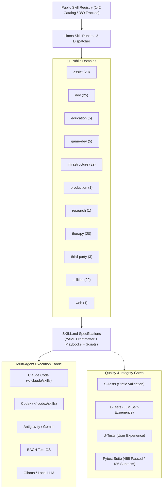
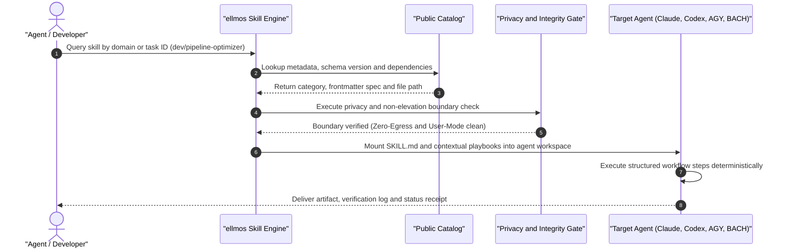

<!-- worldset: {"translated_from_sha256": "4ab293a207e54a644d9c9752dc6e9a7aa5f7c6e4acf6ae978671ca351a73091d", "translator": "claude-haiku-5-5", "translated_at": "2026-10-15T23:32:56.291340+00:00"} -->


<p align="center">
  <a href="README.md"></a>
  <a href="README_de.md"></a>
  <a href="README_es.md"></a>
  <a href="README_zh.md"></a>
  <a href="README_ja.md"></a>
  <a href="README_ru.md"></a>
  <a href="README_fr.md"></a>
  <a href="README_hi.md"></a>
  <a href="README_ar.md"></a>
  <a href="README_bn.md"></a>
  <a href="README_pt.md"></a>
</p>

# ellmos skills

**এগারোটি ভাষায় ডকুমেন্টেশন** · [মেশিন-পাঠযোগ্য প্রসঙ্গ](llms.txt) · **🗺️ [অনলাইনে Skill লাইব্রেরি ব্রাউজ করুন](https://ellmos-ai.github.io/skills.html)** — ব্রাউজারেই প্রতিটি সর্বজনীন skill পড়ুন এবং কপি করুন

> Claude Code-শৈলীর `SKILL.md` workflow, Codex-সামঞ্জস্যপূর্ণ agent setup, BACH, AGY/Gemini এবং অন্যান্য local-first LLM agent runtime-এর জন্য একটি পোর্টেবল AI skill লাইব্রেরি।

[](https://github.com/ellmos-ai/skills/actions/workflows/tests.yml)
[](pyproject.toml)
[](LICENSE)
[-success.svg)](testing/)
[](https://python.org)
[](SECURITY.md)
[](SECURITY.md)
[](SECURITY.md)
[](THIRD_PARTY_LICENSES.md)
[](MARKETING-LOG.txt)
[](https://github.com/ellmos-ai)
[](https://github.com/open-bricks)
[](registry/components.json)
[](SKILLS-MAP.md)
[](llms.txt)
[](NOTICE)
[](CONTRIBUTING.md)
[](MARKETING-LOG.txt)

> [!NOTE]
> **AI Agent ও LLM ইন্টিগ্রেশন:** এই repository-তে YAML frontmatter-সহ মানসম্মত `SKILL.md` ফাইল রয়েছে, যেগুলো Claude Code, Codex, AGY/Gemini এবং কাস্টম agent runtime সরাসরি ব্যবহার করতে পারে। মেশিন-পাঠযোগ্য প্রসঙ্গের জন্য দেখুন [`llms.txt`](llms.txt)।

> [!IMPORTANT]
> **এটি একটি কপি পড়ছেন?** এই লাইব্রেরির সর্বদা-হালনাগাদ, প্রামাণিক সংস্করণ রয়েছে
> **[github.com/ellmos-ai/skills](https://github.com/ellmos-ai/skills)**-এ।
> Fork ও mirror স্বয়ংক্রিয়ভাবে আপডেট হয় না এবং অনেক commit পিছিয়ে থাকতে পারে —
> এখানে যা পড়ছেন তার উপর নির্ভর করার আগে মূল উৎস যাচাই করুন।

---

## দ্রুত নেভিগেশন

- [01. System Architecture ও Quick Reference](#sec-01)
- [02. Multi-Agent Skill Discovery ও Execution Lifecycle](#sec-02)
- [03. Target Personas ও Discoverability](#sec-03)
- [04. বিকল্পগুলোর সাথে Comparative Matrix](#sec-04)
- [05. ASCII Four-View Architectural Topology](#sec-05)
- [06. Start Here ও Quickstart Playbook](#sec-06)
- [07. Catalog Snapshot ও Domain Distribution](#sec-07)
- [08. Featured Skills ও Real-World Workflows](#sec-08)
- [09. Public/Private Boundary ও Isolation](#sec-09)
- [10. Education Skills](#sec-10)
- [11. Repository Structure ও Directory Layout](#sec-11)
- [12. Skill Metadata ও Frontmatter Anatomy](#sec-12)
- [13. Validation ও Automated Quality Gates](#sec-13)
- [14. Search Context ও High-Intent Indexing](#sec-14)
- [15. Governance ও Runtime Invariants Matrix](#sec-15)
- [16. Ecosystem ও Sibling Projects](#sec-16)
- [17. Third-Party Licenses, Level 1 SBOM ও RunAsInvoker](#sec-17)
- [18. Security Policy, § 521 BGB Statutory Disclaimer ও 48h SLA](#sec-18)

---

এই repository হলো ellmos ecosystem-এর পুনঃব্যবহারযোগ্য skill catalog। এতে স্বতন্ত্র process skill, development workflow, research helper, therapy-ভিত্তিক পদ্ধতি, infrastructure playbook এবং utility tool রয়েছে, যেগুলো একটি Anthropic-সামঞ্জস্যপূর্ণ `SKILL.md` ফরম্যাটে সংরক্ষিত। প্রতিটি skill YAML frontmatter-এ নিজস্ব metadata বহন করে, ফলে কোনো কেন্দ্রীয় registry ছাড়াই runtime provenance, compatibility ও dependency পরীক্ষা করতে পারে।

<a id="sec-01"></a><a id="system-architecture"></a>
## 1. System Architecture ও Quick Reference



<a id="sec-02"></a><a id="multi-agent-skill-discovery--execution-lifecycle"></a>
## 2. Multi-Agent Skill Discovery ও Execution Lifecycle



<a id="sec-03"></a><a id="target-personas--discoverability"></a>
## 3. Target Personas ও Discoverability

`ellmos-skills` স্বায়ত্তশাসিত AI agent ও platform engineering-এর বর্ণালির জুড়ে চারটি মূল প্রযুক্তিগত persona-কে সেবা দেয়:

### `[PERSONA-01]` স্বায়ত্তশাসিত AI Agents ও Swarms
- **প্রোফাইল:** Multi-agent framework, orchestrator এবং স্বায়ত্তশাসিত coding loop (*Claude Code, AGY, Codex, BACH*)।
- **মূল সমস্যা:** Hallucinated workflow step, বিক্ষিপ্ত tool, agent সীমানা জুড়ে non-deterministic task execution এবং state drift।
- **`ellmos-skills` কীভাবে এটি সমাধান করে:** কঠোর YAML frontmatter, স্বয়ংসম্পূর্ণ playbook, deterministic input/output contract এবং cold-start portability সহ মানসম্মত `SKILL.md` ফরম্যাট।
- **মূল Workflow ও Skills:** `infrastructure/agents-bridge`, `dev/pipeline-optimizer`, `utilities/generalizer`, `infrastructure/work-autonomous`।

### `[PERSONA-02]` এন্টারপ্রাইজ DevOps ও প্ল্যাটফর্ম ইঞ্জিনিয়ার
- **প্রোফাইল:** ডেভেলপার ফ্লিট, নির্ধারিত অটোমেশন এবং CI পাইপলাইন পরিচালনাকারী অবকাঠামো আর্কিটেক্ট ও প্ল্যাটফর্ম দল।
- **মূল সমস্যা:** পরিচালনা-রক্ষণাবেক্ষণের কাজ বারবার নতুন করে তৈরি করা, ভঙ্গুর ad-hoc স্ক্রিপ্ট, হোস্টগুলোর মধ্যে অসামঞ্জস্য এবং বিশৃঙ্খল রিপোজিটরি গোছানো।
- **`ellmos-skills` কীভাবে সমাধান করে:** বিক্রেতা-টুলের বিস্তার ছাড়াই রিফ্যাক্টরিং, Git হাইজিন এবং পাইপলাইন অপ্টিমাইজেশনের জন্য প্রস্তুত, পরীক্ষিত ইঞ্জিনিয়ারিং প্লেবুক।
- **মূল ওয়ার্কফ্লো ও দক্ষতা:** `dev/project-bootstrapper`, `dev/pipeline-bootstrapper`, `utilities/folder-organization`, `dev/github-repo-care`।

### `[PERSONA-03]` লোকাল-ফার্স্ট, গোপনীয়তা ও SecOps বিশেষজ্ঞ
- **প্রোফাইল:** নিয়ন্ত্রিত বা air-gapped পরিবেশে কর্মরত নিরাপত্তা কর্মকর্তা, সম্মতি নিরীক্ষক এবং গোপনীয়তা ইঞ্জিনিয়ার।
- **মূল সমস্যা:** অনিচ্ছাকৃত ক্লাউড টেলিমেট্রি ফাঁস, যাচাইবিহীন transitive প্যাকেজ, সাপ্লাই-চেইনের দুর্বলতা এবং এজেন্ট টুলে উচ্চ-স্তরের এক্সিকিউশন বিশেষাধিকার।
- **`ellmos-skills` কীভাবে সমাধান করে:** কঠোর Zero-Egress (`INV-LOCAL-01`), স্বয়ংক্রিয় স্ট্যাটিক গোপনীয়তা সীমানা গেট (`testing/privacy_gate.py`), ব্যবহারকারী-মোড এক্সিকিউশন (`RunAsInvoker`), 0% copyleft, এবং Level 1 SBOM স্বচ্ছতা।
- **মূল ওয়ার্কফ্লো ও দক্ষতা:** `infrastructure/privacy-gate`, `utilities/secret-redactor`, `SECURITY.md`, `THIRD_PARTY_LICENSES.md`।

### `[PERSONA-04]` ডোমেইন স্কিল লেখক ও গবেষণা ইঞ্জিনিয়ার
- **প্রোফাইল:** পুনরুৎপাদনযোগ্য এজেন্ট সক্ষমতা তৈরিকারী AI গবেষক, পদ্ধতিবিদ ও ডোমেইন বিশেষজ্ঞ।
- **মূল সমস্যা:** কনভেনশনের অভাব, অসামঞ্জস্যপূর্ণ বহু-ভাষা হ্যান্ডলিং, এবং কাস্টম স্কিলের জন্য টেস্টিং হার্নেসের অনুপস্থিতি।
- **`ellmos-skills` কীভাবে সমাধান করে:** আনুষ্ঠানিক স্কিমা স্পেসিফিকেশন (`docs/CONVENTIONS.md`), পাবলিক রেজিস্ট্রি জেনারেটর (`registry/components.json`), এবং তিন-স্তরের S/L/U টেস্টিং ফ্রেমওয়ার্ক।
- **মূল ওয়ার্কফ্লো ও দক্ষতা:** `schemas/assist-v1.schema.json`, `docs/CONVENTIONS.md`, `testing/skill_tester.py`, `research/research-agent`।

### টার্গেট পার্সোনা সারসংক্ষেপ ম্যাট্রিক্স

| পার্সোনা | মূল সমস্যা | `ellmos-skills` কীভাবে সমাধান করে | মূল ওয়ার্কফ্লো ও দক্ষতা |
|---|---|---|---|
| **স্বায়ত্তশাসিত AI এজেন্ট ও সোয়ার্ম** *(Claude Code, AGY, Codex, BACH)* | বানানো (hallucinated) ওয়ার্কফ্লো ধাপ, খণ্ডিত টুল, এবং এজেন্ট সীমানা জুড়ে নন-ডিটারমিনিস্টিক টাস্ক এক্সিকিউশন। | কঠোর YAML frontmatter, স্বয়ংসম্পূর্ণ প্লেবুক এবং ডিটারমিনিস্টিক ইনপুট/আউটপুট চুক্তিসহ স্ট্যান্ডার্ডাইজড `SKILL.md` ফরম্যাট। | `infrastructure/agents-bridge`, `dev/pipeline-optimizer`, `utilities/generalizer` |
| **এন্টারপ্রাইজ DevOps ও প্ল্যাটফর্ম ইঞ্জিনিয়ার** | পরিচালনা-রক্ষণাবেক্ষণের কাজ বারবার নতুন করে তৈরি, ভঙ্গুর CI স্ক্রিপ্ট এবং বিশৃঙ্খল রিপোজিটরি গোছানো। | রিফ্যাক্টরিং, Git হাইজিন ও পাইপলাইন অপ্টিমাইজেশনের জন্য প্রস্তুত, পরীক্ষিত ইঞ্জিনিয়ারিং প্লেবুক, টুল বিস্তার ছাড়াই। | `dev/project-bootstrapper`, `dev/pipeline-bootstrapper`, `utilities/folder-organization` |
| **লোকাল-ফার্স্ট, গোপনীয়তা ও SecOps বিশেষজ্ঞ** | অনিচ্ছাকৃত ক্লাউড ডেটা ফাঁস, যাচাইবিহীন transitive প্যাকেজ এবং এজেন্ট টুলে উচ্চ-স্তরের এক্সিকিউশন বিশেষাধিকার। | কঠোর Zero-Egress (`INV-LOCAL-01`), স্বয়ংক্রিয় গোপনীয়তা সীমানা গেট, ব্যবহারকারী-মোড এক্সিকিউশন (`RunAsInvoker`), এবং 0% copyleft। | `infrastructure/privacy-gate`, `utilities/secret-redactor`, `SECURITY.md` |
| **ডোমেইন স্কিল লেখক ও গবেষণা ইঞ্জিনিয়ার** | কনভেনশনের অভাব, অসামঞ্জস্যপূর্ণ বহু-ভাষা হ্যান্ডলিং এবং কাস্টম স্কিলের জন্য টেস্টিং হার্নেসের অনুপস্থিতি। | আনুষ্ঠানিক স্কিমা স্পেসিফিকেশন (`docs/CONVENTIONS.md`), পাবলিক রেজিস্ট্রি জেনারেটর (`registry/components.json`), এবং S/L/U টেস্টিং ফ্রেমওয়ার্ক। | `schemas/assist-v1.schema.json`, `docs/CONVENTIONS.md`, `testing/skill_tester.py` |

### উচ্চ-উদ্দেশ্যমূলক সার্চ কীওয়ার্ড ম্যাট্রিক্স

| বিভাগ | প্রাথমিক সার্চ শব্দ (English) | Relevanz & Suchbegriffe (Deutsch) |
|---|---|---|
| **Agent Frameworks** | `claude code skills`, `codex agent skills`, `anthropic skill md standard`, `agy gemini agent skills` | `Claude Code Skills`, `Codex Agenten Skills`, `Anthropic SKILL.md Standard`, `Gemini Agenten Skills` |
| **Skill Architecture** | `portable ai skills`, `reusable agent playbooks`, `agent skill library`, `deterministic llm workflows` | `Portable KI Fähigkeiten`, `Wiederverwendbare Agenten Playbooks`, `KI Skill Bibliothek`, `Deterministische Workflows` |
| **Privacy & Security** | `zero-egress ai skills`, `local-first agent library`, `fail-closed privacy gate`, `user-mode agent execution` | `Zero-Egress KI Skills`, `Lokale Agenten Bibliothek`, `Fail-Closed Datenschutz Gate`, `Unprivilegierte Ausführung` |
| **Ecosystem & Catalog** | `bach skill catalog`, `multi-agent skill library`, `offline ai tools`, `open source agent skills` | `BACH Skill Katalog`, `Multi-Agenten Skill Bibliothek`, `Offline KI Werkzeuge`, `Open Source Agenten Skills` |

<!-- lang-only: zh -->
চীনা ব্যবহারকারীরা [Skills宝](https://skilery.com) এর মাধ্যমে স্কিল খুঁজতে ও ইনস্টল করতে পারেন।
<!-- /lang-only -->

<a id="sec-04"></a><a id="comparative-matrix-vs-alternatives"></a>
## 4. বিকল্পগুলোর সাথে তুলনামূলক ম্যাট্রিক্স

`ellmos-skills` একটি বিক্রেতা-নিরপেক্ষ, বহনযোগ্য স্কিল স্ট্যান্ডার্ড প্রদান করে, যা লোকাল-ফার্স্ট ও বহু-এজেন্ট অপারেশনের জন্য অপ্টিমাইজড। নিচের ম্যাট্রিক্সে দশটি গুরুত্বপূর্ণ মাত্রা জুড়ে সাধারণ স্থাপত্যগত পদ্ধতির সাথে এটির তুলনা দেখানো হয়েছে:

| মূল্যায়ন মাত্রা | `ellmos-skills` | অ্যাড-হক সিস্টেম প্রম্পট | শুধু টুল/ফাংশন কলিং | কেন্দ্রীভূত ক্লাউড হাব | ভারী ফ্রেমওয়ার্ক (LangChain/CrewAI) |
|---|:---:|:---:|:---:|:---:|:---:|
| **১. ১০০% স্থানীয়-প্রথম ও শূন্য-বহির্গমন** | **PASS** (শূন্য টেলিমেট্রি) | **PASS** (স্থানীয় টেক্সট) | ⚠️ API প্রদানকারীর উপর নির্ভরশীল | ❌ ক্লাউড অ্যাকাউন্ট ও টেলিমেট্রি আবশ্যক | ⚠️ জটিল নির্ভরতা ও টেলিমেট্রি ঝুঁকি |
| **২. প্রমিত ফরম্যাট (`SKILL.md`)** | **PASS** (Anthropic স্ট্যান্ডার্ড + YAML) | ❌ কাঠামোবিহীন ফ্রিফর্ম টেক্সট | ❌ শুধু JSON স্কিমা, কোনো প্লেবুক নেই | ⚠️ বিক্রেতা-নির্দিষ্ট ম্যানিফেস্ট | ❌ Python/JS কোড বিমূর্তকরণ |
| **৩. মাল্টি-এজেন্ট পোর্টেবিলিটি** | **PASS** (Claude, Codex, AGY, BACH) | ⚠️ মডেল জুড়ে প্রম্পট বিচ্যুত হয় | ⚠️ প্রতি প্রদানকারীর জন্য আলাদা র্যাপার | ❌ মালিকানাধীন ক্লাউডে আবদ্ধ | ⚠️ ফ্রেমওয়ার্ক-নির্দিষ্ট লক-ইন |
| **৪. ধাপে ধাপে প্লেবুক** | **PASS** (কাঠামোবদ্ধ পর্যায় ও গেট) | ❌ অসামঞ্জস্যপূর্ণ নির্দেশ অনুসরণ | ❌ শুধু একক-ধাপ টুল এক্সিকিউশন | ⚠️ লেখক অনুযায়ী ব্যাপক তারতম্য | ⚠️ Python DAG লজিক প্রয়োজন |
| **৫. গোপনীয়তা ও ফাঁস গেট** | **PASS** (স্বয়ংক্রিয় স্ট্যাটিক গেট) | ❌ কিছুই নেই | ❌ কিছুই নেই | ⚠️ শুধু ক্লাউড মডারেশন ফিল্টার | ❌ অন্তর্নির্মিত কিছু নেই |
| **৬. স্বয়ংক্রিয় টেস্ট স্যুট** | **PASS** (৪৫৫টি Pytest টেস্ট, ১৮৬টি সাবটেস্ট, ১০০% সবুজ) | ❌ অপরীক্ষিত | ⚠️ শুধু API কলের ইউনিট টেস্ট | ❌ কোনো public টেস্ট হারনেস নেই | ⚠️ শুধু ফ্রেমওয়ার্ক ইউনিট টেস্ট |
| **৭. মাল্টি-OS CI সমতা** | **PASS** (Linux, Windows, macOS) | N/A | ⚠️ প্রদানকারী-নির্ভর | ❌ হোস্টেড সার্ভিস | ⚠️ OS সামঞ্জস্যের সমস্যা |
| **৮. মেশিন-পঠনযোগ্য ক্যাটালগ** | **PASS** (`registry/components.json`) | ❌ সূচীভুক্ত নয় | ❌ শুধু ডায়নামিক API ইন্ট্রোস্পেকশন | ⚠️ মালিকানাধীন API কোয়েরি | ❌ কোড মডিউল ইমপোর্ট |
| **৯. ওপেন-সোর্স ও ০% কপিলেফট** | **PASS** (100% MIT লাইসেন্স) | N/A | N/A | ❌ মালিকানাধীন প্ল্যাটফর্ম শর্তাবলি | ⚠️ বিভিন্ন লাইসেন্সের মিশ্রণ |
| **১০. শূন্য বহিরাগত রানটাইম নির্ভরতা** | **PASS** (শুধু Python stdlib) | **PASS** | ⚠️ HTTP/JSON লাইব্রেরি প্রয়োজন | ❌ ক্লাউড ক্লায়েন্ট SDK প্রয়োজন | ❌ বিশাল নির্ভরতা বৃক্ষ |

<a id="sec-05"></a><a id="ascii-topology"></a><a id="architectural-topology"></a>
## 5. ASCII চার-দৃষ্টিভঙ্গি স্থাপত্য টপোলজি

```text
+----------------------------------------------------------------------------------------------------+
| VIEW 1: RUNTIME DISPATCH & DISCOVERY PLANE                                                         |
|                                                                                                    |
|  [ Operator / LLM Agent ]                                                                          |
|            |                                                                                       |
|            v (Task Intent / Query)                                                                 |
|  +----------------------------------------------------------------------------------------------+  |
|  | ellmos Skill Runtime & Dispatcher (Pure Python Stdlib)                                        |  |
|  |  * Category Resolver     * Frontmatter Validator    * Dependency & Provenance Introspector   |  |
|  +----------------------------------------------------------------------------------------------+  |
|            |                                            |                                          |
|            v (Discovery Query)                          v (Catalog Index Readback)                 |
|  +-----------------------------------+        +-------------------------------------------------+  |
|  | Public Catalog Registry           |        | llms.txt & Context Index                        |  |
|  | (registry/components.json: 142)   |        | (Machine-readable markdown & category hierarchy)|  |
|  +-----------------------------------+        +-------------------------------------------------+  |
+----------------------------------------------------------------------------------------------------+
| VIEW 2: MULTI-AGENT CLIENT INTEGRATION LAYER                                                       |
|                                                                                                    |
|  [ Claude Code ]      [ OpenAI Codex ]      [ Antigravity / Gemini ]     [ BACH Text-OS / Local ]  |
|  (~/.claude/skills)   (~/.codex/skills)     (~/.gemini/.../skills)       (system/skills/...)       |
|         \                   |                        |                          /                  |
|          +------------------+------------------------+-------------------------+                   |
|                             | Uniform Materialization                                              |
|                             v                                                                      |
|  +----------------------------------------------------------------------------------------------+  |
|  | Standardized SKILL.md Execution Surface                                                      |  |
|  |  * Anthropic YAML Frontmatter Contract   * Step-by-Step Playbooks   * S/L/U Verification Gates  |  |
|  +----------------------------------------------------------------------------------------------+  |
+----------------------------------------------------------------------------------------------------+
| VIEW 3: GOVERNANCE & SECURITY BOUNDARY (FAIL-CLOSED)                                               |
|                                                                                                    |
|  +----------------------------------------------------------------------------------------------+  |
|  | Static Privacy Gate (testing/privacy_gate.py)                                                 |  |
|  |  * Zero-Egress Assertion (INV-LOCAL-01)          * Non-Elevation / RunAsInvoker (INV-UNPRIV-03) |  |
|  |  * Rejection of Concrete User Homes & Hostnames * Rejection of API Keys, Tokens & Private Data |  |
|  +----------------------------------------------------------------------------------------------+  |
|            |                                            |                                          |
|            v (Compliance Audit)                         v (Public/Private Boundary)                |
|  +-----------------------------------+        +-------------------------------------------------+  |
|  | Level 1 SBOM Invariant Matrix     |        | No-Push Boundary Separation                     |  |
|  | (THIRD_PARTY_LICENSES.md/.txt)    |        | (Public generic methods vs Private profiles)    |  |
|  +-----------------------------------+        +-------------------------------------------------+  |
+----------------------------------------------------------------------------------------------------+
| VIEW 4: DOMAIN TOPOLOGY & SKILL ASSET ANATOMY                                                      |
|                                                                                                    |
|  skills/                                                                                           |
|  +-- assist/ (20)        +-- dev/ (25)            +-- education/ (5)       +-- game-dev/ (5)       |
|  +-- infrastructure/ (32)+-- production/ (1)      +-- research/ (1)        +-- therapy/ (20)       |
|  +-- third-party/ (3)    +-- utilities/ (29)      +-- web/ (1)                                     |
|                                                                                                    |
|  [ Individual Skill Anatomy ]:                                                                     |
|  +-- SKILL.md (Frontmatter + Playbook)   +-- scripts/ (Helpers)   +-- references/ (Evidence/Docs)  |
+----------------------------------------------------------------------------------------------------+
```

<a id="sec-06"></a><a id="start-here"></a><a id="quick-start"></a>
## 6. এখান থেকে শুরু করুন ও দ্রুত প্লেবুক

| প্রয়োজন | ফাইল বা কমান্ড |
|---|---|
| সব পাবলিক স্কিল ব্রাউজ করুন | [`skills/`](skills/) |
| প্রতিটি ট্র্যাক করা স্কিলের ট্রি ম্যাপ দেখুন | [`SKILLS-MAP.md`](SKILLS-MAP.md) |
| `SKILL.md` স্কিমা বুঝুন | [`docs/CONVENTIONS.md`](docs/CONVENTIONS.md) |
| মেশিন-পঠনযোগ্য ক্যাটালগ ইনডেক্স | [`registry/components.json`](registry/components.json) |
| নিরাপত্তা নীতি ও সীমানা নিশ্চয়তা | [`SECURITY.md`](SECURITY.md) |
| লেভেল ১ SBOM প্লেইন-টেক্সট সহচর | [`THIRD_PARTY_LICENSES.txt`](THIRD_PARTY_LICENSES.txt) |
| আনুষ্ঠানিক কপিরাইট ও অ্যাট্রিবিউশন বিজ্ঞপ্তি | [`NOTICE`](NOTICE) |
| বিভাগ অনুযায়ী ব্রাউজ করুন | [`skills/`](skills/) (প্রতি বিভাগে একটি সাবফোল্ডার) |
| একটি স্কিল ব্যবহার করুন | `skills/<category>/<name>/` কপি করে আপনার এজেন্টের স্কিল ডিরেক্টরিতে রাখুন (যেমন `~/.claude/skills/`) |
| পাবলিক পরিবর্তনগুলো পর্যালোচনা করুন | [`CHANGELOG.md`](CHANGELOG.md) |
| ক্রলার ও LLM এজেন্টদের জন্য একটি সংক্ষিপ্ত মানচিত্র দিন | [`llms.txt`](llms.txt) |

<a id="sec-07"></a><a id="catalog-snapshot"></a>
## 7. ক্যাটালগ স্ন্যাপশট ও ডোমেইন বণ্টন

বর্তমান পাবলিক ক্যাটালগে ১৪২টি পাবলিক রানটাইম স্কিল রয়েছে (স্থানীয় স্যুট জুড়ে ৩৮০টি ট্র্যাক করা):

| বিভাগ | সংখ্যা | ফোকাস |
|---|---:|---|
|  `assist` | ২০ | অফিসের কাজ, নোট, গৃহস্থালি পরিকল্পনা, যোগাযোগ, স্বাস্থ্য-তথ্য সংগঠন, মিডিয়া ও ইনভেন্টরি এক্সপোর্ট, ভয়েস ওয়ার্কফ্লো, ভ্রমণ, আবহাওয়া, ক্যালেন্ডার ও ট্রান্সক্রিপশনের জন্য ব্যবহারকারী-নিরপেক্ষ পদ্ধতি |
|  `dev` | ২৫ | ডেভেলপমেন্ট প্রোটোকল, ডিবাগিং, বাগ সুইপ, পাইপলাইন সংস্কার, মাইগ্রেশন, ডকুমেন্টেশন, প্লাগইন সিস্টেম ও রিপোজিটরি প্রকাশনা |
|  `education` | ৫ | একাডেমিক পরিকল্পনা, উৎসভিত্তিক শিক্ষা, পরীক্ষা প্রস্তুতি, ওয়ার্কশিট তৈরি এবং ব্যবহারকারী-নিরপেক্ষ শিক্ষাদান ও সহায়তা পরিকল্পনা |
|  `game-dev` | ৫ | Blender, Roblox, Rojo, Studio, অ্যাসেট নিরাপত্তা ও গেম-ডিজাইন ওয়ার্কফ্লো |
|  `infrastructure` | ৩২ | পোর্টেবল AI সেটআপ, সিস্টেম অনবোর্ডিং, স্কিল ল্যান্ডস্কেপ ব্যবস্থাপনা, অটোমেশন স্বয়ং-রক্ষণাবেক্ষণ, সিম্যান্টিক পারসোনা রাউটিং, প্রদানকারী-নিরপেক্ষ কনফিগ সিঙ্ক ও এজেন্ট বুট ব্রিজ |
|  `production` | ১ | টেক্সট প্রোডাকশন রাউটার: সাধারণ টেক্সট, বর্ণনামূলক গল্প, স্থানীয় LaTeX প্রেস-রিলিজ কম্পাইলারসহ PR |
|  `research` | ১ | গবেষণা-এজেন্ট ওয়ার্কফ্লো সহায়তা |
|  `therapy` | ২০ | জার্মান ভাষায় সাইকোএডুকেশন ও কাউন্সেলিং পদ্ধতি প্লেবুক |
| `third-party` | ৩ | যাচাইকৃত লাইসেন্সের অধীনে পুনর্বিতরিত, বাহ্যিকভাবে রচিত কিউরেটেড স্কিল |
|  `utilities` | ২৯ | ব্যাচ অপারেশন, চিন্তন কাঠামো, সিদ্ধান্ত ব্রিফিং, ডকুমেন্ট চাঙ্কিং, এনকোডিং মেরামত, ভিডিও ট্রান্সক্রিপ্ট, ব্যক্তিগত মেইল খসড়া, চাকরির আবেদন সহায়তা, ব্যবহারকারী-মডেল টুলিং এবং জার্মান আইন ও জার্মান কর বিষয়ে প্রাথমিক পয়েন্টার স্কিল |
|  `web` | ১ | ওয়েব-পঠন প্রোটোকল সহায়তা |

<a id="sec-08"></a><a id="featured-skills"></a>
## 8. বৈশিষ্ট্যযুক্ত স্কিল ও বাস্তব-জীবনের ওয়ার্কফ্লো

কিছু স্কিল প্রবেশবিন্দু হিসেবে বিশেষভাবে উপযোগী, কারণ এগুলো অন্য টুলগুলোর সমন্বয় করে, গোছানো নয় এমন এজেন্ট ওয়ার্কফ্লো প্রতিরোধ করে, অথবা স্থানীয় পদ্ধতিগুলোকে পুনরাবৃত্তিযোগ্য প্লেবুকে রূপান্তরিত করে:

| Skill | Why it stands out |
|---|---|
|  [`skill-explorer`](skills/infrastructure/skill-explorer/SKILL.bn.md) | স্কিল ল্যান্ডস্কেপ পরিচালনার জন্য মেটা-স্কিল: বিদ্যমান স্কিল অডিট করে, সেগুলোকে পরিবারে ভাগ করে, বাহ্যিক স্কিল/প্লাগইন গবেষণা করে, এবং শুধু নিরাপত্তা পর্যালোচনা ও স্পষ্ট অনুমোদনের পরেই ইনস্টল করে। |
|  [`model-strategy`](skills/dev/model-strategy/SKILL.bn.md) | Claude, Codex, Gemini এবং Ollama-এর জন্য মাল্টি-মডেল রাউটিং, যেখানে স্কোর-ভিত্তিক নির্বাচন, ডেলিগেশন পথ, এস্কেলেশন ট্রিগার এবং খরচ/গুণমানের ট্রেডঅফ রয়েছে। |
|  [`pipeline-optimizer`](skills/dev/pipeline-optimizer/SKILL.bn.md) | বিদ্যমান প্রজেক্ট ফোল্ডার, ডকুমেন্টেশন সিস্টেম এবং সফটওয়্যার স্ট্যাকের জন্য ছয় ধাপের সংস্কার প্রোটোকল; এটি ডুপ্লিকেট মান এবং ভাঙা ওয়ার্কফ্লো এড়ানোর জন্য ডিজাইন করা হয়েছে। |
|  [`github-repo-care`](skills/dev/github-repo-care/SKILL.bn.md) | GitHub রিপোজিটরির জন্য প্রকাশনা ও রক্ষণাবেক্ষণ গেট: স্থানীয় নিয়ম, লক, `.gitignore`, গোপনীয়তা যাচাই, README/i18n, রিলিজ এবং রিপোজিটরি মেটাডেটা। |
|  [`mcp-config-sync`](skills/infrastructure/mcp-config-sync/SKILL.bn.md) | ব্যবহারকারী-নির্বাচিত প্রদানকারী ও অ্যাপ শ্রেণিজুড়ে প্রদানকারী-নিরপেক্ষ MCP আবিষ্কার ও সিঙ্ক পরিকল্পনা; কোনো অন্তর্নিহিত হাব নেই। |
|  [`video-transcriber`](skills/utilities/video-transcriber/SKILL.bn.md) | ভিডিওর সাবটাইটেল/ট্রান্সক্রিপ্ট এবং মেটাডেটা (YouTube উৎস সমর্থিত) Markdown, JSON বা সাধারণ টেক্সটে বের করে, যাতে ভিডিও বিশ্লেষণ উৎস-ভিত্তিক টেক্সট দিয়ে শুরু হয়। |
|  [`rbx-studio`](skills/game-dev/rbx-studio/SKILL.bn.md) | Roblox Studio পরিচালনা: Explorer/Play-Test ওয়ার্কফ্লো, Rojo দৃশ্য-বনাম-কোড সংযোগ, MCP-এর মাধ্যমে Studio-র AI নিয়ন্ত্রণ, এবং Creator Store অ্যাসেটের জন্য বাধ্যতামূলক ম্যালওয়্যার স্ক্যান। |
|  [`decision-briefing`](skills/utilities/decision-briefing/SKILL.bn.md) | অনেক খোলা সিদ্ধান্তকে সুপারিশসহ একটি ক্রমিক A/B/C/D ব্রিফিংয়ে রূপান্তরিত করে, ব্যাচ উত্তর গ্রহণ করে এবং নির্বাচিত ফলাফল রেকর্ড করে। |
|  [`bugsweep`](skills/dev/bugsweep/SKILL.bn.md) | কোডবেসের আকারের সাথে মানানসই লক্ষ্য সংখ্যা, দ্বিগুণ-বৃদ্ধির এস্কেলেশন, এলাকা ট্র্যাকিং এবং সম্পূর্ণতা যাচাইসহ পদ্ধতিগত বাগ-সুইপ প্রোটোকল -- এলোমেলো বাগ খোঁজাকে একটি পুনরাবৃত্তিযোগ্য, পরিমাপযোগ্য পাসে রূপান্তরিত করে। |
|  [`plugin-system`](skills/dev/plugin-system/SKILL.bn.md) | Python অ্যাপ্লিকেশনের জন্য সাধারণ স্বয়ংক্রিয়-আবিষ্কার প্লাগইন সিস্টেম: শূন্য নির্ভরতা (শুধু stdlib), যাচাইকরণ এবং ফল্ট টলারেন্স, যা নিজের স্ক্রিপ্টগুলোকে একটি প্লাগেবল আর্কিটেকচারে রূপান্তর করে। |
|  [`bilingual-doc-sync`](skills/utilities/bilingual-doc-sync/SKILL.bn.md) | সমান্তরাল-ভাষার ডকুমেন্ট (পেপার, README, `SKILL.md`/`SKILL.en.md` জোড়া) সিঙ্কে রাখে: অনুপস্থিত অনুবাদ এবং সেকশন ড্রিফট শনাক্ত করে, সাথে একটি এক্সপানশন অডিট যাচাই করে যে কোনো ডকুমেন্টের আরও ভাষার প্রয়োজন আছে কিনা। |
|  [`law-checker`](skills/utilities/law-checker/SKILL.bn.md) | স্বতন্ত্র `ellmos-ai/law-checker` মডিউলের পয়েন্টার স্কিল: জার্মান আইনের জন্য উৎস-ভিত্তিক AI প্রাথমিক আইনি মূল্যায়ন, একটি আইন রেজিস্ট্রি এবং একটি আইন-মূর্তকরণ এজেন্টসহ -- শুধু AI দিশা প্রদান, আইনজীবীর বিকল্প নয়। |
|  [`steuer-assistent`](skills/utilities/steuer-assistent/SKILL.bn.md) | স্বতন্ত্র `ellmos-ai/steuer-assistent` মডিউলের পয়েন্টার স্কিল: জার্মান কর্মচারীদের আয়-সংক্রান্ত ব্যয় (Werbungskosten) এর জন্য অফলাইন-প্রথম স্থানীয় ওয়ার্কশিট -- কর পরামর্শ নয়, কর-রিটার্ন দাখিলও নয়। |
|  [`worksheet-generator`](skills/education/worksheet-generator/SKILL.bn.md) | স্বতন্ত্র `ellmos-ai/worksheet-generator` মডিউলের পয়েন্টার স্কিল: শিক্ষাগত/থেরাপিউটিক পেশাজীবীদের জন্য একটি সহায়তা লক্ষ্য, স্তর ও বয়স থেকে ব্যক্তিগতকৃত ওয়ার্কশিট তৈরি করে, নিজস্ব ICF রেফারেন্স আনার সুবিধাসহ -- এটি একটি উপকরণ জেনারেটর, থেরাপি প্রোগ্রাম নয়। |
|  [`research-agent`](skills/research/research-agent/SKILL.bn.md) | PubMed ও arXiv-কেন্দ্রিক স্বয়ংসম্পূর্ণ বৈজ্ঞানিক সাহিত্য ওয়ার্কফ্লো (বিশুদ্ধ Python stdlib): এলোমেলো পেপার খোঁজাকে একটি পুনরাবৃত্তিযোগ্য, উৎস-ভিত্তিক গবেষণা পাসে রূপান্তরিত করে, ellmos ইকোসিস্টেম ছাড়াই সম্পূর্ণ পোর্টেবল। |
|  [`agent-config-sync`](skills/infrastructure/agent-config-sync/SKILL.bn.md) | প্রদানকারী/অ্যাপ শ্রেণির সারফেস আবিষ্কার করে এবং ব্যবহারকারী-নির্বাচিত MCP, স্কিল ও রুল-ফাইল সত্য-টopology পরিকল্পনা করে। |
|  [`agents-bridge`](skills/infrastructure/agents-bridge/SKILL.bn.md) | পোর্টেবল প্রদানকারী-নিরপেক্ষ ফাইল ব্রিজ: স্পষ্ট বুট/সত্য গ্রাফ, আলাদা মেমরি সাইলো, মেসেজিং, উপস্থিতি ও লক ক্যাপচার করে, তারপর গোপনীয়তা-গেটেড ইনস্ট্যান্স প্যাকেজের প্রিভিউ, রিস্টোর, যাচাই বা রোলব্যাক করে। |
|  [`automation-self-care`](skills/infrastructure/automation-self-care/SKILL.bn.md) | নির্ধারিত LLM কাজ ও ডেস্কটপ-অ্যাপ অটোমেশনের জন্য প্রদানকারী-নিরপেক্ষ রক্ষণাবেক্ষণ কোর সেট তৈরি করে, যাতে নেটিভ রিডব্যাক, রোলব্যাক ও ক্রস-সিস্টেম কভারেজ থাকে। |
|  [`semantic-persona-routing`](skills/infrastructure/semantic-persona-routing/SKILL.bn.md) | সমন্বয়কারী ভূমিকা, বিশেষজ্ঞ এবং যাচাইকৃত লাইভ স্কিল এন্ডপয়েন্টের মাধ্যমে অনুরোধ রাউট করে, এবং পার্সোনা ওভারলেকে সক্ষমতা ও অনুমতি থেকে আলাদা রাখে। |
|  [`build-your-users-mind`](skills/utilities/build-your-users-mind/SKILL.bn.md) | অনুমোদিত অভিজ্ঞতামূলক পছন্দ মডেল তৈরির জন্য সাধারণ, ব্যবহারকারী-নিরপেক্ষ পয়েন্টার; ব্যক্তিগত প্রোফাইল ও প্রমাণ ব্যক্তিগত থাকে। |
|  [`dev-soft-agent`](skills/dev/dev-soft-agent/SKILL.bn.md) | স্বতন্ত্র উন্নয়ন-অটোমেশন পাইপলাইন (কোড বিশ্লেষণ, টাস্ক ইঞ্জিন, নীতি, প্রম্পট টেমপ্লেট) শূন্য-নির্ভরতা Python-এ -- বাহ্যিক সার্ভিস ছাড়াই একটি সম্পূর্ণ ডেভ-এজেন্ট ওয়ার্কফ্লো। |
|  [`llm-text-hygiene`](skills/utilities/llm-text-hygiene/SKILL.bn.md) | সমাপ্ত টেক্সট থেকে AI চিহ্ন ও চ্যাট অবশেষ সরায় এবং AI-প্রকাশের স্তর পরিচালনা করে -- প্রকাশিত ডকুমেন্টকে LLM আর্টিফ্যাক্ট-মুক্ত রাখে। |
|  [`idea-mining`](skills/utilities/idea-mining/SKILL.bn.md) | আটকে থাকা সমস্যা থেকে ধারণা খনন করার জন্য স্বতন্ত্র বহু-কৌশল পদ্ধতি -- প্রজেক্ট দেয়ালে ঠেকলে মুক্ত-ধারার ব্রেনস্টর্মিংয়ের কাঠামোবদ্ধ বিকল্প। |
|  [`skill-extractor`](skills/infrastructure/skill-extractor/SKILL.bn.md) | চ্যাট ইতিহাস (বর্তমান সেশন বা ট্রান্সক্রিপ্ট ফাইল) থেকে পুনর্ব্যবহারযোগ্য স্কিল বের করে -- যা সদ্য কাজ করেছে তাকে একটি পোর্টেবল প্লেবুকে রূপান্তরিত করে, বা প্রমাণের ভিত্তিতে বিদ্যমান স্কিল উন্নত করে। |
|  [`workflow-extract`](skills/infrastructure/workflow-extract/SKILL.bn.md) | চ্যাট ইতিহাস বা অন্য এজেন্ট সিস্টেমের বিদ্যমান অটোমেশন প্রম্পট থেকে অটোমেশন তৈরি করে -- কথোপকথনকে পুনরাবৃত্তিযোগ্য ওয়ার্কফ্লোতে রূপান্তরিত করে। |
|  [`ai-portable-setup`](skills/infrastructure/ai-portable-setup/SKILL.bn.md) | USB স্টিক বা যেকোনো ড্রাইভে একটি পোর্টেবল অফলাইন AI কর্মপরিবেশ তৈরি করে: স্থানীয় LLM মডেল ও একটি RAG পাইপলাইন, কোনো ক্লাউড প্রয়োজন নেই। |
|  [`bewerbungsexperte`](skills/utilities/bewerbungsexperte/SKILL.bn.md) | শুরু থেকে শেষ পর্যন্ত চাকরির আবেদন সহায়তা: চাকরির বিজ্ঞাপন বিশ্লেষণ, CV/LinkedIn অপ্টিমাইজেশন, কভার লেটার, সাথে ডাটাবেস/ফোল্ডার-চালিত ASCII CV জেনারেটর (জার্মান-ভাষা-কেন্দ্রিক)। |
|  [`therapy/` collection](skills/therapy/) | 19-স্কিলের থেরাপি পরিবার (প্রধান: [`cognitive-restructuring`](skills/therapy/cognitive-restructuring/SKILL.bn.md), [`motivational-interviewing`](skills/therapy/motivational-interviewing/SKILL.bn.md)) -- প্রমাণ-উদ্ধৃত, দ্বিভাষিক, নৈতিকতা-গেটেড সাইকোএডুকেশন ও কাউন্সেলিং পদ্ধতির প্লেবুক; লাইব্রেরির সবচেয়ে গভীর সুসংগত ব্লক। |
|  [`lebende-verfassung`](skills/utilities/lebende-verfassung/SKILL.bn.md) | কার্যকর করা সাংবিধানিক সুপারপজিশন ('Position of the Unborn'): একটি 5-CORE পর্যালোচনা আর্কিটেকচার এবং বাধ্যতামূলক কাউন্টারফ্যাকচুয়াল বিশ্লেষণের মাধ্যমে ভবিষ্যৎ ও অজাত প্রজন্মকে স্বল্পমেয়াদী বর্তমান অপ্টিমাইজেশনের বিরুদ্ধে একটি আনুষ্ঠানিক অ্যালগরিদমিক Rawlsian ভেটো অধিকার দেয়। |
|  [`work-autonomous`](skills/infrastructure/work-autonomous/SKILL.bn.md) | এজেন্টিক অলসতার বিরুদ্ধে প্রমাণ-ভিত্তিক অ-সমাপ্তি প্রোটোকল (WAAFAP): স্টপিং শর্ত উল্টে দেয়, ফলে একটি স্বায়ত্তশাসিত লুপ শেষ করতে কাজের অনুপস্থিতির খণ্ডনযোগ্য প্রমাণ লাগে ('quit requires proof of inactivity')। |
|  [`piggyback-hosting`](skills/dev/piggyback-hosting/SKILL.bn.md) | শূন্য-অবস্থা গোপনীয়তা ডিপ্লয়মেন্ট প্যাটার্ন (Huckepack-Hosting): SQLite-WASM/OPFS-এর মাধ্যমে দর্শকের ব্রাউজারে ক্লায়েন্ট-সাইড BYOK সহ রিলেশনাল SQLite চালায়, নকশা অনুযায়ী সার্ভার ডাটাবেস, ব্যবহারকারী অ্যাকাউন্ট ও GDPR দায় দূর করে। |
|  [`software-in-worten`](skills/dev/software-in-worten/SKILL.bn.md) | দ্বিমুখী UI-প্রম্পট সংশ্লেষণ ('The click is the prompt'): একটি 4D উপাদান লিজেন্ডসহ টাইপড ASCII ব্লুপ্রিন্ট ফরম্যাট, যা ফ্রন্টএন্ড বিল্ড ধাপ ছাড়াই GUI ডিজাইন ও এজেন্ট নির্দেশনার মধ্যে সেতু তৈরি করে। |
|  [`metacognitive-injectors`](skills/infrastructure/metacognitive-injectors/SKILL.bn.md) | চাটুকারিতা ও অকালে সমাপ্তি রোধে এজেন্ট রানটাইম প্রি-ফ্লাইট চেকে সমন্বিত স্নায়ুমনস্তাত্ত্বিক নির্বাহী নিয়ন্ত্রণ ফাংশন (Miyake inhibition, working memory buffer, mental rehearsal)। |
|  [`paveman`](skills/utilities/paveman/SKILL.bn.md) | নির্ধারক, মডেল-মুক্ত নিয়ম সংকোচন: LLM অনুমান, হ্যালুসিনেশন বা শব্দার্থিক ড্রিফট ছাড়াই বড় Markdown নিয়ম ও মেমরি ফাইল টোকেন পরিমাণে 40% পর্যন্ত ছোট করে। |
|  [`wayfinding-routing`](skills/infrastructure/wayfinding-routing/SKILL.bn.md) | বিভ্রান্ত AI এজেন্টের জন্য সার্বজনীন নৌ-নেভিগেশন প্রোটোকল (Celestial Fix, Dead Reckoning): প্রসঙ্গ ড্রিফট বা লুপে আটকে গেলে পুনরুদ্ধার হিউরিস্টিক ও অবস্থা পুনর্গঠন প্রদান করে। |
|  [`condition`](skills/infrastructure/condition/SKILL.bn.md) | প্রম্পটের জন্য ঘোষণামূলক শর্ত-গেট DSL: প্রাক-শর্ত, মাইলস্টোন ও ক্রম-নির্ভরতাকে স্ট্যান্ডার্ড Markdown-এর মধ্যে fail-closed গেটে আবদ্ধ করে। |
|  [`letter-hooker`](skills/infrastructure/letter-hooker/SKILL.bn.md) | হুক-বিহীন CLI এজেন্টের জন্য প্রি-ফ্লাইট বুটলোডার: নেটিভ JSON ইভেন্ট হুক ছাড়াই টার্নের আগে গভর্নেন্স নিয়ম, মেমরি ট্র্যাভার্সাল ও স্ব-নিরাময় প্রসঙ্গ ইনজেক্ট করে। |
|  [`pingpong`](skills/infrastructure/pingpong/SKILL.bn.md) | শেয়ার্ড সিঙ্কড ফোল্ডারের উপর সেশন-সীমিত রেডিও স্টেশন: অসমমিত ভূমিকা (`ListenSync` শ্রোতা বনাম `WriteSync` ডেল্টা প্রেরক) আলাদা করে, কেন্দ্রীয় সার্ভার ছাড়াই অ্যাসিঙ্ক্রোনাস মাল্টি-এজেন্ট সমন্বয়ের জন্য। |
|  [`choose-your-orchestrator`](skills/infrastructure/choose-your-orchestrator/SKILL.bn.md) | মাল্টি-এজেন্ট কাজের জন্য সেশন-চুক্তি নেগোশিয়েটর: কার্যকর হওয়ার আগে অর্কেস্ট্রেশন টপোলজি, সমবর্তিতা, মডেল স্লট ও এস্কেলেশন ট্রিগার সীমাবদ্ধ করে। |
|  [`reissverschluss-merge`](skills/dev/reissverschluss-merge/SKILL.bn.md) | অত্যধিক ভিন্নমুখী ব্রাঞ্চের জন্য জিপার মার্জ প্রোটোকল: একটি সিদ্ধান্ত সারণি ব্যবহার করে সেকশন-বাই-সেকশন তুলনা করে, চূড়ান্ত এস্কেলেশন ধাপ হিসেবে উদ্দেশ্য পুনর্গঠন ('rebuild instead of merge')। |
|  [`migrate-rename`](skills/dev/migrate-rename/SKILL.bn.md) | র‍্যাপার ও MOVED স্টাব সহ বিবর্তনমূলক ফাইল ও মডিউল নামকরণ: এজেন্ট বহরজুড়ে ব্রেকিং পরিবর্তন রোধ করে, যখন রেফারেন্সগুলো ব্যবহারের মাধ্যমে স্বাভাবিকভাবে আপডেট হয়। |
|  [`projekt-pipeline-umbrella`](skills/dev/projekt-pipeline-umbrella/SKILL.bn.md) | শ্রেণিবদ্ধ 2x2 পাইপলাইন কম্পাস (Greenfield বনাম Brownfield x Project বনাম Pipeline): সঠিক অনবোর্ডিং, বুটস্ট্র্যাপার বা সংস্কার স্কিলে রাউট করে LLM স্ক্যাফোল্ডিং পক্ষপাত রোধ করে। |
|  [`tidy-up`](skills/dev/tidy-up/SKILL.bn.md) | নির্ধারক 3-ভূমিকার সেশন-শেষ স্বাস্থ্যবিধি লুপ (Tasksolver, Writer, Maintainer): এজেন্ডা ক্রিপ ছাড়াই অমীমাংসিত তুচ্ছ কাজ সমাধান করে, ডকুমেন্টেশনকে পরিমাপকৃত সত্যের সাথে সিঙ্ক করে, এবং বিক্ষিপ্ত ফাইল উল্টানো যায় এমনভাবে আর্কাইভ করে। |
|  [`human-loop-audit`](skills/dev/human-loop-audit/SKILL.bn.md) | অ্যাসিঙ্ক্রোনাস হিউম্যান-ইন-দ্য-লুপ পাইপলাইনিং: ব্যবহারকারী যখন আইটেম N লাইভ পরীক্ষা করে, এজেন্ট আইটেম N+1 আগাম চালু করে এবং আইটেম N-1-এর জন্য ফিক্স ওয়ার্কারে কাজ বণ্টন করে, অলস অপেক্ষার সময় দূর করে। |
|  [`folder-organization`](skills/utilities/folder-organization/SKILL.bn.md) | Cut-and-Clue ব্যবহার করে শব্দার্থিক ফাইলসিস্টেম পরিষ্কার: উৎসে মেশিন-পাঠযোগ্য পয়েন্টার ক্লু দিয়ে সক্রিয় ও লিগেসি ফাইল আলাদা করে, ট্যাক্সোনমি ও অডিট লগ সংরক্ষণ করে। |
|  [`iterative-bundle-selection`](skills/utilities/iterative-bundle-selection/SKILL.bn.md) | ঐচ্ছিক টপিক পুল, ফিল্টার ধাপ এবং বারবার পুনর্বিন্যস্ত বান্ডিলের মাধ্যমে বড় প্রার্থী তালিকা ধাপে ধাপে কমায় -- স্কিল, টাস্ক, ধারণা বা ফাইল নির্বাচন, ফিল্টার বা দলবদ্ধভাবে মেশানোর জন্য, বাকিগুলো স্থায়ীভাবে বাদ না দিয়ে। |

<a id="sec-09"></a><a id="publicprivate-boundary"></a>
## ৯. সর্বজনীন/ব্যক্তিগত সীমানা ও ফেল-ক্লোজড আইসোলেশন

সর্বজনীন স্কিল ফোল্ডারে শুধুমাত্র পোর্টেবল পদ্ধতি এবং নিরপেক্ষ সম্পদ থাকে। অ্যাপ- বা হোস্ট-নির্দিষ্ট অ্যাডাপ্টার, অ্যাকাউন্ট, ডাটাবেস, স্থানীয় পথ, প্রকৃত ব্যবহারকারীর ডেটা এবং ব্যক্তিগত ডিফল্ট একটি আলাদা ব্যক্তিগত প্রোফাইল বা ব্যক্তিগত ফর্কে থাকে। রিপোজিটরির গোপনীয়তা গেট নির্দিষ্ট ব্যবহারকারী-হোম পথ, পরিচিত ব্যক্তিগত হোস্ট, টোকেন প্যাটার্ন এবং দুর্ঘটনাবশত ট্র্যাক করা উপেক্ষিত ফাইল প্রত্যাখ্যান করে।

`foerderplaner` এই মডেল স্পষ্টভাবে অনুসরণ করে: সর্বজনীন স্কিলটি শুধুমাত্র শিক্ষাদান ও সহায়তা পরিকল্পনা আচ্ছাদিত করে। সাধারণ প্রতিবেদন তৈরি একটি আলাদা সর্বজনীন প্রকল্প, [`report-forge`](https://github.com/ellmos-ai/report-forge)। ব্যক্তিগত সহায়তা-প্রতিবেদন টেমপ্লেট ও প্রোফাইল এই রিপোজিটরির অংশ নয়।

একই সীমানা অন্যত্রও প্রযোজ্য: `build-your-users-mind` এবং `decision-avatar` হল সর্বজনীন ব্যবহারকারী-মডেল কোর; নামযুক্ত ব্যক্তিগত অবতার ব্যক্তিগত থাকে। স্টোর-ওয়েভ অপারেটর ওয়ার্কফ্লো শুধুমাত্র ব্যক্তিগত এবং সরবরাহ করা হয় না। `law-checker` হল সর্বজনীন আইনি অভিমুখীকরণ মডিউল; ব্যক্তিগত আইনি-বিভাগের ওয়ার্কফ্লো সরবরাহ করা হয় না।

সর্বজনীন ক্যাটালগে শুধুমাত্র Ellmos-লিখিত স্কিল থাকে। তৃতীয়-পক্ষের স্কিল Ellmos লেখকের নামে পুনঃপ্রকাশ করা হয় না। সর্বজনীন [`registry/components.json`](registry/components.json) তাই একটি ন্যূনতম আবিষ্কার সূচক; অভ্যন্তরীণ মালিকানা মূল্যায়ন, গোপনীয়তা শ্রেণিবিভাগ এবং সম্পূর্ণ রক্ষণাবেক্ষক রেজিস্ট্রি একটি আলাদা No-Push রিপোজিটরিতে থাকে। এর বৃত্তাকার-নয় উৎস কর্তৃত্ব হল সংস্করণযুক্ত [`registry/public-skill-files.json`](registry/public-skill-files.json): Git চেকআউটে এটি তৈরি ও যাচাই করে, আর gitless archive এবং সমৃদ্ধ Plan-D প্রজেকশন শুধুমাত্র এর তালিকাভুক্ত ফাইল ব্যবহার করে এবং স্থানীয় ব্যক্তিগত অতিরিক্ত উপেক্ষা করে।

[`registry/components.json`](registry/components.json) এবং [`SKILLS-MAP.md`](SKILLS-MAP.md) উভয়ই **জেনারেটেড**। `skills/`-এর নিচে যেকোনো পরিবর্তনের পর `python build_public_registry.py` ও `python build_skills_map.py` চালান, ডিফ পর্যালোচনা করুন এবং কমিট করুন। কিছুই নীরবে পুনরুৎপাদিত হয় না: CI ধাপ `Check public catalog outputs` এবং প্রি-কমিট হুক `public-registry-current` / `skills-map-current` একটি বাসি ক্যাটালগে উচ্চস্বরে ব্যর্থ হয়।

<a id="sec-10"></a><a id="education-skills"></a>
## ১০. শিক্ষা স্কিল

পাঁচটি প্রতিষ্ঠান- ও ব্যবহারকারী-নিরপেক্ষ শিক্ষা স্কিল। সর্বজনীন `foerderplaner` শিক্ষাদান ও সহায়তা ব্যবস্থা পরিকল্পনা করে; এটি ব্যক্তিগত সহায়তা প্রতিবেদন তৈরি করে না।

| স্কিল | এটি কী করে |
|---|---|
|  [`academic-study-control`](skills/education/academic-study-control/SKILL.bn.md) | সেমিস্টার পরিকল্পনা, সময়সীমা ট্র্যাকিং, পরীক্ষা নিবন্ধন, পুনঃভর্তি, মেইল/পোর্টাল যাচাই, এবং উৎস যাচাই ও গোপনীয়তা নিরাপত্তা বেষ্টনী সহ ক্যালেন্ডার অনুস্মারক। |
|  [`academic-study-learn`](skills/education/academic-study-learn/SKILL.bn.md) | পাঁচ-ধাপের উৎসভিত্তিক শিখন চক্র: উদ্দেশ্য স্পষ্টীকরণ → মূল ধারণা নিষ্কাশন → শব্দকোষ নির্মাণ → স্থানান্তর/প্রয়োগ → ফাঁক ট্র্যাকিং সহ স্মৃতি-অনুশীলন। |
|  [`academic-study-test`](skills/education/academic-study-test/SKILL.bn.md) | পাঁচটি পরীক্ষা মোড (দ্রুত পরীক্ষা, পরীক্ষা ব্লক, মৌখিক পরীক্ষা, অ্যাসাইনমেন্ট প্রশিক্ষণ, ত্রুটি নির্ণয়) রুব্রিক-ভিত্তিক মূল্যায়ন ব্যবস্থা এবং লাইভ-পরীক্ষা সহায়তার বিরুদ্ধে কঠোর নৈতিক সীমানা সহ। |
| [`foerderplaner`](skills/education/foerderplaner/SKILL.bn.md) | লক্ষ্য, ব্যবস্থা, পার্থক্যকরণ, পর্যবেক্ষণ মানদণ্ড ও পর্যালোচনা বিন্দু সহ ব্যবহারকারী-নিরপেক্ষ শিক্ষাদান ও সহায়তা পরিকল্পনা; কোনো প্রতিবেদন জেনারেটর নেই। |
|  [`worksheet-generator`](skills/education/worksheet-generator/SKILL.bn.md) | একটি শিখন লক্ষ্য ও স্তরের ভিত্তিতে পার্থক্যকৃত ওয়ার্কশিট ও শিখন উপকরণ। |

<a id="sec-11"></a><a id="repository-structure"></a>
## ১১. রিপোজিটরি কাঠামো ও ডিরেক্টরি লেআউট

```text
skills/
  <category>/
    <skill-name>/
      SKILL.md              # Definition, frontmatter, usage workflow
      scripts/              # Optional executable helpers
      references/           # Optional supporting documents
  _templates/               # Templates for new skills
docs/
  CONVENTIONS.md            # Frontmatter specification
registry/components.json    # Minimal public catalog index
registry/public-skill-files.json # Public source authority for gitless copies
NOTICE                      # Formal copyright notice and attribution
THIRD_PARTY_LICENSES.txt    # Plain-text Level 1 SBOM companion
llms.txt                    # Compact project map for LLM crawlers
```

<a id="sec-12"></a><a id="skill-metadata"></a>
## ১২. স্কিল মেটাডেটা ও ফ্রন্টম্যাটার গঠন

প্রতিটি `SKILL.md` ঘোষণা করে এটি স্বতন্ত্রভাবে কাজ করে কিনা, BACH-এর সাথে সামঞ্জস্যপূর্ণ কিনা, এবং এর উৎস কোথায়:

```yaml
standalone: true
bach_compatible: true
bach_origin: true
provenance:
  origin: "bach"
  origin_path: "system/skills/therapie/"
  origin_version: "1.0.0"
  last_sync_from_origin: "2026-03-12"
  last_sync_to_origin: null
  local_changes_since_sync: false
```

সমর্থিত স্কিল ধরন হল `skill`, `agent`, `expert`, `service`, `protocol`, এবং `tool`।

<a id="sec-13"></a><a id="validation"></a>
## ১৩. যাচাইকরণ ও স্বয়ংক্রিয় গুণমান গেট

একটি সর্বজনীন `SKILL.md` পরিবর্তন করে এমন পুল রিকোয়েস্ট ও পুশ সম্পূর্ণ স্ট্যাটিক S-টেস্ট গেট চালায়। স্থানীয়ভাবে একই ট্র্যাক-করা-স্কিল পরীক্ষা চালান:

```bash
python testing/skill_tester.py batch --type static --ci
```

[pre-commit](https://pre-commit.com/) ইনস্টল থাকলে, `pre-commit install` দিয়ে রিপোজিটরি হুক একবার সক্রিয় করুন। এটি কমিটের আগে শুধুমাত্র পরিবর্তিত `SKILL.md` ফাইলে একই গেট প্রয়োগ করে।

### বহিরাগত মূল্যায়ন

স্বতন্ত্র স্কিলের স্বাধীন, তৃতীয়-পক্ষের A/B মূল্যায়ন, উপলব্ধ হওয়ার সাথে সাথে এখানে উল্লেখ করা হয়েছে (এই প্রকল্প দ্বারা চালিত বা কমিশনকৃত নয়):

- [`cloud-communication-protocols`](skills/infrastructure/cloud-communication-protocols/SKILL.bn.md) -- [decimal.ai](https://app.decimal.ai/skills/ellmos-ai-cloud-communication-protocols), 2026-08-08 তারিখে Gemini-3.6-flash-এ পরীক্ষিত, ২২টি কেস: পাস রেট 22.7% -> 95.5% (+73pp), -14% টোকেন, নিরাপত্তা 15/15 চেক (3/3)।

<a id="sec-14"></a><a id="search-context"></a>
## ১৪. অনুসন্ধান প্রেক্ষাপট ও উচ্চ-উদ্দেশ্য ইন্ডেক্সিং

নিম্নলিখিত অনুসন্ধানের জন্য এই রিপোজিটরি ব্যবহার করুন:

- `ellmos skills`
- `ellmos-ai/skills`
- `agent skill library`
- `SKILL.md catalog`
- `portable AI skills`
- `Claude Code SKILL.md library`
- `Codex skills library`
- `Claude Code and Codex skills`
- `local-first LLM agent skills`
- `BACH skill catalog`
- `Anthropic-compatible skills`

নামটি ইচ্ছাকৃতভাবে সাধারণ, তাই এই প্রকল্পকে লিঙ্ক বা ইন্ডেক্স করার সময় ক্যানোনিক্যাল রিপোজিটরি স্ট্রিং `ellmos-ai/skills` ব্যবহার করুন। এটি একটি পুনর্ব্যবহারযোগ্য স্কিল ক্যাটালগ, MCP সার্ভার, হোস্টেড SaaS মার্কেটপ্লেস, প্রম্পট প্যাক, বা ব্যক্তিগত স্কিল ইনস্টলার নয়।

<a id="sec-15"></a><a id="governance--runtime-invariants"></a><a id="invariants-matrix"></a>
## ১৫. শাসন ও রানটাইম ইনভেরিয়েন্ট ম্যাট্রিক্স

`ellmos-skills`-এর মধ্যে প্রতিটি স্কিল, ইউটিলিটি স্ক্রিপ্ট ও মেটাডেটা ম্যানিফেস্ট দশটি মৌলিক ইনভেরিয়েন্ট দ্বারা পরিচালিত:

| ইনভেরিয়েন্ট ID | নাম | অপারেশনাল ও আর্কিটেকচারাল পরিধি | যাচাই ও কমপ্লায়েন্স স্থিতি |
|---|---|---|---|
| **INV-LOCAL-01** | ১০০% লোকাল-ফার্স্ট ও শূন্য এগ্রেস | নেটওয়ার্ক ও গোপনীয়তা | **PASS** — বিশুদ্ধ Markdown এবং লোকাল Python স্ক্রিপ্ট; শূন্য টেলিমেট্রি এবং শূন্য আউটবাউন্ড নেটওয়ার্ক কল। |
| **INV-PRIVACY-02** | ফেইল-ক্লোজড গোপনীয়তা সীমানা গেট | ডেটা সুরক্ষা | **PASS** — স্বয়ংক্রিয় গোপনীয়তা গেট কংক্রিট ব্যবহারকারী হোম, হোস্ট-স্কোপড নাম এবং টোকেন প্যাটার্ন প্রত্যাখ্যান করে। |
| **INV-UNPRIV-03** | নন-এলিভেশন ও RunAsInvoker | প্রসেস এক্সিকিউশন | **PASS** — সকল ওয়ার্কফ্লো কঠোরভাবে অপ্রিভিলেজড ইউজার স্পেসে চলে; root বা admin এলিভেশন নিষিদ্ধ। |
| **INV-SCHEMA-04** | ডিটারমিনিস্টিক ফ্রন্টম্যাটার ও স্কিমা ইন্টেগ্রিটি | কন্ট্রাক্ট কমপ্লায়েন্স | **PASS** — YAML ফ্রন্টম্যাটার `docs/CONVENTIONS.md` এবং স্কিমা যাচাই গেটের সাথে কঠোরভাবে সামঞ্জস্যপূর্ণ। |
| **INV-ISOLATION-05** | পোর্টেবল ও স্বয়ংসম্পূর্ণ স্কিল অ্যানাটমি | মডুলারিটি | **PASS** — স্কিলগুলো নিজস্ব প্লেবুক, রেফারেন্স ও স্ক্রিপ্ট প্যাকেজ করে, কোনো অন্তর্নিহিত হোস্ট কাপলিং ছাড়াই। |
| **INV-PORTABLE-06** | মাল্টি-এজেন্ট রানটাইম পোর্টেবিলিটি | ইন্টারঅপারেবিলিটি | **PASS** — Claude Code, Codex, AGY/Gemini, BACH এবং লোকাল Ollama রানটাইমের সাথে সামঞ্জস্যপূর্ণ। |
| **INV-DISCOVERY-07** | পাবলিক/প্রাইভেট সীমানা বিচ্ছিন্নকরণ | সীমানা শুদ্ধতা | **PASS** — পাবলিক ক্যাটালগ (`registry/components.json`) কেবল যাচাইকৃত অ-সংবেদনশীল ডিসকভারি ফিল্ড প্রকাশ করে। |
| **INV-PLATFORM-08** | মাল্টি-OS প্যারিটি ও প্ল্যাটফর্ম স্বাধীনতা | পোর্টেবিলিটি | **PASS** — Python 3.10 থেকে 3.13-এ মাল্টি-OS CI ম্যাট্রিক্সের মাধ্যমে Linux, Windows ও macOS একইভাবে যাচাইকৃত। |
| **INV-SYNC-09** | মাল্টি-হোস্ট ক্লাউড সিঙ্ক ও লক রেজিলিয়েন্স | কনকারেন্সি | **PASS** — শক্তিশালীকৃত `.gitignore` এবং কোঅপারেটিভ লক প্রোটোকল ক্লাউড সিঙ্ক রেস ও ডেটা দুর্নীতি প্রতিরোধ করে। |
| **INV-SLA-10** | ৪৮ ঘণ্টার নিরাপত্তা প্রতিক্রিয়া ও ট্রায়াজ প্রতিশ্রুতি | গভর্নেন্স | **PASS** — ফরমাল রেসপন্স SLA: ৪৮ ঘণ্টায় প্রাথমিক স্বীকৃতি, `SECURITY.md`-এর মাধ্যমে ৫-দিনের ট্রায়াজ প্রতিশ্রুতি। |

<a id="sec-16"></a><a id="ecosystem--sibling-projects"></a>
## ১৬. ইকোসিস্টেম ও সহোদর প্রকল্প ম্যাট্রিক্স

| প্রকল্প | সংগঠন | ভূমিকা |
|---|---|---|
| [BACH](https://github.com/ellmos-ai/bach) | `ellmos-ai` | সম্পূর্ণ টেক্সট-ভিত্তিক LLM অপারেটিং সিস্টেম |
| [ellmos-controlcenter-mcp](https://github.com/ellmos-ai/ellmos-controlcenter-mcp) | `ellmos-ai` | ইউনিফাইড টুল ও প্রোফাইল গেটওয়ে MCP সার্ভার |
| [agent-ops-stack](https://github.com/ellmos-ai/agent-ops-stack) | `ellmos-ai` | Git-fetch ম্যানিফেস্ট এই লাইব্রেরিটিকে একটি `skill-pack` সোর্স হিসেবে তালিকাভুক্ত করে |
| [system-explorer](https://github.com/ellmos-ai/system-explorer) | `ellmos-ai` | এজেন্ট ফ্লিট কম্পোজিশন ও সিস্টেম এক্সপ্লোরেশন |
| [workflowhooker](https://github.com/ellmos-ai/workflowhooker) | `ellmos-ai` | ট্রানজেকশনাল ওয়ার্কফ্লো হুক ডিসপ্যাচার |
| [sqlite-transit-sync](https://github.com/ellmos-ai/sqlite-transit-sync) | `ellmos-ai` | অফলাইন-ফার্স্ট ট্রানজিট সিঙ্ক ও স্ন্যাপশট রিটেনশন |
| [MarbleRun](https://github.com/ellmos-ai/MarbleRun) | `ellmos-ai` | স্বায়ত্তশাসিত LLM এজেন্ট চেইনের জন্য লোকাল-ফার্স্ট অটোমেশন ফ্রেমওয়ার্ক |
| [gardener](https://github.com/ellmos-ai/gardener) | `ellmos-ai` | এজেন্টিক সিস্টেমের জন্য কিউরেটেড ক্রস-সোর্স মেমরি ইনডেক্স |
| [usmc](https://github.com/ellmos-ai/usmc) | `ellmos-ai` | লোকাল SQLite মেমরি ও ক্রস-এজেন্ট কনটেক্সট শেয়ারিং |
| [DevCenter](https://github.com/dev-bricks/DevCenter) | `dev-bricks` | ডেস্কটপ ডেভেলপার ওয়ার্কস্টেশন স্যুট |
| [CodeBox](https://github.com/dev-bricks/CodeBox) | `dev-bricks` | মাল্টি-ল্যাঙ্গুয়েজ কোড এডিটর ও স্যান্ডবক্স এনভায়রনমেন্ট |

<a id="sec-17"></a><a id="third-party-licenses--transparency"></a>
## ১৭. তৃতীয়-পক্ষের লাইসেন্স, লেভেল ১ SBOM ও RunAsInvoker

`ellmos-skills` সম্পূর্ণ স্বচ্ছতা, ক্লিন-রুম সফটওয়্যার সীমানা এবং সাপ্লাই চেইন নিরাপত্তার প্রতি প্রতিশ্রুতিবদ্ধ:

- **শূন্য বাহ্যিক রানটাইম নির্ভরতা**: সকল কোর ক্যাটালগ টুল, স্কিমা জেনারেটর ও গোপনীয়তা সীমানা যাচাইকারী কঠোরভাবে Python Standard Library-তে চলে (`>=3.10`)।
- **অনুমতিমূলক তৃতীয়-পক্ষের স্কিল**: `skills/third-party/`-এর কিউরেটেড বাহ্যিক স্কিলগুলো (`grill-me`, `grilling`) আপস্ট্রিম [mattpocock/skills](https://github.com/mattpocock/skills)-এর MIT License-এর অধীনে লাইসেন্সপ্রাপ্ত।
- **আনুষ্ঠানিক অ্যাট্রিবিউশন ও নোটিশ**: আইনি নোটিশ ও ওপেন-সোর্স অ্যাট্রিবিউশন [`NOTICE`](NOTICE)-এ লিপিবদ্ধ আছে।
- **লেভেল ১ SBOM সহায়ক ফাইল**: সম্পূর্ণ তৃতীয়-পক্ষের লাইসেন্স ইনভেন্টরি ও ইনভেরিয়েন্ট ম্যাপিং [`THIRD_PARTY_LICENSES.md`](THIRD_PARTY_LICENSES.md)-এ এবং প্লেইন-টেক্সট সহায়ক ফাইল [`THIRD_PARTY_LICENSES.txt`](THIRD_PARTY_LICENSES.txt)-এ নথিভুক্ত।
- **০% কপিলেফট**: রানটাইমে কোনো GPL, AGPL বা LGPL উপাদান বান্ডেল বা প্রয়োজন হয় না।
- **অপ্রিভিলেজড ইউজার মোড (RunAsInvoker)**: সকল স্ক্রিপ্ট এলিভেশন ছাড়াই কঠোরভাবে ইউজার-মোড স্পেসে কাজ করে।
- **১০টি গভর্নেন্স ও রানটাইম ইনভেরিয়েন্ট**: প্রতিটি রিলিজ কঠোর ইনভেরিয়েন্টের বিপরীতে যাচাই করা হয় (`INV-LOCAL-01` থেকে `INV-SLA-10`)।
- সম্পূর্ণ নির্ভরতার বিবরণ, লাইসেন্স টেক্সট ও ইনভেরিয়েন্টের সংজ্ঞা [`THIRD_PARTY_LICENSES.md`](THIRD_PARTY_LICENSES.md)-এ নথিভুক্ত।

<a id="sec-18"></a><a id="security-policy--liability"></a><a id="license--liability"></a>
## ১৮. নিরাপত্তা নীতি, § 521 BGB সংবিধিবদ্ধ দাবিত্যাগ ও ৪৮ ঘণ্টার SLA

### নিরাপত্তা নীতি ও ৪৮ ঘণ্টার SLA প্রতিশ্রুতি

আমরা সকল এজেন্ট রানটাইম জুড়ে নিরাপত্তা ও গোপনীয়তা সীমানা প্রয়োগকে গুরুত্বের সাথে নিই:
- **বাধ্যতামূলক ৪৮-ঘণ্টার প্রতিক্রিয়া SLA**: দুর্বলতার প্রতিবেদন প্রাপ্তি ৪৮ ঘণ্টার মধ্যে স্বীকার করা হয়।
- **৫-দিনের ট্রায়াজ SLA**: ৫ কার্যদিবসের মধ্যে সম্পূর্ণ নিরাপত্তা মূল্যায়ন ও প্রতিকারের রোডম্যাপ প্রদান করা হয়।
- **রিপোর্টিং চ্যানেল**: **[security@ellmos.ai](mailto:security@ellmos.ai)**-এ যোগাযোগ করুন, CC দিন **[support@lukasgeiger.com](mailto:support@lukasgeiger.com)**-এ, অথবা একটি ব্যক্তিগত [GitHub Security Advisory](https://github.com/ellmos-ai/skills/security/advisories) খুলুন। নিরাপত্তা দুর্বলতার জন্য পাবলিক ইস্যু দাখিল করবেন না।
- সম্পূর্ণ নীতির বিবরণ: [`SECURITY.md`](SECURITY.md)।

### সংবিধিবদ্ধ নোটিশ ও দায়বদ্ধতার সীমাবদ্ধতা (§ 521 BGB)

এই প্রকল্পটি একটি বিনামূল্যের ওপেন-সোর্স অনুদান। দায় § 521 BGB Gefälligkeitsrecht (জার্মান সিভিল কোডের ধারা 521) অনুযায়ী কেবল উদ্দেশ্য এবং গুরুতর অবহেলার মধ্যে সীমাবদ্ধ। নিজের ঝুঁকিতে ব্যবহার করুন। কোনো ওয়ারেন্টি, রক্ষণাবেক্ষণের নিশ্চয়তা, প্রাপ্যতার নিশ্চয়তা, বা উদ্দেশ্যের উপযোগিতার নিশ্চয়তা প্রদান করা হয় না।

### লাইসেন্স ও অবদান

`ellmos-skills` [MIT License](LICENSE)-এর অধীনে লাইসেন্সপ্রাপ্ত। সম্পূর্ণ স্বীকৃতি ও কপিরাইট বিজ্ঞপ্তি [`NOTICE`](NOTICE)-এ রাখা আছে। বিস্তারিত উন্নয়ন নির্দেশিকা, অপরিবর্তনীয় নীতি এবং জমা দেওয়ার প্রোটোকল [`CONTRIBUTING.md`](CONTRIBUTING.md)-এ নথিভুক্ত আছে।
