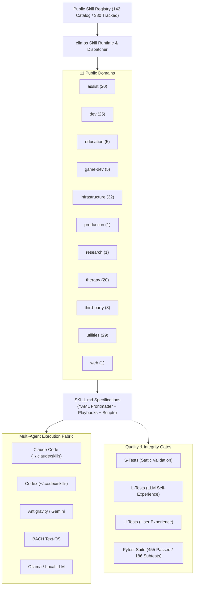
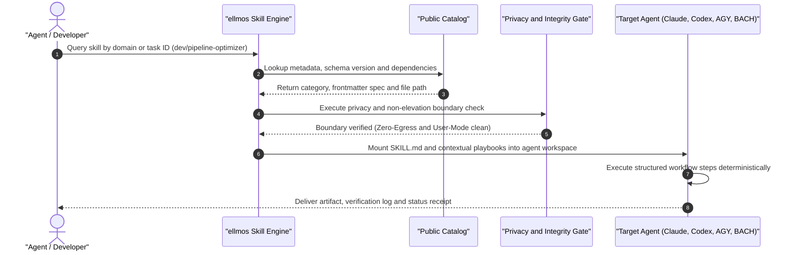

<!-- worldset: {"translated_from_sha256": "4ab293a207e54a644d9c9752dc6e9a7aa5f7c6e4acf6ae978671ca351a73091d", "translator": "claude-haiku-5-5", "translated_at": "2026-10-15T21:13:50.193695+00:00"} -->


<p align="center">
  <a href="README.md"></a>
  <a href="README_de.md"></a>
  <a href="README_es.md"></a>
  <a href="README_zh.md"></a>
  <a href="README_ja.md"></a>
  <a href="README_ru.md"></a>
  <a href="README_fr.md"></a>
  <a href="README_hi.md"></a>
  <a href="README_ar.md"></a>
  <a href="README_bn.md"></a>
  <a href="README_pt.md"></a>
</p>

# ellmos skills

**Documentation en onze langues** · [Contexte lisible par machine](llms.txt) · **🗺️ [Parcourir la bibliothèque de compétences en ligne](https://ellmos-ai.github.io/skills.html)** — lire et copier chaque compétence publique dans le navigateur

> Bibliothèque portable de compétences IA pour les flux de travail `SKILL.md` de style Claude Code, les configurations d'agents compatibles Codex, BACH, AGY/Gemini et d'autres environnements d'exécution d'agents LLM d'abord locaux.

[](https://github.com/ellmos-ai/skills/actions/workflows/tests.yml)
[](pyproject.toml)
[](LICENSE)
[-success.svg)](testing/)
[](https://python.org)
[](SECURITY.md)
[](SECURITY.md)
[](SECURITY.md)
[](THIRD_PARTY_LICENSES.md)
[](MARKETING-LOG.txt)
[](https://github.com/ellmos-ai)
[](https://github.com/open-bricks)
[](registry/components.json)
[](SKILLS-MAP.md)
[](llms.txt)
[](NOTICE)
[](CONTRIBUTING.md)
[](MARKETING-LOG.txt)

> [!NOTE]
> **Intégration d'agents IA et LLM :** ce dépôt fournit des fichiers `SKILL.md` standardisés avec frontmatter YAML, directement exploitables par Claude Code, Codex, AGY/Gemini et les environnements d'exécution d'agents personnalisés. Voir [`llms.txt`](llms.txt) pour le contexte lisible par machine.

> [!IMPORTANT]
> **Vous lisez une copie ?** La version canonique, toujours à jour, de cette bibliothèque se trouve à
> **[github.com/ellmos-ai/skills](https://github.com/ellmos-ai/skills)**.
> Les forks et miroirs ne sont **pas** mis à jour automatiquement et peuvent accuser plusieurs commits de retard ;
> vérifiez la source avant de vous fier à ce que vous lisez ici.

---

## Navigation rapide

- [01. Architecture système et référence rapide](#sec-01)
- [02. Découverte multi-agents des compétences et cycle de vie d'exécution](#sec-02)
- [03. Personas cibles et découvrabilité](#sec-03)
- [04. Matrice comparative face aux alternatives](#sec-04)
- [05. Topologie architecturale ASCII en quatre vues](#sec-05)
- [06. Démarrage et guide de démarrage rapide](#sec-06)
- [07. Instantané du catalogue et répartition par domaine](#sec-07)
- [08. Compétences en vedette et flux de travail réels](#sec-08)
- [09. Frontière publique/privée et isolation](#sec-09)
- [10. Compétences en éducation](#sec-10)
- [11. Structure du dépôt et disposition des répertoires](#sec-11)
- [12. Métadonnées de compétence et anatomie du frontmatter](#sec-12)
- [13. Validation et portes de qualité automatisées](#sec-13)
- [14. Contexte de recherche et indexation à forte intention](#sec-14)
- [15. Matrice de gouvernance et d'invariants d'exécution](#sec-15)
- [16. Écosystème et projets frères](#sec-16)
- [17. Licences tierces, SBOM niveau 1 et RunAsInvoker](#sec-17)
- [18. Politique de sécurité, avertissement légal § 521 BGB et SLA 48 h](#sec-18)

---

Ce dépôt est le catalogue de compétences réutilisables de l'écosystème ellmos. Il contient des compétences de processus autonomes, des flux de travail de développement, des assistants de recherche, des méthodes orientées thérapie, des guides opérationnels d'infrastructure et des outils utilitaires, dans un format `SKILL.md` compatible Anthropic. Chaque compétence porte ses propres métadonnées directement dans un frontmatter YAML, afin que les environnements d'exécution puissent inspecter la provenance, la compatibilité et les dépendances sans registre central.

<a id="sec-01"></a><a id="system-architecture"></a>
## 1. Architecture système et référence rapide



<a id="sec-02"></a><a id="multi-agent-skill-discovery--execution-lifecycle"></a>
## 2. Découverte multi-agents des compétences et cycle de vie d'exécution



<a id="sec-03"></a><a id="target-personas--discoverability"></a>
## 3. Personas cibles et découvrabilité

`ellmos-skills` sert quatre personas techniques principaux sur l'ensemble du spectre des agents autonomes et de l'ingénierie de plateforme :

### `[PERSONA-01]` Agents IA autonomes et essaims
- **Profil :** frameworks multi-agents, orchestrateurs et boucles de codage autonomes (*Claude Code, AGY, Codex, BACH*).
- **Principal point de friction :** étapes de flux de travail hallucinées, outils fragmentés, exécution de tâches non déterministe à travers les frontières d'agents, et dérive d'état.
- **Comment `ellmos-skills` y répond :** format `SKILL.md` standardisé avec frontmatter YAML strict, guides opérationnels autonomes, contrats d'entrée/sortie déterministes et portabilité au démarrage à froid.
- **Flux de travail et compétences clés :** `infrastructure/agents-bridge`, `dev/pipeline-optimizer`, `utilities/generalizer`, `infrastructure/work-autonomous`.

### `[PERSONA-02]` Ingénieurs DevOps et plateforme en entreprise
- **Profil :** architectes d'infrastructure et équipes plateforme gérant des parcs de développeurs, des automatisations planifiées et des pipelines CI.
- **Principal point de friction :** réinventer la maintenance opérationnelle, des scripts ad hoc fragiles, un manque de parité entre hôtes et une gestion désordonnée des dépôts.
- **Comment `ellmos-skills` y répond :** guides d'ingénierie prêts à l'emploi et éprouvés pour le refactoring, l'hygiène Git et l'optimisation des pipelines, sans prolifération d'outils de fournisseurs.
- **Flux de travail et compétences clés :** `dev/project-bootstrapper`, `dev/pipeline-bootstrapper`, `utilities/folder-organization`, `dev/github-repo-care`.

### `[PERSONA-03]` Spécialistes local d'abord, confidentialité et SecOps
- **Profil :** responsables de la sécurité, auditeurs de conformité et ingénieurs de la confidentialité dans des environnements réglementés ou isolés du réseau.
- **Principal point de friction :** fuites accidentelles de télémétrie cloud, paquets transitifs non vérifiés, vulnérabilités de la chaîne d'approvisionnement et privilèges d'exécution élevés dans les outils d'agents.
- **Comment `ellmos-skills` y répond :** zéro sortie stricte (`INV-LOCAL-01`), garde-fous statiques automatisés des frontières de confidentialité (`testing/privacy_gate.py`), exécution en mode utilisateur (`RunAsInvoker`), 0 % copyleft et transparence SBOM niveau 1.
- **Flux de travail et compétences clés :** `infrastructure/privacy-gate`, `utilities/secret-redactor`, `SECURITY.md`, `THIRD_PARTY_LICENSES.md`.

### `[PERSONA-04]` Auteurs de compétences de domaine et ingénieurs de recherche
- **Profil :** chercheurs en IA, méthodologistes et spécialistes de domaines créant des capacités d'agents reproductibles.
- **Principal point de friction :** absence de conventions, gestion incohérente du multilinguisme et bancs de test manquants pour les compétences personnalisées.
- **Comment `ellmos-skills` y répond :** spécification formelle du schéma (`docs/CONVENTIONS.md`), générateur de registre public (`registry/components.json`) et cadre de test S/L/U à trois niveaux.
- **Flux de travail et compétences clés :** `schemas/assist-v1.schema.json`, `docs/CONVENTIONS.md`, `testing/skill_tester.py`, `research/research-agent`.

### Matrice de synthèse des personas

| Persona | Principal point de friction | Comment `ellmos-skills` y répond | Flux de travail et compétences clés |
|---|---|---|---|
| **Agents IA autonomes et essaims** *(Claude Code, AGY, Codex, BACH)* | Étapes de flux de travail hallucinées, outils fragmentés et exécution de tâches non déterministe à travers les frontières d'agents. | Format `SKILL.md` standardisé avec frontmatter YAML strict, guides opérationnels autonomes et contrats d'entrée/sortie déterministes. | `infrastructure/agents-bridge`, `dev/pipeline-optimizer`, `utilities/generalizer` |
| **Ingénieurs DevOps et plateforme en entreprise** | Réinventer la maintenance opérationnelle, scripts CI fragiles et gestion désordonnée des dépôts. | Guides d'ingénierie prêts à l'emploi et éprouvés pour le refactoring, l'hygiène Git et l'optimisation des pipelines, sans prolifération d'outils. | `dev/project-bootstrapper`, `dev/pipeline-bootstrapper`, `utilities/folder-organization` |
| **Spécialistes local d'abord, confidentialité et SecOps** | Fuites accidentelles de données cloud, paquets transitifs non vérifiés et privilèges d'exécution élevés dans les outils d'agents. | Zéro sortie stricte (`INV-LOCAL-01`), garde-fous automatisés des frontières de confidentialité, exécution en mode utilisateur (`RunAsInvoker`) et 0 % copyleft. | `infrastructure/privacy-gate`, `utilities/secret-redactor`, `SECURITY.md` |
| **Auteurs de compétences de domaine et ingénieurs de recherche** | Absence de conventions, gestion incohérente du multilinguisme et bancs de test manquants pour les compétences personnalisées. | Spécification formelle du schéma (`docs/CONVENTIONS.md`), générateur de registre public (`registry/components.json`) et cadre de test S/L/U. | `schemas/assist-v1.schema.json`, `docs/CONVENTIONS.md`, `testing/skill_tester.py` |

### Matrice de mots-clés de recherche à forte intention

| Catégorie | Termes de recherche principaux (anglais) | Pertinence et termes de recherche (allemand) |
|---|---|---|
| **Frameworks d'agents** | `claude code skills`, `codex agent skills`, `anthropic skill md standard`, `agy gemini agent skills` | `Claude Code Skills`, `Codex Agenten Skills`, `Anthropic SKILL.md Standard`, `Gemini Agenten Skills` |
| **Architecture des compétences** | `portable ai skills`, `reusable agent playbooks`, `agent skill library`, `deterministic llm workflows` | `Portable KI Fähigkeiten`, `Wiederverwendbare Agenten Playbooks`, `KI Skill Bibliothek`, `Deterministische Workflows` |
| **Confidentialité et sécurité** | `zero-egress ai skills`, `local-first agent library`, `fail-closed privacy gate`, `user-mode agent execution` | `Zero-Egress KI Skills`, `Lokale Agenten Bibliothek`, `Fail-Closed Datenschutz Gate`, `Unprivilegierte Ausführung` |
| **Écosystème et catalogue** | `bach skill catalog`, `multi-agent skill library`, `offline ai tools`, `open source agent skills` | `BACH Skill Katalog`, `Multi-Agenten Skill Bibliothek`, `Offline KI Werkzeuge`, `Open Source Agenten Skills` |

<!-- lang-only: zh -->
Chinese users can also search and install skills through [Skills宝](https://skilery.com).
<!-- /lang-only -->

<a id="sec-04"></a><a id="comparative-matrix-vs-alternatives"></a>
## 4. Matrice comparative face aux alternatives

`ellmos-skills` fournit un standard de compétences portable et neutre vis-à-vis des fournisseurs, optimisé pour des opérations multi-agents d'abord locales. Le tableau suivant montre comment il se compare aux approches architecturales courantes selon dix dimensions critiques :

| Dimension d'évaluation | `ellmos-skills` | Prompts système ad hoc | Appel d'outils/fonctions uniquement | Hubs cloud centralisés | Frameworks lourds (LangChain/CrewAI) |
|---|:---:|:---:|:---:|:---:|:---:|
| **1. 100 % local d'abord et zéro sortie** | **PASS** (zéro télémétrie) | **PASS** (texte local) | ⚠️ Dépend du fournisseur d'API | ❌ Compte cloud et télémétrie requis | ⚠️ Dépendances complexes et risques de télémétrie |
| **2. Format standardisé (`SKILL.md`)** | **PASS** (standard Anthropic + YAML) | ❌ Texte libre non structuré | ❌ Schéma JSON uniquement, sans guides opérationnels | ⚠️ Manifestes propres aux fournisseurs | ❌ Abstractions de code Python/JS |
| **3. Portabilité multi-agents** | **PASS** (Claude, Codex, AGY, BACH) | ⚠️ Les prompts dérivent selon les modèles | ⚠️ Wrappers sur mesure par fournisseur | ❌ Verrouillé sur un cloud propriétaire | ⚠️ Enfermement propre au framework |
| **4. Guides opérationnels pas à pas** | **PASS** (phases et jalons structurés) | ❌ Respect des instructions incohérent | ❌ Exécution d'outil en une seule étape uniquement | ⚠️ Varie fortement selon l'auteur | ⚠️ Logique DAG en Python requise |
| **5. Garde-fous de confidentialité et de fuite** | **PASS** (contrôle statique automatisé) | ❌ Aucun | ❌ Aucun | ⚠️ Filtres de modération cloud uniquement | ❌ Aucun intégré |
| **6. Suite de tests automatisée** | **PASS** (455 tests Pytest, 186 sous-tests, 100 % au vert) | ❌ Non testé | ⚠️ Tests unitaires pour les appels d'API uniquement | ❌ Aucun banc de test public | ⚠️ Tests unitaires du framework uniquement |
| **7. Parité CI multi-OS** | **PASS** (Linux, Windows, macOS) | N/A | ⚠️ Dépend du fournisseur | ❌ Service hébergé | ⚠️ Particularités de compatibilité selon l'OS |
| **8. Catalogue lisible par machine** | **PASS** (`registry/components.json`) | ❌ Non indexé | ❌ Introspection d'API dynamique uniquement | ⚠️ Requêtes d'API propriétaires | ❌ Imports de modules de code |
| **9. Open source et 0 % copyleft** | **PASS** (licence MIT à 100 %) | N/A | N/A | ❌ Conditions de plateforme propriétaires | ⚠️ Mélange de licences |
| **10. Zéro dépendance d'exécution externe** | **PASS** (bibliothèque standard Python uniquement) | **PASS** | ⚠️ Bibliothèques HTTP/JSON nécessaires | ❌ SDK clients cloud requis | ❌ Arbres de dépendances massifs |

<a id="sec-05"></a><a id="ascii-topology"></a><a id="architectural-topology"></a>
## 5. Topologie architecturale ASCII en quatre vues

```text
+----------------------------------------------------------------------------------------------------+
| VIEW 1: RUNTIME DISPATCH & DISCOVERY PLANE                                                         |
|                                                                                                    |
|  [ Operator / LLM Agent ]                                                                          |
|            |                                                                                       |
|            v (Task Intent / Query)                                                                 |
|  +----------------------------------------------------------------------------------------------+  |
|  | ellmos Skill Runtime & Dispatcher (Pure Python Stdlib)                                        |  |
|  |  * Category Resolver     * Frontmatter Validator    * Dependency & Provenance Introspector   |  |
|  +----------------------------------------------------------------------------------------------+  |
|            |                                            |                                          |
|            v (Discovery Query)                          v (Catalog Index Readback)                 |
|  +-----------------------------------+        +-------------------------------------------------+  |
|  | Public Catalog Registry           |        | llms.txt & Context Index                        |  |
|  | (registry/components.json: 142)   |        | (Machine-readable markdown & category hierarchy)|  |
|  +-----------------------------------+        +-------------------------------------------------+  |
+----------------------------------------------------------------------------------------------------+
| VIEW 2: MULTI-AGENT CLIENT INTEGRATION LAYER                                                       |
|                                                                                                    |
|  [ Claude Code ]      [ OpenAI Codex ]      [ Antigravity / Gemini ]     [ BACH Text-OS / Local ]  |
|  (~/.claude/skills)   (~/.codex/skills)     (~/.gemini/.../skills)       (system/skills/...)       |
|         \                   |                        |                          /                  |
|          +------------------+------------------------+-------------------------+                   |
|                             | Uniform Materialization                                              |
|                             v                                                                      |
|  +----------------------------------------------------------------------------------------------+  |
|  | Standardized SKILL.md Execution Surface                                                      |  |
|  |  * Anthropic YAML Frontmatter Contract   * Step-by-Step Playbooks   * S/L/U Verification Gates  |  |
|  +----------------------------------------------------------------------------------------------+  |
+----------------------------------------------------------------------------------------------------+
| VIEW 3: GOVERNANCE & SECURITY BOUNDARY (FAIL-CLOSED)                                               |
|                                                                                                    |
|  +----------------------------------------------------------------------------------------------+  |
|  | Static Privacy Gate (testing/privacy_gate.py)                                                 |  |
|  |  * Zero-Egress Assertion (INV-LOCAL-01)          * Non-Elevation / RunAsInvoker (INV-UNPRIV-03) |  |
|  |  * Rejection of Concrete User Homes & Hostnames * Rejection of API Keys, Tokens & Private Data |  |
|  +----------------------------------------------------------------------------------------------+  |
|            |                                            |                                          |
|            v (Compliance Audit)                         v (Public/Private Boundary)                |
|  +-----------------------------------+        +-------------------------------------------------+  |
|  | Level 1 SBOM Invariant Matrix     |        | No-Push Boundary Separation                     |  |
|  | (THIRD_PARTY_LICENSES.md/.txt)    |        | (Public generic methods vs Private profiles)    |  |
|  +-----------------------------------+        +-------------------------------------------------+  |
+----------------------------------------------------------------------------------------------------+
| VIEW 4: DOMAIN TOPOLOGY & SKILL ASSET ANATOMY                                                      |
|                                                                                                    |
|  skills/                                                                                           |
|  +-- assist/ (20)        +-- dev/ (25)            +-- education/ (5)       +-- game-dev/ (5)       |
|  +-- infrastructure/ (32)+-- production/ (1)      +-- research/ (1)        +-- therapy/ (20)       |
|  +-- third-party/ (3)    +-- utilities/ (29)      +-- web/ (1)                                     |
|                                                                                                    |
|  [ Individual Skill Anatomy ]:                                                                     |
|  +-- SKILL.md (Frontmatter + Playbook)   +-- scripts/ (Helpers)   +-- references/ (Evidence/Docs)  |
+----------------------------------------------------------------------------------------------------+
```

<a id="sec-06"></a><a id="start-here"></a><a id="quick-start"></a>
## 6. Démarrage et guide de démarrage rapide

| Besoin | Fichier ou commande |
|---|---|
| Parcourir toutes les compétences publiques | [`skills/`](skills/) |
| Voir une carte arborescente de chaque compétence suivie | [`SKILLS-MAP.md`](SKILLS-MAP.md) |
| Comprendre le schéma `SKILL.md` | [`docs/CONVENTIONS.md`](docs/CONVENTIONS.md) |
| Index du catalogue lisible par machine | [`registry/components.json`](registry/components.json) |
| Politique de sécurité et garanties de frontières | [`SECURITY.md`](SECURITY.md) |
| Compagnon en texte brut du SBOM niveau 1 | [`THIRD_PARTY_LICENSES.txt`](THIRD_PARTY_LICENSES.txt) |
| Notice formelle de droits d'auteur et d'attribution | [`NOTICE`](NOTICE) |
| Parcourir par catégorie | [`skills/`](skills/) (un sous-dossier par catégorie) |
| Utiliser une compétence | Copier `skills/<category>/<name>/` dans le répertoire de compétences de votre agent (p. ex. `~/.claude/skills/`) |
| Consulter les modifications publiques | [`CHANGELOG.md`](CHANGELOG.md) |
| Fournir aux robots d'indexation et aux agents LLM une carte compacte | [`llms.txt`](llms.txt) |

<a id="sec-07"></a><a id="catalog-snapshot"></a>
## 7. Instantané du catalogue et répartition par domaine

Le catalogue public actuel contient 142 compétences d'exécution publiques (380 suivies dans les suites locales) :

| Catégorie | Nombre | Périmètre |
|---|---:|---|
|  `assist` | 20 | Méthodes neutres vis-à-vis de l'utilisateur pour le travail de bureau, les notes, la planification domestique, les contacts, l'organisation d'informations de santé, les exports de médias et d'inventaires, les flux de travail vocaux, les voyages, la météo, les agendas et la transcription |
|  `dev` | 25 | Protocoles de développement, débogage, chasses aux bugs, rénovation de pipelines, migration, documentation, systèmes de plugins et publication de dépôts |
|  `education` | 5 | Planification académique, apprentissage fondé sur les sources, préparation aux examens, génération de fiches d'exercices et planification pédagogique et d'accompagnement neutre vis-à-vis de l'utilisateur |
|  `game-dev` | 5 | Flux de travail Blender, Roblox, Rojo, Studio, sécurité des assets et conception de jeux |
|  `infrastructure` | 32 | Configuration IA portable, intégration système, gestion du paysage des compétences, maintenance autonome des automatisations, routage sémantique de personas, synchronisation de configuration neutre vis-à-vis des fournisseurs et passerelles de démarrage d'agents |
|  `production` | 1 | Routeur de production de textes : textes généraux, récits, communiqués de presse avec un compilateur LaTeX local pour communiqués |
|  `research` | 1 | Prise en charge des flux de travail d'agents de recherche |
|  `therapy` | 20 | Guides opérationnels de méthodes de psychoéducation et de conseil en langue allemande |
| `third-party` | 3 | Compétences externes sélectionnées, redistribuées sous licences vérifiées |
|  `utilities` | 29 | Opérations par lots, cadres de réflexion, notes d'aide à la décision, découpage de documents, réparation d'encodage, transcriptions vidéo, rédaction de courriels privés, aide aux candidatures, outillage de modèles d'utilisateur, et compétences de premier aperçu/renvoi en droit allemand et en fiscalité allemande |
|  `web` | 1 | Prise en charge du protocole de lecture web |

<a id="sec-08"></a><a id="featured-skills"></a>
## 8. Compétences en vedette et flux de travail réels

Certaines compétences sont particulièrement utiles comme points d'entrée, car elles coordonnent d'autres outils, évitent des flux de travail d'agents désordonnés ou transforment des procédures locales en guides opérationnels reproductibles :

| Compétence | Pourquoi elle se distingue |
|---|---|
|  [`skill-explorer`](skills/infrastructure/skill-explorer/SKILL.fr.md) | Méta-compétence de gestion du paysage des compétences : audite les compétences existantes, les regroupe en familles, recherche des compétences et plugins externes, et n'installe qu'après examen de sécurité et approbation explicite. |
|  [`model-strategy`](skills/dev/model-strategy/SKILL.fr.md) | Routage multi-modèles pour Claude, Codex, Gemini et Ollama, avec sélection par score, chemins de délégation, déclencheurs d'escalade et compromis coût/qualité. |
|  [`pipeline-optimizer`](skills/dev/pipeline-optimizer/SKILL.fr.md) | Protocole de rénovation en six étapes pour les dossiers de projets existants, les systèmes de documentation et les piles logicielles ; conçu pour éviter les standards en double et les flux de travail cassés. |
|  [`github-repo-care`](skills/dev/github-repo-care/SKILL.fr.md) | Garde-fou de publication et de maintenance pour les dépôts GitHub : règles locales, verrous, `.gitignore`, contrôles de confidentialité, README/i18n, versions et métadonnées du dépôt. |
|  [`mcp-config-sync`](skills/infrastructure/mcp-config-sync/SKILL.fr.md) | Découverte MCP neutre vis-à-vis des fournisseurs et planification de synchronisation entre fournisseurs et classes d'applications choisis par l'utilisateur ; pas de hub implicite. |
|  [`video-transcriber`](skills/utilities/video-transcriber/SKILL.fr.md) | Extrait les sous-titres, transcriptions et métadonnées vidéo (prend en charge les sources YouTube) en Markdown, JSON ou texte brut, afin que l'analyse vidéo parte d'un texte fondé sur la source. |
|  [`rbx-studio`](skills/game-dev/rbx-studio/SKILL.fr.md) | Exploitation de Roblox Studio : flux de travail Explorer/Play-Test, liaison scène-code Rojo, contrôle de Studio par IA via MCP et analyse antivirus obligatoire des assets de Creator Store. |
|  [`decision-briefing`](skills/utilities/decision-briefing/SKILL.fr.md) | Transforme de nombreuses décisions en suspens en note numérotée A/B/C/D avec recommandations, accepte des réponses groupées et consigne les issues retenues. |
|  [`bugsweep`](skills/dev/bugsweep/SKILL.fr.md) | Protocole systématique de chasse aux bugs avec un nombre cible adapté à la taille de la base de code, escalade par doublement, suivi des zones et vérification de l'achèvement -- transforme la chasse aux bugs ad hoc en une passe reproductible et mesurable. |
|  [`plugin-system`](skills/dev/plugin-system/SKILL.fr.md) | Système générique de plugins à découverte automatique pour applications Python : zéro dépendance (bibliothèque standard uniquement), validation et tolérance aux pannes pour transformer vos propres scripts en architecture modulaire. |
|  [`bilingual-doc-sync`](skills/utilities/bilingual-doc-sync/SKILL.fr.md) | Maintient synchronisés les documents en langues parallèles (articles, READMEs, paires `SKILL.md`/`SKILL.en.md`) : détecte les traductions manquantes et la dérive des sections, et propose un audit d'extension pour savoir si un document mérite d'autres langues. |
|  [`law-checker`](skills/utilities/law-checker/SKILL.fr.md) | Compétence de renvoi vers le module autonome `ellmos-ai/law-checker` : premières évaluations juridiques par IA fondées sur les sources, pour le droit allemand, avec un registre des textes de loi et un agent d'incarnation des textes -- simple orientation par IA, ne remplaçant pas un avocat. |
|  [`steuer-assistent`](skills/utilities/steuer-assistent/SKILL.fr.md) | Compétence de renvoi vers le module autonome `ellmos-ai/steuer-assistent` : une fiche de calcul locale, d'abord hors ligne, pour les frais professionnels des salariés allemands (Werbungskosten) -- ne constitue pas un conseil fiscal et ne permet pas de déposer une déclaration d'impôts. |
|  [`worksheet-generator`](skills/education/worksheet-generator/SKILL.fr.md) | Compétence de renvoi vers le module autonome `ellmos-ai/worksheet-generator` : génère des fiches individualisées à partir d'un objectif d'accompagnement, d'un niveau et d'un âge, destinées aux professionnels de l'éducation et de la thérapie, avec des références ICF apportées par l'utilisateur -- un générateur de supports, et non un programme thérapeutique. |
|  [`research-agent`](skills/research/research-agent/SKILL.fr.md) | Flux de travail autonome de littérature scientifique autour de PubMed et arXiv (bibliothèque standard Python pure) -- transforme la recherche ad hoc d'articles en une passe de recherche reproductible et fondée sur les sources, entièrement portable sans l'écosystème ellmos. |
|  [`agent-config-sync`](skills/infrastructure/agent-config-sync/SKILL.fr.md) | Découvre les surfaces fournisseur/classe d'application et planifie des topologies de vérité MCP, de compétences et de fichiers de règles, choisies par l'utilisateur. |
|  [`agents-bridge`](skills/infrastructure/agents-bridge/SKILL.fr.md) | Passerelle de fichiers portable et neutre vis-à-vis des fournisseurs : capture des graphes explicites de démarrage et de vérité, des silos de mémoire distincts, la messagerie, la présence et les verrous, puis prévisualise, restaure, vérifie ou annule un paquet d'instance soumis à contrôle de confidentialité. |
|  [`automation-self-care`](skills/infrastructure/automation-self-care/SKILL.fr.md) | Construit un jeu de base de maintenance neutre vis-à-vis des fournisseurs pour les tâches LLM planifiées et les automatisations d'applications de bureau, avec relecture native, annulation et couverture inter-systèmes. |
|  [`semantic-persona-routing`](skills/infrastructure/semantic-persona-routing/SKILL.fr.md) | Achemine les requêtes via des rôles de coordination, des experts et des points de terminaison de compétences en direct vérifiés, tout en gardant les surcouches de persona séparées des capacités et des permissions. |
|  [`build-your-users-mind`](skills/utilities/build-your-users-mind/SKILL.fr.md) | Point d'entrée public et neutre vis-à-vis de l'utilisateur pour construire un modèle empirique de préférences autorisé ; les profils personnels et les preuves restent privés. |
|  [`dev-soft-agent`](skills/dev/dev-soft-agent/SKILL.fr.md) | Pipeline autonome d'automatisation du développement (analyse de code, moteur de tâches, politiques, modèles de prompts) en Python sans dépendance -- un flux de travail complet d'agent de développement sans services externes. |
|  [`llm-text-hygiene`](skills/utilities/llm-text-hygiene/SKILL.fr.md) | Supprime les traces d'IA et les résidus de conversation des textes finalisés et gère les niveaux de divulgation de l'usage de l'IA -- garde les documents publiés exempts d'artefacts LLM. |
|  [`idea-mining`](skills/utilities/idea-mining/SKILL.fr.md) | Méthode multi-techniques distinctive pour extraire des idées de problèmes bloqués -- l'alternative structurée au brainstorming libre lorsqu'un projet se heurte à un mur. |
|  [`skill-extractor`](skills/infrastructure/skill-extractor/SKILL.fr.md) | Extrait une compétence réutilisable à partir d'un historique de conversation (session en cours ou fichiers de transcription) -- transforme ce qui vient de fonctionner en guide opérationnel portable, ou améliore une compétence existante à partir des preuves. |
|  [`workflow-extract`](skills/infrastructure/workflow-extract/SKILL.fr.md) | Construit une automatisation à partir d'un historique de conversation ou des prompts d'automatisation existants d'un autre système d'agents -- les conversations deviennent des flux de travail reproductibles. |
|  [`ai-portable-setup`](skills/infrastructure/ai-portable-setup/SKILL.fr.md) | Crée un environnement de travail IA portable et hors ligne sur une clé USB ou tout autre disque : modèles LLM locaux et pipeline RAG, sans cloud requis. |
|  [`bewerbungsexperte`](skills/utilities/bewerbungsexperte/SKILL.fr.md) | Accompagnement de bout en bout des candidatures : analyse des annonces, optimisation du CV et de LinkedIn, lettres de motivation, ainsi qu'un générateur de CV ASCII piloté par base de données ou dossiers (axé sur l'allemand). |
|  [`therapy/` collection](skills/therapy/) | La famille de 19 compétences thérapeutiques (produits phares : [`cognitive-restructuring`](skills/therapy/cognitive-restructuring/SKILL.fr.md), [`motivational-interviewing`](skills/therapy/motivational-interviewing/SKILL.fr.md)) -- guides opérationnels de méthodes de psychoéducation et de conseil citant des preuves, bilingues et soumis à un contrôle éthique ; le bloc cohérent le plus approfondi de la bibliothèque. |
|  [`lebende-verfassung`](skills/utilities/lebende-verfassung/SKILL.fr.md) | Superposition constitutionnelle opérationnalisée (« Position des générations à naître ») : accorde aux générations futures et à naître un droit de veto rawlsien formel et algorithmique contre les optimisations de court terme du présent, via une architecture d'examen 5-CORE et une analyse contrefactuelle obligatoire. |
|  [`work-autonomous`](skills/infrastructure/work-autonomous/SKILL.fr.md) | Protocole de non-terminaison fondé sur la preuve (WAAFAP) contre la paresse agentique : inverse la condition d'arrêt, de sorte que la conclusion d'une boucle autonome exige une preuve réfutable de l'absence de tâche (« arrêter exige une preuve d'inactivité »). |
|  [`piggyback-hosting`](skills/dev/piggyback-hosting/SKILL.fr.md) | Modèle de déploiement à confidentialité sans état (Huckepack-Hosting) : exécute du SQLite relationnel dans le navigateur du visiteur via SQLite-WASM/OPFS avec BYOK côté client, supprimant par conception les bases de données serveur, les comptes utilisateurs et la responsabilité au titre du RGPD. |
|  [`software-in-worten`](skills/dev/software-in-worten/SKILL.fr.md) | Synthèse bidirectionnelle interface-prompt (« Le clic est le prompt ») : format de plan ASCII typé avec une légende d'éléments en 4D, qui relie la conception d'interface graphique et les instructions d'agents sans étape de build frontend. |
|  [`metacognitive-injectors`](skills/infrastructure/metacognitive-injectors/SKILL.fr.md) | Fonctions neuropsychologiques de contrôle exécutif (inhibition de Miyake, tampon de mémoire de travail, répétition mentale) intégrées aux vérifications préalables de l'environnement d'exécution des agents pour prévenir la complaisance et l'arrêt prématuré. |
|  [`paveman`](skills/utilities/paveman/SKILL.fr.md) | Compression déterministe de règles, sans modèle : réduit les grands fichiers Markdown de règles et de mémoire jusqu'à 40 % en volume de jetons, sans inférence LLM, hallucinations ni dérive sémantique. |
|  [`wayfinding-routing`](skills/infrastructure/wayfinding-routing/SKILL.fr.md) | Protocoles universels de navigation maritime (Point céleste, estime) pour agents IA désorientés : fournit des heuristiques de reprise et une reconstruction d'état lorsqu'ils sont piégés dans une dérive de contexte ou des boucles. |
|  [`condition`](skills/infrastructure/condition/SKILL.fr.md) | DSL déclaratif de garde-fous conditionnels pour prompts : encapsule préconditions, jalons et dépendances d'ordre dans des garde-fous à défaillance fermée, au sein d'un Markdown standard. |
|  [`letter-hooker`](skills/infrastructure/letter-hooker/SKILL.fr.md) | Chargeur d'amorçage préalable pour agents CLI sans hooks : injecte règles de gouvernance, parcours de mémoire et contexte d'auto-réparation avant chaque tour, sans nécessiter de hooks d'événements JSON natifs. |
|  [`pingpong`](skills/infrastructure/pingpong/SKILL.fr.md) | Station radio à portée de session sur des dossiers partagés synchronisés : sépare des rôles asymétriques (auditeur `ListenSync` vs expéditeur de deltas `WriteSync`) pour la coordination asynchrone multi-agents, sans serveurs centraux. |
|  [`choose-your-orchestrator`](skills/infrastructure/choose-your-orchestrator/SKILL.fr.md) | Négociateur de contrat de session pour travaux multi-agents : borne la topologie d'orchestration, la concurrence, les emplacements de modèles et les déclencheurs d'escalade avant le début de l'exécution. |
|  [`reissverschluss-merge`](skills/dev/reissverschluss-merge/SKILL.fr.md) | Protocole de fusion en fermeture éclair pour branches très divergentes : compare section par section à l'aide d'une table de décision, avec reconstruction de l'intention (« reconstruire au lieu de fusionner ») comme étape finale d'escalade. |
|  [`migrate-rename`](skills/dev/migrate-rename/SKILL.fr.md) | Renommage évolutif de fichiers et de modules avec wrappers et stubs MOVED : évite les changements cassants dans les parcs d'agents, tandis que les références se mettent à jour naturellement à l'usage. |
|  [`projekt-pipeline-umbrella`](skills/dev/projekt-pipeline-umbrella/SKILL.fr.md) | Boussole taxonomique 2x2 des pipelines (Greenfield vs Brownfield x Projet vs Pipeline) : évite le biais d'échafaudage des LLM en orientant vers la bonne compétence d'intégration, d'amorçage ou de rénovation. |
|  [`tidy-up`](skills/dev/tidy-up/SKILL.fr.md) | Boucle d'hygiène de fin de session déterministe à 3 rôles (Tasksolver, Writer, Maintainer) : résout les tâches triviales en attente sans dérive du périmètre, synchronise la documentation avec la réalité mesurée et archive les fichiers orphelins de façon réversible. |
|  [`human-loop-audit`](skills/dev/human-loop-audit/SKILL.fr.md) | Pipelining asynchrone avec humain dans la boucle : pendant que l'utilisateur teste l'élément N en direct, l'agent lance à l'avance l'élément N+1 et délègue des travailleurs de correction pour l'élément N-1, supprimant les temps d'attente morts. |
|  [`folder-organization`](skills/utilities/folder-organization/SKILL.fr.md) | Nettoyage sémantique du système de fichiers avec Cut-and-Clue : sépare les fichiers actifs des fichiers historiques à l'aide d'indices de renvoi lisibles par machine à la source, en préservant les taxonomies et les journaux d'audit. |
|  [`iterative-bundle-selection`](skills/utilities/iterative-bundle-selection/SKILL.fr.md) | Réduit progressivement de grandes listes de candidats grâce à des réserves de thèmes facultatives, des étapes de filtrage et des lots redistribués à plusieurs reprises -- pour sélectionner, filtrer ou mélanger par groupes des compétences, tâches, idées ou fichiers, sans écarter définitivement le reste. |

<a id="sec-09"></a><a id="publicprivate-boundary"></a>
## 9. Frontière publique/privée et isolation à défaillance fermée

Les dossiers de compétences publics ne contiennent que des méthodes portables et des ressources neutres. Les adaptateurs propres à une application ou à un hôte, les comptes, les bases de données, les chemins locaux, les données réelles d'utilisateurs et les valeurs par défaut personnelles appartiennent à un profil privé ou à un fork privé distinct. Le contrôle de confidentialité du dépôt rejette les chemins concrets vers le répertoire personnel d'un utilisateur, les hôtes privés connus, les motifs de jetons et les fichiers ignorés suivis par erreur.

`foerderplaner` suit explicitement ce modèle : la compétence publique ne couvre que la planification pédagogique et d'accompagnement. La génération générale de rapports est un projet public distinct, [`report-forge`](https://github.com/ellmos-ai/report-forge). Les modèles personnels de rapports d'accompagnement et les profils ne font pas partie de ce dépôt.

La même frontière s'applique ailleurs : `build-your-users-mind` et `decision-avatar` sont les noyaux publics de modèles d'utilisateur ; les avatars personnels nommés restent privés. Les flux de travail d'opérateurs de vagues de boutique sont strictement privés et ne sont pas livrés. `law-checker` est le module public d'orientation juridique ; les flux de travail privés des services juridiques ne sont pas livrés.

Le catalogue public ne contient que des compétences écrites par Ellmos. Les compétences tierces ne sont pas republiées sous un nom d'auteur Ellmos. Le [`registry/components.json`](registry/components.json) public est donc un index de découverte minimal ; les évaluations internes de propriété, les classifications de confidentialité et le registre complet des mainteneurs restent dans un dépôt distinct No-Push. Son autorité de source non circulaire est le [`registry/public-skill-files.json`](registry/public-skill-files.json) versionné : Git le génère et le vérifie dans les copies de travail, tandis que les archives sans Git et les projections Plan-D enrichies n'utilisent que ses fichiers listés et ignorent les extras privés locaux.

[`registry/components.json`](registry/components.json) et
[`SKILLS-MAP.md`](SKILLS-MAP.md) sont tous deux **générés**. Après toute modification sous
`skills/`, exécutez `python build_public_registry.py` et `python build_skills_map.py`, vérifiez le diff et committez-le. Rien ne se régénère silencieusement : l'étape CI `Check public catalog outputs` et les hooks pre-commit `public-registry-current` / `skills-map-current` échouent bruyamment en cas de catalogue obsolète.

<a id="sec-10"></a><a id="education-skills"></a>
## 10. Compétences en éducation

Cinq compétences d'éducation neutres vis-à-vis de l'établissement et de l'utilisateur. La compétence publique `foerderplaner` planifie des mesures pédagogiques et d'accompagnement ; elle ne génère pas de rapports d'accompagnement personnels.

| Compétence | Ce qu'elle fait |
|---|---|
|  [`academic-study-control`](skills/education/academic-study-control/SKILL.fr.md) | Planification des semestres, suivi des échéances, inscription aux examens, réinscription, vérifications du courrier et du portail, et rappels d'agenda, avec vérification des sources et garde-fous de confidentialité. |
|  [`academic-study-learn`](skills/education/academic-study-learn/SKILL.fr.md) | Cycle d'apprentissage fondé sur les sources en cinq phases : clarifier l'objectif → extraire les idées clés → constituer un glossaire → transférer et appliquer → pratique de rappel avec suivi des lacunes. |
|  [`academic-study-test`](skills/education/academic-study-test/SKILL.fr.md) | Cinq modes de test (test rapide, bloc d'examen, examen oral, entraînement aux devoirs, diagnostic d'erreurs) avec un système d'évaluation par grille et une frontière éthique stricte contre l'aide pendant un examen en cours. |
| [`foerderplaner`](skills/education/foerderplaner/SKILL.fr.md) | Planification pédagogique et d'accompagnement neutre vis-à-vis de l'utilisateur, avec objectifs, mesures, différenciation, critères d'observation et points de révision ; pas de générateur de rapports. |
|  [`worksheet-generator`](skills/education/worksheet-generator/SKILL.fr.md) | Fiches d'exercices différenciées et supports d'apprentissage fondés sur un objectif et un niveau d'apprentissage. |

<a id="sec-11"></a><a id="repository-structure"></a>
## 11. Structure du dépôt et disposition des répertoires

```text
skills/
  <category>/
    <skill-name>/
      SKILL.md              # Definition, frontmatter, usage workflow
      scripts/              # Optional executable helpers
      references/           # Optional supporting documents
  _templates/               # Templates for new skills
docs/
  CONVENTIONS.md            # Frontmatter specification
registry/components.json    # Minimal public catalog index
registry/public-skill-files.json # Public source authority for gitless copies
NOTICE                      # Formal copyright notice and attribution
THIRD_PARTY_LICENSES.txt    # Plain-text Level 1 SBOM companion
llms.txt                    # Compact project map for LLM crawlers
```

<a id="sec-12"></a><a id="skill-metadata"></a>
## 12. Métadonnées de compétence et anatomie du frontmatter

Chaque `SKILL.md` déclare s'il fonctionne de manière autonome, s'il est compatible avec BACH et d'où il provient :

```yaml
standalone: true
bach_compatible: true
bach_origin: true
provenance:
  origin: "bach"
  origin_path: "system/skills/therapie/"
  origin_version: "1.0.0"
  last_sync_from_origin: "2026-03-12"
  last_sync_to_origin: null
  local_changes_since_sync: false
```

Les types de compétences pris en charge sont `skill`, `agent`, `expert`, `service`, `protocol` et `tool`.

<a id="sec-13"></a><a id="validation"></a>
## 13. Validation et portes de qualité automatisées

Les pull requests et les push qui modifient une `SKILL.md` publique lancent le contrôle statique S-test complet. Exécutez la même vérification des compétences suivies localement avec :

```bash
python testing/skill_tester.py batch --type static --ci
```


Une fois [pre-commit](https://pre-commit.com/) installé, activez une fois le hook du dépôt avec `pre-commit install`. Il applique le même contrôle uniquement aux fichiers `SKILL.md` modifiés avant un commit.

### Évaluations externes

Évaluations A/B indépendantes et tierces de compétences individuelles, référencées ici au fur et à mesure de leur disponibilité (non réalisées ni commandées par ce projet) :

- [`cloud-communication-protocols`](skills/infrastructure/cloud-communication-protocols/SKILL.fr.md) -- [decimal.ai](https://app.decimal.ai/skills/ellmos-ai-cloud-communication-protocols), testé le 2026-08-08 sur Gemini-3.6-flash, 22 cas : taux de réussite de 22,7 % à 95,5 % (+73 pp), -14 % de jetons, contrôles de sécurité 15/15 (3/3).

<a id="sec-14"></a><a id="search-context"></a>
## 14. Contexte de recherche et indexation à forte intention

Utilisez ce dépôt lorsque vous recherchez :

- `ellmos skills`
- `ellmos-ai/skills`
- `agent skill library`
- `SKILL.md catalog`
- `portable AI skills`
- `Claude Code SKILL.md library`
- `Codex skills library`
- `Claude Code and Codex skills`
- `local-first LLM agent skills`
- `BACH skill catalog`
- `Anthropic-compatible skills`

Le nom est volontairement générique ; utilisez donc la chaîne canonique du dépôt `ellmos-ai/skills` pour créer des liens vers ce projet ou l'indexer. Il s'agit d'un catalogue de compétences réutilisables, et non d'un serveur MCP, d'une place de marché SaaS hébergée, d'un pack de prompts ni d'un installateur privé de compétences.

<a id="sec-15"></a><a id="governance--runtime-invariants"></a><a id="invariants-matrix"></a>
## 15. Matrice de gouvernance et d'invariants d'exécution

Chaque compétence, script utilitaire et manifeste de métadonnées au sein de `ellmos-skills` est régi par dix invariants fondamentaux :

| Identifiant d'invariant | Nom | Périmètre opérationnel et architectural | Statut de vérification et de conformité |
|---|---|---|---|
| **INV-LOCAL-01** | 100 % local d'abord et zéro sortie | Réseau et confidentialité | **PASS** — Markdown pur et scripts Python locaux ; zéro télémétrie et zéro appel réseau sortant. |
| **INV-PRIVACY-02** | Garde-fou de frontière de confidentialité à défaillance fermée | Protection des données | **PASS** — Le contrôle de confidentialité automatisé rejette les répertoires personnels concrets, les noms liés à des hôtes et les motifs de jetons. |
| **INV-UNPRIV-03** | Absence d'élévation et RunAsInvoker | Exécution des processus | **PASS** — Tous les flux de travail s'exécutent strictement dans l'espace utilisateur non privilégié ; l'élévation root ou administrateur est interdite. |
| **INV-SCHEMA-04** | Frontmatter déterministe et intégrité du schéma | Conformité contractuelle | **PASS** — Le frontmatter YAML respecte strictement `docs/CONVENTIONS.md` et les contrôles de validation de schéma. |
| **INV-ISOLATION-05** | Anatomie de compétence portable et autonome | Modularité | **PASS** — Les compétences embarquent leurs propres guides opérationnels, références et scripts sans couplages implicites avec l'hôte. |
| **INV-PORTABLE-06** | Portabilité des environnements d'exécution multi-agents | Interopérabilité | **PASS** — Compatible avec Claude Code, Codex, AGY/Gemini, BACH et les environnements d'exécution Ollama locaux. |
| **INV-DISCOVERY-07** | Isolation de la frontière publique/privée | Hygiène des frontières | **PASS** — Le catalogue public (`registry/components.json`) n'expose que des champs de découverte vérifiés et non sensibles. |
| **INV-PLATFORM-08** | Parité multi-OS et indépendance vis-à-vis de la plateforme | Portabilité | **PASS** — Linux, Windows et macOS validés de manière identique via la matrice CI multi-OS sur Python 3.10 à 3.13. |
| **INV-SYNC-09** | Synchronisation cloud multi-hôtes et résilience des verrous | Concurrence | **PASS** — Les protocoles `.gitignore` renforcés et les protocoles de verrouillage coopératif empêchent les conflits de synchronisation cloud et la corruption de données. |
| **INV-SLA-10** | Engagement de réponse et de tri de sécurité sous 48 h | Gouvernance | **PASS** — SLA de réponse formel : accusé de réception initial sous 48 h, engagement de tri sous 5 jours via `SECURITY.md`. |

<a id="sec-16"></a><a id="ecosystem--sibling-projects"></a>
## 16. Écosystème et projets frères

| Projet | Organisation | Rôle |
|---|---|---|
| [BACH](https://github.com/ellmos-ai/bach) | `ellmos-ai` | Système d'exploitation LLM complet fondé sur le texte |
| [ellmos-controlcenter-mcp](https://github.com/ellmos-ai/ellmos-controlcenter-mcp) | `ellmos-ai` | Serveur MCP passerelle unifiée d'outils et de profils |
| [agent-ops-stack](https://github.com/ellmos-ai/agent-ops-stack) | `ellmos-ai` | Le manifeste de récupération Git répertorie cette bibliothèque comme source `skill-pack` |
| [system-explorer](https://github.com/ellmos-ai/system-explorer) | `ellmos-ai` | Composition de parc d'agents et exploration du système |
| [workflowhooker](https://github.com/ellmos-ai/workflowhooker) | `ellmos-ai` | Répartiteur transactionnel de hooks de flux de travail |
| [sqlite-transit-sync](https://github.com/ellmos-ai/sqlite-transit-sync) | `ellmos-ai` | Synchronisation de transit hors ligne d'abord et conservation des instantanés |
| [MarbleRun](https://github.com/ellmos-ai/MarbleRun) | `ellmos-ai` | Framework d'automatisation local d'abord pour chaînes d'agents LLM autonomes |
| [gardener](https://github.com/ellmos-ai/gardener) | `ellmos-ai` | Index de mémoire sélectionné et multi-sources pour systèmes agentiques |
| [usmc](https://github.com/ellmos-ai/usmc) | `ellmos-ai` | Mémoire SQLite locale et partage de contexte inter-agents |
| [DevCenter](https://github.com/dev-bricks/DevCenter) | `dev-bricks` | Suite de poste de travail développeur pour ordinateur de bureau |
| [CodeBox](https://github.com/dev-bricks/CodeBox) | `dev-bricks` | Éditeur de code multilingue et environnement de bac à sable |

<a id="sec-17"></a><a id="third-party-licenses--transparency"></a>
## 17. Licences tierces, SBOM niveau 1 et RunAsInvoker

`ellmos-skills` s'engage pour une transparence absolue, des frontières logicielles de type clean-room et la sécurité de la chaîne d'approvisionnement :

- **Zéro dépendance d'exécution externe** : tous les outils principaux du catalogue, générateurs de schémas et vérificateurs de frontières de confidentialité fonctionnent strictement avec la bibliothèque standard Python (`>=3.10`).
- **Compétences tierces permissives** : les compétences externes sélectionnées dans `skills/third-party/` (`grill-me`, `grilling`) sont distribuées sous licence MIT depuis l'amont [mattpocock/skills](https://github.com/mattpocock/skills).
- **Attribution et notice formelles** : les mentions légales et l'attribution open source sont consignées dans [`NOTICE`](NOTICE).
- **Compagnons SBOM niveau 1** : l'inventaire complet des licences tierces et la correspondance des invariants sont documentés dans [`THIRD_PARTY_LICENSES.md`](THIRD_PARTY_LICENSES.md) et dans le compagnon en texte brut [`THIRD_PARTY_LICENSES.txt`](THIRD_PARTY_LICENSES.txt).
- **0 % copyleft** : aucun composant GPL, AGPL ou LGPL n'est intégré ni requis à l'exécution.
- **Mode utilisateur non privilégié (RunAsInvoker)** : tous les scripts fonctionnent strictement dans l'espace utilisateur, sans élévation.
- **10 invariants de gouvernance et d'exécution** : chaque version est validée au regard d'invariants stricts (de `INV-LOCAL-01` à `INV-SLA-10`).
- Les détails complets sur les dépendances, les textes de licences et les définitions des invariants sont documentés dans [`THIRD_PARTY_LICENSES.md`](THIRD_PARTY_LICENSES.md).

<a id="sec-18"></a><a id="security-policy--liability"></a><a id="license--liability"></a>
## 18. Politique de sécurité, avertissement légal § 521 BGB et SLA 48 h

### Politique de sécurité et engagement SLA de 48 h

Nous prenons au sérieux l'application de la sécurité et des frontières de confidentialité dans tous les environnements d'exécution d'agents :
- **SLA de réponse de 48 heures, contraignant** : la réception des signalements de vulnérabilités est accusée dans un délai de 48 heures.
- **SLA de tri de 5 jours** : évaluation de sécurité complète et feuille de route de remédiation fournies sous 5 jours ouvrés.
- **Canaux de signalement** : contactez **[security@ellmos.ai](mailto:security@ellmos.ai)** en copie à **[support@lukasgeiger.com](mailto:support@lukasgeiger.com)** ou ouvrez un [GitHub Security Advisory](https://github.com/ellmos-ai/skills/security/advisories) privé. N'ouvrez PAS de tickets publics pour les vulnérabilités de sécurité.
- Détails complets de la politique : [`SECURITY.md`](SECURITY.md).

### Mention légale et limitation de responsabilité (§ 521 BGB)

Ce projet est un don open source non rémunéré. La responsabilité est limitée à l'intention et à la faute lourde au sens de l'article 521 du Code civil allemand (§ 521 BGB Gefälligkeitsrecht). Utilisation à vos propres risques. Aucune garantie, garantie de maintenance, garantie de disponibilité ni garantie d'adéquation à un usage particulier n'est fournie.

### Licence et contribution

`ellmos-skills` est distribué sous la [licence MIT](LICENSE). Les mentions complètes d'attribution et de droits d'auteur sont tenues à jour dans [`NOTICE`](NOTICE). Les directives de développement détaillées, les invariants et les protocoles de soumission sont documentés dans [`CONTRIBUTING.md`](CONTRIBUTING.md).
