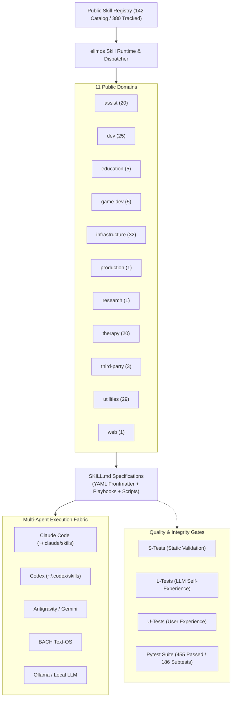
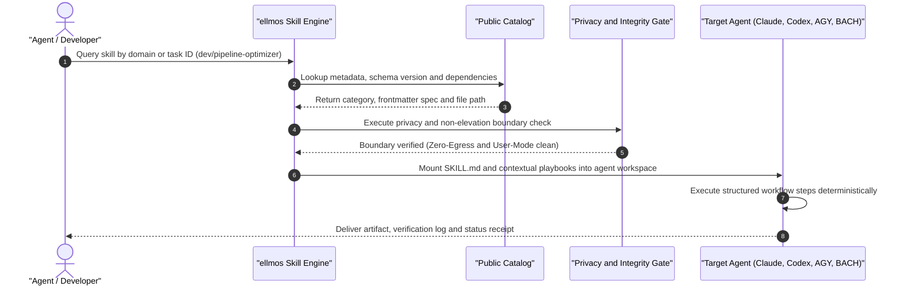

<!-- worldset: {"translated_from_sha256": "4ab293a207e54a644d9c9752dc6e9a7aa5f7c6e4acf6ae978671ca351a73091d", "translator": "claude-haiku-5-5", "translated_at": "2026-10-16T00:13:20.757759+00:00"} -->


<p align="center">
  <a href="README.md"></a>
  <a href="README_de.md"></a>
  <a href="README_es.md"></a>
  <a href="README_zh.md"></a>
  <a href="README_ja.md"></a>
  <a href="README_ru.md"></a>
  <a href="README_fr.md"></a>
  <a href="README_hi.md"></a>
  <a href="README_ar.md"></a>
  <a href="README_bn.md"></a>
  <a href="README_pt.md"></a>
</p>

# ellmos skills

**ग्यारह भाषाओं में दस्तावेज़ीकरण** · [मशीन-पठनीय संदर्भ](llms.txt) · **🗺️ [कौशल पुस्तकालय ऑनलाइन देखें](https://ellmos-ai.github.io/skills.html)** — ब्राउज़र में हर सार्वजनिक कौशल पढ़ें और कॉपी करें

> Claude Code-शैली `SKILL.md` वर्कफ़्लो, Codex-संगत एजेंट सेटअप, BACH, AGY/Gemini, और अन्य लोकल-फ़र्स्ट LLM एजेंट रनटाइम के लिए पोर्टेबल AI कौशल पुस्तकालय।

[](https://github.com/ellmos-ai/skills/actions/workflows/tests.yml)
[](pyproject.toml)
[](LICENSE)
[-success.svg)](testing/)
[](https://python.org)
[](SECURITY.md)
[](SECURITY.md)
[](SECURITY.md)
[](THIRD_PARTY_LICENSES.md)
[](MARKETING-LOG.txt)
[](https://github.com/ellmos-ai)
[](https://github.com/open-bricks)
[](registry/components.json)
[](SKILLS-MAP.md)
[](llms.txt)
[](NOTICE)
[](CONTRIBUTING.md)
[](MARKETING-LOG.txt)

> [!NOTE]
> **AI एजेंट और LLM एकीकरण:** यह रिपॉज़िटरी YAML फ्रंटमैटर वाली मानकीकृत `SKILL.md` फ़ाइलें प्रदान करता है, जिन्हें Claude Code, Codex, AGY/Gemini, और कस्टम एजेंट रनटाइम सीधे उपयोग कर सकते हैं। मशीन-पठनीय संदर्भ के लिए [`llms.txt`](llms.txt) देखें।

> [!IMPORTANT]
> **इसकी कॉपी पढ़ रहे हैं?** इस पुस्तकालय का प्रामाणिक, हमेशा अद्यतन संस्करण
> **[github.com/ellmos-ai/skills](https://github.com/ellmos-ai/skills)** पर है।
> फ़ोर्क और मिरर स्वचालित रूप से अपडेट नहीं होते और कई कमिट पीछे हो सकते हैं —
> यहाँ पढ़ी किसी भी चीज़ पर भरोसा करने से पहले स्रोत जाँच लें।

---

## त्वरित नेविगेशन

- [01. सिस्टम आर्किटेक्चर और त्वरित संदर्भ](#sec-01)
- [02. मल्टी-एजेंट कौशल खोज और निष्पादन जीवनचक्र](#sec-02)
- [03. लक्षित पर्सोना और खोजने योग्यता](#sec-03)
- [04. विकल्पों के साथ तुलनात्मक मैट्रिक्स](#sec-04)
- [05. ASCII चार-दृश्य आर्किटेक्चरल टोपोलॉजी](#sec-05)
- [06. यहाँ से शुरू करें और क्विकस्टार्ट प्लेबुक](#sec-06)
- [07. कैटलॉग स्नैपशॉट और डोमेन वितरण](#sec-07)
- [08. प्रमुख कौशल और वास्तविक-विश्व वर्कफ़्लो](#sec-08)
- [09. सार्वजनिक/निजी सीमा और अलगाव](#sec-09)
- [10. शिक्षा कौशल](#sec-10)
- [11. रिपॉज़िटरी संरचना और डायरेक्टरी लेआउट](#sec-11)
- [12. कौशल मेटाडेटा और फ्रंटमैटर संरचना](#sec-12)
- [13. सत्यापन और स्वचालित गुणवत्ता गेट](#sec-13)
- [14. खोज संदर्भ और उच्च-इरादा इंडेक्सिंग](#sec-14)
- [15. शासन और रनटाइम इनवेरिएंट मैट्रिक्स](#sec-15)
- [16. इकोसिस्टम और सहयोगी परियोजनाएँ](#sec-16)
- [17. तृतीय-पक्ष लाइसेंस, लेवल 1 SBOM और RunAsInvoker](#sec-17)
- [18. सुरक्षा नीति, § 521 BGB वैधानिक अस्वीकरण और 48h SLA](#sec-18)

---

यह रिपॉज़िटरी ellmos इकोसिस्टम की पुन: उपयोग योग्य कौशल कैटलॉग है। इसमें स्वतंत्र प्रक्रिया कौशल, विकास वर्कफ़्लो, शोध सहायक, थेरेपी-उन्मुख विधियाँ, इन्फ़्रास्ट्रक्चर प्लेबुक और उपयोगिता उपकरण Anthropic-संगत `SKILL.md` प्रारूप में शामिल हैं। हर कौशल अपना मेटाडेटा सीधे YAML फ्रंटमैटर में रखता है, इसलिए रनटाइम किसी केंद्रीय रजिस्ट्री के बिना उद्गम, संगतता और निर्भरताओं की जाँच कर सकते हैं।

<a id="sec-01"></a><a id="system-architecture"></a>
## 1. सिस्टम आर्किटेक्चर और त्वरित संदर्भ



<a id="sec-02"></a><a id="multi-agent-skill-discovery--execution-lifecycle"></a>
## 2. मल्टी-एजेंट कौशल खोज और निष्पादन जीवनचक्र



<a id="sec-03"></a><a id="target-personas--discoverability"></a>
## 3. लक्षित पर्सोना और खोजने योग्यता

`ellmos-skills` चार मुख्य तकनीकी पर्सोना को स्वायत्त एजेंट और प्लेटफ़ॉर्म इंजीनियरिंग के स्पेक्ट्रम में सेवा देता है:

### `[PERSONA-01]` स्वायत्त AI एजेंट और स्वार्म
- **प्रोफ़ाइल:** मल्टी-एजेंट फ़्रेमवर्क, ऑर्केस्ट्रेटर और स्वायत्त कोडिंग लूप (*Claude Code, AGY, Codex, BACH*)।
- **मुख्य समस्या:** भ्रमित (hallucinated) वर्कफ़्लो चरण, बिखरे हुए टूल, एजेंट सीमाओं के पार गैर-नियतात्मक कार्य निष्पादन, और स्टेट ड्रिफ़्ट।
- **`ellmos-skills` इसे कैसे हल करता है:** सख्त YAML फ्रंटमैटर, स्व-निहित प्लेबुक, नियतात्मक इनपुट/आउटपुट अनुबंध और कोल्ड-स्टार्ट पोर्टेबिलिटी वाला मानकीकृत `SKILL.md` प्रारूप।
- **मुख्य वर्कफ़्लो और कौशल:** `infrastructure/agents-bridge`, `dev/pipeline-optimizer`, `utilities/generalizer`, `infrastructure/work-autonomous`।

### `[PERSONA-02]` एंटरप्राइज़ DevOps और प्लेटफ़ॉर्म इंजीनियर
- **प्रोफ़ाइल:** इन्फ़्रास्ट्रक्चर आर्किटेक्ट और प्लेटफ़ॉर्म टीमें जो डेवलपर फ़्लीट, निर्धारित ऑटोमेशन और CI पाइपलाइन का प्रबंधन करती हैं।
- **मुख्य समस्या:** परिचालन रखरखाव को बार-बार नए सिरे से बनाना, नाज़ुक एड-हॉक स्क्रिप्ट, होस्ट के बीच समानता की कमी, और अव्यवस्थित रिपॉज़िटरी सफ़ाई।
- **`ellmos-skills` इसे कैसे हल करता है:** रीफ़ैक्टरिंग, Git स्वच्छता और पाइपलाइन अनुकूलन के लिए तैयार-से-माउंट, व्यवहार में परखे गए इंजीनियरिंग प्लेबुक, बिना विक्रेता टूल के जाल के।
- **मुख्य वर्कफ़्लो और कौशल:** `dev/project-bootstrapper`, `dev/pipeline-bootstrapper`, `utilities/folder-organization`, `dev/github-repo-care`।

### `[PERSONA-03]` लोकल-फ़र्स्ट, गोपनीयता और SecOps विशेषज्ञ
- **प्रोफ़ाइल:** विनियमित या एयर-गैप्ड वातावरण में सुरक्षा अधिकारी, अनुपालन ऑडिटर और गोपनीयता इंजीनियर।
- **मुख्य समस्या:** अनजाने में क्लाउड टेलीमेट्री लीक, असत्यापित ट्रांज़िटिव पैकेज, आपूर्ति-श्रृंखला की कमज़ोरियाँ, और एजेंट टूल में उन्नत निष्पादन विशेषाधिकार।
- **`ellmos-skills` इसे कैसे हल करता है:** सख़्त ज़ीरो-एग्रेस (`INV-LOCAL-01`), स्वचालित स्थैतिक गोपनीयता सीमा गेट (`testing/privacy_gate.py`), यूज़र-मोड निष्पादन (`RunAsInvoker`), 0% कॉपीलेफ़्ट, और लेवल 1 SBOM पारदर्शिता।
- **मुख्य वर्कफ़्लो और कौशल:** `infrastructure/privacy-gate`, `utilities/secret-redactor`, `SECURITY.md`, `THIRD_PARTY_LICENSES.md`।

### `[PERSONA-04]` डोमेन स्किल लेखक और शोध इंजीनियर
- **प्रोफ़ाइल:** AI शोधकर्ता, कार्यप्रणाली विशेषज्ञ और डोमेन विशेषज्ञ जो दोहराने योग्य एजेंट क्षमताएँ बनाते हैं।
- **मुख्य समस्या:** परंपराओं की कमी, बहु-भाषा प्रबंधन में असंगति, और कस्टम स्किल के लिए परीक्षण हार्नेस का अभाव।
- **`ellmos-skills` इसे कैसे हल करता है:** औपचारिक स्कीमा विनिर्देश (`docs/CONVENTIONS.md`), सार्वजनिक रजिस्ट्री जनरेटर (`registry/components.json`), और तीन-स्तरीय S/L/U परीक्षण ढाँचा।
- **मुख्य वर्कफ़्लो और कौशल:** `schemas/assist-v1.schema.json`, `docs/CONVENTIONS.md`, `testing/skill_tester.py`, `research/research-agent`।

### लक्ष्य व्यक्तित्व सारांश मैट्रिक्स

| व्यक्तित्व | मुख्य समस्या | `ellmos-skills` इसे कैसे हल करता है | मुख्य वर्कफ़्लो और कौशल |
|---|---|---|---|
| **स्वायत्त AI एजेंट और झुंड** *(Claude Code, AGY, Codex, BACH)* | भ्रामक वर्कफ़्लो चरण, खंडित टूल, और एजेंट सीमाओं के बीच गैर-नियतात्मक कार्य निष्पादन। | सख़्त YAML फ़्रंटमैटर, स्व-निहित प्लेबुक, और नियतात्मक इनपुट/आउटपुट अनुबंधों के साथ मानकीकृत `SKILL.md` प्रारूप। | `infrastructure/agents-bridge`, `dev/pipeline-optimizer`, `utilities/generalizer` |
| **एंटरप्राइज़ DevOps और प्लेटफ़ॉर्म इंजीनियर** | परिचालन रखरखाव को बार-बार नए सिरे से बनाना, नाज़ुक CI स्क्रिप्ट, और अव्यवस्थित रिपॉज़िटरी सफ़ाई। | रीफ़ैक्टरिंग, Git स्वच्छता और पाइपलाइन अनुकूलन के लिए तैयार-से-माउंट, व्यवहार में परखे गए इंजीनियरिंग प्लेबुक, बिना टूल के जाल के। | `dev/project-bootstrapper`, `dev/pipeline-bootstrapper`, `utilities/folder-organization` |
| **लोकल-फ़र्स्ट, गोपनीयता और SecOps विशेषज्ञ** | अनजाने में क्लाउड डेटा लीक, असत्यापित ट्रांज़िटिव पैकेज, और एजेंट टूल में उन्नत निष्पादन विशेषाधिकार। | सख़्त ज़ीरो-एग्रेस (`INV-LOCAL-01`), स्वचालित गोपनीयता सीमा गेट, यूज़र-मोड निष्पादन (`RunAsInvoker`), और 0% कॉपीलेफ़्ट। | `infrastructure/privacy-gate`, `utilities/secret-redactor`, `SECURITY.md` |
| **डोमेन स्किल लेखक और शोध इंजीनियर** | परंपराओं की कमी, बहु-भाषा प्रबंधन में असंगति, और कस्टम स्किल के लिए परीक्षण हार्नेस का अभाव। | औपचारिक स्कीमा विनिर्देश (`docs/CONVENTIONS.md`), सार्वजनिक रजिस्ट्री जनरेटर (`registry/components.json`), और S/L/U परीक्षण ढाँचा। | `schemas/assist-v1.schema.json`, `docs/CONVENTIONS.md`, `testing/skill_tester.py` |

### उच्च-इरादे खोज कीवर्ड मैट्रिक्स

| श्रेणी | प्राथमिक खोज शब्द (अंग्रेज़ी) | Relevanz & Suchbegriffe (Deutsch) |
|---|---|---|
| **एजेंट फ़्रेमवर्क** | `claude code skills`, `codex agent skills`, `anthropic skill md standard`, `agy gemini agent skills` | `Claude Code Skills`, `Codex Agenten Skills`, `Anthropic SKILL.md Standard`, `Gemini Agenten Skills` |
| **स्किल आर्किटेक्चर** | `portable ai skills`, `reusable agent playbooks`, `agent skill library`, `deterministic llm workflows` | `Portable KI Fähigkeiten`, `Wiederverwendbare Agenten Playbooks`, `KI Skill Bibliothek`, `Deterministische Workflows` |
| **गोपनीयता और सुरक्षा** | `zero-egress ai skills`, `local-first agent library`, `fail-closed privacy gate`, `user-mode agent execution` | `Zero-Egress KI Skills`, `Lokale Agenten Bibliothek`, `Fail-Closed Datenschutz Gate`, `Unprivilegierte Ausführung` |
| **इकोसिस्टम और कैटलॉग** | `bach skill catalog`, `multi-agent skill library`, `offline ai tools`, `open source agent skills` | `BACH Skill Katalog`, `Multi-Agenten Skill Bibliothek`, `Offline KI Werkzeuge`, `Open Source Agenten Skills` |

<!-- lang-only: zh -->
चीनी उपयोगकर्ता [Skills宝](https://skilery.com) के माध्यम से भी स्किल खोज और इंस्टॉल कर सकते हैं।
<!-- /lang-only -->

<a id="sec-04"></a><a id="comparative-matrix-vs-alternatives"></a>
## 4. विकल्पों के साथ तुलनात्मक मैट्रिक्स

`ellmos-skills` एक विक्रेता-तटस्थ, पोर्टेबल स्किल मानक प्रदान करता है जो लोकल-फ़र्स्ट, बहु-एजेंट संचालन के लिए अनुकूलित है। निम्नलिखित मैट्रिक्स दस महत्वपूर्ण आयामों में इसकी सामान्य आर्किटेक्चरल दृष्टिकोणों से तुलना दर्शाता है:

| मूल्यांकन आयाम | `ellmos-skills` | Ad-Hoc System Prompts | Tool/Function Calling Only | Centralized Cloud Hubs | Heavyweight Frameworks (LangChain/CrewAI) |
|---|:---:|:---:|:---:|:---:|:---:|
| **1. 100% Local-First & Zero-Egress** | **PASS** (शून्य टेलीमेट्री) | **PASS** (स्थानीय टेक्स्ट) | ⚠️ API प्रदाता पर निर्भर | ❌ क्लाउड खाता और टेलीमेट्री आवश्यक | ⚠️ जटिल निर्भरताएँ और टेलीमेट्री जोखिम |
| **2. Standardized Format (`SKILL.md`)** | **PASS** (Anthropic मानक + YAML) | ❌ फ्रीफ़ॉर्म असंरचित टेक्स्ट | ❌ केवल JSON schema, कोई playbook नहीं | ⚠️ विक्रेता-विशिष्ट manifests | ❌ Python/JS कोड अमूर्तन |
| **3. Multi-Agent Portability** | **PASS** (Claude, Codex, AGY, BACH) | ⚠️ प्रॉम्प्ट विभिन्न मॉडलों में भटकते हैं | ⚠️ प्रति प्रदाता कस्टम रैपर | ❌ मालिकाना क्लाउड तक सीमित | ⚠️ फ्रेमवर्क-विशिष्ट लॉक-इन |
| **4. Step-by-Step Playbooks** | **PASS** (संरचित चरण और गेट्स) | ❌ निर्देशों के पालन में असंगति | ❌ केवल एकल-चरण टूल निष्पादन | ⚠️ लेखक के अनुसार व्यापक रूप से भिन्न | ⚠️ Python DAG तर्क आवश्यक |
| **5. Privacy & Leakage Gates** | **PASS** (स्वचालित स्थैतिक गेट) | ❌ कोई नहीं | ❌ कोई नहीं | ⚠️ केवल क्लाउड मॉडरेशन फ़िल्टर | ❌ अंतर्निहित कोई नहीं |
| **6. Automated Test Suite** | **PASS** (455 Pytest परीक्षण, 186 subtests, 100% सफल) | ❌ अपरीक्षित | ⚠️ केवल API कॉल के लिए यूनिट परीक्षण | ❌ कोई सार्वजनिक परीक्षण हार्नेस नहीं | ⚠️ केवल फ्रेमवर्क यूनिट परीक्षण |
| **7. Multi-OS CI Parity** | **PASS** (Linux, Windows, macOS) | N/A | ⚠️ प्रदाता-निर्भर | ❌ होस्टेड सेवा | ⚠️ OS संगतता संबंधी अनियमितताएँ |
| **8. Machine-Readable Catalog** | **PASS** (`registry/components.json`) | ❌ अनुक्रमित नहीं | ❌ केवल डायनामिक API introspection | ⚠️ मालिकाना API क्वेरी | ❌ कोड मॉड्यूल इम्पोर्ट |
| **9. Open-Source & 0% Copyleft** | **PASS** (100% MIT लाइसेंस) | N/A | N/A | ❌ मालिकाना प्लेटफ़ॉर्म शर्तें | ⚠️ लाइसेंसों का मिश्रण |
| **10. Zero External Runtime Deps** | **PASS** (केवल Python stdlib) | **PASS** | ⚠️ HTTP/JSON लाइब्रेरी आवश्यक | ❌ क्लाउड क्लाइंट SDK आवश्यक | ❌ विशाल निर्भरता वृक्ष |

<a id="sec-05"></a><a id="ascii-topology"></a><a id="architectural-topology"></a>
## 5. ASCII चार-दृश्य वास्तुकला टोपोलॉजी

```text
+----------------------------------------------------------------------------------------------------+
| VIEW 1: RUNTIME DISPATCH & DISCOVERY PLANE                                                         |
|                                                                                                    |
|  [ Operator / LLM Agent ]                                                                          |
|            |                                                                                       |
|            v (Task Intent / Query)                                                                 |
|  +----------------------------------------------------------------------------------------------+  |
|  | ellmos Skill Runtime & Dispatcher (Pure Python Stdlib)                                        |  |
|  |  * Category Resolver     * Frontmatter Validator    * Dependency & Provenance Introspector   |  |
|  +----------------------------------------------------------------------------------------------+  |
|            |                                            |                                          |
|            v (Discovery Query)                          v (Catalog Index Readback)                 |
|  +-----------------------------------+        +-------------------------------------------------+  |
|  | Public Catalog Registry           |        | llms.txt & Context Index                        |  |
|  | (registry/components.json: 142)   |        | (Machine-readable markdown & category hierarchy)|  |
|  +-----------------------------------+        +-------------------------------------------------+  |
+----------------------------------------------------------------------------------------------------+
| VIEW 2: MULTI-AGENT CLIENT INTEGRATION LAYER                                                       |
|                                                                                                    |
|  [ Claude Code ]      [ OpenAI Codex ]      [ Antigravity / Gemini ]     [ BACH Text-OS / Local ]  |
|  (~/.claude/skills)   (~/.codex/skills)     (~/.gemini/.../skills)       (system/skills/...)       |
|         \                   |                        |                          /                  |
|          +------------------+------------------------+-------------------------+                   |
|                             | Uniform Materialization                                              |
|                             v                                                                      |
|  +----------------------------------------------------------------------------------------------+  |
|  | Standardized SKILL.md Execution Surface                                                      |  |
|  |  * Anthropic YAML Frontmatter Contract   * Step-by-Step Playbooks   * S/L/U Verification Gates  |  |
|  +----------------------------------------------------------------------------------------------+  |
+----------------------------------------------------------------------------------------------------+
| VIEW 3: GOVERNANCE & SECURITY BOUNDARY (FAIL-CLOSED)                                               |
|                                                                                                    |
|  +----------------------------------------------------------------------------------------------+  |
|  | Static Privacy Gate (testing/privacy_gate.py)                                                 |  |
|  |  * Zero-Egress Assertion (INV-LOCAL-01)          * Non-Elevation / RunAsInvoker (INV-UNPRIV-03) |  |
|  |  * Rejection of Concrete User Homes & Hostnames * Rejection of API Keys, Tokens & Private Data |  |
|  +----------------------------------------------------------------------------------------------+  |
|            |                                            |                                          |
|            v (Compliance Audit)                         v (Public/Private Boundary)                |
|  +-----------------------------------+        +-------------------------------------------------+  |
|  | Level 1 SBOM Invariant Matrix     |        | No-Push Boundary Separation                     |  |
|  | (THIRD_PARTY_LICENSES.md/.txt)    |        | (Public generic methods vs Private profiles)    |  |
|  +-----------------------------------+        +-------------------------------------------------+  |
+----------------------------------------------------------------------------------------------------+
| VIEW 4: DOMAIN TOPOLOGY & SKILL ASSET ANATOMY                                                      |
|                                                                                                    |
|  skills/                                                                                           |
|  +-- assist/ (20)        +-- dev/ (25)            +-- education/ (5)       +-- game-dev/ (5)       |
|  +-- infrastructure/ (32)+-- production/ (1)      +-- research/ (1)        +-- therapy/ (20)       |
|  +-- third-party/ (3)    +-- utilities/ (29)      +-- web/ (1)                                     |
|                                                                                                    |
|  [ Individual Skill Anatomy ]:                                                                     |
|  +-- SKILL.md (Frontmatter + Playbook)   +-- scripts/ (Helpers)   +-- references/ (Evidence/Docs)  |
+----------------------------------------------------------------------------------------------------+
```

<a id="sec-06"></a><a id="start-here"></a><a id="quick-start"></a>
## 6. यहाँ से शुरू करें और त्वरित प्रारंभ प्लेबुक

| आवश्यकता | फ़ाइल या कमांड |
|---|---|
| सभी सार्वजनिक skills देखें | [`skills/`](skills/) |
| हर ट्रैक किए गए skill का ट्री मानचित्र देखें | [`SKILLS-MAP.md`](SKILLS-MAP.md) |
| `SKILL.md` स्कीमा समझें | [`docs/CONVENTIONS.md`](docs/CONVENTIONS.md) |
| मशीन-पठनीय कैटलॉग इंडेक्स | [`registry/components.json`](registry/components.json) |
| सुरक्षा नीति और सीमा गारंटी | [`SECURITY.md`](SECURITY.md) |
| Level 1 SBOM सादा-पाठ सहचर | [`THIRD_PARTY_LICENSES.txt`](THIRD_PARTY_LICENSES.txt) |
| औपचारिक कॉपीराइट और श्रेय सूचना | [`NOTICE`](NOTICE) |
| श्रेणी के अनुसार ब्राउज़ करें | [`skills/`](skills/) (प्रत्येक श्रेणी के लिए एक उपफ़ोल्डर) |
| एक skill का उपयोग करें | `skills/<category>/<name>/` को अपनी एजेंट की skills डायरेक्टरी में कॉपी करें (उदा. `~/.claude/skills/`) |
| सार्वजनिक परिवर्तनों की समीक्षा करें | [`CHANGELOG.md`](CHANGELOG.md) |
| क्रॉलर और LLM एजेंटों को संक्षिप्त मानचित्र दें | [`llms.txt`](llms.txt) |

<a id="sec-07"></a><a id="catalog-snapshot"></a>
## 7. कैटलॉग स्नैपशॉट और डोमेन वितरण

वर्तमान सार्वजनिक कैटलॉग में 142 सार्वजनिक runtime skills हैं (स्थानीय सूटों में 380 ट्रैक किए गए):

| श्रेणी | संख्या | फ़ोकस |
|---|---:|---|
|  `assist` | 20 | कार्यालय कार्य, नोट्स, घरेलू योजना, संपर्क, स्वास्थ्य-जानकारी संगठन, मीडिया और इन्वेंटरी निर्यात, वॉइस वर्कफ़्लो, यात्रा, मौसम, कैलेंडर और ट्रांस्क्रिप्शन के लिए उपयोगकर्ता-तटस्थ विधियाँ |
|  `dev` | 25 | विकास प्रोटोकॉल, डिबगिंग, बग स्वीप, पाइपलाइन नवीनीकरण, माइग्रेशन, दस्तावेज़ीकरण, प्लगइन सिस्टम और रिपॉज़िटरी प्रकाशन |
|  `education` | 5 | शैक्षणिक योजना, स्रोत-आधारित शिक्षण, परीक्षा तैयारी, वर्कशीट निर्माण और उपयोगकर्ता-तटस्थ शिक्षण व सहायता योजना |
|  `game-dev` | 5 | Blender, Roblox, Rojo, Studio, एसेट सुरक्षा और गेम-डिज़ाइन वर्कफ़्लो |
|  `infrastructure` | 32 | पोर्टेबल AI सेटअप, सिस्टम ऑनबोर्डिंग, skill परिदृश्य प्रबंधन, स्वचालन स्व-देखभाल, सिमेंटिक persona routing, प्रदाता-तटस्थ कॉन्फ़िग सिंक और एजेंट बूट ब्रिज |
|  `production` | 1 | टेक्स्ट उत्पादन राउटर: सामान्य पाठ, कथात्मक कहानियाँ, स्थानीय LaTeX प्रेस-रिलीज़ कंपाइलर के साथ PR |
|  `research` | 1 | शोध-एजेंट वर्कफ़्लो सहायता |
|  `therapy` | 20 | जर्मन-भाषा मनोशिक्षा और परामर्श विधि प्लेबुक |
| `third-party` | 3 | सत्यापित लाइसेंसों के तहत पुनर्वितरित, क्यूरेटेड बाहरी रूप से लिखित skills |
|  `utilities` | 29 | बैच ऑपरेशन, विचार ढाँचे, निर्णय ब्रीफ़िंग, दस्तावेज़ चंकिंग, एन्कोडिंग मरम्मत, वीडियो ट्रांस्क्रिप्ट, निजी-मेल ड्राफ़्टिंग, नौकरी-आवेदन सहायता, उपयोगकर्ता-मॉडल टूलिंग, और जर्मन-कानून तथा जर्मन-कर के प्रथम-दृष्टि पॉइंटर skills |
|  `web` | 1 | वेब-पठन प्रोटोकॉल सहायता |

<a id="sec-08"></a><a id="featured-skills"></a>
## 8. अनुशंसित skills और वास्तविक-विश्व वर्कफ़्लो

कुछ skills प्रवेश बिंदु के रूप में विशेष रूप से उपयोगी हैं क्योंकि वे अन्य टूल्स का समन्वय करते हैं, गड़बड़ एजेंट वर्कफ़्लो को रोकते हैं, या स्थानीय प्रक्रियाओं को दोहराने योग्य playbooks में बदलते हैं:

| Skill | Why it stands out |
|---|---|
|  [`skill-explorer`](skills/infrastructure/skill-explorer/SKILL.hi.md) | स्किल-परिदृश्य के प्रबंधन के लिए मेटा-स्किल: मौजूदा स्किलों का ऑडिट करती है, उन्हें परिवारों में समूहित करती है, बाहरी स्किलों/प्लगइनों की खोज करती है, और केवल सुरक्षा समीक्षा तथा स्पष्ट स्वीकृति के बाद ही इंस्टॉल करती है। |
|  [`model-strategy`](skills/dev/model-strategy/SKILL.hi.md) | Claude, Codex, Gemini और Ollama के लिए मल्टी-मॉडल रूटिंग, जिसमें स्कोर-आधारित चयन, डेलिगेशन पथ, एस्केलेशन ट्रिगर और लागत/गुणवत्ता के समझौते शामिल हैं। |
|  [`pipeline-optimizer`](skills/dev/pipeline-optimizer/SKILL.hi.md) | मौजूदा प्रोजेक्ट फ़ोल्डरों, दस्तावेज़ीकरण प्रणालियों और सॉफ़्टवेयर स्टैकों के लिए छह-चरणीय नवीनीकरण प्रोटोकॉल; इसे डुप्लिकेट मानकों और टूटे हुए वर्कफ़्लो से बचने के लिए डिज़ाइन किया गया है। |
|  [`github-repo-care`](skills/dev/github-repo-care/SKILL.hi.md) | GitHub रिपॉज़िटरी के लिए प्रकाशन और रखरखाव गेट: स्थानीय नियम, लॉक, `.gitignore`, गोपनीयता जाँच, README/i18n, रिलीज़ और रिपॉज़िटरी मेटाडेटा। |
|  [`mcp-config-sync`](skills/infrastructure/mcp-config-sync/SKILL.hi.md) | प्रदाता-निरपेक्ष MCP खोज और सिंक योजना, जो उपयोगकर्ता द्वारा चुने गए प्रदाताओं और ऐप वर्गों में काम करती है; कोई निहित हब नहीं। |
|  [`video-transcriber`](skills/utilities/video-transcriber/SKILL.hi.md) | वीडियो सबटाइटल/ट्रांसक्रिप्ट के साथ मेटाडेटा (YouTube स्रोतों का समर्थन) को Markdown, JSON या सादे टेक्स्ट में निकालती है, ताकि वीडियो विश्लेषण स्रोत-आधारित टेक्स्ट से शुरू हो। |
|  [`rbx-studio`](skills/game-dev/rbx-studio/SKILL.hi.md) | Roblox Studio संचालन: Explorer/Play-Test वर्कफ़्लो, Rojo दृश्य-बनाम-कोड कनेक्शन, MCP के माध्यम से Studio का AI नियंत्रण, और Creator Store एसेट्स के लिए अनिवार्य मैलवेयर स्कैन। |
|  [`decision-briefing`](skills/utilities/decision-briefing/SKILL.hi.md) | कई खुले निर्णयों को सिफ़ारिशों के साथ क्रमांकित A/B/C/D ब्रीफ़िंग में बदलती है, बैच उत्तर स्वीकार करती है और चुने गए परिणाम दर्ज करती है। |
|  [`bugsweep`](skills/dev/bugsweep/SKILL.hi.md) | कोडबेस के आकार के अनुसार लक्ष्य संख्या, दोगुनी एस्केलेशन, क्षेत्र-ट्रैकिंग और पूर्णता सत्यापन वाला व्यवस्थित बग-स्वीप प्रोटोकॉल; यह अनियोजित बग-खोज को दोहराने योग्य और मापने योग्य पास में बदल देता है। |
|  [`plugin-system`](skills/dev/plugin-system/SKILL.hi.md) | Python अनुप्रयोगों के लिए सामान्य स्वतः-खोज प्लगइन प्रणाली: शून्य निर्भरताएँ (केवल stdlib), सत्यापन और दोष-सहिष्णुता, ताकि आपकी अपनी स्क्रिप्ट्स को प्लगेबल आर्किटेक्चर में बदला जा सके। |
|  [`bilingual-doc-sync`](skills/utilities/bilingual-doc-sync/SKILL.hi.md) | समानांतर-भाषा दस्तावेज़ों (शोधपत्र, READMEs, `SKILL.md`/`SKILL.en.md` जोड़े) को सिंक में रखती है: गायब अनुवादों और अनुभाग-विचलन का पता लगाती है, साथ ही यह भी आँकती है कि किसी दस्तावेज़ को और भाषाओं की आवश्यकता है या नहीं। |
|  [`law-checker`](skills/utilities/law-checker/SKILL.hi.md) | स्वतंत्र `ellmos-ai/law-checker` मॉड्यूल का पॉइंटर स्किल: जर्मन कानून के लिए स्रोत-आधारित AI प्रारंभिक कानूनी आकलन, जिसमें कानून रजिस्ट्री और कानून-मूर्त एजेंट है — केवल AI अभिविन्यास, किसी वकील का विकल्प नहीं। |
|  [`steuer-assistent`](skills/utilities/steuer-assistent/SKILL.hi.md) | स्वतंत्र `ellmos-ai/steuer-assistent` मॉड्यूल का पॉइंटर स्किल: जर्मन कर्मचारियों के आय-संबंधित व्यय (Werbungskosten) के लिए ऑफ़लाइन-प्राथमिक स्थानीय वर्कशीट — कर सलाह नहीं, कर-रिटर्न दाखिल नहीं। |
|  [`worksheet-generator`](skills/education/worksheet-generator/SKILL.hi.md) | स्वतंत्र `ellmos-ai/worksheet-generator` मॉड्यूल का पॉइंटर स्किल: शैक्षिक/चिकित्सीय पेशेवरों के लिए सहायता लक्ष्य, स्तर और आयु के आधार पर व्यक्तिगत वर्कशीट बनाती है, साथ में अपने ICF संदर्भ लाने का विकल्प — यह एक सामग्री जनरेटर है, थेरेपी कार्यक्रम नहीं। |
|  [`research-agent`](skills/research/research-agent/SKILL.hi.md) | PubMed और arXiv के आसपास स्वयं-निहित वैज्ञानिक साहित्य वर्कफ़्लो (केवल pure Python stdlib) — अनियोजित शोधपत्र-खोज को दोहराने योग्य, स्रोत-आधारित शोध पास में बदलता है, ellmos पारिस्थितिकी तंत्र के बिना पूरी तरह पोर्टेबल। |
|  [`agent-config-sync`](skills/infrastructure/agent-config-sync/SKILL.hi.md) | प्रदाता/ऐप वर्ग सतहों की खोज करती है और उपयोगकर्ता द्वारा चुने गए MCP, स्किल और नियम-फ़ाइल सत्य-टोपोलॉजी की योजना बनाती है। |
|  [`agents-bridge`](skills/infrastructure/agents-bridge/SKILL.hi.md) | पोर्टेबल प्रदाता-निरपेक्ष फ़ाइल ब्रिज: स्पष्ट बूट/सत्य ग्राफ़, अलग मेमोरी सिलोज़, मैसेजिंग, प्रेज़ेंस और लॉक को कैप्चर करती है, फिर गोपनीयता-गेटेड इंस्टेंस पैकेज का पूर्वावलोकन, पुनर्स्थापन, सत्यापन या रोलबैक करती है। |
|  [`automation-self-care`](skills/infrastructure/automation-self-care/SKILL.hi.md) | निर्धारित LLM कार्यों और डेस्कटॉप-ऐप स्वचालनों के लिए प्रदाता-निरपेक्ष रखरखाव कोर सेट बनाती है, जिसमें नेटिव रीडबैक, रोलबैक और क्रॉस-सिस्टम कवरेज शामिल है। |
|  [`semantic-persona-routing`](skills/infrastructure/semantic-persona-routing/SKILL.hi.md) | अनुरोधों को कोऑर्डिनेटर भूमिकाओं, विशेषज्ञों और सत्यापित लाइव स्किल एंडपॉइंट्स के माध्यम से रूट करती है, जबकि पर्सोना ओवरले को क्षमताओं और अनुमतियों से अलग रखती है। |
|  [`build-your-users-mind`](skills/utilities/build-your-users-mind/SKILL.hi.md) | अधिकृत अनुभवजन्य प्राथमिकता मॉडल बनाने के लिए सार्वजनिक, उपयोगकर्ता-तटस्थ पॉइंटर; व्यक्तिगत प्रोफ़ाइल और साक्ष्य निजी रहते हैं। |
|  [`dev-soft-agent`](skills/dev/dev-soft-agent/SKILL.hi.md) | शून्य-निर्भरता Python में स्वतंत्र डेवलपमेंट-ऑटोमेशन पाइपलाइन (कोड विश्लेषण, टास्क इंजन, नीतियाँ, प्रॉम्प्ट टेम्पलेट) — बाहरी सेवाओं के बिना एक पूर्ण dev-agent वर्कफ़्लो। |
|  [`llm-text-hygiene`](skills/utilities/llm-text-hygiene/SKILL.hi.md) | तैयार पाठों से AI के निशान और चैट अवशेष हटाती है और AI-प्रकटीकरण स्तरों को संभालती है — प्रकाशित दस्तावेज़ों को LLM कलाकृतियों से साफ़ रखती है। |
|  [`idea-mining`](skills/utilities/idea-mining/SKILL.hi.md) | अटकी हुई समस्याओं से विचार निकालने की विशिष्ट बहु-तकनीक विधि — जब कोई परियोजना दीवार से टकरा जाए, तब मुक्त-रूप ब्रेनस्टॉर्मिंग का संरचित विकल्प। |
|  [`skill-extractor`](skills/infrastructure/skill-extractor/SKILL.hi.md) | चैट इतिहास (वर्तमान सत्र या ट्रांसक्रिप्ट फ़ाइलें) से पुन: उपयोग योग्य स्किल निकालती है — जो अभी काम किया, उसे पोर्टेबल प्लेबुक में बदलती है, या साक्ष्य के आधार पर मौजूदा स्किल को सुधारती है। |
|  [`workflow-extract`](skills/infrastructure/workflow-extract/SKILL.hi.md) | चैट इतिहास से या किसी अन्य एजेंट सिस्टम के मौजूदा ऑटोमेशन प्रॉम्प्ट से स्वचालन बनाती है — बातचीत दोहराए जाने योग्य वर्कफ़्लो बन जाती है। |
|  [`ai-portable-setup`](skills/infrastructure/ai-portable-setup/SKILL.hi.md) | USB स्टिक या किसी भी ड्राइव पर पोर्टेबल ऑफ़लाइन AI कार्य-वातावरण बनाती है: स्थानीय LLM मॉडल और RAG पाइपलाइन, कोई क्लाउड आवश्यक नहीं। |
|  [`bewerbungsexperte`](skills/utilities/bewerbungsexperte/SKILL.hi.md) | नौकरी-आवेदन के लिए एंड-टू-एंड सहायता: जॉब-विज्ञापन विश्लेषण, CV/LinkedIn अनुकूलन, कवर लेटर, साथ ही डेटाबेस/फ़ोल्डर-आधारित ASCII CV जेनरेटर (जर्मन-भाषा पर केंद्रित)। |
|  [`therapy/` collection](skills/therapy/) | 19-स्किल थेरेपी परिवार (मुख्य: [`cognitive-restructuring`](skills/therapy/cognitive-restructuring/SKILL.hi.md), [`motivational-interviewing`](skills/therapy/motivational-interviewing/SKILL.hi.md)) — साक्ष्य-उद्धृत, द्विभाषी, नैतिकता-गेटेड मनोशिक्षा और परामर्श विधि प्लेबुक; लाइब्रेरी का सबसे गहरा सुसंगत खंड। |
|  [`lebende-verfassung`](skills/utilities/lebende-verfassung/SKILL.hi.md) | संचालित संवैधानिक अधिरोपण ('Position of the Unborn'): 5-CORE समीक्षा आर्किटेक्चर और अनिवार्य प्रतितथ्यात्मक विश्लेषण के माध्यम से भविष्य और अजन्मी पीढ़ियों को अल्पकालिक वर्तमान-कालीन अनुकूलनों के विरुद्ध औपचारिक एल्गोरिथमिक रॉल्सियन वीटो अधिकार देती है। |
|  [`work-autonomous`](skills/infrastructure/work-autonomous/SKILL.hi.md) | एजेंटिक सुस्ती के विरुद्ध प्रमाण-आधारित गैर-समाप्ति प्रोटोकॉल (WAAFAP): स्वायत्त लूप को समाप्त करने के लिए कार्य-अनुपस्थिति के खंडनीय प्रमाण की आवश्यकता होती है, इस प्रकार स्टॉपिंग शर्त उलटी जाती है ('quit requires proof of inactivity')। |
|  [`piggyback-hosting`](skills/dev/piggyback-hosting/SKILL.hi.md) | शून्य-स्टेट गोपनीयता तैनाती पैटर्न (Huckepack-Hosting): SQLite-WASM/OPFS के माध्यम से विज़िटर के ब्राउज़र में क्लाइंट-साइड BYOK के साथ रिलेशनल SQLite चलाती है, डिज़ाइन द्वारा सर्वर डेटाबेस, उपयोगकर्ता खाते और GDPR दायित्व समाप्त करती है। |
|  [`software-in-worten`](skills/dev/software-in-worten/SKILL.hi.md) | द्विदिशीय UI-प्रॉम्प्ट संश्लेषण ('The click is the prompt'): टाइप्ड ASCII ब्लूप्रिंट प्रारूप जिसमें 4D एलिमेंट लीजेंड है, जो फ्रंटएंड बिल्ड चरण की आवश्यकता के बिना GUI डिज़ाइन और एजेंट निर्देशों को जोड़ता है। |
|  [`metacognitive-injectors`](skills/infrastructure/metacognitive-injectors/SKILL.hi.md) | तंत्रिका-मनोवैज्ञानिक कार्यकारी नियंत्रण कार्य (Miyake निषेध, कार्यशील स्मृति बफ़र, मानसिक पूर्वाभ्यास) को चापलूसी और समय-पूर्व समाप्ति रोकने के लिए एजेंट रनटाइम प्रीफ़्लाइट जाँच में एकीकृत किया गया है। |
|  [`paveman`](skills/utilities/paveman/SKILL.hi.md) | निर्धारक, मॉडल-मुक्त नियम संपीड़न: LLM अनुमान, मतिभ्रम या अर्थ-विचलन के बिना बड़ी Markdown नियम और मेमोरी फ़ाइलों को टोकन मात्रा में 40% तक कम करता है। |
|  [`wayfinding-routing`](skills/infrastructure/wayfinding-routing/SKILL.hi.md) | दिशाहीन AI एजेंटों के लिए सार्वभौमिक नौवहन प्रोटोकॉल (Celestial Fix, Dead Reckoning): संदर्भ-बहाव या लूप में फँसने पर पुनर्प्राप्ति ह्यूरिस्टिक्स और स्थिति पुनर्निर्माण प्रदान करते हैं। |
|  [`condition`](skills/infrastructure/condition/SKILL.hi.md) | प्रॉम्प्ट के लिए घोषणात्मक शर्त-गेट DSL: पूर्व-शर्तों, मील के पत्थरों और क्रम-निर्भरताओं को मानक Markdown के भीतर फ़ेल-क्लोज़्ड गेट्स में समाहित करती है। |
|  [`letter-hooker`](skills/infrastructure/letter-hooker/SKILL.hi.md) | हुक-रहित CLI एजेंटों के लिए प्रीफ़्लाइट बूटलोडर: नेटिव JSON इवेंट हुक की आवश्यकता के बिना टर्न से पहले शासन नियम, मेमोरी ट्रैवर्सल और स्व-उपचार संदर्भ डालता है। |
|  [`pingpong`](skills/infrastructure/pingpong/SKILL.hi.md) | साझा सिंक्ड फ़ोल्डरों पर सत्र-सीमित रेडियो स्टेशन: असममित भूमिकाओं (`ListenSync` श्रोता बनाम `WriteSync` डेल्टा प्रेषक) को अलग करता है, केंद्रीय सर्वरों के बिना अतुल्यकालिक बहु-एजेंट समन्वय के लिए। |
|  [`choose-your-orchestrator`](skills/infrastructure/choose-your-orchestrator/SKILL.hi.md) | बहु-एजेंट कार्य के लिए सत्र-अनुबंध वार्ताकार: निष्पादन शुरू होने से पहले ऑर्केस्ट्रेशन टोपोलॉजी, समवर्तीता, मॉडल स्लॉट और एस्केलेशन ट्रिगर को सीमित करता है। |
|  [`reissverschluss-merge`](skills/dev/reissverschluss-merge/SKILL.hi.md) | अत्यधिक विचलित शाखाओं के लिए ज़िपर मर्ज प्रोटोकॉल: निर्णय तालिका का उपयोग करके अनुभाग-दर-अनुभाग तुलना करता है, जिसका अंतिम एस्केलेशन चरण इरादा-पुनर्निर्माण ('merge के बजाय rebuild') है। |
|  [`migrate-rename`](skills/dev/migrate-rename/SKILL.hi.md) | रैपर और MOVED स्टब्स के साथ क्रमिक फ़ाइल और मॉड्यूल नामकरण: एजेंट फ्लीट्स में ब्रेकिंग परिवर्तन रोकता है, जबकि संदर्भ उपयोग के माध्यम से स्वाभाविक रूप से अद्यतन होते हैं। |
|  [`projekt-pipeline-umbrella`](skills/dev/projekt-pipeline-umbrella/SKILL.hi.md) | वर्गीकरणात्मक 2x2 पाइपलाइन कम्पास (Greenfield बनाम Brownfield x Project बनाम Pipeline): LLM स्कैफ़ोल्डिंग पूर्वाग्रह को रोकता है, सही ऑनबोर्डिंग, बूटस्ट्रैपर या नवीनीकरण स्किल की ओर रूट करता है। |
|  [`tidy-up`](skills/dev/tidy-up/SKILL.hi.md) | निर्धारक 3-भूमिका सत्र-समापन स्वच्छता लूप (Tasksolver, Writer, Maintainer): एजेंडा विस्तार के बिना लंबित तुच्छ कार्य हल करता है, दस्तावेज़ीकरण को मापे गए सत्य के साथ सिंक करता है, और आवारा फ़ाइलों को उलटा-योग्य रूप से संग्रहीत करता है। |
|  [`human-loop-audit`](skills/dev/human-loop-audit/SKILL.hi.md) | अतुल्यकालिक मानव-इन-द-लूप पाइपलाइनिंग: जब उपयोगकर्ता आइटम N का लाइव परीक्षण करता है, एजेंट आइटम N+1 को पहले से लॉन्च करता है और आइटम N-1 के लिए फ़िक्स वर्कर्स सौंपता है, जिससे निष्क्रिय प्रतीक्षा समय समाप्त होता है। |
|  [`folder-organization`](skills/utilities/folder-organization/SKILL.hi.md) | Cut-and-Clue का उपयोग करके सिमेंटिक फ़ाइलसिस्टम सफ़ाई: स्रोत पर मशीन-पठनीय पॉइंटर सुराग के साथ सक्रिय और पुरानी फ़ाइलों को अलग करती है, वर्गीकरण और ऑडिट लॉग को संरक्षित रखती है। |
|  [`iterative-bundle-selection`](skills/utilities/iterative-bundle-selection/SKILL.hi.md) | वैकल्पिक विषय-पूलों, फ़िल्टर चरणों और बार-बार पुनर्व्यवस्थित बंडलों के माध्यम से बड़ी उम्मीदवार सूचियों को चरणबद्ध रूप से घटाती है — स्किल, कार्य, विचार या फ़ाइलों को समूहों में चुनने, छानने या मिलाने के लिए, बाकी को स्थायी रूप से हटाए बिना। |

<a id="sec-09"></a><a id="publicprivate-boundary"></a>
## 9. सार्वजनिक/निजी सीमा और फ़ेल-क्लोज़्ड आइसोलेशन

सार्वजनिक स्किल फ़ोल्डरों में केवल पोर्टेबल विधियाँ और तटस्थ संसाधन होते हैं। ऐप- या होस्ट-विशिष्ट एडैप्टर, खाते, डेटाबेस, स्थानीय पथ, वास्तविक उपयोगकर्ता डेटा और व्यक्तिगत डिफ़ॉल्ट एक अलग निजी प्रोफ़ाइल या निजी फ़ोर्क में रहते हैं। रिपॉज़िटरी की गोपनीयता जाँच ठोस उपयोगकर्ता-होम पथों, ज्ञात निजी होस्टों, टोकन पैटर्न और गलती से ट्रैक की गई अनदेखी फ़ाइलों को अस्वीकार करती है।

`foerderplaner` इस मॉडल का स्पष्ट रूप से पालन करता है: सार्वजनिक स्किल केवल शिक्षण और सहायता योजना को कवर करता है। सामान्य रिपोर्ट निर्माण एक अलग सार्वजनिक प्रोजेक्ट है, [`report-forge`](https://github.com/ellmos-ai/report-forge)। व्यक्तिगत सहायता-रिपोर्ट टेम्पलेट और प्रोफ़ाइल इस रिपॉज़िटरी का हिस्सा नहीं हैं।

यही सीमा अन्यत्र भी लागू होती है: `build-your-users-mind` और `decision-avatar` सार्वजनिक उपयोगकर्ता-मॉडल कोर हैं; नामित व्यक्तिगत अवतार निजी रहते हैं। स्टोर-वेव ऑपरेटर वर्कफ़्लो केवल निजी हैं और उन्हें शिप नहीं किया जाता। `law-checker` सार्वजनिक कानूनी अभिविन्यास मॉड्यूल है; निजी कानूनी-विभाग वर्कफ़्लो शिप नहीं किए जाते।

सार्वजनिक कैटलॉग में केवल Ellmos-लेखित स्किल होते हैं। तृतीय-पक्ष स्किल Ellmos लेखक नाम के तहत पुनः प्रकाशित नहीं किए जाते। सार्वजनिक [`registry/components.json`](registry/components.json) इसलिए एक न्यूनतम खोज सूचकांक है; आंतरिक स्वामित्व मूल्यांकन, गोपनीयता वर्गीकरण और पूर्ण मेंटेनर रजिस्ट्री एक अलग No-Push रिपॉज़िटरी में रहते हैं। इसका गैर-चक्रीय स्रोत अधिकार संस्करणित [`registry/public-skill-files.json`](registry/public-skill-files.json) है: Git इसे चेकआउट में उत्पन्न और सत्यापित करता है, जबकि बिना-Git आर्काइव और समृद्ध Plan-D प्रक्षेपण केवल इसकी सूचीबद्ध फ़ाइलों का उपयोग करते हैं और स्थानीय निजी अतिरिक्त चीज़ों को अनदेखा करते हैं।

[`registry/components.json`](registry/components.json) और [`SKILLS-MAP.md`](SKILLS-MAP.md) दोनों **जनित (generated)** हैं। `skills/` के नीचे किसी भी बदलाव के बाद `python build_public_registry.py` और `python build_skills_map.py` चलाएँ, अंतर की समीक्षा करें और उसे कमिट करें। कुछ भी चुपचाप पुनः उत्पन्न नहीं होता: CI चरण `Check public catalog outputs` और प्री-कमिट हुक `public-registry-current` / `skills-map-current` पुराने कैटलॉग पर ज़ोर से विफल होते हैं।

<a id="sec-10"></a><a id="education-skills"></a>
## 10. शिक्षा स्किल

पाँच संस्था- और उपयोगकर्ता-तटस्थ शिक्षा स्किल। सार्वजनिक `foerderplaner` शिक्षण और सहायता उपायों की योजना बनाता है; यह व्यक्तिगत सहायता रिपोर्ट उत्पन्न नहीं करता।

| स्किल | यह क्या करता है |
|---|---|
|  [`academic-study-control`](skills/education/academic-study-control/SKILL.hi.md) | सेमेस्टर योजना, समय-सीमा ट्रैकिंग, परीक्षा पंजीकरण, पुनः नामांकन, मेल/पोर्टल जाँच, और स्रोत सत्यापन तथा गोपनीयता सुरक्षा उपायों के साथ कैलेंडर रिमाइंडर। |
|  [`academic-study-learn`](skills/education/academic-study-learn/SKILL.hi.md) | पाँच-चरणीय स्रोत-आधारित शिक्षण चक्र: उद्देश्य स्पष्ट करें → मुख्य विचार निकालें → शब्दावली बनाएँ → स्थानांतरण/प्रयोग → अंतराल ट्रैकिंग के साथ स्मरण अभ्यास। |
|  [`academic-study-test`](skills/education/academic-study-test/SKILL.hi.md) | पाँच परीक्षण मोड (त्वरित परीक्षा, परीक्षा ब्लॉक, मौखिक परीक्षा, असाइनमेंट प्रशिक्षण, त्रुटि निदान) रूब्रिक-आधारित मूल्यांकन प्रणाली और लाइव-परीक्षा सहायता के विरुद्ध सख्त नैतिक सीमा के साथ। |
| [`foerderplaner`](skills/education/foerderplaner/SKILL.hi.md) | लक्ष्यों, उपायों, विभेदन, अवलोकन मानदंडों और समीक्षा बिंदुओं के साथ उपयोगकर्ता-तटस्थ शिक्षण और सहायता योजना; कोई रिपोर्ट जनरेटर नहीं। |
|  [`worksheet-generator`](skills/education/worksheet-generator/SKILL.hi.md) | सीखने के लक्ष्य और स्तर पर आधारित विभेदित वर्कशीट और शिक्षण सामग्री। |

<a id="sec-11"></a><a id="repository-structure"></a>
## 11. रिपॉज़िटरी संरचना और डायरेक्टरी लेआउट

```text
skills/
  <category>/
    <skill-name>/
      SKILL.md              # Definition, frontmatter, usage workflow
      scripts/              # Optional executable helpers
      references/           # Optional supporting documents
  _templates/               # Templates for new skills
docs/
  CONVENTIONS.md            # Frontmatter specification
registry/components.json    # Minimal public catalog index
registry/public-skill-files.json # Public source authority for gitless copies
NOTICE                      # Formal copyright notice and attribution
THIRD_PARTY_LICENSES.txt    # Plain-text Level 1 SBOM companion
llms.txt                    # Compact project map for LLM crawlers
```

<a id="sec-12"></a><a id="skill-metadata"></a>
## 12. स्किल मेटाडेटा और फ़्रंटमैटर संरचना

हर `SKILL.md` घोषित करता है कि वह स्वतंत्र रूप से काम करता है या नहीं, वह BACH के साथ संगत है या नहीं, और उसका स्रोत कहाँ से है:

```yaml
standalone: true
bach_compatible: true
bach_origin: true
provenance:
  origin: "bach"
  origin_path: "system/skills/therapie/"
  origin_version: "1.0.0"
  last_sync_from_origin: "2026-03-12"
  last_sync_to_origin: null
  local_changes_since_sync: false
```

समर्थित स्किल प्रकार `skill`, `agent`, `expert`, `service`, `protocol` और `tool` हैं।

<a id="sec-13"></a><a id="validation"></a>
## 13. सत्यापन और स्वचालित गुणवत्ता गेट

जो पुल रिक्वेस्ट और पुश किसी सार्वजनिक `SKILL.md` को बदलते हैं, वे पूर्ण स्थैतिक S-test गेट चलाते हैं। वही ट्रैक्ड-स्किल जाँच स्थानीय रूप से इस प्रकार चलाएँ:

```bash
python testing/skill_tester.py batch --type static --ci
```

[pre-commit](https://pre-commit.com/) इंस्टॉल होने पर, `pre-commit install` के साथ रिपॉज़िटरी हुक को एक बार सक्षम करें। यह कमिट से पहले केवल बदली गई `SKILL.md` फ़ाइलों पर वही गेट लागू करता है।

### बाहरी मूल्यांकन

स्वतंत्र, तृतीय-पक्ष A/B मूल्यांकन व्यक्तिगत स्किल पर, जैसे-जैसे वे उपलब्ध होते हैं, यहाँ संदर्भित हैं (इस प्रोजेक्ट द्वारा न चलाए गए और न ही कमीशन किए गए):

- [`cloud-communication-protocols`](skills/infrastructure/cloud-communication-protocols/SKILL.hi.md) -- [decimal.ai](https://app.decimal.ai/skills/ellmos-ai-cloud-communication-protocols), 2026-08-08 को Gemini-3.6-flash पर परीक्षण, 22 मामले: पास दर 22.7% -> 95.5% (+73pp), -14% टोकन, सुरक्षा 15/15 जाँच (3/3)।

<a id="sec-14"></a><a id="search-context"></a>
## 14. खोज संदर्भ और उच्च-इरादा इंडेक्सिंग

इस रिपॉज़िटरी का उपयोग तब करें जब आप खोज रहे हों:

- `ellmos skills`
- `ellmos-ai/skills`
- `agent skill library`
- `SKILL.md catalog`
- `portable AI skills`
- `Claude Code SKILL.md library`
- `Codex skills library`
- `Claude Code and Codex skills`
- `local-first LLM agent skills`
- `BACH skill catalog`
- `Anthropic-compatible skills`

यह नाम जानबूझकर सामान्य रखा गया है, इसलिए इस प्रोजेक्ट को लिंक या इंडेक्स करते समय मानक रिपॉज़िटरी स्ट्रिंग `ellmos-ai/skills` का उपयोग करें। यह एक पुन:उपयोग योग्य स्किल कैटलॉग है, MCP सर्वर, होस्टेड SaaS मार्केटप्लेस, प्रॉम्प्ट पैक या निजी स्किल इंस्टॉलर नहीं।

<a id="sec-15"></a><a id="governance--runtime-invariants"></a><a id="invariants-matrix"></a>
## 15. शासन और रनटाइम इन्वेरिएंट मैट्रिक्स

`ellmos-skills` के भीतर हर स्किल, उपयोगिता स्क्रिप्ट और मेटाडेटा मैनिफ़ेस्ट दस मूलभूत इन्वेरिएंट द्वारा शासित है:

| इन्वेरिएंट ID | नाम | परिचालन और वास्तुकला दायरा | सत्यापन और अनुपालन स्थिति |
|---|---|---|---|
| **INV-LOCAL-01** | 100% स्थानीय-प्रथम और शून्य बहिर्गमन | नेटवर्क और गोपनीयता | **PASS** — शुद्ध Markdown और स्थानीय Python स्क्रिप्ट; शून्य टेलीमेट्री और शून्य बहिर्गामी नेटवर्क कॉल। |
| **INV-PRIVACY-02** | फेल-क्लोज़्ड गोपनीयता सीमा गेट | डेटा संरक्षण | **PASS** — स्वचालित गोपनीयता गेट ठोस उपयोगकर्ता होम, होस्ट-स्कोप्ड नाम और टोकन पैटर्न को अस्वीकार करता है। |
| **INV-UNPRIV-03** | गैर-उन्नयन और RunAsInvoker | प्रक्रिया निष्पादन | **PASS** — सभी वर्कफ़्लो सख्ती से अविशेषाधिकार प्राप्त उपयोगकर्ता स्पेस में निष्पादित होते हैं; root या admin उन्नयन निषिद्ध है। |
| **INV-SCHEMA-04** | निर्धारक फ्रंटमैटर और स्कीमा अखंडता | अनुबंध अनुपालन | **PASS** — YAML फ्रंटमैटर सख्ती से `docs/CONVENTIONS.md` और स्कीमा सत्यापन गेट के अनुरूप है। |
| **INV-ISOLATION-05** | पोर्टेबल और स्व-निहित स्किल संरचना | मॉड्यूलरिटी | **PASS** — स्किल अपने प्लेबुक, संदर्भ और स्क्रिप्ट बिना अंतर्निहित होस्ट युग्मन के पैकेज करते हैं। |
| **INV-PORTABLE-06** | बहु-एजेंट रनटाइम पोर्टेबिलिटी | अंतरसंचालनीयता | **PASS** — Claude Code, Codex, AGY/Gemini, BACH और स्थानीय Ollama रनटाइम के साथ संगत। |
| **INV-DISCOVERY-07** | सार्वजनिक/निजी सीमा पृथक्करण | सीमा स्वच्छता | **PASS** — सार्वजनिक कैटलॉग (`registry/components.json`) केवल सत्यापित गैर-संवेदनशील खोज फ़ील्ड उजागर करता है। |
| **INV-PLATFORM-08** | बहु-OS समानता और प्लेटफ़ॉर्म स्वतंत्रता | पोर्टेबिलिटी | **PASS** — Python 3.10 से 3.13 पर बहु-OS CI मैट्रिक्स के माध्यम से Linux, Windows और macOS समान रूप से सत्यापित। |
| **INV-SYNC-09** | बहु-होस्ट क्लाउड सिंक और लॉक लचीलापन | समवर्तिता | **PASS** — सुदृढ़ `.gitignore` और सहकारी लॉक प्रोटोकॉल क्लाउड सिंक दौड़ और डेटा भ्रष्टाचार को रोकते हैं। |
| **INV-SLA-10** | 48 घंटे सुरक्षा प्रतिक्रिया और ट्राइएज प्रतिबद्धता | शासन | **PASS** — औपचारिक प्रतिक्रिया SLA: 48 घंटे प्रारंभिक स्वीकृति, `SECURITY.md` के माध्यम से 5-दिन ट्राइएज प्रतिबद्धता। |

<a id="sec-16"></a><a id="ecosystem--sibling-projects"></a>
## 16. पारिस्थितिकी तंत्र और सहोदर परियोजनाएँ मैट्रिक्स

| परियोजना | संगठन | भूमिका |
|---|---|---|
| [BACH](https://github.com/ellmos-ai/bach) | `ellmos-ai` | पूर्ण पाठ-आधारित LLM ऑपरेटिंग सिस्टम |
| [ellmos-controlcenter-mcp](https://github.com/ellmos-ai/ellmos-controlcenter-mcp) | `ellmos-ai` | एकीकृत टूल और प्रोफ़ाइल गेटवे MCP सर्वर |
| [agent-ops-stack](https://github.com/ellmos-ai/agent-ops-stack) | `ellmos-ai` | Git-fetch मैनिफ़ेस्ट इस लाइब्रेरी को `skill-pack` स्रोत के रूप में सूचीबद्ध करता है |
| [system-explorer](https://github.com/ellmos-ai/system-explorer) | `ellmos-ai` | एजेंट फ़्लीट संरचना और सिस्टम अन्वेषण |
| [workflowhooker](https://github.com/ellmos-ai/workflowhooker) | `ellmos-ai` | लेनदेन-आधारित वर्कफ़्लो हुक डिस्पैचर |
| [sqlite-transit-sync](https://github.com/ellmos-ai/sqlite-transit-sync) | `ellmos-ai` | ऑफ़लाइन-प्रथम ट्रांज़िट सिंक और स्नैपशॉट प्रतिधारण |
| [MarbleRun](https://github.com/ellmos-ai/MarbleRun) | `ellmos-ai` | स्वायत्त LLM एजेंट श्रृंखलाओं के लिए स्थानीय-प्रथम स्वचालन फ़्रेमवर्क |
| [gardener](https://github.com/ellmos-ai/gardener) | `ellmos-ai` | एजेंटिक सिस्टमों के लिए क्यूरेटेड क्रॉस-स्रोत मेमोरी इंडेक्स |
| [usmc](https://github.com/ellmos-ai/usmc) | `ellmos-ai` | स्थानीय SQLite मेमोरी और क्रॉस-एजेंट संदर्भ साझाकरण |
| [DevCenter](https://github.com/dev-bricks/DevCenter) | `dev-bricks` | डेस्कटॉप डेवलपर वर्कस्टेशन सुइट |
| [CodeBox](https://github.com/dev-bricks/CodeBox) | `dev-bricks` | बहु-भाषा कोड एडिटर और सैंडबॉक्स वातावरण |

<a id="sec-17"></a><a id="third-party-licenses--transparency"></a>
## 17. तृतीय-पक्ष लाइसेंस, स्तर 1 SBOM और RunAsInvoker

`ellmos-skills` पूर्ण पारदर्शिता, क्लीन-रूम सॉफ़्टवेयर सीमाओं और आपूर्ति श्रृंखला सुरक्षा के प्रति प्रतिबद्ध है:

- **शून्य बाहरी रनटाइम निर्भरताएँ**: सभी मुख्य कैटलॉग टूल, स्कीमा जनरेटर और गोपनीयता सीमा सत्यापनकर्ता सख्ती से Python Standard Library (`>=3.10`) पर चलते हैं।
- **अनुमेय तृतीय-पक्ष स्किल**: `skills/third-party/` में क्यूरेटेड बाहरी स्किल (`grill-me`, `grilling`) upstream [mattpocock/skills](https://github.com/mattpocock/skills) से MIT License के तहत लाइसेंस प्राप्त हैं।
- **औपचारिक श्रेय और सूचना**: कानूनी सूचनाएँ और ओपन-सोर्स श्रेय [`NOTICE`](NOTICE) में दर्ज हैं।
- **स्तर 1 SBOM सहायक दस्तावेज़**: पूर्ण तृतीय-पक्ष लाइसेंस सूची और invariant मैपिंग [`THIRD_PARTY_LICENSES.md`](THIRD_PARTY_LICENSES.md) और सादा-पाठ सहायक [`THIRD_PARTY_LICENSES.txt`](THIRD_PARTY_LICENSES.txt) में दस्तावेज़ित हैं।
- **0% कॉपीलेफ़्ट**: रनटाइम पर कोई GPL, AGPL या LGPL घटक शामिल या आवश्यक नहीं है।
- **अविशेषाधिकार प्राप्त उपयोगकर्ता मोड (RunAsInvoker)**: सभी स्क्रिप्ट उन्नयन के बिना सख्ती से उपयोगकर्ता-मोड स्पेस में संचालित होती हैं।
- **10 शासन और रनटाइम Invariants**: प्रत्येक रिलीज़ सख्त invariants (`INV-LOCAL-01` से `INV-SLA-10`) के विरुद्ध सत्यापित होती है।
- पूर्ण निर्भरता विवरण, लाइसेंस पाठ और invariant परिभाषाएँ [`THIRD_PARTY_LICENSES.md`](THIRD_PARTY_LICENSES.md) में दस्तावेज़ित हैं।

<a id="sec-18"></a><a id="security-policy--liability"></a><a id="license--liability"></a>
## 18. सुरक्षा नीति, § 521 BGB वैधानिक अस्वीकरण और 48h SLA

### सुरक्षा नीति और 48h SLA प्रतिबद्धता

हम सभी एजेंट रनटाइम में सुरक्षा और गोपनीयता सीमा प्रवर्तन को गंभीरता से लेते हैं:
- **बाध्यकारी 48-घंटे प्रतिक्रिया SLA**: सुरक्षा भेद्यता रिपोर्ट की प्राप्ति 48 घंटों के भीतर स्वीकार की जाती है।
- **5-दिन ट्राइएज SLA**: 5 कार्यदिवसों के भीतर व्यापक सुरक्षा मूल्यांकन और सुधार रोडमैप प्रदान किया जाता है।
- **रिपोर्टिंग चैनल**: **[security@ellmos.ai](mailto:security@ellmos.ai)** पर संपर्क करें, CC के साथ **[support@lukasgeiger.com](mailto:support@lukasgeiger.com)** या एक निजी [GitHub Security Advisory](https://github.com/ellmos-ai/skills/security/advisories) खोलें। सुरक्षा भेद्यताओं के लिए सार्वजनिक issues दर्ज न करें।
- पूर्ण नीति विवरण: [`SECURITY.md`](SECURITY.md)।

### वैधानिक सूचना और दायित्व सीमा (§ 521 BGB)

यह परियोजना एक बिना वेतन वाला, ओपन-सोर्स दान है। देयता केवल इरादे और घोर लापरवाही तक सीमित है, जैसा कि जर्मन नागरिक संहिता की धारा 521 (§ 521 BGB Gefälligkeitsrecht) के तहत है। इसका उपयोग अपने जोखिम पर करें। कोई वारंटी, रखरखाव की गारंटी, उपलब्धता की गारंटी, या उद्देश्य-उपयुक्तता की गारंटी प्रदान नहीं की जाती है।

### लाइसेंस और योगदान

`ellmos-skills` [MIT लाइसेंस](LICENSE) के तहत लाइसेंस प्राप्त है। पूर्ण श्रेय और कॉपीराइट सूचनाएँ [`NOTICE`](NOTICE) में बनाए रखी गई हैं। विस्तृत विकास दिशानिर्देश, अपरिवर्तनीय नियम और सबमिशन प्रोटोकॉल [`CONTRIBUTING.md`](CONTRIBUTING.md) में प्रलेखित हैं।
