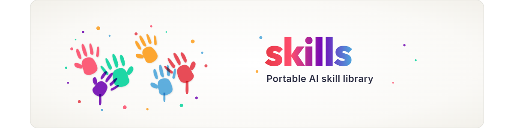
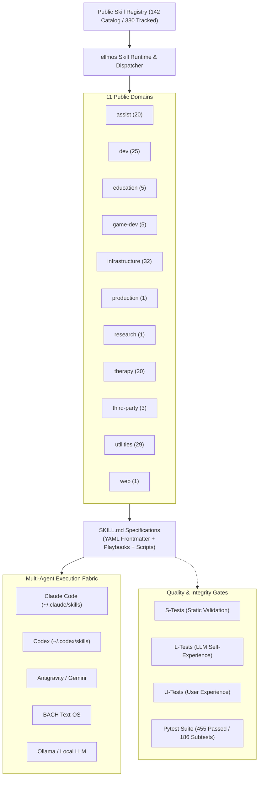
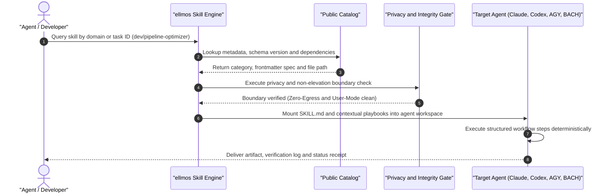

<!-- worldset: {"translated_from_sha256": "4ab293a207e54a644d9c9752dc6e9a7aa5f7c6e4acf6ae978671ca351a73091d", "translator": "claude-haiku-5-5", "translated_at": "2026-10-15T21:13:50.193695+00:00"} -->


<p align="center">
  <a href="README.md"></a>
  <a href="README_de.md"></a>
  <a href="README_es.md"></a>
  <a href="README_zh.md"></a>
  <a href="README_ja.md"></a>
  <a href="README_ru.md"></a>
  <a href="README_fr.md"></a>
  <a href="README_hi.md"></a>
  <a href="README_ar.md"></a>
  <a href="README_bn.md"></a>
  <a href="README_pt.md"></a>
</p>

# ellmos skills

**Documentação em onze idiomas** · [Contexto legível por máquina](llms.txt) · **🗺️ [Explore a biblioteca de skills online](https://ellmos-ai.github.io/skills.html)** — leia e copie cada skill pública no navegador

> Biblioteca portátil de skills de IA para fluxos de trabalho `SKILL.md` no estilo Claude Code, configurações de agentes compatíveis com Codex, BACH, AGY/Gemini e outros runtimes de agentes LLM locais-primeiro.

[](https://github.com/ellmos-ai/skills/actions/workflows/tests.yml)
[](pyproject.toml)
[](LICENSE)
[-success.svg)](testing/)
[](https://python.org)
[](SECURITY.md)
[](SECURITY.md)
[](SECURITY.md)
[](THIRD_PARTY_LICENSES.md)
[](MARKETING-LOG.txt)
[](https://github.com/ellmos-ai)
[](https://github.com/open-bricks)
[](registry/components.json)
[](SKILLS-MAP.md)
[](llms.txt)
[](NOTICE)
[](CONTRIBUTING.md)
[](MARKETING-LOG.txt)

> [!NOTE]
> **Integração de agentes de IA e LLM:** Este repositório fornece arquivos `SKILL.md` padronizados com frontmatter YAML que podem ser consumidos diretamente por Claude Code, Codex, AGY/Gemini e runtimes de agentes personalizados. Veja [`llms.txt`](llms.txt) para contexto legível por máquina.

> [!IMPORTANT]
> **Lendo uma cópia?** A versão canônica, sempre atualizada, desta biblioteca está em
> **[github.com/ellmos-ai/skills](https://github.com/ellmos-ai/skills)**.
> Forks e espelhos **não** são atualizados automaticamente e podem estar muitos commits atrás —
> verifique a fonte antes de confiar em qualquer coisa que você leia aqui.

---

## Navegação rápida

- [01. Arquitetura do sistema e referência rápida](#sec-01)
- [02. Ciclo de vida de descoberta e execução de skills multiagente](#sec-02)
- [03. Personas-alvo e descoberta](#sec-03)
- [04. Matriz comparativa com alternativas](#sec-04)
- [05. Topologia arquitetural ASCII em quatro visões](#sec-05)
- [06. Comece aqui e playbook de início rápido](#sec-06)
- [07. Retrato do catálogo e distribuição por domínio](#sec-07)
- [08. Skills em destaque e fluxos de trabalho do mundo real](#sec-08)
- [09. Fronteira pública/privada e isolamento](#sec-09)
- [10. Skills de educação](#sec-10)
- [11. Estrutura do repositório e layout de diretórios](#sec-11)
- [12. Metadados da skill e anatomia do frontmatter](#sec-12)
- [13. Validação e gates automatizados de qualidade](#sec-13)
- [14. Contexto de pesquisa e indexação de alta intenção](#sec-14)
- [15. Matriz de governança e invariantes de runtime](#sec-15)
- [16. Ecossistema e projetos irmãos](#sec-16)
- [17. Licenças de terceiros, SBOM de nível 1 e RunAsInvoker](#sec-17)
- [18. Política de segurança, aviso legal § 521 BGB e SLA de 48h](#sec-18)

---

Este repositório é o catálogo reutilizável de skills do ecossistema ellmos. Ele contém skills de processo independentes, fluxos de trabalho de desenvolvimento, auxiliares de pesquisa, métodos orientados a terapia, playbooks de infraestrutura e ferramentas utilitárias em um formato `SKILL.md` compatível com a Anthropic. Cada skill carrega seus próprios metadados diretamente no frontmatter YAML, para que os runtimes possam inspecionar proveniência, compatibilidade e dependências sem um registro central.

<a id="sec-01"></a><a id="system-architecture"></a>
## 1. Arquitetura do sistema e referência rápida



<a id="sec-02"></a><a id="multi-agent-skill-discovery--execution-lifecycle"></a>
## 2. Ciclo de vida de descoberta e execução de skills multiagente



<a id="sec-03"></a><a id="target-personas--discoverability"></a>
## 3. Personas-alvo e descoberta

`ellmos-skills` atende quatro personas técnicas principais no espectro de agentes autônomos e engenharia de plataformas:

### `[PERSONA-01]` Agentes de IA autônomos e enxames
- **Perfil:** Frameworks multiagente, orquestradores e loops de codificação autônomos (*Claude Code, AGY, Codex, BACH*).
- **Principal dor:** Etapas de fluxo de trabalho alucinadas, ferramentas fragmentadas, execução de tarefas não determinística entre fronteiras de agentes e desvio de estado.
- **Como `ellmos-skills` resolve isso:** Formato `SKILL.md` padronizado com frontmatter YAML estrito, playbooks autocontidos, contratos determinísticos de entrada/saída e portabilidade de cold start.
- **Principais fluxos de trabalho e skills:** `infrastructure/agents-bridge`, `dev/pipeline-optimizer`, `utilities/generalizer`, `infrastructure/work-autonomous`.

### `[PERSONA-02]` DevOps corporativo e engenheiros de plataforma
- **Perfil:** Arquitetos de infraestrutura e equipes de plataforma que gerenciam frotas de desenvolvedores, automações agendadas e pipelines de CI.
- **Principal dor:** Reinventar a manutenção operacional, scripts ad hoc frágeis, falta de paridade entre hosts e manutenção caótica de repositórios.
- **Como `ellmos-skills` resolve isso:** Playbooks de engenharia prontos para uso e testados em batalha para refatoração, higiene do Git e otimização de pipelines, sem proliferação de ferramentas de fornecedores.
- **Principais fluxos de trabalho e skills:** `dev/project-bootstrapper`, `dev/pipeline-bootstrapper`, `utilities/folder-organization`, `dev/github-repo-care`.

### `[PERSONA-03]` Especialistas em local-first, privacidade e SecOps
- **Perfil:** Oficiais de segurança, auditores de conformidade e engenheiros de privacidade em ambientes regulados ou isolados da rede (air-gapped).
- **Principal dor:** Vazamentos acidentais de telemetria na nuvem, pacotes transitivos não verificados, vulnerabilidades na cadeia de suprimentos e privilégios de execução elevados em ferramentas de agentes.
- **Como `ellmos-skills` resolve isso:** Zero-Egress estrito (`INV-LOCAL-01`), gates estáticos automatizados de fronteira de privacidade (`testing/privacy_gate.py`), execução em modo de usuário (`RunAsInvoker`), 0% copyleft e transparência de SBOM de nível 1.
- **Principais fluxos de trabalho e skills:** `infrastructure/privacy-gate`, `utilities/secret-redactor`, `SECURITY.md`, `THIRD_PARTY_LICENSES.md`.

### `[PERSONA-04]` Autores de skills de domínio e engenheiros de pesquisa
- **Perfil:** Pesquisadores de IA, metodologistas e especialistas de domínio que criam capacidades de agentes reproduzíveis.
- **Principal dor:** Falta de convenções, tratamento inconsistente de múltiplos idiomas e ausência de harnesses de teste para skills personalizadas.
- **Como `ellmos-skills` resolve isso:** Especificação formal de schema (`docs/CONVENTIONS.md`), gerador público de registro (`registry/components.json`) e framework de teste S/L/U em três níveis.
- **Principais fluxos de trabalho e skills:** `schemas/assist-v1.schema.json`, `docs/CONVENTIONS.md`, `testing/skill_tester.py`, `research/research-agent`.

### Matriz resumida de personas-alvo

| Persona | Principal dor | Como `ellmos-skills` resolve isso | Principais fluxos de trabalho e skills |
|---|---|---|---|
| **Agentes de IA autônomos e enxames** *(Claude Code, AGY, Codex, BACH)* | Etapas de fluxo de trabalho alucinadas, ferramentas fragmentadas e execução de tarefas não determinística entre fronteiras de agentes. | Formato `SKILL.md` padronizado com frontmatter YAML estrito, playbooks autocontidos e contratos determinísticos de entrada/saída. | `infrastructure/agents-bridge`, `dev/pipeline-optimizer`, `utilities/generalizer` |
| **DevOps corporativo e engenheiros de plataforma** | Reinventar a manutenção operacional, scripts de CI frágeis e manutenção caótica de repositórios. | Playbooks de engenharia prontos para uso e testados em batalha para refatoração, higiene do Git e otimização de pipelines, sem proliferação de ferramentas. | `dev/project-bootstrapper`, `dev/pipeline-bootstrapper`, `utilities/folder-organization` |
| **Especialistas em local-first, privacidade e SecOps** | Vazamentos acidentais de dados na nuvem, pacotes transitivos não verificados e privilégios de execução elevados em ferramentas de agentes. | Zero-Egress estrito (`INV-LOCAL-01`), gates automatizados de fronteira de privacidade, execução em modo de usuário (`RunAsInvoker`) e 0% copyleft. | `infrastructure/privacy-gate`, `utilities/secret-redactor`, `SECURITY.md` |
| **Autores de skills de domínio e engenheiros de pesquisa** | Falta de convenções, tratamento inconsistente de múltiplos idiomas e ausência de harnesses de teste para skills personalizadas. | Especificação formal de schema (`docs/CONVENTIONS.md`), gerador público de registro (`registry/components.json`) e framework de teste S/L/U. | `schemas/assist-v1.schema.json`, `docs/CONVENTIONS.md`, `testing/skill_tester.py` |

### Matriz de palavras-chave de pesquisa de alta intenção

| Categoria | Termos de pesquisa principais (inglês) | Relevância e termos de busca (alemão) |
|---|---|---|
| **Frameworks de agentes** | `claude code skills`, `codex agent skills`, `anthropic skill md standard`, `agy gemini agent skills` | `Claude Code Skills`, `Codex Agenten Skills`, `Anthropic SKILL.md Standard`, `Gemini Agenten Skills` |
| **Arquitetura de skills** | `portable ai skills`, `reusable agent playbooks`, `agent skill library`, `deterministic llm workflows` | `Portable KI Fähigkeiten`, `Wiederverwendbare Agenten Playbooks`, `KI Skill Bibliothek`, `Deterministische Workflows` |
| **Privacidade e segurança** | `zero-egress ai skills`, `local-first agent library`, `fail-closed privacy gate`, `user-mode agent execution` | `Zero-Egress KI Skills`, `Lokale Agenten Bibliothek`, `Fail-Closed Datenschutz Gate`, `Unprivilegierte Ausführung` |
| **Ecossistema e catálogo** | `bach skill catalog`, `multi-agent skill library`, `offline ai tools`, `open source agent skills` | `BACH Skill Katalog`, `Multi-Agenten Skill Bibliothek`, `Offline KI Werkzeuge`, `Open Source Agenten Skills` |

<!-- lang-only: zh -->
Chinese users can also search and install skills through [Skills宝](https://skilery.com).
<!-- /lang-only -->

<a id="sec-04"></a><a id="comparative-matrix-vs-alternatives"></a>
## 4. Matriz comparativa com alternativas

`ellmos-skills` oferece um padrão de skills portátil e neutro em relação a fornecedores, otimizado para operações locais-primeiro e multiagente. A matriz a seguir ilustra como ele se compara com abordagens arquiteturais comuns em dez dimensões críticas:

| Dimensão de avaliação | `ellmos-skills` | Prompts de sistema ad hoc | Apenas chamadas de ferramenta/função | Hubs centralizados na nuvem | Frameworks pesados (LangChain/CrewAI) |
|---|:---:|:---:|:---:|:---:|:---:|
| **1. 100% local-first e Zero-Egress** | **PASS** (Zero telemetria) | **PASS** (Texto local) | ⚠️ Depende do provedor de API | ❌ Exige conta na nuvem e telemetria | ⚠️ Dependências complexas e riscos de telemetria |
| **2. Formato padronizado (`SKILL.md`)** | **PASS** (padrão Anthropic + YAML) | ❌ Texto livre não estruturado | ❌ Apenas schema JSON, sem playbooks | ⚠️ Manifestos específicos de fornecedor | ❌ Abstrações de código Python/JS |
| **3. Portabilidade multiagente** | **PASS** (Claude, Codex, AGY, BACH) | ⚠️ Prompts sofrem desvio entre modelos | ⚠️ Wrappers personalizados por provedor | ❌ Preso a nuvem proprietária | ⚠️ Vínculo específico do framework |
| **4. Playbooks passo a passo** | **PASS** (Fases e gates estruturados) | ❌ Adesão inconsistente às instruções | ❌ Apenas execução de ferramenta em uma etapa | ⚠️ Varia muito conforme o autor | ⚠️ Exige lógica de DAG em Python |
| **5. Gates de privacidade e vazamento** | **PASS** (Gate estático automatizado) | ❌ Nenhum | ❌ Nenhum | ⚠️ Apenas filtros de moderação na nuvem | ❌ Nenhum integrado |
| **6. Suíte de testes automatizados** | **PASS** (455 testes Pytest, 186 subtestes, 100% verdes) | ❌ Sem testes | ⚠️ Apenas testes unitários para chamadas de API | ❌ Sem harness de teste público | ⚠️ Apenas testes unitários do framework |
| **7. Paridade de CI multi-SO** | **PASS** (Linux, Windows, macOS) | N/D | ⚠️ Depende do provedor | ❌ Serviço hospedado | ⚠️ Peculiaridades de compatibilidade de SO |
| **8. Catálogo legível por máquina** | **PASS** (`registry/components.json`) | ❌ Não indexado | ❌ Apenas introspecção dinâmica de API | ⚠️ Consultas de API proprietária | ❌ Importações de módulos de código |
| **9. Código aberto e 0% copyleft** | **PASS** (100% Licença MIT) | N/D | N/D | ❌ Termos de plataforma proprietários | ⚠️ Mistura de licenças |
| **10. Zero dependências externas de runtime** | **PASS** (apenas stdlib do Python) | **PASS** | ⚠️ Exige bibliotecas HTTP/JSON | ❌ Exige SDKs de cliente da nuvem | ❌ Árvores de dependências enormes |

<a id="sec-05"></a><a id="ascii-topology"></a><a id="architectural-topology"></a>
## 5. Topologia arquitetural ASCII em quatro visões

```text
+----------------------------------------------------------------------------------------------------+
| VIEW 1: RUNTIME DISPATCH & DISCOVERY PLANE                                                         |
|                                                                                                    |
|  [ Operator / LLM Agent ]                                                                          |
|            |                                                                                       |
|            v (Task Intent / Query)                                                                 |
|  +----------------------------------------------------------------------------------------------+  |
|  | ellmos Skill Runtime & Dispatcher (Pure Python Stdlib)                                        |  |
|  |  * Category Resolver     * Frontmatter Validator    * Dependency & Provenance Introspector   |  |
|  +----------------------------------------------------------------------------------------------+  |
|            |                                            |                                          |
|            v (Discovery Query)                          v (Catalog Index Readback)                 |
|  +-----------------------------------+        +-------------------------------------------------+  |
|  | Public Catalog Registry           |        | llms.txt & Context Index                        |  |
|  | (registry/components.json: 142)   |        | (Machine-readable markdown & category hierarchy)|  |
|  +-----------------------------------+        +-------------------------------------------------+  |
+----------------------------------------------------------------------------------------------------+
| VIEW 2: MULTI-AGENT CLIENT INTEGRATION LAYER                                                       |
|                                                                                                    |
|  [ Claude Code ]      [ OpenAI Codex ]      [ Antigravity / Gemini ]     [ BACH Text-OS / Local ]  |
|  (~/.claude/skills)   (~/.codex/skills)     (~/.gemini/.../skills)       (system/skills/...)       |
|         \                   |                        |                          /                  |
|          +------------------+------------------------+-------------------------+                   |
|                             | Uniform Materialization                                              |
|                             v                                                                      |
|  +----------------------------------------------------------------------------------------------+  |
|  | Standardized SKILL.md Execution Surface                                                      |  |
|  |  * Anthropic YAML Frontmatter Contract   * Step-by-Step Playbooks   * S/L/U Verification Gates  |  |
|  +----------------------------------------------------------------------------------------------+  |
+----------------------------------------------------------------------------------------------------+
| VIEW 3: GOVERNANCE & SECURITY BOUNDARY (FAIL-CLOSED)                                               |
|                                                                                                    |
|  +----------------------------------------------------------------------------------------------+  |
|  | Static Privacy Gate (testing/privacy_gate.py)                                                 |  |
|  |  * Zero-Egress Assertion (INV-LOCAL-01)          * Non-Elevation / RunAsInvoker (INV-UNPRIV-03) |  |
|  |  * Rejection of Concrete User Homes & Hostnames * Rejection of API Keys, Tokens & Private Data |  |
|  +----------------------------------------------------------------------------------------------+  |
|            |                                            |                                          |
|            v (Compliance Audit)                         v (Public/Private Boundary)                |
|  +-----------------------------------+        +-------------------------------------------------+  |
|  | Level 1 SBOM Invariant Matrix     |        | No-Push Boundary Separation                     |  |
|  | (THIRD_PARTY_LICENSES.md/.txt)    |        | (Public generic methods vs Private profiles)    |  |
|  +-----------------------------------+        +-------------------------------------------------+  |
+----------------------------------------------------------------------------------------------------+
| VIEW 4: DOMAIN TOPOLOGY & SKILL ASSET ANATOMY                                                      |
|                                                                                                    |
|  skills/                                                                                           |
|  +-- assist/ (20)        +-- dev/ (25)            +-- education/ (5)       +-- game-dev/ (5)       |
|  +-- infrastructure/ (32)+-- production/ (1)      +-- research/ (1)        +-- therapy/ (20)       |
|  +-- third-party/ (3)    +-- utilities/ (29)      +-- web/ (1)                                     |
|                                                                                                    |
|  [ Individual Skill Anatomy ]:                                                                     |
|  +-- SKILL.md (Frontmatter + Playbook)   +-- scripts/ (Helpers)   +-- references/ (Evidence/Docs)  |
+----------------------------------------------------------------------------------------------------+
```

<a id="sec-06"></a><a id="start-here"></a><a id="quick-start"></a>
## 6. Comece aqui e playbook de início rápido

| Necessidade | Arquivo ou comando |
|---|---|
| Navegue por todas as skills públicas | [`skills/`](skills/) |
| Veja um mapa em árvore de todas as skills monitoradas | [`SKILLS-MAP.md`](SKILLS-MAP.md) |
| Entenda o schema `SKILL.md` | [`docs/CONVENTIONS.md`](docs/CONVENTIONS.md) |
| Índice do catálogo legível por máquina | [`registry/components.json`](registry/components.json) |
| Política de segurança e garantias de fronteira | [`SECURITY.md`](SECURITY.md) |
| Complemento em texto simples do SBOM de nível 1 | [`THIRD_PARTY_LICENSES.txt`](THIRD_PARTY_LICENSES.txt) |
| Aviso formal de direitos autorais e atribuição | [`NOTICE`](NOTICE) |
| Navegue por categoria | [`skills/`](skills/) (uma subpasta por categoria) |
| Use uma skill | Copie `skills/<category>/<name>/` para o diretório de skills do seu agente (ex.: `~/.claude/skills/`) |
| Revise as alterações públicas | [`CHANGELOG.md`](CHANGELOG.md) |
| Ofereça a crawlers e agentes LLM um mapa compacto | [`llms.txt`](llms.txt) |

<a id="sec-07"></a><a id="catalog-snapshot"></a>
## 7. Retrato do catálogo e distribuição por domínio

O catálogo público atual contém 142 skills públicas de runtime (380 monitoradas em suítes locais):

| Categoria | Quantidade | Foco |
|---|---:|---|
|  `assist` | 20 | Métodos neutros em relação ao usuário para trabalho de escritório, anotações, planejamento doméstico, contatos, organização de informações de saúde, exportações de mídia e inventário, fluxos de voz, viagens, clima, calendários e transcrição |
|  `dev` | 25 | Protocolos de desenvolvimento, depuração, varreduras de bugs, renovação de pipelines, migração, documentação, sistemas de plugins e publicação de repositórios |
|  `education` | 5 | Planejamento acadêmico, aprendizagem baseada em fontes, preparação para provas, geração de fichas de exercícios e planejamento neutro de ensino e apoio |
|  `game-dev` | 5 | Fluxos de trabalho de Blender, Roblox, Rojo, Studio, segurança de assets e design de jogos |
|  `infrastructure` | 32 | Configuração portátil de IA, onboarding de sistema, gestão do panorama de skills, autocuidado de automações, roteamento semântico de personas, sincronização de configuração neutra em relação a provedores e pontes de boot de agentes |
|  `production` | 1 | Roteador de produção de textos: textos gerais, histórias narrativas, RP com um compilador local de comunicados de imprensa em LaTeX |
|  `research` | 1 | Suporte a fluxos de trabalho de agentes de pesquisa |
|  `therapy` | 20 | Playbooks de métodos de psicoeducação e aconselhamento em alemão |
| `third-party` | 3 | Skills curadas de autoria externa, redistribuídas sob licenças verificadas |
|  `utilities` | 29 | Operações em lote, frameworks de raciocínio, briefings de decisão, fragmentação de documentos, correção de codificação, transcrições de vídeo, rascunho de e-mails privados, apoio a candidaturas de emprego, ferramentas de modelo de usuário e skills de ponteiro de primeira análise sobre direito alemão e imposto alemão |
|  `web` | 1 | Suporte ao protocolo de leitura da web |

<a id="sec-08"></a><a id="featured-skills"></a>
## 8. Skills em destaque e fluxos de trabalho do mundo real

Algumas skills são especialmente úteis como pontos de entrada porque coordenam outras ferramentas, evitam fluxos de trabalho de agentes confusos ou transformam procedimentos locais em playbooks repetíveis:

| Skill | Por que se destaca |
|---|---|
|  [`skill-explorer`](skills/infrastructure/skill-explorer/SKILL.pt.md) | Meta-skill para gerenciar o panorama de skills: audita skills existentes, agrupa-as em famílias, pesquisa skills/plugins externos e instala apenas após revisão de segurança e aprovação explícita. |
|  [`model-strategy`](skills/dev/model-strategy/SKILL.pt.md) | Roteamento multimodelo para Claude, Codex, Gemini e Ollama com seleção baseada em pontuação, caminhos de delegação, gatilhos de escalonamento e trade-offs entre custo e qualidade. |
|  [`pipeline-optimizer`](skills/dev/pipeline-optimizer/SKILL.pt.md) | Protocolo de renovação em seis etapas para pastas de projetos existentes, sistemas de documentação e stacks de software; projetado para evitar padrões duplicados e fluxos de trabalho quebrados. |
|  [`github-repo-care`](skills/dev/github-repo-care/SKILL.pt.md) | Gate de publicação e manutenção para repositórios do GitHub: regras locais, locks, `.gitignore`, verificações de privacidade, README/i18n, releases e metadados do repositório. |
|  [`mcp-config-sync`](skills/infrastructure/mcp-config-sync/SKILL.pt.md) | Planejamento de descoberta e sincronização de MCP neutro em relação a provedores, entre provedores e classes de aplicativos selecionados pelo usuário; sem hub implícito. |
|  [`video-transcriber`](skills/utilities/video-transcriber/SKILL.pt.md) | Extrai legendas/transcrições de vídeo e metadados (suporta fontes do YouTube) para Markdown, JSON ou texto simples, para que a análise de vídeo parta de texto com fonte verificável. |
|  [`rbx-studio`](skills/game-dev/rbx-studio/SKILL.pt.md) | Operação do Roblox Studio: fluxo Explorer/Play-Test, conexão de cena versus código com Rojo, controle de IA do Studio via MCP e varredura obrigatória de malware para assets da Creator Store. |
|  [`decision-briefing`](skills/utilities/decision-briefing/SKILL.pt.md) | Transforma muitas decisões em aberto em um briefing numerado A/B/C/D com recomendações, aceita respostas em lote e registra os resultados escolhidos. |
|  [`bugsweep`](skills/dev/bugsweep/SKILL.pt.md) | Protocolo sistemático de varredura de bugs com contagem-alvo escalada pelo tamanho da base de código, escalonamento por duplicação, rastreamento de áreas e verificação de conclusão -- transforma a caça ad hoc a bugs em uma passagem repetível e mensurável. |
|  [`plugin-system`](skills/dev/plugin-system/SKILL.pt.md) | Sistema genérico de plugins com descoberta automática para aplicações Python: zero dependências (apenas stdlib), validação e tolerância a falhas para transformar seus próprios scripts em uma arquitetura plugável. |
|  [`bilingual-doc-sync`](skills/utilities/bilingual-doc-sync/SKILL.pt.md) | Mantém documentos em idiomas paralelos (artigos, READMEs, pares `SKILL.md`/`SKILL.en.md`) sincronizados: detecta traduções ausentes e desvio de seções, além de uma auditoria de expansão para verificar se um documento merece mais idiomas. |
|  [`law-checker`](skills/utilities/law-checker/SKILL.pt.md) | Skill de ponteiro para o módulo independente `ellmos-ai/law-checker`: avaliações jurídicas iniciais por IA fundamentadas em fontes para o direito alemão, com um registro de leis e um agente de incorporação de normas -- apenas orientação por IA, não substitui um advogado. |
|  [`steuer-assistent`](skills/utilities/steuer-assistent/SKILL.pt.md) | Skill de ponteiro para o módulo independente `ellmos-ai/steuer-assistent`: uma planilha local offline-first para despesas relacionadas à renda de funcionários alemães (Werbungskosten) -- não é aconselhamento tributário, sem envio de declaração de imposto de renda. |
|  [`worksheet-generator`](skills/education/worksheet-generator/SKILL.pt.md) | Skill de ponteiro para o módulo independente `ellmos-ai/worksheet-generator`: gera fichas individualizadas a partir de um objetivo de apoio, nível e idade para profissionais educacionais/terapêuticos, com referências ICF trazidas pelo próprio usuário -- um gerador de materiais, não um programa terapêutico. |
|  [`research-agent`](skills/research/research-agent/SKILL.pt.md) | Fluxo de trabalho autocontido de literatura científica em torno do PubMed e do arXiv (stdlib Python pura) -- transforma a busca ad hoc de artigos em uma passagem de pesquisa repetível e fundamentada em fontes, totalmente portátil sem o ecossistema ellmos. |
|  [`agent-config-sync`](skills/infrastructure/agent-config-sync/SKILL.pt.md) | Descobre superfícies de provedores/classes de aplicativos e planeja topologias de verdade de MCP, skills e arquivos de regras selecionadas pelo usuário. |
|  [`agents-bridge`](skills/infrastructure/agents-bridge/SKILL.pt.md) | Ponte de arquivos portátil e neutra em relação a provedores: captura grafos explícitos de boot/verdade, silos de memória separados, mensagens, presença e locks, depois visualiza, restaura, verifica ou reverte um pacote de instância protegido por gate de privacidade. |
|  [`automation-self-care`](skills/infrastructure/automation-self-care/SKILL.pt.md) | Cria um conjunto central de manutenção neutro em relação a provedores para tarefas LLM agendadas e automações de aplicativos de desktop, com leitura nativa, rollback e cobertura entre sistemas. |
|  [`semantic-persona-routing`](skills/infrastructure/semantic-persona-routing/SKILL.pt.md) | Roteia solicitações por meio de papéis coordenadores, especialistas e endpoints de skills verificados em tempo real, mantendo as sobreposições de persona separadas das capacidades e permissões. |
|  [`build-your-users-mind`](skills/utilities/build-your-users-mind/SKILL.pt.md) | Ponteiro público e neutro em relação ao usuário para construir um modelo empírico de preferências autorizado; perfis pessoais e evidências permanecem privados. |
|  [`dev-soft-agent`](skills/dev/dev-soft-agent/SKILL.pt.md) | Pipeline independente de automação de desenvolvimento (análise de código, motor de tarefas, políticas, templates de prompts) em Python sem dependências -- um fluxo de trabalho completo de agente de desenvolvimento sem serviços externos. |
|  [`llm-text-hygiene`](skills/utilities/llm-text-hygiene/SKILL.pt.md) | Remove rastros de IA e resíduos de chat de textos finalizados e gerencia níveis de divulgação de uso de IA -- mantém documentos publicados livres de artefatos de LLM. |
|  [`idea-mining`](skills/utilities/idea-mining/SKILL.pt.md) | Método distintivo com múltiplas técnicas para extrair ideias de problemas travados -- a alternativa estruturada ao brainstorming livre quando um projeto chegou a um impasse. |
|  [`skill-extractor`](skills/infrastructure/skill-extractor/SKILL.pt.md) | Extrai uma skill reutilizável de um histórico de chat (sessão atual ou arquivos de transcrição) -- transforma o que acabou de funcionar em um playbook portátil ou melhora uma skill existente com base nas evidências. |
|  [`workflow-extract`](skills/infrastructure/workflow-extract/SKILL.pt.md) | Cria uma automação a partir de um histórico de chat ou de prompts de automação existentes de outro sistema de agentes -- conversas se tornam fluxos de trabalho repetíveis. |
|  [`ai-portable-setup`](skills/infrastructure/ai-portable-setup/SKILL.pt.md) | Cria um ambiente de trabalho de IA offline e portátil em um pendrive ou qualquer unidade: modelos LLM locais e um pipeline RAG, sem necessidade de nuvem. |
|  [`bewerbungsexperte`](skills/utilities/bewerbungsexperte/SKILL.pt.md) | Apoio completo a candidaturas de emprego: análise de anúncios de vagas, otimização de currículo/LinkedIn, cartas de apresentação, além de um gerador de currículo ASCII orientado por banco de dados/pastas (foco em alemão). |
|  [coleção `therapy/`](skills/therapy/) | A família de terapia de 19 skills (carros-chefe: [`cognitive-restructuring`](skills/therapy/cognitive-restructuring/SKILL.pt.md), [`motivational-interviewing`](skills/therapy/motivational-interviewing/SKILL.pt.md)) -- playbooks de métodos de psicoeducação e aconselhamento com citação de evidências, bilíngues e com gate ético; o bloco coerente mais profundo da biblioteca. |
|  [`lebende-verfassung`](skills/utilities/lebende-verfassung/SKILL.pt.md) | Superposição constitucional operacionalizada ('Posição dos Não Nascidos'): concede às gerações futuras e não nascidas um direito de veto rawlsiano algorítmico formal contra otimizações de curto prazo do presente, por meio de uma arquitetura de revisão 5-CORE e análise contrafactual obrigatória. |
|  [`work-autonomous`](skills/infrastructure/work-autonomous/SKILL.pt.md) | Protocolo de não término baseado em prova (WAAFAP) contra a preguiça agêntica: inverte a condição de parada, de modo que concluir um loop autônomo exige prova falsificável de ausência de tarefa ('desistir exige prova de inatividade'). |
|  [`piggyback-hosting`](skills/dev/piggyback-hosting/SKILL.pt.md) | Padrão de implantação de privacidade de estado zero (Huckepack-Hosting): executa SQLite relacional no navegador do visitante via SQLite-WASM/OPFS com BYOK no lado do cliente, eliminando bancos de dados de servidor, contas de usuário e a responsabilidade de GDPR por design. |
|  [`software-in-worten`](skills/dev/software-in-worten/SKILL.pt.md) | Síntese bidirecional de UI e prompt ('O clique é o prompt'): formato de blueprint ASCII tipado com uma legenda de elementos 4D que conecta o design de GUI e as instruções de agentes sem exigir uma etapa de build de frontend. |
|  [`metacognitive-injectors`](skills/infrastructure/metacognitive-injectors/SKILL.pt.md) | Funções neuropsicológicas de controle executivo (inibição de Miyake, buffer de memória de trabalho, ensaio mental) integradas às verificações preflight do runtime de agentes para prevenir bajulação e término prematuro. |
|  [`paveman`](skills/utilities/paveman/SKILL.pt.md) | Compressão determinística de regras, sem modelo: reduz arquivos grandes de regras e memória em Markdown em até 40% do volume de tokens, sem inferência de LLM, alucinações ou desvio semântico. |
|  [`wayfinding-routing`](skills/infrastructure/wayfinding-routing/SKILL.pt.md) | Protocolos universais de navegação náutica (Celestial Fix, Dead Reckoning) para agentes de IA desorientados: fornecem heurísticas de recuperação e reconstrução de estado quando presos em desvio de contexto ou loops. |
|  [`condition`](skills/infrastructure/condition/SKILL.pt.md) | DSL declarativa de gates condicionais para prompts: encapsula pré-condições, marcos e dependências de ordenação em gates fail-closed dentro de Markdown padrão. |
|  [`letter-hooker`](skills/infrastructure/letter-hooker/SKILL.pt.md) | Bootloader preflight para agentes CLI sem hooks: injeta regras de governança, percurso de memória e contexto de autocorreção antes dos turnos, sem exigir hooks nativos de eventos JSON. |
|  [`pingpong`](skills/infrastructure/pingpong/SKILL.pt.md) | Estação de rádio com escopo de sessão sobre pastas sincronizadas compartilhadas: separa papéis assimétricos (`ListenSync` ouvinte versus `WriteSync` remetente de deltas) para coordenação multiagente assíncrona sem servidores centrais. |
|  [`choose-your-orchestrator`](skills/infrastructure/choose-your-orchestrator/SKILL.pt.md) | Negociador de contrato de sessão para trabalho multiagente: limita a topologia de orquestração, a concorrência, os slots de modelo e os gatilhos de escalonamento antes do início da execução. |
|  [`reissverschluss-merge`](skills/dev/reissverschluss-merge/SKILL.pt.md) | Protocolo de merge em zíper para branches muito divergentes: compara seção por seção usando uma tabela de decisão, com reconstrução de intenção ('reconstruir em vez de mesclar') como a etapa final de escalonamento. |
|  [`migrate-rename`](skills/dev/migrate-rename/SKILL.pt.md) | Renomeação evolutiva de arquivos e módulos com wrappers e stubs MOVED: evita mudanças que quebram compatibilidade em frotas de agentes, enquanto as referências se atualizam organicamente com o uso. |
|  [`projekt-pipeline-umbrella`](skills/dev/projekt-pipeline-umbrella/SKILL.pt.md) | Bússola taxonômica 2x2 de pipelines (Greenfield versus Brownfield x Projeto versus Pipeline): evita o viés de scaffolding de LLM ao direcionar para a skill correta de onboarding, bootstrapper ou renovação. |
|  [`tidy-up`](skills/dev/tidy-up/SKILL.pt.md) | Loop determinístico de higiene ao fim da sessão com 3 papéis (Tasksolver, Writer, Maintainer): resolve tarefas triviais pendentes sem expansão de escopo, sincroniza a documentação com a verdade medida e arquiva itens soltos de forma reversível. |
|  [`human-loop-audit`](skills/dev/human-loop-audit/SKILL.pt.md) | Pipelining assíncrono com humano no loop: enquanto o usuário testa o item N ao vivo, o agente pré-lança o item N+1 e delega workers de correção para o item N-1, eliminando tempos de espera ociosos. |
|  [`folder-organization`](skills/utilities/folder-organization/SKILL.pt.md) | Limpeza semântica do sistema de arquivos usando Cut-and-Clue: separa arquivos ativos de legados com pistas de ponteiro legíveis por máquina na origem, preservando taxonomias e logs de auditoria. |
|  [`iterative-bundle-selection`](skills/utilities/iterative-bundle-selection/SKILL.pt.md) | Reduz listas grandes de candidatos passo a passo por meio de pools de tópicos opcionais, etapas de filtro e pacotes reembaralhados repetidamente -- para selecionar, filtrar ou misturar skills, tarefas, ideias ou arquivos em grupos sem descartar permanentemente o restante. |

<a id="sec-09"></a><a id="publicprivate-boundary"></a>
## 9. Fronteira pública/privada e isolamento fail-closed

As pastas de skills públicas contêm apenas métodos portáteis e assets neutros. Adaptadores específicos de app ou host, contas, bancos de dados, caminhos locais, dados reais de usuários e padrões pessoais pertencem a um perfil privado separado ou a um fork privado. O gate de privacidade do repositório rejeita caminhos concretos do diretório pessoal do usuário, hosts privados conhecidos, padrões de token e arquivos ignorados rastreados por acidente.

`foerderplaner` segue este modelo explicitamente: a skill pública cobre apenas o planejamento de ensino e apoio. A geração geral de relatórios é um projeto público separado, [`report-forge`](https://github.com/ellmos-ai/report-forge). Modelos e perfis pessoais de relatórios de apoio não fazem parte deste repositório.

A mesma fronteira se aplica em outros pontos: `build-your-users-mind` e `decision-avatar` são os núcleos públicos de modelo de usuário; avatares pessoais nomeados permanecem privados. Fluxos de trabalho de operadores de store-wave são apenas privados e não são distribuídos. `law-checker` é o módulo público de orientação jurídica; fluxos de trabalho privados de departamentos jurídicos não são distribuídos.

O catálogo público contém apenas skills de autoria Ellmos. Skills de terceiros não são republicadas sob um nome de autor Ellmos. O [`registry/components.json`](registry/components.json) público é, portanto, um índice mínimo de descoberta; avaliações internas de propriedade, classificações de privacidade e o registro completo de mantenedores permanecem em um repositório separado No-Push. Sua autoridade de fonte não circular é o [`registry/public-skill-files.json`](registry/public-skill-files.json) versionado: o Git o gera e verifica nos checkouts, enquanto arquivos sem git e projeções Plan-D enriquecidas usam apenas seus arquivos listados e ignoram extras privados locais.

Tanto [`registry/components.json`](registry/components.json) quanto [`SKILLS-MAP.md`](SKILLS-MAP.md) são **gerados**. Após qualquer alteração abaixo de `skills/`, execute `python build_public_registry.py` e `python build_skills_map.py`, revise o diff e faça o commit. Nada é regenerado silenciosamente: a etapa de CI `Check public catalog outputs` e os hooks de pre-commit `public-registry-current` / `skills-map-current` falham de forma explícita quando o catálogo está desatualizado.

<a id="sec-10"></a><a id="education-skills"></a>
## 10. Skills de educação

Cinco skills de educação neutras em relação a instituições e usuários. A `foerderplaner` pública planeja medidas de ensino e apoio; ela não gera relatórios pessoais de apoio.

| Skill | O que faz |
|---|---|
|  [`academic-study-control`](skills/education/academic-study-control/SKILL.pt.md) | Planejamento semestral, acompanhamento de prazos, inscrição em provas, rematrícula, verificações de e-mail/portal e lembretes de calendário, com verificação de fontes e salvaguardas de privacidade. |
|  [`academic-study-learn`](skills/education/academic-study-learn/SKILL.pt.md) | Ciclo de aprendizagem baseado em fontes em cinco fases: esclarecer objetivo → extrair ideias-chave → criar glossário → transferir/aplicar → prática de recuperação com rastreamento de lacunas. |
|  [`academic-study-test`](skills/education/academic-study-test/SKILL.pt.md) | Cinco modos de teste (teste rápido, bloco de prova, prova oral, treino de tarefas, diagnóstico de erros) com um sistema de avaliação baseado em rubricas e uma fronteira ética estrita contra apoio em provas ao vivo. |
| [`foerderplaner`](skills/education/foerderplaner/SKILL.pt.md) | Planejamento de ensino e apoio neutro em relação ao usuário, com objetivos, medidas, diferenciação, critérios de observação e pontos de revisão; sem gerador de relatórios. |
|  [`worksheet-generator`](skills/education/worksheet-generator/SKILL.pt.md) | Fichas de exercícios diferenciadas e materiais de aprendizagem com base em um objetivo e nível de aprendizagem. |

<a id="sec-11"></a><a id="repository-structure"></a>
## 11. Estrutura do repositório e layout de diretórios

```text
skills/
  <category>/
    <skill-name>/
      SKILL.md              # Definition, frontmatter, usage workflow
      scripts/              # Optional executable helpers
      references/           # Optional supporting documents
  _templates/               # Templates for new skills
docs/
  CONVENTIONS.md            # Frontmatter specification
registry/components.json    # Minimal public catalog index
registry/public-skill-files.json # Public source authority for gitless copies
NOTICE                      # Formal copyright notice and attribution
THIRD_PARTY_LICENSES.txt    # Plain-text Level 1 SBOM companion
llms.txt                    # Compact project map for LLM crawlers
```

<a id="sec-12"></a><a id="skill-metadata"></a>
## 12. Metadados da skill e anatomia do frontmatter

Cada `SKILL.md` declara se funciona de forma independente, se é compatível com BACH e de onde veio:

```yaml
standalone: true
bach_compatible: true
bach_origin: true
provenance:
  origin: "bach"
  origin_path: "system/skills/therapie/"
  origin_version: "1.0.0"
  last_sync_from_origin: "2026-03-12"
  last_sync_to_origin: null
  local_changes_since_sync: false
```

Os tipos de skill suportados são `skill`, `agent`, `expert`, `service`, `protocol` e `tool`.

<a id="sec-13"></a><a id="validation"></a>
## 13. Validação e gates automatizados de qualidade

Pull requests e pushes que alterem uma `SKILL.md` pública executam o gate estático completo de testes S. Execute a mesma verificação de skills monitoradas localmente com:

```bash
python testing/skill_tester.py batch --type static --ci
```


Com o [pre-commit](https://pre-commit.com/) instalado, ative o hook do repositório uma única vez com `pre-commit install`. Ele aplica o mesmo gate apenas aos arquivos `SKILL.md` alterados antes de um commit.

### Avaliações externas

Avaliações A/B independentes de terceiros de skills individuais, referenciadas aqui à medida que ficam disponíveis (não executadas nem encomendadas por este projeto):

- [`cloud-communication-protocols`](skills/infrastructure/cloud-communication-protocols/SKILL.pt.md) -- [decimal.ai](https://app.decimal.ai/skills/ellmos-ai-cloud-communication-protocols), testado em 2026-08-08 com Gemini-3.6-flash, 22 casos: taxa de aprovação 22.7% -> 95.5% (+73 p.p.), -14% de tokens, verificações de segurança 15/15 (3/3).

<a id="sec-14"></a><a id="search-context"></a>
## 14. Contexto de pesquisa e indexação de alta intenção

Use este repositório ao pesquisar por:

- `ellmos skills`
- `ellmos-ai/skills`
- `agent skill library`
- `SKILL.md catalog`
- `portable AI skills`
- `Claude Code SKILL.md library`
- `Codex skills library`
- `Claude Code and Codex skills`
- `local-first LLM agent skills`
- `BACH skill catalog`
- `Anthropic-compatible skills`

O nome é intencionalmente genérico, por isso use a string canônica do repositório `ellmos-ai/skills` ao criar links ou indexar este projeto. É um catálogo reutilizável de skills, não um servidor MCP, marketplace SaaS hospedado, pacote de prompts ou instalador privado de skills.

<a id="sec-15"></a><a id="governance--runtime-invariants"></a><a id="invariants-matrix"></a>
## 15. Matriz de governança e invariantes de runtime

Cada skill, script utilitário e manifesto de metadados dentro de `ellmos-skills` é regido por dez invariantes fundamentais:

| ID do invariante | Nome | Escopo operacional e arquitetural | Status de verificação e conformidade |
|---|---|---|---|
| **INV-LOCAL-01** | 100% Local-First e Zero Egress | Rede e privacidade | **PASS** — Apenas Markdown puro e scripts Python locais; zero telemetria e zero chamadas de rede de saída. |
| **INV-PRIVACY-02** | Gate de fronteira de privacidade fail-closed | Proteção de dados | **PASS** — O gate de privacidade automatizado rejeita diretórios pessoais concretos, nomes restritos a hosts e padrões de token. |
| **INV-UNPRIV-03** | Sem elevação e RunAsInvoker | Execução de processos | **PASS** — Todos os fluxos de trabalho são executados estritamente em espaço de usuário sem privilégios; elevação para root ou administrador é proibida. |
| **INV-SCHEMA-04** | Frontmatter determinístico e integridade do schema | Conformidade contratual | **PASS** — O frontmatter YAML está estritamente em conformidade com `docs/CONVENTIONS.md` e com os gates de validação do schema. |
| **INV-ISOLATION-05** | Anatomia de skill portátil e autocontida | Modularidade | **PASS** — As skills empacotam seus próprios playbooks, referências e scripts, sem acoplamentos implícitos ao host. |
| **INV-PORTABLE-06** | Portabilidade de runtime multiagente | Interoperabilidade | **PASS** — Compatível com os runtimes Claude Code, Codex, AGY/Gemini, BACH e Ollama local. |
| **INV-DISCOVERY-07** | Isolamento da fronteira público/privado | Higiene de fronteiras | **PASS** — O catálogo público (`registry/components.json`) expõe apenas campos de descoberta verificados e não sensíveis. |
| **INV-PLATFORM-08** | Paridade multi-SO e independência de plataforma | Portabilidade | **PASS** — Linux, Windows e macOS validados de forma idêntica por meio da matriz de CI multi-SO em Python 3.10 a 3.13. |
| **INV-SYNC-09** | Sincronização em nuvem multi-host e resiliência de locks | Concorrência | **PASS** — `.gitignore` reforçado e protocolos de lock cooperativos evitam condições de corrida na sincronização em nuvem e corrupção de dados. |
| **INV-SLA-10** | Compromisso de resposta e triagem de segurança em 48h | Governança | **PASS** — SLA formal de resposta: confirmação inicial em 48h, compromisso de triagem em 5 dias via `SECURITY.md`. |

<a id="sec-16"></a><a id="ecosystem--sibling-projects"></a>
## 16. Matriz do ecossistema e projetos irmãos

| Projeto | Organização | Papel |
|---|---|---|
| [BACH](https://github.com/ellmos-ai/bach) | `ellmos-ai` | Sistema operacional LLM completo baseado em texto |
| [ellmos-controlcenter-mcp](https://github.com/ellmos-ai/ellmos-controlcenter-mcp) | `ellmos-ai` | Servidor MCP gateway unificado de ferramentas e perfis |
| [agent-ops-stack](https://github.com/ellmos-ai/agent-ops-stack) | `ellmos-ai` | Manifesto de git-fetch lista esta biblioteca como fonte `skill-pack` |
| [system-explorer](https://github.com/ellmos-ai/system-explorer) | `ellmos-ai` | Composição de frota de agentes e exploração de sistema |
| [workflowhooker](https://github.com/ellmos-ai/workflowhooker) | `ellmos-ai` | Despachante transacional de hooks de fluxo de trabalho |
| [sqlite-transit-sync](https://github.com/ellmos-ai/sqlite-transit-sync) | `ellmos-ai` | Sincronização de trânsito offline-first e retenção de snapshots |
| [MarbleRun](https://github.com/ellmos-ai/MarbleRun) | `ellmos-ai` | Framework de automação local-first para cadeias de agentes LLM autônomos |
| [gardener](https://github.com/ellmos-ai/gardener) | `ellmos-ai` | Índice de memória curado e multifonte para sistemas agênticos |
| [usmc](https://github.com/ellmos-ai/usmc) | `ellmos-ai` | Memória SQLite local e compartilhamento de contexto entre agentes |
| [DevCenter](https://github.com/dev-bricks/DevCenter) | `dev-bricks` | Suíte de estação de trabalho de desenvolvedor para desktop |
| [CodeBox](https://github.com/dev-bricks/CodeBox) | `dev-bricks` | Editor de código multilíngue e ambiente de sandbox |

<a id="sec-17"></a><a id="third-party-licenses--transparency"></a>
## 17. Licenças de terceiros, SBOM de nível 1 e RunAsInvoker

`ellmos-skills` está comprometido com transparência absoluta, fronteiras de software clean-room e segurança da cadeia de suprimentos:

- **Zero dependências externas de runtime**: Todas as ferramentas principais do catálogo, geradores de schema e verificadores de fronteira de privacidade rodam estritamente na Biblioteca Padrão do Python (`>=3.10`).
- **Skills de terceiros permissivas**: Skills externas curadas em `skills/third-party/` (`grill-me`, `grilling`) são licenciadas sob a Licença MIT do upstream [mattpocock/skills](https://github.com/mattpocock/skills).
- **Atribuição e aviso formais**: Avisos legais e atribuições de código aberto estão registrados em [`NOTICE`](NOTICE).
- **Complementos de SBOM de nível 1**: O inventário completo de licenças de terceiros e o mapeamento de invariantes estão documentados em [`THIRD_PARTY_LICENSES.md`](THIRD_PARTY_LICENSES.md) e no complemento em texto simples [`THIRD_PARTY_LICENSES.txt`](THIRD_PARTY_LICENSES.txt).
- **0% copyleft**: Nenhum componente GPL, AGPL ou LGPL é incluído nem exigido em runtime.
- **Modo de usuário sem privilégios (RunAsInvoker)**: Todos os scripts operam estritamente no espaço de modo de usuário, sem elevação.
- **10 invariantes de governança e runtime**: Cada release é validada contra invariantes estritos (`INV-LOCAL-01` a `INV-SLA-10`).
- Detalhes completos de dependências, textos de licença e definições de invariantes estão documentados em [`THIRD_PARTY_LICENSES.md`](THIRD_PARTY_LICENSES.md).

<a id="sec-18"></a><a id="security-policy--liability"></a><a id="license--liability"></a>
## 18. Política de segurança, aviso legal § 521 BGB e SLA de 48h

### Política de segurança e compromisso de SLA de 48h

Levamos a segurança e a aplicação das fronteiras de privacidade a sério em todos os runtimes de agentes:
- **SLA de resposta vinculante de 48 horas**: O recebimento de relatórios de vulnerabilidade é confirmado em até 48 horas.
- **SLA de triagem de 5 dias**: Avaliação de segurança abrangente e roteiro de correção fornecidos em até 5 dias úteis.
- **Canais de reporte**: Entre em contato com **[security@ellmos.ai](mailto:security@ellmos.ai)** com cópia para **[support@lukasgeiger.com](mailto:support@lukasgeiger.com)** ou abra um [GitHub Security Advisory](https://github.com/ellmos-ai/skills/security/advisories) privado. NÃO abra issues públicas para vulnerabilidades de segurança.
- Detalhes completos da política: [`SECURITY.md`](SECURITY.md).

### Aviso legal e limitação de responsabilidade (§ 521 BGB)

Este projeto é uma doação de código aberto não remunerada. A responsabilidade é limitada a dolo e culpa grave, nos termos da Seção 521 do Código Civil alemão (§ 521 BGB Gefälligkeitsrecht). Use por sua conta e risco. Não são oferecidas garantia, garantia de manutenção, garantia de disponibilidade nem garantia de adequação a um fim específico.

### Licença e contribuição

`ellmos-skills` é licenciado sob a [Licença MIT](LICENSE). As atribuições e avisos de direitos autorais completos são mantidos em [`NOTICE`](NOTICE). Diretrizes detalhadas de desenvolvimento, invariantes e protocolos de envio estão documentados em [`CONTRIBUTING.md`](CONTRIBUTING.md).
