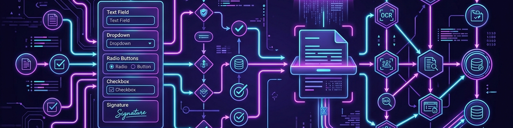

# Leitor de Estrutura de Formulários

## Finalidade

Analisar formulários em JSON, YAML, CSV ou texto de forma independente de aplicação.

**Resultado:** Visão geral dos campos, riscos de validação, achados de acessibilidade e melhorias concretas.

## Fluxo de Trabalho

1. Esclarecer o objetivo, o contexto e o formato de saída desejado.
2. Usar apenas as informações fornecidas no pedido atual.
3. Produzir o resultado de forma estruturada e rastreável.
4. Identificar suposições e obter confirmação antes de quaisquer alterações externas.

## Exemplo

**Entrada:** Verifique este formulário JSON quanto a campos obrigatórios e rótulos compreensíveis.

**Resultado:** Visão geral dos campos, riscos de validação, achados de acessibilidade e melhorias concretas.

## Núcleo Público e Extensões Privadas

Esta skill pública contém apenas o método transferível. Adaptadores específicos de aplicações, contas, caminhos locais, bases de dados e preferências pessoais pertencem a um perfil complementar privado ou a um fork privado e não devem ser incluídos neste repositório.

Sem perfil privado, a skill trabalha apenas com as informações expressamente fornecidas no pedido atual.

## Limites e Privacidade

- Os dados não são armazenados por padrão.
- Nenhuma fonte, arquivo ou interface é aberta ou alterada sem autorização expressa.

## Registro de Alterações

### 2.0.0 (2026-07-30)

- Núcleo público neutro quanto ao utilizador; integrações privadas e perfis pessoais removidos.
