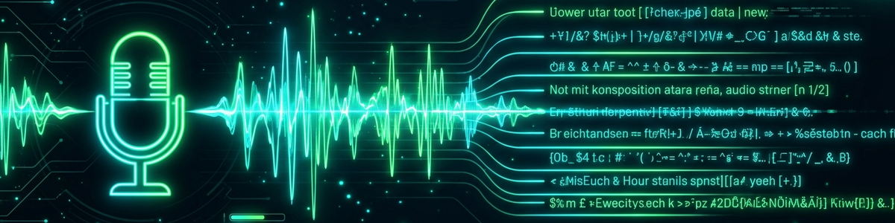

> **Français** — Version française officielle de la compétence `transkription`.

# Transcription audio/vidéo (`transkription`)

## Objectif

Convertir des fichiers audio/vidéo en texte — localement, sans dépendance cloud
obligatoire. La compétence détecte automatiquement si Whisper ou Vosk est installé
et choisit le meilleur backend disponible. Sans backend, elle fonctionne en mode
dry-run et renvoie un texte fictif, afin que le flux de travail reste toujours
opérationnel.

Les transcriptions sont enregistrées localement dans `transkription/store.db` et
peuvent être consultées.

---

## Déclencheurs

| Formulation | Action |
|---|---|
| « Transcris cet audio » | Transcrire le fichier audio |
| « Transcris [fichier] » | Transcrire le fichier nommé |
| « Montre mes transcriptions » | Lister les dernières transcriptions |
| « Recherche dans les transcriptions [terme] » | Recherche plein texte dans les transcriptions |
| « Exporte la transcription [ID] » | Exporter la transcription en TXT |

---

## Flux de travail

1. **Vérification du backend** : contrôler si `whisper` ou `vosk` est importable.
2. **Vérification du fichier** : le fichier d'entrée doit exister (audio : wav, mp3, m4a, ogg, flac ; vidéo : mp4, mkv, webm — extraction via ffmpeg).
3. **Transcription** : appeler le backend et récupérer le texte brut.
4. **Enregistrement** : stocker le résultat avec les métadonnées (fichier, durée, langue, backend, horodatage) dans `store.db`.
5. **Sortie** : renvoyer le texte ; l'exporter éventuellement en `.txt`.

---

## Point d'entrée CLI

```bash
# Transcrire un fichier
python transkription_core.py transcribe audio.wav

# Avec langue explicite
python transkription_core.py transcribe audio.mp3 --lang fr

# Dry-run (aucun backend requis)
python transkription_core.py transcribe audio.wav --dry-run

# Lister les transcriptions
python transkription_core.py list [--limit 20]

# Recherche plein texte
python transkription_core.py search "terme"

# Exporter
python transkription_core.py export <id> [--out fichier.txt]

# Vérifier les backends
python transkription_core.py check

# Chemin de stockage alternatif (p. ex. pour les tests)
python transkription_core.py --store /tmp/test.db transcribe audio.wav --dry-run
```

---

## Stockage

| Propriété | Valeur |
|---|---|
| Type | SQLite |
| Chemin (par défaut) | `skills/assist/transkription/store.db` |
| Surcharge | `--store <chemin>` ou variable d'env `TRANSKRIPTION_STORE` |
| Tables | `transcripts` |

### Schéma `transcripts`

```sql
CREATE TABLE IF NOT EXISTS transcripts (
    id          TEXT PRIMARY KEY,  -- UUID (court : 8 hex)
    file_path   TEXT NOT NULL,     -- Chemin d'origine du fichier audio
    file_name   TEXT NOT NULL,     -- Nom du fichier (sans chemin, pour affichage)
    text        TEXT NOT NULL,     -- Texte transcrit
    language    TEXT,              -- Langue (ex. "de", "en", "fr")
    backend     TEXT,              -- "whisper" | "vosk" | "dry-run"
    duration_s  REAL,              -- Durée en secondes (si connue)
    created_at  TEXT NOT NULL,     -- Horodatage ISO-8601
    tags        TEXT               -- Tags séparés par des virgules (optionnel)
);
```

---

## Posture

- Sans backend installé, la compétence fonctionne en mode dry-run (texte de démonstration).
- Whisper est préféré à Vosk (meilleure qualité pour l'allemand).
- Le choix entre Whisper et Vosk peut être défini via `assist/prefs.json` (`transkription_backend: "whisper"|"vosk"|"auto"`).
- `ffmpeg` pour l'extraction vidéo est requis séparément et n'est pas inclus dans la compétence.

---

## Confidentialité

- **Toutes les transcriptions restent locales** — aucun transfert vers le cloud sans le mode en ligne de Whisper.
- Whisper peut être utilisé localement (modèle tiny/base/medium) ou via l'API OpenAI.
  Par défaut, le modèle local est utilisé.
- `store.db` contient des propos potentiellement sensibles — **ne pas commiter dans Git**.
- Recommandation : ajouter `store.db` dans `.gitignore`.

---

## Ressources associées

- BACH `hub/_services/voice/voice_stt.py` — modèle de backend (inspiration, lecture seule)
- Compétence `utilities/yt-transcriber` — transcription YouTube (compétence distincte, pas de doublon : spécifique à YouTube)
- `tools/module-installer/module_installer.py` — le registre contient whisper + vosk

---

## Journal des modifications

| Version | Date | Modification |
|---|---|---|
| 0.1.1 | 2026-11-22 | Avis de langue corrigé |
| 0.1.0 | 2026-06-22 | Création initiale — stockage SQLite propre, contrôle de présence Whisper/Vosk |