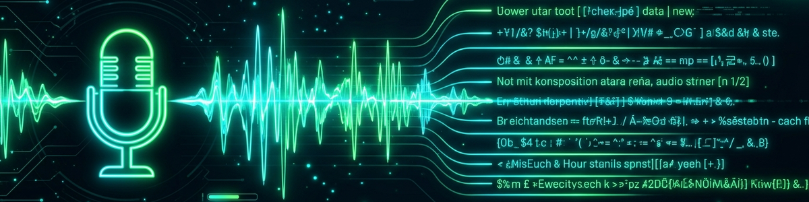

## Finalidade

Converter arquivos de áudio/vídeo em texto — localmente, sem obrigatoriedade de nuvem. A skill detecta por si mesma se Whisper ou Vosk está instalado e escolhe o melhor backend disponível. Sem backend, ela roda em modo dry-run e retorna um texto de placeholder, para que o fluxo de trabalho sempre funcione.

As transcrições são armazenadas localmente em `transkription/store.db` e podem ser consultadas.

---

## Gatilhos

| Frase | Ação |
|---|---|
| „Transkribiere diese Audio" / „Transcreva este áudio" | Transcrever arquivo de áudio |
| „Transkribiere [Datei]" / „Transcreva [arquivo]" | Transcrever o arquivo indicado |
| „Zeig meine Transkripte" / „Mostre minhas transcrições" | Listar as últimas transcrições |
| „Suche Transkript [Begriff]" / „Pesquise transcrição [termo]" | Pesquisa de texto completo nas transcrições |
| „Exportiere Transkript [ID]" / „Exporte transcrição [ID]" | Exportar a transcrição como TXT |

---

## Fluxo de trabalho

1. **Verificação do backend**: verificar se `whisper` ou `vosk` pode ser importado.
2. **Verificação do arquivo**: o arquivo de entrada deve existir (áudio: wav, mp3, m4a, ogg, flac; vídeo: mp4, mkv, webm — extração via ffmpeg).
3. **Transcrição**: chamar o backend e obter o texto bruto.
4. **Armazenamento**: salvar o resultado com metadados (arquivo, duração, idioma, backend, carimbo de data/hora) em `store.db`.
5. **Saída**: retornar o texto; opcionalmente exportá-lo como `.txt`.

---

## Entrada via CLI

```bash
# Datei transkribieren
python transkription_core.py transcribe audio.wav

# Mit expliziter Sprache
python transkription_core.py transcribe audio.mp3 --lang de

# Dry-Run (kein Backend nötig)
python transkription_core.py transcribe audio.wav --dry-run

# Transkripte auflisten
python transkription_core.py list [--limit 20]

# Volltextsuche
python transkription_core.py search "Begriff"

# Exportieren
python transkription_core.py export <id> [--out datei.txt]

# Backend-Check
python transkription_core.py check

# Alternativer Store-Pfad (z.B. für Tests)
python transkription_core.py --store /tmp/test.db transcribe audio.wav --dry-run
```

---

## Store

| Propriedade | Valor |
|---|---|
| Tipo | SQLite |
| Caminho (padrão) | `skills/assist/transkription/store.db` |
| Substituição | `--store <pfad>` ou Env `TRANSKRIPTION_STORE` |
| Tabelas | `transcripts` |

### Schema `transcripts`

```sql
CREATE TABLE IF NOT EXISTS transcripts (
    id          TEXT PRIMARY KEY,  -- UUID (kurz: 8 Hex)
    file_path   TEXT NOT NULL,     -- Originalpfad der Audiodatei
    file_name   TEXT NOT NULL,     -- Dateiname (ohne Pfad, für Anzeige)
    text        TEXT NOT NULL,     -- Transkribierter Text
    language    TEXT,              -- Sprache (z.B. "de", "en")
    backend     TEXT,              -- "whisper" | "vosk" | "dry-run"
    duration_s  REAL,              -- Dauer in Sekunden (wenn bekannt)
    created_at  TEXT NOT NULL,     -- ISO-8601 Timestamp
    tags        TEXT               -- Komma-getrennte Tags (optional)
);
```

---

## Princípios

- Sem backend instalado, a skill funciona em modo dry-run (texto de demonstração).
- Whisper é preferido em relação ao Vosk (melhor qualidade em alemão).
- A escolha entre Whisper e Vosk pode ser definida por `assist/prefs.json` (`transkription_backend: "whisper"|"vosk"|"auto"`).
- O ffmpeg para extração de vídeo é necessário separadamente e não está incluído na skill.

---

## Privacidade

- **Todas as transcrições permanecem locais** — nenhuma transmissão para a nuvem sem o modo online do Whisper.
- O Whisper pode ser usado localmente (modelo tiny/base/medium) ou pela API da OpenAI.
  Por padrão, o modelo local é utilizado.
- `store.db` contém conteúdo de conversas potencialmente sensível — **não fazer commit no Git**.
- Recomendação: complementar `.gitignore` com `store.db`.

---

## Recursos relacionados

- BACH `hub/_services/voice/voice_stt.py` — padrão de backend (inspiração, somente leitura)
- Skill `utilities/yt-transcriber` — transcrição do YouTube (skill separada, não duplicada: específica para YT)
- `tools/module-installer/module_installer.py` — o registro contém whisper + vosk

---

## Changelog

| Versão | Data | Alteração |
|---|---|---|
| 0.1.0 | 2026-06-22 | Criação inicial — store SQLite próprio, verificação de presença de Whisper/Vosk |
