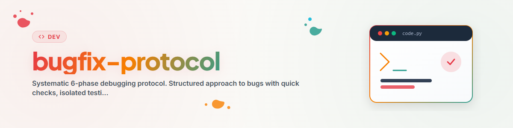

# বাগফিক্স-প্রোটোকল: পদ্ধতিগত ৬-ধাপের ডিবাগিং

বাগের ক্ষেত্রে কাঠামোগত পদ্ধতি — লক্ষণ বিশ্লেষণ থেকে যাচাইকরণ পর্যন্ত।
পরিকল্পনাহীন এলোমেলো চেষ্টা এড়ায় এবং নিশ্চিত করে যে ফিক্সগুলো টেকসই।

---

## সংক্ষিপ্ত বিবরণ

| ধাপ | নাম | লক্ষ্য | সর্বোচ্চ সময় |
|-----|-----|--------|---------------|
| 1 | দ্রুত পরীক্ষা | সুস্পষ্ট কারণগুলো বাদ দেওয়া | 2 মিনিট |
| 2 | রোগনির্ণয় | কারণ চিহ্নিত করা | 10 মিনিট |
| 3 | বিচ্ছিন্ন পরীক্ষা | বাগটি পুনরুৎপাদনযোগ্য করা | 5 মিনিট |
| 4 | ফিক্স | ন্যূনতম সংশোধন | 10 মিনিট |
| 5 | যাচাইকরণ | ফিক্স ও পার্শ্বপ্রতিক্রিয়া পরীক্ষা | 5 মিনিট |
| 6 | ডকুমেন্টেশন | জ্ঞান সংরক্ষণ | 2 মিনিট |

**২০-মিনিটের নিয়ম:** ২০ মিনিট পরেও অগ্রগতি না হলে → পদ্ধতি বদলান বা সাহায্য নিন।

---

## ধাপ ১: দ্রুত পরীক্ষা (2 মিনিট)

গভীরে যাওয়ার আগে — সবচেয়ে সাধারণ কারণগুলো পরীক্ষা করুন:

### চেকলিস্ট

- [ ] **সিনট্যাক্স ত্রুটি?** ত্রুটিবার্তা মনোযোগ দিয়ে পড়ুন, লাইন পরীক্ষা করুন
- [ ] **ইমপোর্ট ত্রুটি?** মডিউল ইনস্টল করা আছে? সঠিক নাম? সার্কুলার ইমপোর্ট?
- [ ] **টাইপো?** ভেরিয়েবল/ফাংশনের নাম সঠিক?
- [ ] **ভুল ডেটা টাইপ?** Int-এর জায়গায় String? অবজেক্ট প্রত্যাশিত জায়গায় None?
- [ ] **পুরোনো ক্যাশ?** `__pycache__` মুছুন, পুনরায় চালু করুন
- [ ] **ভুল পরিবেশ?** সঠিক venv সক্রিয়? সঠিক Python সংস্করণ?
- [ ] **এনকোডিং?** UTF-8 বনাম cp1252 (Windows-এর পরিচিত সমস্যা)

### দ্রুত ক্রিয়া

```bash
# Cache leeren
find . -name "__pycache__" -type d -exec rm -rf {} + 2>&1
find . -name "*.pyc" -delete 2>&1

# Imports pruefen
python -c "import modulname"

# Syntax pruefen
python -m py_compile datei.py
```

---

## ধাপ ২: রোগনির্ণয় (10 মিনিট)

### কৌশল: বাইরে থেকে ভেতরে

1. **ত্রুটিবার্তা বিশ্লেষণ করুন** — Traceback নিচ থেকে উপরের দিকে পড়ুন
2. **সাম্প্রতিক পরিবর্তনগুলো পরীক্ষা করুন** — `git diff`, `git log --oneline -10`
3. **রোগনির্ণয় টুল ব্যবহার করুন** — প্রকল্প অনুযায়ী নিজস্ব রোগনির্ণয় টুল ব্যবহার করুন

### রোগনির্ণয় টুল (উদাহরণ)

প্রকল্পভেদে বিশেষায়িত রোগনির্ণয় স্ক্রিপ্ট সহায়ক হতে পারে:

| টুল | উদ্দেশ্য |
|-----|----------|
| `import_diagnose.py` | ইমপোর্ট সমস্যা বিশ্লেষণ |
| `method_analyzer.py` | মেথড সিগনেচার পরীক্ষা |
| `env_checker.py` | এনভায়রনমেন্ট ভেরিয়েবল/পাথ যাচাই |

> **দ্রষ্টব্য:** প্রকল্প অনুযায়ী নিজস্ব রোগনির্ণয় টুল তৈরি করুন বা বিদ্যমান
> প্রকল্প-টুল ব্যবহার করুন। গুরুত্বপূর্ণ হলো পদ্ধতিগত পথ, নির্দিষ্ট টুল নয়।

### ডিবাগিং কৌশল

```python
# 1. Print-Debugging (schnell aber effektiv)
print(f"DEBUG: variable={variable!r}, type={type(variable)}")

# 2. Breakpoint (interaktiv)
breakpoint()  # Python 3.7+

# 3. Traceback erweitern
import traceback
traceback.print_exc()

# 4. Logging statt Print
import logging
logging.basicConfig(level=logging.DEBUG)
logger = logging.getLogger(__name__)
logger.debug(f"State: {state!r}")
```

---

## ধাপ ৩: বিচ্ছিন্ন পরীক্ষা (5 মিনিট)

### ন্যূনতম পুনরুৎপাদনযোগ্য উদাহরণ (MRE)

লক্ষ্য: ন্যূনতম কোড দিয়ে বাগটি পুনরুৎপাদন করা।

```python
# test_bug.py — Minimaler Reproduktions-Test
"""
Bug: [Kurze Beschreibung]
Erwartet: [Was sollte passieren]
Tatsaechlich: [Was passiert stattdessen]
"""

# Minimaler Setup
# ... nur das Noetigste

# Bug-Ausloeser
# ... exakter Code der den Bug triggert

# Erwartetes Ergebnis
# assert result == expected, f"Got {result}"
```

### বিচ্ছিন্নকরণ কৌশল

1. **নতুন ফাইল:** আলাদা ফাইলে বাগটি পুনরুৎপাদন করুন
2. **নির্ভরতা সরান:** একটি একটি করে, যতক্ষণ না বাগ অদৃশ্য হয়
3. **অর্ধেক করুন:** কোড-ব্লক অর্ধেক করুন, কোন অংশে বাগ আছে পরীক্ষা করুন
4. **Git Bisect:** `git bisect start`, `git bisect bad`, `git bisect good <commit>`

---

## ধাপ ৪: ফিক্স (10 মিনিট)

### নীতিসমূহ

1. **ন্যূনতম:** যতটা সম্ভব কম পরিবর্তন করুন
2. **বুঝে ঠিক করুন:** কখনো অন্ধভাবে ফিক্স করবেন না — কেন ভাঙল তা বুঝুন
3. **একটি বিষয়:** প্রতি কমিটে একটি ফিক্স, একসাথে একাধিক সমস্যা নয়
4. **পশ্চাৎ-সামঞ্জস্যপূর্ণ:** বিদ্যমান কার্যকারিতা ভাঙবেন না

### ফিক্স-প্যাটার্ন

```python
# SCHLECHT: Symptom behandeln
try:
    result = broken_function()
except:  # Alles schlucken
    result = default_value

# GUT: Ursache beheben
def broken_function():
    if input_data is None:  # Eigentliche Ursache: None-Check fehlte
        return default_value
    return process(input_data)
```

### সাধারণ ফিক্স-বিভাগ

| বিভাগ | সাধারণ ফিক্স |
|-------|--------------|
| None/Null | গার্ড-ক্লজ: `if x is None: return default` |
| ইনডেক্স ত্রুটি | সীমা-পরীক্ষা: `if i < len(lst)` |
| টাইপ ত্রুটি | স্পষ্ট রূপান্তর: `str(x)`, `int(x)` |
| ইমপোর্ট ত্রুটি | পাথ সংশোধন, প্যাকেজ ইনস্টল |
| এনকোডিং | UTF-8 স্পষ্টভাবে নির্দিষ্ট করুন: `encoding='utf-8'` |
| রেস কন্ডিশন | Lock/Mutex, বা ক্রম পরিবর্তন |
| স্টেট-বাগ | ইনিশিয়ালাইজেশন পরীক্ষা, রিসেট যোগ করুন |

---

## ধাপ ৫: যাচাইকরণ (5 মিনিট)

### চেকলিস্ট

- [ ] **বাগ ফিক্স হয়েছে:** মূল সমস্যা আর ঘটছে না
- [ ] **MRE উত্তীর্ণ:** বিচ্ছিন্ন পরীক্ষা সফলভাবে চলছে
- [ ] **কোনো রিগ্রেশন নেই:** বিদ্যমান পরীক্ষাগুলো এখনও চলছে
- [ ] **এজ কেস:** ফাঁকা ইনপুট, None, বড় ডেটা পরীক্ষিত
- [ ] **প্রকল্প-টুল:** প্রাসঙ্গিক টেস্ট/ভ্যালিডেশন টুল আছে কিনা প্রকল্পের টুল-ডিরেক্টরিতে দেখুন

### টেস্ট-কমান্ড

```bash
# Unit-Tests
python -m pytest tests/ -v

# Nur betroffene Tests
python -m pytest tests/test_modul.py -v -k "test_name"

# Type-Check
python -m mypy datei.py

# Lint
python -m flake8 datei.py
```

---

## ধাপ ৬: ডকুমেন্টেশন (2 মিনিট)

### বাগ-রিপোর্ট টেমপ্লেট

```markdown
## Bug-Report: [Kurztitel]

**Datum:** YYYY-MM-DD
**Schwere:** kritisch / hoch / mittel / niedrig
**Komponente:** [Modul/Datei]

### Symptom
[Was der User sieht / Fehlermeldung]

### Ursache
[Technische Root-Cause]

### Fix
[Was geaendert wurde + warum]

### Betroffene Dateien
- `datei1.py` — [Aenderung]
- `datei2.py` — [Aenderung]

### Praevention
[Wie kann dieser Bug-Typ in Zukunft vermieden werden?]
```

### কমিট-মেসেজ ফরম্যাট

```
fix: [Kurze Beschreibung des Fixes]

Ursache: [Root-Cause in einem Satz]
Fix: [Was geaendert wurde]
Test: [Wie verifiziert]
```

---

## PyQt6 / GUI ডিবাগিং — সাধারণ ফাঁদ

> এই বিভাগটি PyQt6/PySide6 দিয়ে তৈরি ডেস্কটপ-GUI প্রকল্পের জন্য প্রাসঙ্গিক।

### শীর্ষ ৫ PyQt6 ফাঁদ

| ফাঁদ | সমস্যা | সমাধান |
|------|--------|--------|
| **Signal-Slot বিচ্ছিন্নতা** | Signal সংযুক্ত কিন্তু হ্যান্ডলার চলে না | হ্যান্ডলারে `print`, সিগনেচার পরীক্ষা করুন |
| **Thread-Safety** | Worker-থ্রেড থেকে GUI আপডেট | `QMetaObject.invokeMethod` ব্যবহার করুন বা Signal ব্যবহার করুন |
| **Layout-Cascade** | উইজেট অদৃশ্য/ভুল স্থানে | `widget.show()`, Layout-হায়ারার্কি পরীক্ষা করুন |
| **Event-Loop ব্লক** | GUI জমে যায় | দীর্ঘমেয়াদী কাজ QThread-এ সরান |
| **Garbage Collection** | উইজেট হঠাৎ অদৃশ্য হয় | রেফারেন্স `self.widget` হিসেবে রাখুন |

### PyQt6 ডিবাগ-সহায়ক

```python
# Widget-Hierarchie ausgeben
def dump_widget_tree(widget, indent=0):
    print(" " * indent + f"{widget.__class__.__name__}: {widget.objectName()}")
    for child in widget.findChildren(QWidget):
        if child.parent() == widget:
            dump_widget_tree(child, indent + 2)

# Signal-Debugging
from PyQt6.QtCore import QObject
original_connect = QObject.connect
def debug_connect(self, *args, **kwargs):
    print(f"CONNECT: {self.__class__.__name__} -> {args}")
    return original_connect(self, *args, **kwargs)
```

---

## দ্রুত রেফারেন্স

```
BUG GEFUNDEN?
     │
     ▼
[Phase 1: Schnell-Checks]  ──── Offensichtlich? → FIX
     │
     ▼
[Phase 2: Diagnose]  ────────── Ursache klar? → Phase 4
     │
     ▼
[Phase 3: Isolierter Test]  ── Reproduzierbar? → Phase 4
     │                              │
     │                         Nicht reproduzierbar?
     │                              │
     │                         Logging einbauen,
     │                         auf erneutes Auftreten warten
     ▼
[Phase 4: Fix]  ─────────────── Minimal + verstanden
     │
     ▼
[Phase 5: Verifikation]  ────── Tests gruen? → Phase 6
     │                              │
     │                         Tests rot? → Zurueck zu Phase 4
     ▼
[Phase 6: Dokumentation]  ───── Bug-Report + Commit
```

### ২০-মিনিটের নিয়ম

২০ মিনিট পরেও আটকে গেলে:

1. **পদ্ধতি বদলান** — অন্য ডিবাগিং কৌশল চেষ্টা করুন
2. **রাবার ডাক** — সমস্যাটি জোরে ব্যাখ্যা করুন (বা লিখে ফেলুন)
3. **বিরতি** — ৫ মিনিট সরে যান, তারপর নতুন দৃষ্টিভঙ্গিতে ফিরুন
4. **সাহায্য নিন** — সহকর্মীকে জিজ্ঞাসা করুন, Stack Overflow, ডকুমেন্টেশন দেখুন
5. **পুনরায় শুরু** — `git stash`, সম্পূর্ণ নতুন করে শুরু করুন
