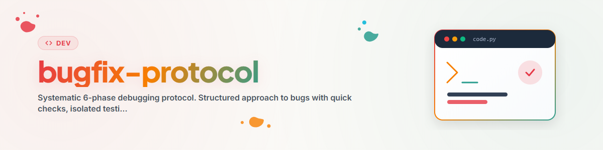

> **Français** — Version française officielle de la compétence `bugfix-protocol`.

# Protocole de correction de bugs : débogage systématique en 6 phases

Approche structurée face aux bugs — de l'analyse des symptômes jusqu'à la vérification.
Évite les tâtonnements désordonnés et garantit des corrections durables.

---

## Aperçu

| Phase | Nom | Objectif | Durée max. |
|-------|-----|----------|------------|
| 1 | Vérifications rapides | Exclure les causes évidentes | 2 min |
| 2 | Diagnostic | Localiser la cause racine | 10 min |
| 3 | Test isolé | Rendre le bug reproductible | 5 min |
| 4 | Correction | Correction minimale | 10 min |
| 5 | Vérification | Contrôler la correction + effets de bord | 5 min |
| 6 | Documentation | Capitaliser les connaissances | 2 min |

**Règle des 20 minutes :** S'il n'y a aucun progrès après 20 minutes → changer d'approche ou demander de l'aide.

---

## Phase 1 : Vérifications rapides (2 min)

Avant d'aller plus loin — vérifier les causes les plus fréquentes :

### Liste de contrôle

- [ ] **Erreur de syntaxe ?** Lire attentivement le message d'erreur, vérifier la ligne
- [ ] **Erreur d'import ?** Module installé ? Nom correct ? Import circulaire ?
- [ ] **Faute de frappe ?** Noms de variables/fonctions corrects ?
- [ ] **Mauvais type de données ?** Chaîne au lieu d'entier ? `None` là où un objet est attendu ?
- [ ] **Cache obsolète ?** Supprimer `__pycache__`, redémarrer
- [ ] **Mauvais environnement ?** Bon `venv` actif ? Bonne version de Python ?
- [ ] **Encodage ?** UTF-8 vs cp1252 (classique sous Windows)

### Actions rapides

```bash
# Vider le cache
find . -name "__pycache__" -type d -exec rm -rf {} + 2>&1
find . -name "*.pyc" -delete 2>&1

# Vérifier les imports
python -c "import modulname"

# Vérifier la syntaxe
python -m py_compile fichier.py
```

---

## Phase 2 : Diagnostic (10 min)

### Stratégie : de l'extérieur vers l'intérieur

1. **Analyser le message d'erreur** — lire la pile d'appels (traceback) de bas en haut
2. **Vérifier les modifications récentes** — `git diff`, `git log --oneline -10`
3. **Utiliser des outils de diagnostic** — employer les outils de diagnostic propres au projet

### Outils de diagnostic (exemples)

Selon le projet, des scripts de diagnostic spécialisés peuvent être utiles :

| Outil | Rôle |
|-------|------|
| `import_diagnose.py` | Analyser les problèmes d'import |
| `method_analyzer.py` | Vérifier les signatures de méthodes |
| `env_checker.py` | Valider les variables d'environnement/chemins |

> **Remarque :** Créer des outils de diagnostic adaptés au projet ou utiliser ceux
> déjà existants. C'est la démarche systématique qui importe, pas l'outil spécifique.

### Techniques de débogage

```python
# 1. Print-Debugging (rapide mais efficace)
print(f"DEBUG: variable={variable!r}, type={type(variable)}")

# 2. Point d'arrêt (interactif)
breakpoint()  # Python 3.7+

# 3. Afficher la pile d'appels (traceback)
import traceback
traceback.print_exc()

# 4. Logging au lieu de print
import logging
logging.basicConfig(level=logging.DEBUG)
logger = logging.getLogger(__name__)
logger.debug(f"State: {state!r}")
```

---

## Phase 3 : Test isolé (5 min)

### Exemple minimal reproductible (MRE)

Objectif : reproduire le bug avec un minimum de code.

```python
# test_bug.py — Test minimal de reproduction
"""
Bug : [Courte description]
Attendu : [Ce qui devrait se passer]
Observé : [Ce qui se passe à la place]
"""

# Configuration minimale
# ... uniquement l'essentiel

# Déclencheur du bug
# ... code exact qui déclenche le bug

# Résultat attendu
# assert result == expected, f"Got {result}"
```

### Stratégies d'isolation

1. **Nouveau fichier :** reproduire le bug dans un fichier dédié
2. **Retirer les dépendances :** une par une, jusqu'à ce que le bug disparaisse
3. **Dichotomie :** diviser le bloc de code par deux, vérifier quelle moitié contient le bug
4. **Git Bisect :** `git bisect start`, `git bisect bad`, `git bisect good <commit>`

---

## Phase 4 : Correction (10 min)

### Principes

1. **Minimale :** modifier le moins de code possible
2. **Comprendre :** ne jamais corriger à l'aveugle — comprendre POURQUOI c'est cassé
3. **Une chose à la fois :** un correctif par commit, ne pas traiter plusieurs problèmes simultanément
4. **Rétrocompatible :** ne pas casser les fonctionnalités existantes

### Modèles de correction

```python
# MAUVAIS : masquer le symptôme
try:
    result = broken_function()
except:  # Tout avaler sans diagnostic
    result = default_value

# BON : corriger la cause racine
def broken_function():
    if input_data is None:  # Cause réelle : contrôle None manquant
        return default_value
    return process(input_data)
```

### Catégories de corrections fréquentes

| Catégorie | Correction typique |
|-----------|--------------------|
| None/Null | Clause de garde : `if x is None: return default` |
| Erreur d'index | Contrôle des bornes : `if i < len(lst)` |
| Erreur de type | Conversion explicite : `str(x)`, `int(x)` |
| Erreur d'import | Corriger le chemin, installer le paquet |
| Encodage | Indiquer UTF-8 explicitement : `encoding='utf-8'` |
| Condition de course | Lock/Mutex, ou modifier l'ordre |
| Bug d'état | Vérifier l'initialisation, ajouter une réinitialisation |

---

## Phase 5 : Vérification (5 min)

### Liste de contrôle

- [ ] **Le bug est corrigé :** le problème initial ne se produit plus
- [ ] **Le MRE passe :** le test isolé réussit
- [ ] **Aucune régression :** les tests existants passent toujours
- [ ] **Cas limites :** entrée vide, `None`, gros volumes testés
- [ ] **Outils du projet :** vérifier dans le répertoire d'outils du projet s'il existe des outils de test ou de validation pertinents

### Commandes de test

```bash
# Tests unitaires
python -m pytest tests/ -v

# Uniquement les tests concernés
python -m pytest tests/test_module.py -v -k "test_name"

# Vérification des types
python -m mypy fichier.py

# Lint
python -m flake8 fichier.py
```

---

## Phase 6 : Documentation (2 min)

### Modèle de rapport de bug

```markdown
## Rapport de bug : [Titre court]

**Date :** YYYY-MM-DD
**Sévérité :** critique / élevée / moyenne / faible
**Composant :** [Module/Fichier]

### Symptôme
[Ce que voit l'utilisateur / message d'erreur]

### Cause
[Cause racine technique]

### Correction
[Ce qui a été modifié + pourquoi]

### Fichiers concernés
- `fichier1.py` — [Modification]
- `fichier2.py` — [Modification]

### Prévention
[Comment éviter ce type de bug à l'avenir ?]
```

### Format de message de commit

```
fix: [Courte description du correctif]

Cause : [Cause racine en une phrase]
Correction : [Ce qui a été modifié]
Test : [Comment vérifié]
```

---

## Débogage PyQt6 / GUI — Pièges fréquents

> Cette section concerne les projets d'interface graphique de bureau avec PyQt6/PySide6.

### Top 5 des pièges PyQt6

| Piège | Problème | Solution |
|-------|----------|----------|
| **Déconnexion Signal-Slot** | Signal connecté mais le gestionnaire ne s'exécute pas | `print` dans le gestionnaire, vérifier la signature |
| **Thread-Safety** | Mise à jour GUI depuis un thread worker | Utiliser `QMetaObject.invokeMethod` ou un signal |
| **Cascade de layout** | Widget invisible ou mal placé | `widget.show()`, vérifier la hiérarchie des layouts |
| **Blocage de la boucle d'événements** | L'interface se fige | Déporter les opérations longues dans un `QThread` |
| **Garbage Collection** | Le widget disparaît soudainement | Conserver la référence via `self.widget` |

### Outils de débogage PyQt6

```python
# Afficher la hiérarchie des widgets
def dump_widget_tree(widget, indent=0):
    print(" " * indent + f"{widget.__class__.__name__}: {widget.objectName()}")
    for child in widget.findChildren(QWidget):
        if child.parent() == widget:
            dump_widget_tree(child, indent + 2)

# Débogage des signaux
from PyQt6.QtCore import QObject
original_connect = QObject.connect
def debug_connect(self, *args, **kwargs):
    print(f"CONNECT: {self.__class__.__name__} -> {args}")
    return original_connect(self, *args, **kwargs)
```

---

## Référence rapide

```
BUG TROUVÉ ?
     │
     ▼
[Phase 1 : Vérifications rapides]  ──── Évident ? → CORRECTION
     │
     ▼
[Phase 2 : Diagnostic]             ──── Cause claire ? → Phase 4
     │
     ▼
[Phase 3 : Test isolé]             ──── Reproductible ? → Phase 4
     │                                       │
     │                                  Non reproductible ?
     │                                       │
     │                                  Ajouter des logs,
     │                                  attendre une réapparition
     ▼
[Phase 4 : Correction]             ──── Minimale + comprise
     │
     ▼
[Phase 5 : Vérification]           ──── Tests verts ? → Phase 6
     │                                       │
     │                                  Tests rouges ? → Retour Phase 4
     ▼
[Phase 6 : Documentation]          ──── Rapport de bug + Commit
```

### Règle des 20 minutes

Si vous êtes bloqué après 20 minutes :

1. **Changer d'approche** — essayer une autre technique de débogage
2. **Rubber Duck** — expliquer le problème à voix haute (ou par écrit)
3. **Faire une pause** — s'éloigner 5 minutes, puis revenir avec un regard neuf
4. **Demander de l'aide** — consulter un collègue, Stack Overflow, la documentation
5. **Réinitialiser** — `git stash`, repartir complètement à zéro

## Journal des modifications

### 1.1.1 (2026-11-22)
- Avis de langue corrigé