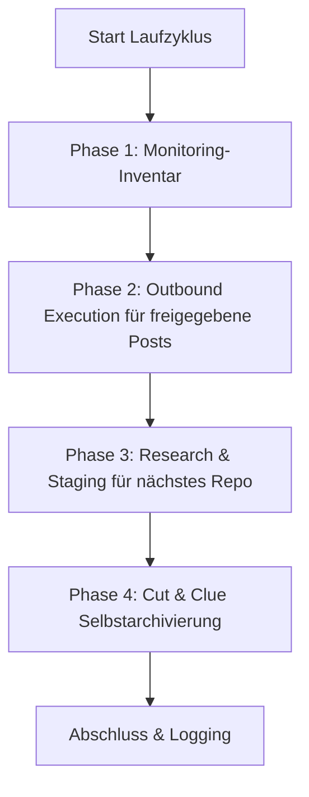

# أداة التواصل المجتمعي والتوصية بالحلول

مهارة محايدة للمزوّد ونماذج اللغة الكبيرة ونظام التشغيل، للتعريف الآلي والموجّه نحو الحلول بالبرمجيات مفتوحة المصدر والمستودعات والأدوات في مجتمعات المطورين وخيوط Reddit والمنتديات وتعليقات الفيديو.

---

## 🌟 المبادئ الأساسية وضمانات الأمان

1. **الإنسان في الحلقة والنشر المغلق عند الفشل:**
   * لا يُنشر أي منشور آلي مباشرةً دون مراجعة بشرية مسبقة.
   * تُعرض المسودات في `POST-EINGANG.md`. تسمح خانة الاختيار `- [x] Genehmigt` فقط بمحاولة النشر.
   * لا يُسجَّل السجل والتدوير والمخرجات وسجل التكرار إلا بعد وجود `PublishReceipt` كامل ومرتبط بالمنصة وعنوان URL المستهدف. وبدون ناشر متصل يبقى الإدخال في قائمة الانتظار.
2. **مكافحة الرسائل المزعجة وملاءمة 100%(„الامتناع عن النشر أفضل من نشر غير ملائم“):**
   * يعالج كل منشور مشكلة تقنية محددة مصوغة في الخيط المستهدف.
   * الالتزام الصارم بقواعد المجتمع والمنصة المعنية (لا إعلان مستتر، والإعلان الشفاف عن الكاتب/المشرف على المشروع).
3. **حماية صارمة من التكرار:**
   * يسجّل `posts_history.json` و`POSTVERZEICHNIS.md` كل عنوان URL مستهدف مثبت بإيصال.
   * لا يُخاطَب أي خيط أو فيديو مرتين.
4. **التناوب العادل بالدورة ودوران المنصات:**
   * تُدوَّر المشاريع حسب أطول فترة غياب (يأخذ كل مستودع دوره بالتساوي).
   * تُتناوب المنصات (Reddit و$\rightarrow$ وYouTube و$\rightarrow$ و$\rightarrow$ وDev.to / المنتديات المتخصصة وReddit).
5. **الأرشفة الذاتية بالقطع والتوجيه:**
   * تُنقل مخرجات المنشورات التاريخية تلقائياً عند بلوغ حد الحجم إلى `_archive/`، ويُشار إليها في الترويسة.

---

## 📂 البنية الأساسية القياسية

ينشئ المهارة في دليل الهدف (`<workspace_root>/.COMMUNITY_OUTREACH/` أو ما شابه) البنية المعيارية التالية:

| الملف | الغرض |
| :--- | :--- |
| `USECASES.md` | نظرة عامة على جميع المستودعات وحالات استخدامها والمشكلات المستهدفة التي تحلها |
| `usecases.json` | قاعدة بيانات تدوير قابلة للقراءة آلياً تتضمن الطوابع الزمنية والبيانات الوصفية |
| `POST-EINGANG.md` | قائمة انتظار موافقات الإنسان في الحلقة مع خانات اختيار `- [ ] Genehmigt` |
| `POST-AUSGANG.md` | رصد المنشورات المنشورة وتغذية المجتمع الواردة |
| `POSTVERZEICHNIS.md` | فهرس الحماية العام من تكرار عناوين URL والخيوط |
| `ACCOUNTVERZEICHNIS.md` | نظرة عامة على الملفات الشخصية المصرّح بها وآليات تسجيل الدخول الموحد SSO |
| `config.json` | إعدادات النسخة (المستودعات والترددات والمنصات المستهدفة) |

يوجد وصف وقت التشغيل المتحقَّق منه في [`references/runtime-readme.md`](references/runtime-readme.md).

---

## 🔄 دورة التشغيل ذات المراحل الأربع



1. **المرحلة 1 (جرد الرصد):** تُحصي إدخالات السجل المنشورة بوصفها خيوطاً تُفحص محلياً. لا ينسحب النواة على ردود المنصات؛ فذلك يتطلب موصلاً وارداً منفصلاً ومصرّحاً به.
2. **المرحلة 2 (التنفيذ الصادر):** تتحقق من الإدخالات المعتمدة وتكرارات عناوين URL المطابقة والناشر المتصل. لا يُحدث إلا `PublishReceipt` مُتحقَّق منه تغييرات محلية في الحالة. لا ينشر المحوّل المرفق بواجهة سطر الأوامر أي شيء بذاته.
3. **المرحلة 3 (مهمة البحث):** تختار عبر التناوب العادل المستودع الذي لم يُستخدم لأطول فترة، وتُسلّم `needs-action`. لا يحق إلا لبحث منفصل أن يحفظ عنوان URL مستهدفاً حقيقياً وحديثاً وغير مستخدم بعد، ومسودة مُدقَّقة في `POST-EINGANG.md`؛ ولا تُنشأ عناصر نائبة.
4. **المرحلة 4 (الأرشفة الذاتية):** تؤرشف أقدم الإدخالات المكتملة إلى `_archive/`، وتُبقي أحدث الإدخالات مباشرة، وتكون عديمة التأثير عند التكرار.

يُعد تشغيل `--dry-run` حساباً للخطة فقط: لا يستدعي أي ناشر، ولا يعدّل أي ملف، ولا ينشئ أي دليل.

---

## ⚙️ التشغيل بعدة جدولات ووكلاء

تدعم المهارة جميع بيئات الجدولة والوكلاء الشائعة:

### 1. Antigravity Sidecar / المهمة المجدولة
تُسجَّل كمكوّن جانبي أصلي في `.gemini/config/sidecars/community-outreach/sidecar.json`.
* **الميزة:** تعمل فقط عند فتح التطبيق، مع تحكم كامل من لوحة الواجهة الرسومية.
* **التكرار:** مثلاً مرة يومياً (`0 10 * * *`) أو أربع مرات يومياً (`0 8,12,16,20 * * *`).

### 2. Codex وClaude Code / Cron
* الاستدعاء عبر جلسة سطر أوامر أو عبر مشغّل مهام موجود:
  ```bash
  python scripts/outreach_engine.py --full-run
  ```

### 3. جدولة مهام Windows (`schtasks`)
* اختياري للتنفيذ الذاتي في الخلفية على نظام التشغيل:
  ```powershell
  python scripts/setup_scheduler.py --backend windows --schedule 09:00
  ```

## 📋 البدء السريع (التهيئة)

1. **تهيئة مساحة العمل:**
   ```bash
   python scripts/init_outreach_workspace.py --target-dir ./outreach_data --repo-list ./repos.json
   ```
2. **إسقاط محوّل وقت التشغيل المحمول:**
   ```bash
   python scripts/deploy_runtime.py --target ./outreach_data --json
   ```
   ينسخ النشر النواة والمحوّلات وملف README لوقت التشغيل واختبار الدخان الخاص به فقط؛ وتبقى ملفات البيانات وقائمة الانتظار دون مساس. يتحقق `--check` من الإسقاط دون أي صلاحية كتابة.
3. **تشغيل تجريبي (Dry-Run):**
   ```bash
   python scripts/outreach_engine.py --workspace ./outreach_data --dry-run
   ```
   تبقى حالة الإرجاع `needs-action` ما دام البحث الحقيقي أو الناشر مفقوداً. وهذا ليس خطأً ولا إثباتاً للنشر.
4. **تفعيل الجدولة:**
   ```bash
   python scripts/setup_scheduler.py --backend antigravity --workspace ./outreach_data
   ```

---

## 🔒 الإعدادات الخاصة / المحلية

تُخزَّن المسارات المحددة وبيانات الاعتماد وملفات SSO الشخصية في `config.private.json` أو `.env`. تُستبعد هذه الملفات عبر `.gitignore` ولا تصل أبداً إلى المستودعات العامة.

---

## سجل التغييرات

### 1.1.0 (2026-08-29)
- نواة قياسية مع محوّل وقت تشغيل رقيق ومسارات قراءة متوافقة لمخططي البيانات السابقين.
- `PublishReceipt` عند الفشل، وحماية دقيقة من التكرار، ومعالجة لقائمة الانتظار تحافظ على البايتات، وإسقاط محلي قابل للاستئناف.
- تشغيل تجريبي خالٍ من الكتابة، وأرشفة idempotent قائمة على الإدخالات، وحالة صادقة لـ `needs-action` في المرحلة 3.

### 1.0.0 (2026-08-13)
- الإصدار الأولي: مهارة التواصل المجتمعي والتوصية بالحلول الشاملة.
- محرك من أربع مراحل مع الإنسان في الحلقة وحماية من التكرار والتناوب العادل والأرشفة بالقطع والتوجيه.
- دعم الجدولة المتعددة (Antigravity وجدولة مهام Windows وCron وellmos-scheduler وCodex وClaude Code).
