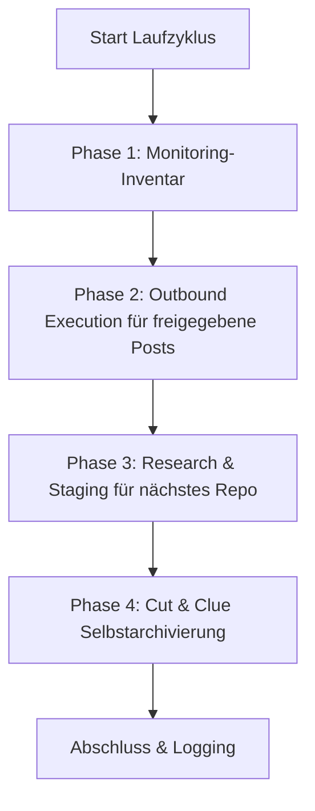

# Community Outreach & Solution Recommender

একটি প্রদানকারী-, LLM- ও অপারেটিং সিস্টেম-নিরপেক্ষ Skill, যা ডেভেলপার কমিউনিটি, Reddit-থ্রেড, ফোরাম ও ভিডিও মন্তব্যে ওপেন-সোর্স সফটওয়্যার, Repository ও টুলগুলো স্বয়ংক্রিয়ভাবে, সমাধান-কেন্দ্রিকভাবে উপস্থাপন করে।

---

## 🌟 মূল নীতি ও নিরাপত্তা-নিশ্চয়তা

1. **Human-in-the-Loop ও fail-closed প্রকাশনা:**
   * কোনো স্বয়ংক্রিয় পোস্ট মানুষের পর্যালোচনা ছাড়া লাইভ হয় না।
   * খসড়াগুলো `POST-EINGANG.md`-এ উপস্থাপন করা হয়। `- [x] Genehmigt` চিহ্নটি শুধু প্রকাশের চেষ্টার অনুমতি দেয়।
   * শুধু একটি সম্পূর্ণ, প্ল্যাটফর্ম ও লক্ষ্য-URL-এ আবদ্ধ `PublishReceipt` History, Rotation, আউটপুট ও ডুপ্লিকেট-রেজিস্টার আপডেট করতে পারে। সংযুক্ত Publisher না থাকলে এন্ট্রি Queue-তেই থাকে।
2. **Anti-Spam ও 100% প্রাসঙ্গিকতা („Lieber kein Post als ein unpassender“ — অপ্রাসঙ্গিক পোস্টের চেয়ে কোনো পোস্ট না করা ভালো):**
   * প্রতিটি পোস্ট লক্ষ্য-থ্রেডে সুনির্দিষ্টভাবে বর্ণিত একটি প্রযুক্তিগত সমস্যার সমাধান করে।
   * সংশ্লিষ্ট কমিউনিটি ও প্ল্যাটফর্মের নিয়মাবলি কঠোরভাবে মানা হয় (গোপন বিজ্ঞাপন নয়, লেখক/Maintainer হিসেবে স্বচ্ছ উল্লেখ)।
3. **কঠোর ডুপ্লিকেট-সুরক্ষা:**
   * `posts_history.json` ও `POSTVERZEICHNIS.md` Receipt দ্বারা প্রমাণিত প্রতিটি লক্ষ্য-URL লিপিবদ্ধ করে।
   * কোনো থ্রেড বা ভিডিও কখনো দুইবার সম্বোধন করা হয় না।
4. **Fair Round-Robin ও প্ল্যাটফর্ম-রোটেশন:**
   * দীর্ঘতম অনুপস্থিতির ভিত্তিতে প্রজেক্ট রোটেট করা হয় (প্রতিটি Repo সমানভাবে সুযোগ পায়)।
   * প্ল্যাটফর্ম পালাক্রমে ব্যবহৃত হয় (Reddit $\rightarrow$ YouTube $\rightarrow$ Dev.to / Fachforen $\rightarrow$ Reddit)।
5. **Cut-and-Clue স্বয়ং-আর্কাইভিং:**
   * একটি আকারসীমায় পৌঁছলে ঐতিহাসিক আউটপুট স্বয়ংক্রিয়ভাবে `_archive/`-এ সরানো হয় এবং Header-এ উল্লেখ করা হয়।

---

## 📂 স্ট্যান্ডার্ড অবকাঠামো

Skill একটি লক্ষ্য-ডিরেক্টরিতে (`<workspace_root>/.COMMUNITY_OUTREACH/` বা অনুরূপ) নিম্নলিখিত মডিউলার কাঠামো তৈরি করে:

| ফাইল | উদ্দেশ্য |
| :--- | :--- |
| `USECASES.md` | সব Repository, তাদের Usecase ও সমাধানকৃত লক্ষ্য-সমস্যার সারসংক্ষেপ |
| `usecases.json` | টাইমস্ট্যাম্প ও মেটাডেটাসহ মেশিন-পঠনযোগ্য Rotation-ডেটাবেস |
| `POST-EINGANG.md` | `- [ ] Genehmigt` চেকবক্সসহ Human-in-the-Loop অনুমোদন-Queue |
| `POST-AUSGANG.md` | প্রকাশিত পোস্টের মনিটরিং ও Inbound কমিউনিটি-প্রতিক্রিয়া |
| `POSTVERZEICHNIS.md` | বৈশ্বিক URL- ও Thread-ডুপ্লিকেট-সুরক্ষা সূচক |
| `ACCOUNTVERZEICHNIS.md` | অনুমোদিত প্রোফাইল ও SSO-লগইন ব্যবস্থার সারসংক্ষেপ |
| `config.json` | ইনস্ট্যান্স-কনফিগারেশন (Repos, ফ্রিকোয়েন্সি, লক্ষ্য-প্ল্যাটফর্ম) |

যাচাইকৃত রানটাইম-বিবরণ রয়েছে [`references/runtime-readme.md`](references/runtime-readme.md)-এ।

---

## 🔄 ৪-ধাপের রান-চক্র



1. **ধাপ 1 (Monitoring-ইনভেন্টরি):** প্রকাশিত History-এন্ট্রিগুলোকে স্থানীয়ভাবে পরীক্ষা করার থ্রেড হিসেবে গণনা করে। Core প্ল্যাটফর্মের উত্তর আনে না; তার জন্য আলাদা, অনুমোদিত Inbound-Adapter প্রয়োজন।
2. **ধাপ 2 (Outbound Execution):** অনুমোদিত এন্ট্রি, হুবহু URL-ডুপ্লিকেট ও সংযুক্ত Publisher যাচাই করে। শুধু একটি যাচাইকৃত `PublishReceipt` স্থানীয় অবস্থা পরিবর্তন ঘটায়। সাথে দেওয়া CLI-Adapter নিজে কিছু প্রকাশ করে না।
3. **ধাপ 3 (গবেষণা-নির্দেশ):** Fair Round-Robin-এ সবচেয়ে দীর্ঘদিন অব্যবহৃত Repo নির্বাচন করে `needs-action` সরবরাহ করে। শুধু আলাদা গবেষণা প্রকৃত, সাম্প্রতিক ও এখনো ব্যবহৃত হয়নি এমন লক্ষ্য-URL এবং যাচাইকৃত খসড়া `POST-EINGANG.md`-এ সংরক্ষণ করতে পারে; প্লেসহোল্ডার তৈরি করা হয় না।
4. **ধাপ 4 (স্বয়ং-আর্কাইভিং):** সবচেয়ে পুরোনো সম্পূর্ণ এন্ট্রিগুলো `_archive/`-এ আর্কাইভ করে, সর্বশেষ এন্ট্রিগুলো লাইভ রাখে এবং পুনরাবৃত্তিতে idempotent থাকে।

`--dry-run`-সহ একটি রান শুধু পরিকল্পনা-গণনা: এটি কোনো Publisher ডাকে না, কোনো ফাইল বদলায় না এবং কোনো ডিরেক্টরি তৈরি করে না।

---

## ⚙️ Multi-Scheduler ও Multi-Agent পরিচালনা

Skill সব প্রচলিত Scheduler ও Agent-পরিবেশ সমর্থন করে:

### 1. Antigravity Sidecar / Scheduled Task
`.gemini/config/sidecars/community-outreach/sidecar.json`-এ নেটিভ Sidecar হিসেবে নিবন্ধিত হয়।
* **সুবিধা:** অ্যাপ খোলা থাকলেই চলে, GUI-Dashboard-এ সম্পূর্ণ নিয়ন্ত্রণ।
* **ফ্রিকোয়েন্সি:** যেমন দৈনিক 1 বার (`0 10 * * *`) বা দৈনিক 4 বার (`0 8,12,16,20 * * *`)।

### 2. Codex ও Claude Code / Cron
* একটি CLI-Session বা বিদ্যমান Task-Runner-এর মাধ্যমে আহ্বান:
  ```bash
  python scripts/outreach_engine.py --full-run
  ```

### 3. Windows Task Scheduler (`schtasks`)
* স্বয়ংসম্পূর্ণ OS-ব্যাকগ্রাউন্ড-এক্সিকিউশনের জন্য ঐচ্ছিক:
  ```powershell
  python scripts/setup_scheduler.py --backend windows --schedule 09:00
  ```

## 📋 দ্রুত শুরু (Bootstrap)

1. **Workspace শুরু করুন:**
   ```bash
   python scripts/init_outreach_workspace.py --target-dir ./outreach_data --repo-list ./repos.json
   ```
2. **পোর্টেবল Runtime-Adapter প্রজেক্ট করুন:**
   ```bash
   python scripts/deploy_runtime.py --target ./outreach_data --json
   ```
   Deploy শুধু Core, Adapter, Runtime-README ও Runtime-Smoke-Test কপি করে; ডেটা- ও Queue-ফাইল অস্পৃষ্ট থাকে। `--check` কোনো লেখা ছাড়াই প্রজেকশন যাচাই করে।
3. **পরীক্ষামূলক রান (Dry-Run) চালান:**
   ```bash
   python scripts/outreach_engine.py --workspace ./outreach_data --dry-run
   ```
   আসল গবেষণা বা Publisher না থাকা পর্যন্ত রিটার্ন-স্ট্যাটাস `needs-action` থাকে। এটি কোনো ত্রুটি নয় এবং প্রকাশনার প্রমাণও নয়।
4. **Scheduler সক্রিয় করুন:**
   ```bash
   python scripts/setup_scheduler.py --backend antigravity --workspace ./outreach_data
   ```

---

## 🔒 ব্যক্তিগত / স্থানীয় কনফিগারেশন

নির্দিষ্ট পাথ, লগইন-তথ্য ও ব্যক্তিগত SSO-প্রোফাইল `config.private.json` বা `.env`-এ সংরক্ষিত হয়। এই ফাইলগুলো `.gitignore`-এর মাধ্যমে বাদ দেওয়া থাকে এবং কখনো পাবলিক Repository-তে পৌঁছায় না।

---

## Changelog

### 1.1.0 (2026-08-29)
- পাতলা Runtime-Adapter সহ ক্যাননিক্যাল Core এবং উভয় পূর্ববর্তী ডেটা-স্কিমার জন্য সামঞ্জস্যপূর্ণ পঠন-পথ।
- Fail-closed `PublishReceipt`, হুবহু ডুপ্লিকেট-সুরক্ষা, বাইট-সংরক্ষণকারী Queue-প্রক্রিয়াকরণ এবং পুনরারম্ভযোগ্য স্থানীয় প্রজেকশন।
- লেখা-বিহীন Dry-Run, এন্ট্রিভিত্তিক idempotent আর্কাইভিং এবং ধাপ 3-এর জন্য সত্যনিষ্ঠ `needs-action`-স্ট্যাটাস।

### 1.0.0 (2026-08-13)
- প্রাথমিক রিলিজ: Universal Community Outreach & Solution Recommender Skill।
- Human-in-the-Loop, ডুপ্লিকেট-সুরক্ষা, Fair-Round-Robin ও Cut-and-Clue আর্কাইভিং সহ ৪-ধাপের ইঞ্জিন।
- Multi-Scheduler সমর্থন (Antigravity, Windows Task Scheduler, Cron, ellmos-scheduler, Codex, Claude Code)।
