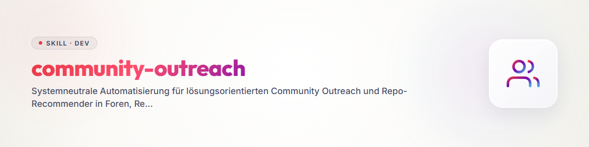

# Community Outreach & Solution Recommender

A provider-, LLM-, and OS-neutral skill for automated, solution-driven recommendation of open-source software, repositories, and developer tools across developer communities, Reddit discussions, technical forums, and video comments.

---

## 🌟 Core Principles & Safety Guarantees

1. **Human-in-the-Loop and fail-closed publishing:**
   * No automated post goes live without explicit human review.
   * Drafts are staged in `POST-EINGANG.md`. The checkbox `- [x] Genehmigt` only authorizes a publication attempt.
   * History, rotation, outbox, and duplicate registry advance only after a complete `PublishReceipt` bound to the platform and target URL. Without an injected publisher, the queue remains unchanged.
2. **Deterministic Claim-to-Code Evidence Contract (`#### Claim-Beleg-Vertrag (Verifiziert):`, Mandatory since `v1.6.0` / 2026-11-13):**
   * Merely listing existing filenames in `- **Code-Beleg (Verifiziert):**` is insufficient: every factual claim about our software in `Textvorschlag` must be bound to verbatim original code via a machine-verifiable JSON contract block:
     ```json
     [
       {
         "text_anchor": "exact substring from Textvorschlag making the software claim",
         "repo": "ellmos-ai/workflowhooker",
         "file": "workflowhooker/cli.py",
         "lines": "103-106",
         "verbatim_code": "exact contiguous code excerpt from that file and line window"
       }
     ]
     ```
   * `_verify_claim_contract()` deterministically enforces across `verify_proposals`, `preview_post`, and `phase2_outbound_execution`:
     1. Valid JSON schema and bounded line windows (`<= 80` lines).
     2. Exact substring match of every `text_anchor` inside `Textvorschlag`.
     3. Path-traversal safety, file existence in `<local_repos_root>/<repo>`, `git ls-files` tracking check (preventing untracked scratch files), and at least one real source-code file for non-skill repositories.
     4. Exact character-for-character match of `verbatim_code` within the declared line range.
     5. Complete sentence-level and filename-level coverage for every software-claim sentence in `Textvorschlag`.
     6. Cross-repo proof whenever a sister repository from the ecosystem (e.g. `Clutch`, `open-compute`, `USMC`, `WorkflowHooker`) is mentioned in the same comment.
     7. Manifest contradiction protection: any `zero-dependency` or `stdlib-only` claim inspects `pyproject.toml` / `package.json` and fails closed if runtime dependencies exist or if the manifest proof is omitted.
3. **Natural Human Comment & Anti-AI-Style Gate (Mandatory since 2026-11-03):**
   * Every draft must inspect 3–5 neighboring comments (`- **Umgebungs-Check (Ton & Länge):**`) and avoid AI-essay patterns (no Markdown headings `###`, no bold markup `**...**`, no em-dashes `—`, no structured 3+ bullet lists, max 1–3 short paragraphs, `<= 1,200` chars on Reddit/YouTube).
4. **Organization Governance & Scope Rules (Mandatory since 2026-11-09):**
   * **Primary Focus (`primary_orgs`):** `ellmos-ai` and Open-Bricks (`dev-bricks`, `file-bricks`, `doc-bricks`, `open-bricks`).
   * **Permanent Exclusion of `biotec-line` (`excluded_orgs: ["biotec-line"]`):** Strictly excluded from catalog sync, candidate selection, preview, verification, and outbound execution for legal/regulatory compliance.
   * **Discourse Positioning Mode for `research-line` (`discourse_only_orgs: ["research-line"]`):** Used specifically for scientific/technical discourse rather than routine tool pitches.
5. **Anti-Spam, 2-Year Thread Age Limit & Blacklist Protection:**
   * Every post directly solves an actual technical problem raised in the target thread (< 24 months old).
   * Rejected proposals, restricted subreddits, blocked platforms (`dev.to`), and excluded organizations (`biotec-line`) are enforced via `rejected_proposals.json` and `BLACKLIST.md`.
6. **Strict Duplicate Prevention:**
   * Global `POSTVERZEICHNIS.md` index tracks every published thread URL; no thread or video is ever targeted twice.
7. **3-Stage Quality & Attention Selection Model (`selection_tier` 1 → 2 → 3) & Platform Rotation:**
   * **Tier 1:** Best module repositories by code quality and standalone idea with low-to-medium human attention (`views_unique_14d <= 6` and unpromoted), PLUS core ecosystem flagships (`ellmos-ai/bach`, `ellmos-ai/open-ocean`, `ellmos-ai/skills`), PLUS 17 curated standout skills (`SPECIFIC_SKILL_PROFILES`).
   * **Tier 2:** High-quality module repositories that already have higher attention (`views_unique_14d > 6` or prior promotions).
   * **Tier 3:** Smaller repositories, specialty modules, seeds, and helper tools.
8. **Cut-and-Clue Self-Archiving:**
   * History logs automatically archive to `_archive/` when size thresholds are reached, maintaining clean pointer headers.

---

## 🔄 4-Phase Execution Cycle

1. **Phase 1 (Monitoring Inventory):** Counts published history records as threads requiring review.
2. **Phase 2 (Outbound Execution):** Validates approved entries, organization exclusions, blacklist, exact URL duplicates, code evidence, deterministic Claim-to-Code Evidence Contract, natural human style, and an injected publisher. Only a verified `PublishReceipt` causes local state changes.
3. **Phase 3 (Research Task):** Selects the next repository via Fair Round-Robin and returns `needs-action`.
4. **Phase 4 (Self-Archiving):** Moves the oldest complete entries into `_archive/`, keeps the newest entries live, and is idempotent.

`--dry-run` is a pure planning mode: it does not invoke a publisher, change a file, or create a directory.

The verified German runtime guide is available at [`references/runtime-readme.md`](references/runtime-readme.md).
Deploy the relative, host-agnostic runtime files with `python scripts/deploy_runtime.py --target <workspace> --json`; add `--check` for a read-only byte comparison.

---

## Changelog

### 1.6.0 (2026-11-13)
- Added deterministic Claim-to-Code Evidence Contract (`#### Claim-Beleg-Vertrag (Verifiziert):` and `compliance.require_claim_contract`) verifying verbatim source code, line windows, `git ls-files` tracking, full software-sentence coverage, sister-repository mentions, and `zero-dependency` manifest consistency across `verify_proposals`, `preview_post`, and `phase2_outbound_execution`.

### 1.5.0 (2026-11-09)
- Added 3-stage quality & attention selection model (`selection_tier` 1 -> 2 -> 3), re-activated `ellmos-ai/skills` alongside `ellmos-ai/bach`, `ellmos-ai/open-ocean`, and 17 standout skills (`SPECIFIC_SKILL_PROFILES`), and added skill-subpath resolution to `verify_proposals`.

### 1.4.0 (2026-11-09)
- Added organization governance (`primary_orgs`, permanent `excluded_orgs` ban for `biotec-line`, and `discourse_only_orgs` mode for `research-line`).

### 1.3.0 (2026-11-03)
- Added `_check_natural_human_style` anti-AI-style gate and mandatory `- **Umgebungs-Check (Ton & Länge):**` thread context check.

### 1.2.0 (2026-11-02)
- Added mandatory `- **Code-Beleg (Verifiziert):**` source-file verification gate (`--verify-proposals`) and `rejected_proposals.json` blacklist enforcement.

### 1.1.0 (2026-08-29)
- Added one canonical core with a thin runtime adapter, fail-closed `PublishReceipt` validation, exact duplicate protection, and write-free dry runs.

### 1.0.0 (2026-08-13)
- Initial release: Universal Community Outreach & Solution Recommender Skill.
