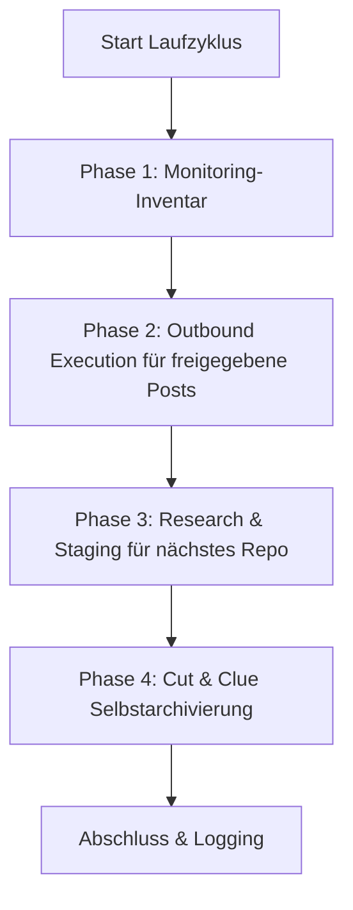

# Alcance Comunitario y Recomendador de Soluciones

Una habilidad neutral respecto al proveedor, al LLM y al sistema operativo para la presentación automatizada y orientada a soluciones de software de código abierto, repositorios y herramientas en comunidades de desarrolladores, hilos de Reddit, foros y comentarios de vídeos.

---

## 🌟 Principios Fundamentales y Garantías de Seguridad

1. **Humano en el bucle y publicación fail-closed:**
   * Ninguna publicación automática se hace pública sin revisión humana previa.
   * Los borradores se presentan en `POST-EINGANG.md`. La casilla `- [x] Genehmigt` solo permite el intento de publicación.
   * Solo un `PublishReceipt` completo, vinculado a la plataforma y a la URL de destino, puede actualizar el historial, la rotación, la salida y el registro de duplicados. Sin un publicador conectado, la entrada permanece en la cola.
2. **Antispam y 100 % de relevancia («Mejor ningún mensaje que uno inapropiado»):**
   * Cada publicación resuelve un problema técnico formulado concretamente en el hilo de destino.
   * Cumplimiento estricto de las normas de cada comunidad y plataforma (sin publicidad encubierta, con mención transparente como autor/mantenedor).
3. **Protección estricta contra duplicados:**
   * `posts_history.json` y `POSTVERZEICHNIS.md` registran cada URL de destino acreditada mediante recibo.
   * Ningún hilo o vídeo se aborda nunca dos veces.
4. **Round-robin justo y rotación de plataformas:**
   * Los proyectos se rotan según el mayor tiempo sin uso (cada repositorio tiene el mismo turno).
   * Las plataformas se alternan (Reddit $\rightarrow$ YouTube $\rightarrow$ Dev.to / foros especializados $\rightarrow$ Reddit).
5. **Cut-and-Clue, autoarchivado:**
   * Las salidas históricas se archivan automáticamente en `_archive/` al alcanzar un límite de tamaño y se referencian en el encabezado.

---

## 📂 Infraestructura Estándar

La habilidad crea en un directorio de destino (`<workspace_root>/.COMMUNITY_OUTREACH/` o similar) la siguiente estructura modular:

| Archivo | Finalidad |
| :--- | :--- |
| `USECASES.md` | Resumen de todos los repositorios, sus casos de uso y los problemas de destino resueltos |
| `usecases.json` | Base de datos de rotación legible por máquina, con marcas de tiempo y metadatos |
| `POST-EINGANG.md` | Cola de aprobación humana en el bucle con casillas `- [ ] Genehmigt` |
| `POST-AUSGANG.md` | Seguimiento de publicaciones y retroalimentación entrante de la comunidad |
| `POSTVERZEICHNIS.md` | Índice global de protección contra duplicados de URL e hilos |
| `ACCOUNTVERZEICHNIS.md` | Resumen de perfiles autorizados y mecanismos de inicio de sesión SSO |
| `config.json` | Configuración de la instancia (repositorios, frecuencias, plataformas de destino) |

La descripción verificada del tiempo de ejecución está en [`references/runtime-readme.md`](references/runtime-readme.md).

---

## 🔄 El Ciclo de Ejecución de 4 Fases



1. **Fase 1 (Inventario de seguimiento):** Cuenta las entradas publicadas del historial como hilos que deben revisarse localmente. El núcleo no recupera respuestas de las plataformas; para ello haría falta un adaptador de entrada separado y autorizado.
2. **Fase 2 (Ejecución saliente):** Comprueba las entradas aprobadas, los duplicados exactos de URL y el publicador conectado. Solo un `PublishReceipt` verificado provoca cambios de estado locales. El adaptador CLI incluido no publica nada por sí mismo.
3. **Fase 3 (Encargo de investigación):** Elige mediante round-robin justo el repositorio que lleva más tiempo sin usarse y entrega `needs-action`. Solo una investigación separada puede persistir una URL de destino real, actual y aún no utilizada, así como un borrador revisado en `POST-EINGANG.md`; no se generan marcadores de posición.
4. **Fase 4 (Autoarchivado):** Archiva las entradas completas más antiguas en `_archive/`, mantiene las más recientes activas y es idempotente ante repeticiones.

Una ejecución con `--dry-run` es un mero cálculo de planificación: no invoca ningún publicador, no modifica ningún archivo y no crea ningún directorio.

---

## ⚙️ Funcionamiento con Múltiples Planificadores y Agentes

La habilidad admite los entornos habituales de planificación y de agentes:

### 1. Antigravity Sidecar / Tarea programada
Se registra como sidecar nativo en `.gemini/config/sidecars/community-outreach/sidecar.json`.
* **Ventaja:** Se ejecuta solo con la aplicación abierta, con control total desde el panel gráfico.
* **Frecuencia:** p. ej., 1 vez al día (`0 10 * * *`) o 4 veces al día (`0 8,12,16,20 * * *`).

### 2. Codex y Claude Code / Cron
* Invocación mediante una sesión CLI o un ejecutor de tareas existente:
  ```bash
  python scripts/outreach_engine.py --full-run
  ```

### 3. Programador de tareas de Windows (`schtasks`)
* Opcional para ejecución autónoma en segundo plano del sistema operativo:
  ```powershell
  python scripts/setup_scheduler.py --backend windows --schedule 09:00
  ```

## 📋 Inicio Rápido (Bootstrap)

1. **Inicializar el espacio de trabajo:**
   ```bash
   python scripts/init_outreach_workspace.py --target-dir ./outreach_data --repo-list ./repos.json
   ```
2. **Proyectar el adaptador de runtime portátil:**
   ```bash
   python scripts/deploy_runtime.py --target ./outreach_data --json
   ```
   El despliegue copia únicamente el núcleo, el adaptador, el README del runtime y la prueba de humo del runtime; los archivos de datos y de cola no se modifican. `--check` verifica la proyección sin acceso de escritura.
3. **Realizar una ejecución de prueba (Dry-Run):**
   ```bash
   python scripts/outreach_engine.py --workspace ./outreach_data --dry-run
   ```
   El estado de retorno permanece en `needs-action` mientras falte la investigación real o un publicador. Eso no es un error ni una prueba de publicación.
4. **Activar el planificador:**
   ```bash
   python scripts/setup_scheduler.py --backend antigravity --workspace ./outreach_data
   ```

---

## 🔒 Configuración Privada / Local

Las rutas específicas, las credenciales y los perfiles SSO personales se guardan en `config.private.json` o `.env`. Estos archivos se excluyen mediante `.gitignore` y nunca llegan a repositorios públicos.

---

## Registro de cambios

### 1.1.0 (2026-08-29)
- Núcleo canónico con un adaptador de runtime fino y rutas de lectura compatibles con ambos esquemas de datos anteriores.
- `PublishReceipt` fail-closed, protección exacta contra duplicados, procesamiento de cola que preserva los bytes y proyección local reanudable.
- Dry-run sin escritura, archivado idempotente por entrada y estado de la fase 3 veraz mediante `needs-action`.

### 1.0.0 (2026-08-13)
- Versión inicial: habilidad universal de Alcance Comunitario y Recomendador de Soluciones.
- Motor de 4 fases con humano en el bucle, protección contra duplicados, round-robin justo y archivado Cut-and-Clue.
- Compatibilidad con múltiples planificadores (Antigravity, Programador de tareas de Windows, Cron, ellmos-scheduler, Codex, Claude Code).
