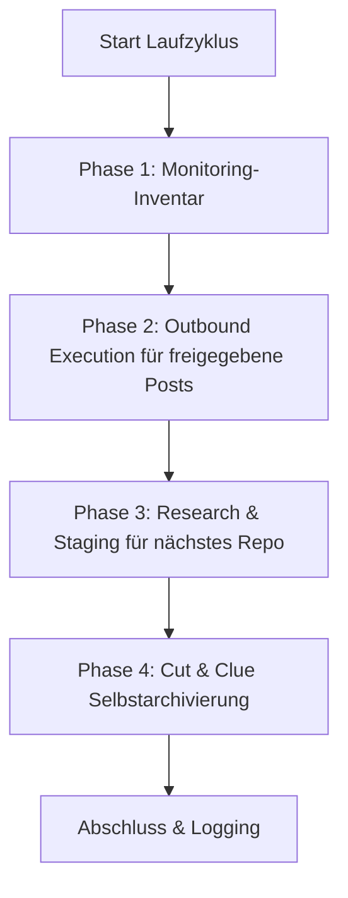

# Community Outreach & Solution Recommender

Une compétence neutre vis-à-vis du fournisseur, du LLM et du système d'exploitation, destinée à la présentation automatisée et orientée solutions de logiciels libres, de dépôts et d'outils dans les communautés de développeurs, les fils de discussion Reddit, les forums et les commentaires vidéo.

---

## 🌟 Principes fondamentaux & garanties de sécurité

1. **Human-in-the-Loop et publication fail-closed :**
   * Aucune publication automatique ne passe en ligne sans contrôle humain préalable.
   * Les brouillons sont soumis dans `POST-EINGANG.md`. La case `- [x] Genehmigt` n'autorise qu'une tentative de publication.
   * Seul un `PublishReceipt` complet, lié à la plateforme et à l'URL cible, peut mettre à jour l'historique, la rotation, l'état d'envoi et le registre des doublons. Sans publisher connecté, l'entrée reste dans la file d'attente.
2. **Anti-spam & 100 % de pertinence (« mieux vaut aucun message qu'un message inapproprié ») :**
   * Chaque message résout un problème technique formulé concrètement dans le fil cible.
   * Respect strict des règles de chaque communauté et plateforme (pas de publicité déguisée, mention transparente de l'auteur/mainteneur).
3. **Protection stricte contre les doublons :**
   * `posts_history.json` et `POSTVERZEICHNIS.md` consignent chaque URL cible attestée par un accusé de réception.
   * Aucun fil de discussion ni aucune vidéo n'est jamais sollicité deux fois.
4. **Round-robin équitable & rotation des plateformes :**
   * Les projets sont tournés selon la plus longue absence (chaque dépôt passe à son tour de manière égale).
   * Les plateformes alternent (Reddit $\rightarrow$ YouTube $\rightarrow$ Dev.to / forums spécialisés $\rightarrow$ Reddit).
5. **Auto-archivage Cut-and-Clue :**
   * Les messages publiés historiques sont automatiquement externalisés vers `_archive/` lorsqu'une limite de taille est atteinte, et référencés dans l'en-tête.

---

## 📂 Infrastructure standard

La compétence construit dans un répertoire cible (`<workspace_root>/.COMMUNITY_OUTREACH/` ou équivalent) la structure modulaire suivante :

| Fichier | Finalité |
| :--- | :--- |
| `USECASES.md` | Vue d'ensemble de tous les dépôts, de leurs cas d'usage et des problèmes cibles résolus |
| `usecases.json` | Base de données de rotation lisible par machine, avec horodatages et métadonnées |
| `POST-EINGANG.md` | File d'approbation Human-in-the-Loop avec cases `- [ ] Genehmigt` |
| `POST-AUSGANG.md` | Suivi des publications et des retours entrants de la communauté |
| `POSTVERZEICHNIS.md` | Index global de protection contre les doublons d'URL et de fils |
| `ACCOUNTVERZEICHNIS.md` | Vue d'ensemble des profils autorisés et des mécanismes de connexion SSO |
| `config.json` | Configuration de l'instance (dépôts, fréquences, plateformes cibles) |

La description d'exécution vérifiée se trouve dans [`references/runtime-readme.md`](references/runtime-readme.md).

---

## 🔄 Le cycle d'exécution en 4 phases



1. **Phase 1 (inventaire de suivi) :** Compte les entrées d'historique publiées comme fils à vérifier localement. Le cœur ne récupère aucune réponse des plateformes ; cela nécessiterait un adaptateur entrant distinct et autorisé.
2. **Phase 2 (exécution sortante) :** Contrôle les entrées approuvées, les doublons d'URL exacts et le publisher connecté. Seul un `PublishReceipt` vérifié déclenche des modifications d'état locales. L'adaptateur CLI fourni ne publie lui-même rien.
3. **Phase 3 (mission de recherche) :** Sélectionne via round-robin équitable le dépôt resté le plus longtemps inactif et fournit `needs-action`. Seule une recherche distincte peut enregistrer une URL cible réelle, actuelle et encore inutilisée, ainsi qu'un brouillon vérifié dans `POST-EINGANG.md` ; aucun espace réservé n'est créé.
4. **Phase 4 (auto-archivage) :** Archive les entrées complètes les plus anciennes dans `_archive/`, maintient les entrées les plus récentes en ligne, et est idempotente en cas de répétition.

Une exécution avec `--dry-run` est un simple calcul de plan : elle n'appelle aucun publisher, ne modifie aucun fichier et ne crée aucun répertoire.

---

## ⚙️ Fonctionnement multi-planificateur & multi-agent

La compétence prend en charge tous les environnements courants de planification et d'agents :

### 1. Antigravity Sidecar / tâche planifiée
Enregistrée comme sidecar natif dans `.gemini/config/sidecars/community-outreach/sidecar.json`.
* **Avantage :** Ne s'exécute que lorsque l'application est ouverte ; contrôle complet dans le tableau de bord graphique.
* **Fréquence :** par exemple 1 fois par jour (`0 10 * * *`) ou 4 fois par jour (`0 8,12,16,20 * * *`).

### 2. Codex & Claude Code / Cron
* Appel via une session CLI ou un exécuteur de tâches existant :
  ```bash
  python scripts/outreach_engine.py --full-run
  ```

### 3. Planificateur de tâches Windows (`schtasks`)
* Facultatif pour une exécution autonome en arrière-plan du système d'exploitation :
  ```powershell
  python scripts/setup_scheduler.py --backend windows --schedule 09:00
  ```

## 📋 Démarrage rapide (Bootstrap)

1. **Initialiser l'espace de travail :**
   ```bash
   python scripts/init_outreach_workspace.py --target-dir ./outreach_data --repo-list ./repos.json
   ```
2. **Projeter l'adaptateur d'exécution portable :**
   ```bash
   python scripts/deploy_runtime.py --target ./outreach_data --json
   ```
   Le déploiement ne copie que le cœur, l'adaptateur, le README d'exécution et le test de fumée d'exécution ; les fichiers de données et de file d'attente restent intacts. `--check` vérifie la projection sans écriture.
3. **Effectuer un test (Dry-Run) :**
   ```bash
   python scripts/outreach_engine.py --workspace ./outreach_data --dry-run
   ```
   Le statut de retour reste `needs-action` tant qu'une recherche réelle ou un publisher fait défaut. Ce n'est ni une erreur ni une preuve de publication.
4. **Activer le planificateur :**
   ```bash
   python scripts/setup_scheduler.py --backend antigravity --workspace ./outreach_data
   ```

---

## 🔒 Configuration privée / locale

Les chemins spécifiques, les identifiants et les profils SSO personnels sont enregistrés dans `config.private.json` ou `.env`. Ces fichiers sont exclus via `.gitignore` et ne figurent jamais dans les dépôts publics.

---

## Journal des modifications

### 1.1.0 (2026-08-29)
- Cœur canonique avec adaptateur d'exécution léger et chemins de lecture compatibles pour les deux schémas de données précédents.
- `PublishReceipt` fail-closed, protection exacte contre les doublons, traitement de la file d'attente préservant les octets et projection locale pouvant reprendre après interruption.
- Dry-run sans écriture, archivage idempotent par entrée et statut `needs-action` fidèle à la réalité pour la phase 3.

### 1.0.0 (2026-08-13)
- Version initiale : compétence universelle Community Outreach & Solution Recommender.
- Moteur en 4 phases avec Human-in-the-Loop, protection contre les doublons, round-robin équitable et archivage Cut-and-Clue.
- Prise en charge multi-planificateur (Antigravity, Planificateur de tâches Windows, Cron, ellmos-scheduler, Codex, Claude Code).
