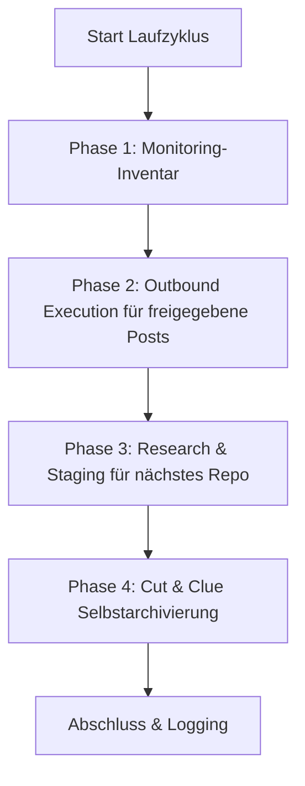

# कम्युनिटी आउटरीच और समाधान रिकमेंडर

एक ऐसा कौशल (Skill) जो किसी प्रदाता, LLM या ऑपरेटिंग सिस्टम पर निर्भर नहीं है और जो डेवलपर कम्युनिटी, Reddit थ्रेड, फ़ोरम और वीडियो कमेंट में ओपन-सोर्स सॉफ़्टवेयर, रिपॉज़िटरी और टूल्स का समाधान-केंद्रित परिचय स्वचालित रूप से कराता है।

---

## 🌟 मूल सिद्धांत और सुरक्षा गारंटी

1. **Human-in-the-Loop और fail-closed प्रकाशन:**
   * कोई भी स्वचालित पोस्ट मानवीय समीक्षा के बिना लाइव नहीं जाती।
   * ड्राफ़्ट `POST-EINGANG.md` में प्रस्तुत किए जाते हैं। चेकबॉक्स `- [x] Genehmigt` केवल प्रकाशन के प्रयास की अनुमति देता है।
   * केवल एक पूर्ण, प्लेटफ़ॉर्म और लक्ष्य URL से बंधा `PublishReceipt` ही इतिहास, रोटेशन, आउटपुट और डुप्लिकेट रजिस्टर को आगे बढ़ा सकता है। बिना जुड़े Publisher के प्रविष्टि कतार में ही रहती है।
2. **Anti-Spam और 100% प्रासंगिकता („अनुचित पोस्ट से बेहतर है कोई पोस्ट नहीं“):**
   * हर पोस्ट लक्ष्य थ्रेड में स्पष्ट रूप से बताई गई किसी तकनीकी समस्या को हल करती है।
   * संबंधित कम्युनिटी और प्लेटफ़ॉर्म नियमों का सख़्ती से पालन (कोई छिपा विज्ञापन नहीं, लेखक/Maintainer के रूप में पारदर्शी उल्लेख)।
3. **सख़्त डुप्लिकेट सुरक्षा:**
   * `posts_history.json` और `POSTVERZEICHNIS.md` हर उस लक्ष्य URL को दर्ज करते हैं, जिसकी रसीद से पुष्टि हुई हो।
   * कोई भी थ्रेड या वीडियो कभी दोबारा संबोधित नहीं किया जाता।
4. **निष्पक्ष Round-Robin और प्लेटफ़ॉर्म रोटेशन:**
   * सबसे लंबे समय से जिस प्रोजेक्ट पर पोस्ट नहीं हुई, उसे पहले चुना जाता है (हर रेपो को समान अवसर मिलता है)।
   * प्लेटफ़ॉर्म बदल-बदलकर चुने जाते हैं (Reddit $\rightarrow$ YouTube $\rightarrow$ Dev.to / विशेषज्ञ फ़ोरम $\rightarrow$ Reddit)।
5. **Cut-and-Clue स्व-संग्रहण:**
   * पुराने आउटबाउंड पोस्ट एक आकार-सीमा पहुँचने पर स्वचालित रूप से `_archive/` में स्थानांतरित हो जाते हैं और हेडर में उनका संदर्भ दिया जाता है।

---

## 📂 मानक इंफ़्रास्ट्रक्चर

यह कौशल लक्ष्य डायरेक्टरी (`<workspace_root>/.COMMUNITY_OUTREACH/` या समान) में निम्न मॉड्यूलर संरचना बनाता है:

| फ़ाइल | उद्देश्य |
| :--- | :--- |
| `USECASES.md` | सभी रिपॉज़िटरी, उनके उपयोग-मामले और हल की गई लक्ष्य समस्याओं का अवलोकन |
| `usecases.json` | टाइमस्टैम्प और मेटाडेटा वाला मशीन-पठनीय रोटेशन डेटाबेस |
| `POST-EINGANG.md` | `- [ ] Genehmigt` चेकबॉक्स वाली Human-in-the-Loop स्वीकृति कतार |
| `POST-AUSGANG.md` | प्रकाशित पोस्ट और इनबाउंड कम्युनिटी फ़ीडबैक की निगरानी |
| `POSTVERZEICHNIS.md` | वैश्विक URL और थ्रेड डुप्लिकेट-सुरक्षा इंडेक्स |
| `ACCOUNTVERZEICHNIS.md` | अधिकृत प्रोफ़ाइलों और SSO-लॉगिन तंत्रों का अवलोकन |
| `config.json` | इंस्टेंस कॉन्फ़िगरेशन (रेपो, आवृत्तियाँ, लक्ष्य प्लेटफ़ॉर्म) |

सत्यापित रनटाइम विवरण [`references/runtime-readme.md`](references/runtime-readme.md) में उपलब्ध है।

---

## 🔄 4-चरणीय रन चक्र



1. **चरण 1 (मॉनिटरिंग इन्वेंटरी):** प्रकाशित इतिहास-प्रविष्टियों को स्थानीय रूप से जाँचे जाने वाले थ्रेड के रूप में गिनता है। Core प्लेटफ़ॉर्म के उत्तर नहीं लाता; इसके लिए एक अलग, अधिकृत इनबाउंड एडाप्टर आवश्यक है।
2. **चरण 2 (आउटबाउंड निष्पादन):** स्वीकृत प्रविष्टियों, सटीक URL डुप्लिकेट और जुड़े Publisher की जाँच करता है। केवल एक सत्यापित `PublishReceipt` ही स्थानीय स्थिति में बदलाव करता है। साथ दिया गया CLI-एडाप्टर स्वयं कुछ भी प्रकाशित नहीं करता।
3. **चरण 3 (रिसर्च कार्य):** Fair Round-Robin से सबसे लंबे समय से अनछुए रेपो को चुनता है और `needs-action` प्रदान करता है। केवल एक अलग रिसर्च ही वास्तविक, ताज़ा और अब तक अप्रयुक्त लक्ष्य URL तथा जाँचा गया ड्राफ़्ट `POST-EINGANG.md` में सहेज सकती है; प्लेसहोल्डर नहीं बनाए जाते।
4. **चरण 4 (स्व-संग्रहण):** सबसे पुरानी पूर्ण प्रविष्टियों को `_archive/` में संग्रहीत करता है, सबसे नई प्रविष्टियों को लाइव रखता है, और दोहराने पर परिणाम नहीं बदलता।

`--dry-run` वाला रन केवल योजना की गणना है: वह कोई Publisher नहीं बुलाता, कोई फ़ाइल नहीं बदलता और कोई डायरेक्टरी नहीं बनाता।

---

## ⚙️ मल्टी-शेड्यूलर और मल्टी-एजेंट संचालन

यह कौशल सभी सामान्य शेड्यूलर और एजेंट वातावरणों का समर्थन करता है:

### 1. Antigravity Sidecar / Scheduled Task
`.gemini/config/sidecars/community-outreach/sidecar.json` में एक मूल Sidecar के रूप में पंजीकृत होता है।
* **लाभ:** केवल ऐप खुला होने पर चलता है, GUI डैशबोर्ड पर पूर्ण नियंत्रण।
* **आवृत्ति:** जैसे दिन में 1 बार (`0 10 * * *`) या दिन में 4 बार (`0 8,12,16,20 * * *`)।

### 2. Codex और Claude Code / Cron
* किसी CLI-सत्र या मौजूदा टास्क-रनर के माध्यम से आह्वान:
  ```bash
  python scripts/outreach_engine.py --full-run
  ```

### 3. Windows Task Scheduler (`schtasks`)
* स्वतंत्र OS-पृष्ठभूमि निष्पादन के लिए वैकल्पिक:
  ```powershell
  python scripts/setup_scheduler.py --backend windows --schedule 09:00
  ```

## 📋 त्वरित आरंभ (Bootstrap)

1. **Workspace आरंभ करें:**
   ```bash
   python scripts/init_outreach_workspace.py --target-dir ./outreach_data --repo-list ./repos.json
   ```
2. **पोर्टेबल रनटाइम-एडाप्टर प्रोजेक्ट करें:**
   ```bash
   python scripts/deploy_runtime.py --target ./outreach_data --json
   ```
   Deploy केवल Core, एडाप्टर, रनटाइम-README और रनटाइम-Smoke-Test कॉपी करता है; डेटा और कतार-फ़ाइलें अछूती रहती हैं। `--check` प्रोजेक्शन को बिना लिखे जाँचता है।
3. **परीक्षण रन करें (Dry-Run):**
   ```bash
   python scripts/outreach_engine.py --workspace ./outreach_data --dry-run
   ```
   जब तक वास्तविक रिसर्च या कोई Publisher उपलब्ध नहीं होता, वापसी स्थिति `needs-action` ही रहती है। यह कोई त्रुटि नहीं है और न ही प्रकाशन का प्रमाण।
4. **शेड्यूलर सक्रिय करें:**
   ```bash
   python scripts/setup_scheduler.py --backend antigravity --workspace ./outreach_data
   ```

---

## 🔒 निजी / स्थानीय कॉन्फ़िगरेशन

विशिष्ट पथ, क्रेडेंशियल और व्यक्तिगत SSO-प्रोफ़ाइल `config.private.json` या `.env` में सहेजे जाते हैं। ये फ़ाइलें `.gitignore` द्वारा बाहर रखी जाती हैं और कभी सार्वजनिक रिपॉज़िटरी में नहीं पहुँचतीं।

---

## Changelog

### 1.1.0 (2026-08-29)
- पतले रनटाइम-एडाप्टर वाला कैनॉनिकल Core और दोनों पूर्ववर्ती डेटा-स्कीमा के लिए संगत पठन-मार्ग।
- Fail-closed `PublishReceipt`, सटीक डुप्लिकेट सुरक्षा, बाइट-संरक्षित कतार-प्रसंस्करण और पुनः-आरंभ योग्य स्थानीय प्रोजेक्शन।
- लेखन-रहित Dry-Run, प्रविष्टि-आधारित idempotent संग्रहण और चरण 3 के लिए सत्यनिष्ठ `needs-action`-स्थिति।

### 1.0.0 (2026-08-13)
- प्रारंभिक रिलीज़: सार्वभौमिक कम्युनिटी आउटरीच और समाधान रिकमेंडर Skill।
- Human-in-the-Loop, डुप्लिकेट सुरक्षा, Fair-Round-Robin और Cut-and-Clue संग्रहण के साथ 4-चरणीय इंजन।
- मल्टी-शेड्यूलर समर्थन (Antigravity, Windows Task Scheduler, Cron, ellmos-scheduler, Codex, Claude Code)।
