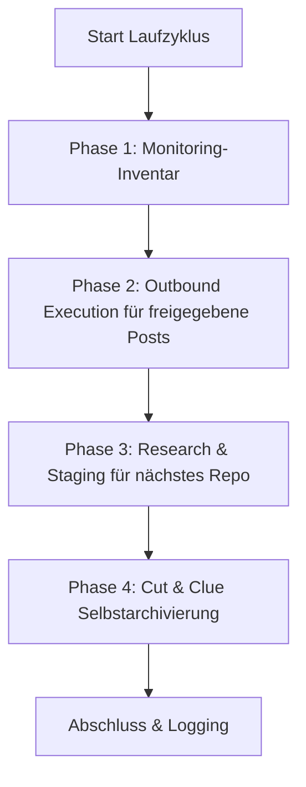

# コミュニティ・アウトリーチ & ソリューション推薦機能

開発者コミュニティ、Reddit のスレッド、フォーラム、動画コメントにおいて、オープンソースソフトウェア、リポジトリ、ツールを、ソリューション指向で自動的に紹介するための、プロバイダー、LLM、オペレーティングシステムに依存しないスキルです。

---

## 🌟 基本原則と安全性の保証

1. **Human-in-the-Loop と fail-closed による公開:**
   * 人間による確認を経ずに自動投稿が公開されることはありません。
   * 下書きは `POST-EINGANG.md` に提示されます。チェックマーク `- [x] Genehmigt` は公開の試行のみを許可します。
   * プラットフォームおよび対象 URL に紐づいた、完全な `PublishReceipt` が存在して初めて、履歴、ローテーション、送信記録、重複登録簿を更新できます。接続された Publisher がない場合、エントリはキューに残ります。
2. **スパム防止と 100% の関連性（「不適切な投稿よりも投稿しないほうがよい」）:**
   * 各投稿は、対象スレッドで具体的に述べられた技術的問題を解決するものでなければなりません。
   * 各コミュニティおよびプラットフォームのルールを厳守すること（広告の偽装禁止、作成者/メンテナーとしての透明な明示）。
3. **厳格な重複防止:**
   * `posts_history.json` と `POSTVERZEICHNIS.md` は、PublishReceipt によって裏付けられた対象 URL をすべて記録します。
   * いかなるスレッドや動画も、二重に対応されることはありません。
4. **公平なラウンドロビンとプラットフォームのローテーション:**
   * プロジェクトは最も長く扱われていない順にローテーションされます（各リポジトリが均等に取り上げられます）。
   * プラットフォームは交互に切り替えられます（Reddit $\rightarrow$ YouTube $\rightarrow$ Dev.to / 専門フォーラム $\rightarrow$ Reddit）。
5. **Cut-and-Clue による自己アーカイブ:**
   * 過去の送信履歴は、サイズの上限に達すると自動的に `_archive/` へ退避され、ヘッダーで参照されます。

---

## 📂 標準インフラストラクチャ

このスキルは、対象ディレクトリ（`<workspace_root>/.COMMUNITY_OUTREACH/` など）に、次のようなモジュール構造を構築します。

| ファイル | 目的 |
| :--- | :--- |
| `USECASES.md` | すべてのリポジトリ、そのユースケース、解決された対象課題の概要 |
| `usecases.json` | タイムスタンプとメタデータを備えた、機械可読なローテーションデータベース |
| `POST-EINGANG.md` | `- [ ] Genehmigt` チェックボックスを備えた Human-in-the-Loop の承認キュー |
| `POST-AUSGANG.md` | 公開済み投稿および受信したコミュニティからのフィードバックの監視 |
| `POSTVERZEICHNIS.md` | グローバルな URL およびスレッドの重複防止インデックス |
| `ACCOUNTVERZEICHNIS.md` | 認可済みプロファイルおよび SSO ログイン仕組みの概要 |
| `config.json` | インスタンス設定（リポジトリ、頻度、対象プラットフォーム） |

検証済みの実行時説明は [`references/runtime-readme.md`](references/runtime-readme.md) にあります。

---

## 🔄 4 フェーズの実行サイクル



1. **フェーズ 1（監視インベントリ）:** 公開済みの履歴エントリを、ローカルで確認すべきスレッドとして集計します。コアはプラットフォームの返信を取得しません。そのためには、別途認可された受信アダプターが必要です。
2. **フェーズ 2（送信実行）:** 承認済みのエントリ、URL の完全一致による重複、接続された Publisher を確認します。検証済みの `PublishReceipt` のみが、ローカルの状態変更を引き起こします。同梱の CLI アダプターは、それ自体では何も公開しません。
3. **フェーズ 3（リサーチ依頼）:** フェアなラウンドロビンで、最も長く扱われていないリポジトリを選び、`needs-action` を提供します。独立したリサーチだけが、実在し、最新で、まだ使用されていない対象 URL と、確認済みの下書きを `POST-EINGANG.md` に永続化することができます。プレースホルダーは生成されません。
4. **フェーズ 4（自己アーカイブ）:** 最も古い完全なエントリを `_archive/` にアーカイブし、最新のエントリを公開状態に保ちます。再実行しても結果は同じになります（冪等）。

`--dry-run` を付けた実行は、純粋な計画計算です。Publisher は呼び出さず、ファイルは変更せず、ディレクトリも作成しません。

---

## ⚙️ マルチスケジューラーおよびマルチエージェントでの運用

このスキルは、一般的なすべてのスケジューラーおよびエージェント環境をサポートします。

### 1. Antigravity Sidecar / スケジュールタスク
`.gemini/config/sidecars/community-outreach/sidecar.json` にネイティブのサイドカーとして登録されます。
* **利点:** アプリが開いている間のみ実行され、GUI ダッシュボードで完全に制御できます。
* **頻度:** 例：1 日 1 回（`0 10 * * *`）または 1 日 4 回（`0 8,12,16,20 * * *`）。

### 2. Codex & Claude Code / Cron
* CLI セッションまたは既存のタスクランナーを通じて呼び出します:
  ```bash
  python scripts/outreach_engine.py --full-run
  ```

### 3. Windows タスクスケジューラー（`schtasks`）
* OS 上でバックグラウンドで自律的に実行する場合のオプション:
  ```powershell
  python scripts/setup_scheduler.py --backend windows --schedule 09:00
  ```

## 📋 クイックスタート（ブートストラップ）

1. **ワークスペースの初期化:**
   ```bash
   python scripts/init_outreach_workspace.py --target-dir ./outreach_data --repo-list ./repos.json
   ```
2. **ポータブルなランタイムアダプターの投影:**
   ```bash
   python scripts/deploy_runtime.py --target ./outreach_data --json
   ```
   デプロイでは、コア、アダプター、ランタイム README、ランタイムのスモークテストのみがコピーされ、データおよびキューのファイルは変更されません。`--check` は、書き込みアクセスなしで投影を検証します。
3. **テスト実行（ドライラン）:**
   ```bash
   python scripts/outreach_engine.py --workspace ./outreach_data --dry-run
   ```
   実際のリサーチまたは Publisher が欠けている間、戻り値のステータスは `needs-action` のままです。これはエラーでも公開の証拠でもありません。
4. **スケジューラーの有効化:**
   ```bash
   python scripts/setup_scheduler.py --backend antigravity --workspace ./outreach_data
   ```

---

## 🔒 非公開 / ローカル設定

特定のパス、認証情報、個人の SSO プロファイルは、`config.private.json` または `.env` に保存されます。これらのファイルは `.gitignore` によって除外され、公開リポジトリに含まれることは決してありません。

---

## 変更履歴

### 1.1.0 (2026-08-29)
- 薄いランタイムアダプターを備えた正規のコアと、両方の従来のデータスキーマに対応する互換の読み取り経路。
- Fail-closed `PublishReceipt`、厳密な重複防止、バイト保持のキュー処理、再開可能なローカル投影。
- 書き込みを行わないドライラン、エントリ単位の冪等なアーカイブ、およびフェーズ 3 における事実に即した `needs-action` ステータス。

### 1.0.0 (2026-08-13)
- 初期リリース: 汎用のコミュニティ・アウトリーチ & ソリューション推薦スキル。
- Human-in-the-Loop、重複防止、フェアなラウンドロビン、Cut-and-Clue アーカイブを備えた 4 フェーズのエンジン。
- マルチスケジューラーのサポート（Antigravity、Windows タスクスケジューラー、Cron、ellmos-scheduler、Codex、Claude Code）。
