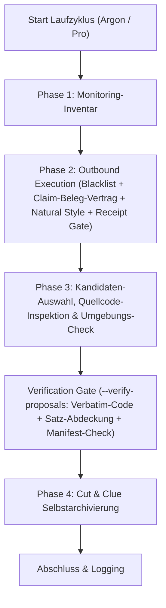

# Community Outreach & Solution Recommender

Ein anbieter-, LLM- und betriebssystemneutraler Skill zur automatisierten, lösungsorientierten Vorstellung von Open-Source-Software, Repositories und Werkzeugen in Entwickler-Communities, Reddit-Threads, Foren und Videokommentaren.

---

## 🌟 Kernprinzipien & Sicherheits-Garantien

1. **Human-in-the-Loop und fail-closed Veröffentlichung:**
   * Kein automatischer Post geht ohne menschliche Sichtung live.
   * Entwürfe werden in `POST-EINGANG.md` vorgelegt. Das Häkchen `- [x] Genehmigt` erlaubt nur den Veröffentlichungsversuch.
   * Erst ein vollständiger, auf Plattform und Ziel-URL gebundener `PublishReceipt` darf History, Rotation, Ausgang und Duplikatregister fortschreiben. Ohne angebundenen Publisher bleibt der Eintrag in der Queue.
2. **Deterministischer Claim-Beleg-Vertrag am Originalcode (`Claim-to-Code Evidence Contract`, Pflicht seit `v1.6.0` / 2026-11-13):**
   * **Kein Entwurf aus dem Gedächtnis oder nur aus `usecases.json` / README-Kurzfassungen:** Jede Aussage über unsere Software im `Textvorschlag` muss direkt am echten, öffentlich getrackten Quellcode im lokalen Klon (`<local_repos_root>/<repo>`) bewiesen werden.
   * **Verpflichtender JSON-Vertragsblock `#### Claim-Beleg-Vertrag (Verifiziert):`:** Zusätzlich zum Kurzüberblick `- **Code-Beleg (Verifiziert):**` enthält jeder Vorschlag in `POST-EINGANG.md` einen maschinenprüfbaren JSON-Block:
     ```json
     [
       {
         "text_anchor": "exakter Teilstring aus dem Textvorschlag",
         "repo": "ellmos-ai/workflowhooker",
         "file": "workflowhooker/cli.py",
         "lines": "103-106",
         "verbatim_code": "exakter zusammenhängender Originalcode-Ausschnitt aus dieser Datei"
       }
     ]
     ```
   * **7-Stufen-Prüfmaschine (`_verify_claim_contract` in `verify_proposals`, `preview_post` & `phase2_outbound_execution`):**
     1. **Schema & Spannen-Grenze:** Nicht-leeres JSON-Array; `lines` 1-basiert mit max. 80 Zeilen Spanne (`invalid-claim-entry`).
     2. **Exakte Textbindung:** Jeder `text_anchor` muss wortwörtlich im `Textvorschlag` stehen (`anchor-not-in-text`).
     3. **Pfad-, Repo- & Git-Tracking-Prüfung:** Die Datei muss im lokalen Repo-Klon existieren, frei von Path-Traversal sein und — sofern `.git` vorliegt — in `git ls-files` getrackt sein (`untracked-claim-file`). Bei Code-Repos muss mindestens ein Beleg auf echten Quellcode (`.py`, `.ts`, `.rs` usw., nicht nur `.md`) zeigen (`code-file-required`).
     4. **Wortwörtlicher Originalcode-Abgleich:** `verbatim_code` muss Zeichen für Zeichen im angegebenen Zeilenfenster der echten Datei stehen (`verbatim-code-mismatch`).
     5. **Vollständige Satz-Abdeckung (`Sentence Coverage Gate`):** Jeder Satz im `Textvorschlag`, der Aussagen über unsere Software trifft (sowie alle im Text genannten Quellcode-Dateinamen), muss durch mindestens einen verifizierten `text_anchor` abgedeckt sein (`uncovered-software-sentence` / `unverified-mentioned-file`).
     6. **Cross-Repo-Belegpflicht (`Sister-Repo Gate`):** Wird im selben Beitrag ein weiteres eigenes Repo genannt (z. B. `Clutch`, `open-compute`, `USMC`, `WorkflowHooker`), muss auch diese Aussage durch einen Originalcode-Beleg dieses Schwester-Repos oder einen wortwörtlichen Beleg im Haupt-Repo gedeckt sein (`unverified-sister-repo`).
     7. **Manifest-Widerspruchsschutz (`zero-dependency` / `stdlib-only`):** Behauptet der Text `zero-dependency` oder `stdlib-only`, liest die Engine `pyproject.toml` bzw. `package.json` des Ziel-Repos aus: Sind dort Laufzeit-`dependencies` deklariert, blockiert das Gate hart (`predicate-contradiction:zero-dependency`), und bei vorhandenem Paketmanifest ist ein expliziter Beleg auf `pyproject.toml`/`package.json` Pflicht (`missing-manifest-proof:zero-dependency`).
3. **Natürlicher menschlicher Kommentar-Stil & Umgebungs-Anpassung (Anti-AI-Style Gate, Pflicht seit 2026-11-03):**
   * **Umgebungs-Check vor dem Entwurf (`- **Umgebungs-Check (Ton & Länge):**`):** Vor jedem Entwurf müssen 3–5 echte Nachbarkommentare im Ziel-Thread gelesen werden. Länge, Tonfall und Direktheit des Entwurfs müssen sich nahtlos in die bestehenden menschlichen Kommentare einfügen.
   * **Absolutes Verbot von KI-Aufsatz-Formatierung in Kommentaren (`_check_natural_human_style`):**
     * **Keine Markdown-Überschriften (`#`, `##`, `###`)** innerhalb eines Kommentars (`markdown-headings-forbidden`).
     * **Kein Fettdruck (`**Begriff**`)** (`bold-markup-forbidden`).
     * **Keine Gedankenstrich-Ketten mit Geviertstrich (`—`, Em-Dash)** (`em-dash-forbidden`).
     * **Keine Lehrbuch-Aufzählungslisten (3+ Bullet-/Nummerierungspunkte)** (`structured-list-essay-forbidden`).
     * **Keine KI-Floskeln** wie *"Here are three practical patterns..."*, *"Spot-on thesis..."*, *"Really insightful breakdown..."* oder *"Treating X as Y gives you..."* (`ai-cliche-phrasing`).
     * **Natürliche Kürze:** Maximal **1 bis 3 kurze, lockere Absätze (ca. 250–850 Zeichen, harte technische Obergrenze 1.200 Zeichen auf Reddit/YouTube)** (`excessive-length`).
4. **Organisations-Governance & Scope-Regeln (Pflicht seit 2026-11-09):**
   * **Primärer Outreach-Fokus (`primary_orgs`):** Regulärer lösungsorientierter Produkt- und Tool-Outreach konzentriert sich primär auf **`ellmos-ai`** sowie die **Open-Bricks-Organisationen** (**`dev-bricks`**, **`file-bricks`**, **`doc-bricks`**, **`open-bricks`**).
   * **Permanenter Ausschluss von `biotec-line` (`excluded_orgs: ["biotec-line"]`):** Repositories der Organisation **`biotec-line`** dürfen **niemals** beworben, in `usecases.json` geführt oder vorgeschlagen werden (rechtliche Vorsicht / Vermeidung einer Einstufung als Verbreitung). Die Engine und `githubbot_bridge.py` blockieren `biotec-line` hart (`excluded_org_legal_compliance` / `status: "blacklisted"`).
   * **Diskurs- & Positionierungs-Modus für `research-line` (`discourse_only_orgs: ["research-line"]`):** Repositories unter **`research-line`** sind von der regulären Tool-Pitch-Rotation ausgenommen und dienen gezielt dem **wissenschaftlichen Diskurs (`outreach_mode: "discourse_positioning"`)**.
5. **Verbindliche Modell-Güte (Kein Flash/Haiku für Outreach-Entwürfe):**
   * Alle Outreach-Automationen und Entwurfs-Subagenten müssen zwingend im Rollen-Tier `thinker_reviewer` (`Gemini 4 Argon (High)` / `--model=pro` bzw. `claude-opus-5`) laufen. Leichte Modelle (`flash`, `flash_lite`, `haiku`) sind für das Verfassen und Gegenprüfen von Outreach-Beiträgen gesperrt.
6. **Anti-Spam, 2-Jahres-Altersgrenze & Blacklist-Schutz:**
   * Jeder Post löst ein konkret im Ziel-Thread formuliertes technisches Problem. Ziel-Threads dürfen **nicht älter als 2 Jahre (24 Monate)** sein.
   * Abgelehnte Vorschläge, Subreddits mit striktem Bot-/Self-Promo-Verbot (z. B. `r/softwarearchitecture`), gesperrte Plattformen (z. B. `dev.to`) und ausgeschlossene Organisationen (`biotec-line`) werden dauerhaft in `BLACKLIST.md` und `rejected_proposals.json` geführt und von der Engine technisch blockiert (`status: "blacklisted"`).
7. **Strikter Duplikatschutz:**
   * `posts_history.json` und `POSTVERZEICHNIS.md` protokollieren jede durch Receipt belegte Ziel-URL.
   * Kein Thread oder Video wird jemals doppelt adressiert.
8. **3-Stufiges Qualitäts- & Aufmerksamkeits-Auswahlmodell (`selection_tier` 1 → 2 → 3) & Plattform-Rotation:**
   * **Stufe 1 (`selection_tier = 1`):** Beste Modul-Repos nach Code-Qualität und eigenständiger Idee mit bisher wenig bis mittlerer menschlicher Aufmerksamkeit (`views_unique_14d <= 6`, `total_promotions == 0`), **Kern-Flaggschiffe** (`ellmos-ai/bach`, `ellmos-ai/open-ocean`, `ellmos-ai/skills`) sowie **17 besondere Einzel-Skills** (`SPECIFIC_SKILL_PROFILES`).
   * **Stufe 2 (`selection_tier = 2`):** Dieselbe Kategorie starker Modul-Repos nach Qualität und Idee (`TOP_QUALITY_MODULE_SCORES`), die bereits höhere Aufmerksamkeit oder frühere Outreach-Runden haben (`views_unique_14d > 6` oder `total_promotions > 0`).
   * **Stufe 3 (`selection_tier = 3`):** Weitere kleinere Repos, Spezialmodule, Seeds und Helper-Tools.
   * Plattformen werden abgewechselt (Reddit $\rightarrow$ YouTube $\rightarrow$ GitHub Discussions $\rightarrow$ Foren); 7-Tage-Cooldown ist bindend.
9. **Cut-and-Clue Selbstarchivierung:**
   * Historische Postausgänge werden bei Erreichen einer Größengrenze automatisch nach `_archive/` ausgelagert und im Header referenziert.

---

## 📂 Standard-Infrastruktur

Der Skill baut in einem Ziel-Verzeichnis (`<workspace_root>/.COMMUNITY_OUTREACH/` o. ä.) folgende modulare Struktur auf:

| Datei | Zweck |
| :--- | :--- |
| `USECASES.md` | Übersicht aller Repositories, deren Usecases und gelöster Zielprobleme |
| `usecases.json` | Maschinenlesbare Rotations-Datenbank mit Zeitstempeln und Metadaten |
| `POST-EINGANG.md` | Human-in-the-Loop Queue mit `- **Umgebungs-Check:**`, `- **Code-Beleg:**`, `#### Claim-Beleg-Vertrag (Verifiziert):` und `- [ ] Genehmigt` |
| `BLACKLIST.md` | Menschenlesbares Sperrregister abgelehnter Vorschläge und ausgeschlossener Plattformen |
| `rejected_proposals.json` | Maschinenlesbare Sperrliste für URLs, Proposal-IDs, Repos und Plattformen |
| `POST-AUSGANG.md` | Monitoring veröffentlichter Beiträge und Inbound-Community-Feedback |
| `POSTVERZEICHNIS.md` | Globaler URL- und Thread-Duplikatschutz-Index |
| `ACCOUNTVERZEICHNIS.md` | Übersicht autorisierter Profile und SSO-Login-Mechanismen |
| `config.json` | Instanz-Konfiguration (`require_code_evidence`, `require_claim_contract`, `require_natural_style`, `local_repos_root`) |

Die verifizierte Laufzeitbeschreibung liegt in [`references/runtime-readme.md`](references/runtime-readme.md).

---

## 🔄 Der 4-Phasen-Laufzyklus + Claim-Beleg-Vertrag & Anti-AI-Style Gate



1. **Phase 1 (Monitoring-Inventar):** Zählt veröffentlichte History-Einträge als lokal zu prüfende Threads.
2. **Phase 2 (Outbound Execution):** Prüft freigegebene Einträge gegen `rejected_proposals.json` (Blacklist), `posts_history.json` (Duplikate), `Code-Beleg`, `Claim-Beleg-Vertrag` (`_verify_claim_contract`), natürlichen menschlichen Stil (`_check_natural_human_style`) und den angebundenen Publisher. Nur ein verifizierter `PublishReceipt` löst lokale Zustandsänderungen aus.
3. **Phase 3 (Research, Originalcode-Vertrag & Umgebungs-Anpassung):** Wählt das nächste Repo aus, inspiziert dessen **echten Quellcode** unter `<local_repos_root>/<repo>`, sucht einen aktuellen Thread (< 2 Jahre, nicht auf Blacklist), analysiert die Nachbarkommentare im Thread (`Umgebungs-Check`), verfasst einen natürlichen Kommentar samt vollständigem `#### Claim-Beleg-Vertrag (Verifiziert):` und verifiziert ihn per `--verify-proposals`.
4. **Phase 4 (Selbstarchivierung):** Archiviert die ältesten vollständigen Einträge nach `_archive/`, hält die neuesten Einträge live und ist bei Wiederholung idempotent.

---

## 📋 Schnellstart & Prüfkommandos

```bash
# 1. Portablen Runtime-Adapter projizieren
python scripts/deploy_runtime.py --target ./outreach_data --json

# 2. Alle Vorschläge in POST-EINGANG.md gegen Blacklist, Duplikate, Originalcode-Vertrag und natürlichen Stil prüfen
python outreach_runner.py --workspace ./outreach_data --verify-proposals --repos-root <local_repos_root> --json

# 3. Schreibfreier Planlauf (Dry-Run)
python outreach_runner.py --workspace ./outreach_data --full-run --dry-run --json
```

---

## Changelog

### 1.6.0 (2026-11-13)
- **Deterministischer Claim-Beleg-Vertrag (`#### Claim-Beleg-Vertrag (Verifiziert):` & `require_claim_contract`):**
  - Jede Software-Aussage im `Textvorschlag` muss über `text_anchor`, `repo`, `file`, `lines` (max. 80 Zeilen) und wortwörtlichen `verbatim_code` direkt am Originalcode bewiesen werden.
  - `_verify_claim_contract` prüft in `verify_proposals`, `preview_post` und `phase2_outbound_execution`: (1) JSON-Schema, (2) exakte Teilstring-Bindung in `Textvorschlag`, (3) Pfad-Sicherheit + `git ls-files`-Tracking + Quellcode-Datei-Pflicht, (4) wortwörtliches Code-Zitat im Zeilenfenster, (5) vollständige Satz- und Dateinamen-Abdeckung aller Software-Aussagen, (6) Cross-Repo-Belegpflicht bei erwähnten Schwester-Repos und (7) Manifest-Widerspruchsschutz gegen falsche `zero-dependency`/`stdlib-only`-Behauptungen via `pyproject.toml` / `package.json`.

### 1.5.0 (2026-11-09)
- **3-Stufiges Qualitäts- & Aufmerksamkeits-Auswahlmodell (`selection_tier` 1 → 2 → 3):**
  - Stufe 1 umfasst Top-Module mit wenig bis mittlerer Aufmerksamkeit (`views_unique_14d <= 6`, unbeworben), die Kern-Flaggschiffe (`ellmos-ai/bach`, `ellmos-ai/open-ocean`, `ellmos-ai/skills`) sowie 17 besondere Einzel-Skills (`SPECIFIC_SKILL_PROFILES`).
  - Pfad-Auflösung in `verify_proposals` erweitert für `ellmos-ai/skills` und Einzel-Skills (`skills/<category>/<name>`).

### 1.4.0 (2026-11-09)
- **Organisations-Governance (`primary_orgs`, `excluded_orgs`, `discourse_only_orgs`):** Primärer Fokus auf `ellmos-ai` und Open-Bricks, permanenter Ausschluss von `biotec-line`, sowie Diskurs-Modus (`discourse_positioning`) für `research-line`.

### 1.3.0 (2026-11-03)
- **Natural Human Comment & Anti-AI-Style Gate (`_check_natural_human_style`)** und verpflichtender `- **Umgebungs-Check (Ton & Länge):**`.

### 1.2.0 (2026-11-02)
- **Code-Fact Verification Gate (`--verify-proposals` & `require_code_evidence`)** und `rejected_proposals.json` Blacklist-Durchsetzung.

### 1.1.0 (2026-08-29)
- Kanonischer Core mit dünnem Runtime-Adapter, fail-closed `PublishReceipt`, exaktem Duplikatschutz und schreibfreiem Dry-Run.

### 1.0.0 (2026-08-13)
- Initiales Release: Universeller Community Outreach & Solution Recommender Skill.
