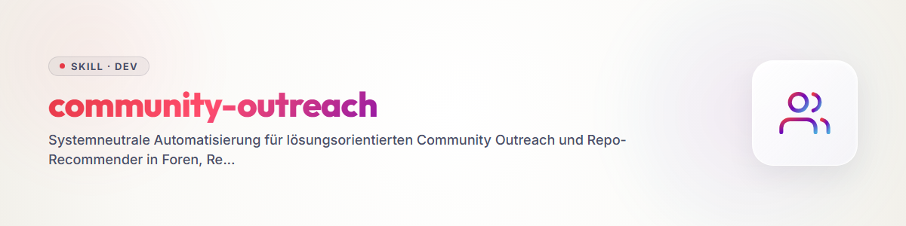
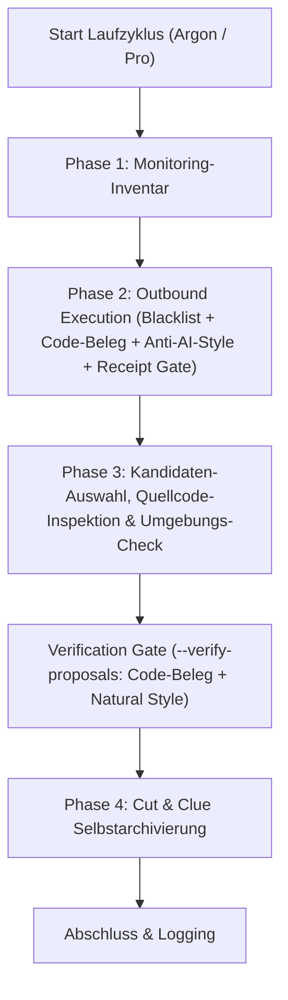

# Community Outreach & Solution Recommender

Ein anbieter-, LLM- und betriebssystemneutraler Skill zur automatisierten, lösungsorientierten Vorstellung von Open-Source-Software, Repositories und Werkzeugen in Entwickler-Communities, Reddit-Threads, Foren und Videokommentaren.

---

## 🌟 Kernprinzipien & Sicherheits-Garantien

1. **Human-in-the-Loop und fail-closed Veröffentlichung:**
   * Kein automatischer Post geht ohne menschliche Sichtung live.
   * Entwürfe werden in `POST-EINGANG.md` vorgelegt. Das Häkchen `- [x] Genehmigt` erlaubt nur den Veröffentlichungsversuch.
   * Erst ein vollständiger, auf Plattform und Ziel-URL gebundener `PublishReceipt` darf History, Rotation, Ausgang und Duplikatregister fortschreiben. Ohne angebundenen Publisher bleibt der Eintrag in der Queue.
2. **Strikte Code-Fakten-Prüfung am echten Quellcode (Code-Fact Verification Gate, Pflicht seit 2026-11-02):**
   * **Kein Entwurf aus dem Gedächtnis oder nur aus `usecases.json` / README-Kurzfassungen:** Jeder Beitrag muss vor der Aufnahme in `POST-EINGANG.md` direkt am echten Quellcode des lokalen Klons (`<LOCAL_DEV_REPOS>/<repo>`) geprüft werden.
   * **Keine erfundenen Features, Parameter oder CLI-Befehle:** Jede genannte Funktion, Klasse, Option, CLI-Flagge und jedes Verhalten im Textvorschlag muss im Quellcode existieren.
   * **Verpflichtendes Feld `- **Code-Beleg (Verifiziert):**`:** Jeder Vorschlag in `POST-EINGANG.md` muss die konkret geprüften Quellcode-Dateien (in Backticks, z. B. `` `src/pkg/module.py` ``) und Symbole benennen.
3. **Natürlicher menschlicher Kommentar-Stil & Umgebungs-Anpassung (Anti-AI-Style Gate, Pflicht seit 2026-11-03):**
   * **Umgebungs-Check vor dem Entwurf (`- **Umgebungs-Check (Ton & Länge):**`):** Vor jedem Entwurf müssen 3–5 echte Nachbarkommentare im Ziel-Thread gelesen werden. Länge, Tonfall und Direktheit des Entwurfs müssen sich nahtlos in die bestehenden menschlichen Kommentare einfügen.
   * **Absolutes Verbot von KI-Aufsatz-Formatierung in Kommentaren:**
     * **Keine Markdown-Überschriften (`#`, `##`, `###`)** innerhalb eines Kommentars (`markdown-headings-forbidden`).
     * **Kein Fettdruck (`**Begriff**`)** — weder als fettgedruckte Aufzählungs-Labels (`- **Punkt:**`) noch zum Hervorheben einzelner Fachbegriffe im Fließtext (`bold-markup-forbidden`). Ein normaler Entwickler macht sich in einem Reddit-/Forenkommentar nicht die Mühe, Begriffe fett zu formatieren.
     * **Keine Gedankenstrich-Ketten mit Geviertstrich (`—`, Em-Dash)** (`em-dash-forbidden`).
     * **Keine Lehrbuch-Aufzählungslisten (3+ Bullet-/Nummerierungspunkte)** (`structured-list-essay-forbidden`).
     * **Keine KI-Floskeln** wie *"Here are three practical patterns..."*, *"Spot-on thesis..."*, *"Really insightful breakdown..."* oder *"Treating X as Y gives you..."* (`ai-cliche-phrasing`).
     * **Natürliche Kürze:** Maximal **1 bis 3 kurze, lockere Absätze (ca. 250–850 Zeichen, harte technische Obergrenze 1.200 Zeichen auf Reddit/YouTube)** (`excessive-length`).
   * **Technische Durchsetzung:** `--verify-proposals`, `preview_post` und `phase2_outbound_execution` prüfen jeden Textvorschlag über `_check_natural_human_style()` und blockieren jeden Beitrag mit KI-Formatierungsmerkmalen (`reason: "ai-style-violation"`).
4. **Verbindliche Modell-Güte (Kein Flash/Haiku für Outreach-Entwürfe):**
   * Alle Outreach-Automationen und Entwurfs-Subagenten müssen zwingend im Rollen-Tier `thinker_reviewer` (`Gemini 4 Argon (High)` / `--model=pro` bzw. `claude-opus-5`) laufen. Leichte Modelle (`flash`, `flash_lite`, `haiku`) sind für das Verfassen und Gegenprüfen von Outreach-Beiträgen gesperrt.
5. **Anti-Spam, 2-Jahres-Altersgrenze & Blacklist-Schutz:**
   * Jeder Post löst ein konkret im Ziel-Thread formuliertes technisches Problem. Ziel-Threads dürfen **nicht älter als 2 Jahre (24 Monate)** sein.
   * Abgelehnte Vorschläge, Subreddits mit striktem Bot-/Self-Promo-Verbot (z. B. `r/softwarearchitecture`) und gesperrte Plattformen (z. B. `dev.to`) werden dauerhaft in `BLACKLIST.md` und `rejected_proposals.json` geführt und von der Engine technisch blockiert (`status: "blacklisted"`).
6. **Strikter Duplikatschutz:**
   * `posts_history.json` und `POSTVERZEICHNIS.md` protokollieren jede durch Receipt belegte Ziel-URL.
   * Kein Thread oder Video wird jemals doppelt adressiert.
7. **Fair Round-Robin & Plattform-Rotation:**
   * Unbeworbene Projekte (`total_promotions == 0`) haben Vorrang; danach Rotation nach Traffic-Score und längster Abstinenz (7-Tage-Cooldown).
   * Plattformen werden abgewechselt (Reddit $\rightarrow$ YouTube $\rightarrow$ GitHub Discussions $\rightarrow$ Foren).
8. **Cut-and-Clue Selbstarchivierung:**
   * Historische Postausgänge werden bei Erreichen einer Größengrenze automatisch nach `_archive/` ausgelagert und im Header referenziert.

---

## 📂 Standard-Infrastruktur

Der Skill baut in einem Ziel-Verzeichnis (`<workspace_root>/.COMMUNITY_OUTREACH/` o. ä.) folgende modulare Struktur auf:

| Datei | Zweck |
| :--- | :--- |
| `USECASES.md` | Übersicht aller Repositories, deren Usecases und gelöster Zielprobleme |
| `usecases.json` | Maschinenlesbare Rotations-Datenbank mit Zeitstempeln und Metadaten |
| `POST-EINGANG.md` | Human-in-the-Loop Genehmigungs-Queue mit `- [ ] Genehmigt`, `- **Code-Beleg (Verifiziert):**` und `- **Umgebungs-Check (Ton & Länge):**` |
| `BLACKLIST.md` | Menschenlesbares Sperrregister abgelehnter Vorschläge und ausgeschlossener Plattformen |
| `rejected_proposals.json` | Maschinenlesbare Sperrliste für URLs, Proposal-IDs und Plattformen |
| `POST-AUSGANG.md` | Monitoring veröffentlichter Beiträge und Inbound-Community-Feedback |
| `POSTVERZEICHNIS.md` | Globaler URL- und Thread-Duplikatschutz-Index |
| `ACCOUNTVERZEICHNIS.md` | Übersicht autorisierter Profile und SSO-Login-Mechanismen |
| `config.json` | Instanz-Konfiguration (`require_code_evidence`, `require_natural_style`, `local_repos_root`, `excluded_platforms`) |

Die verifizierte Laufzeitbeschreibung liegt in [`references/runtime-readme.md`](references/runtime-readme.md).

---

## 🔄 Der 4-Phasen-Laufzyklus + Code-Fact & Anti-AI-Style Gate



1. **Phase 1 (Monitoring-Inventar):** Zählt veröffentlichte History-Einträge als lokal zu prüfende Threads.
2. **Phase 2 (Outbound Execution):** Prüft freigegebene Einträge gegen `rejected_proposals.json` (Blacklist), `posts_history.json` (Duplikate), `Code-Beleg`, natürlichen menschlichen Stil (`_check_natural_human_style`) und den angebundenen Publisher. Nur ein verifizierter `PublishReceipt` löst lokale Zustandsänderungen aus.
3. **Phase 3 (Research, Code-Verifikation & Umgebungs-Anpassung):** Wählt das nächste Repo aus, inspiziert dessen **echten Quellcode** unter `<LOCAL_DEV_REPOS>/<repo>`, sucht einen aktuellen Thread (< 2 Jahre, nicht auf Blacklist), analysiert die Nachbarkommentare im Thread (`Umgebungs-Check`) und erstellt einen kurzen, natürlich klingenden Entwurf (1–3 Absätze, kein Fettdruck, keine Überschriften, keine Aufzählungslisten), der anschließend per `--verify-proposals` geprüft wird.
4. **Phase 4 (Selbstarchivierung):** Archiviert die ältesten vollständigen Einträge nach `_archive/`, hält die neuesten Einträge live und ist bei Wiederholung idempotent.

---

## 📋 Schnellstart & Prüfkommandos

```bash
# 1. Portablen Runtime-Adapter projizieren
python scripts/deploy_runtime.py --target ./outreach_data --json

# 2. Alle Vorschläge in POST-EINGANG.md gegen Blacklist, Duplikate, echten Repo-Quellcode und natürlichen Kommentar-Stil prüfen
python outreach_runner.py --workspace ./outreach_data --verify-proposals --repos-root "<LOCAL_DEV_REPOS>" --json

# 3. Schreibfreier Planlauf (Dry-Run)
python outreach_runner.py --workspace ./outreach_data --full-run --dry-run --json
```

---

## Changelog

### 1.3.0 (2026-11-03)
- **Natural Human Comment & Anti-AI-Style Gate (`_check_natural_human_style`):** Technische Blockade von KI-Aufsatz-Merkmalen in Community-Kommentaren: Verbot von Markdown-Überschriften (`###`), Fettdruck (`**...**`), Geviertstrichen (`—`), strukturierten Bullet-Listen (3+ Punkte), KI-Einleitungs-/Schlussfloskeln und Überlänge (> 1.200 Zeichen auf Reddit/YouTube).
- **Umgebungs-Check (`- **Umgebungs-Check (Ton & Länge):**`):** Pflicht zur Analyse der bestehenden Nachbarkommentare im Ziel-Thread, damit sich Länge (1–3 kurze Absätze, 250–850 Zeichen) und Tonfall organisch in die Diskussion einfügen.

### 1.2.0 (2026-11-02)
- **Code-Fact Verification Gate (`--verify-proposals` & `require_code_evidence`):** Verpflichtender Nachweis `- **Code-Beleg (Verifiziert):**` mit realer Datei-Existenzprüfung im lokalen Klon (`<LOCAL_DEV_REPOS>/<repo>`).
- **Blacklist-Durchsetzung (`rejected_proposals.json` & `BLACKLIST.md`):** Technische Blockade abgelehnter Ziel-URLs, Proposal-IDs und ausgeschlossener Plattformen (`dev.to`) in Phase 2, `preview_post` und `verify_proposals`.
- **Modell-Härtung:** Verbindliche Festlegung auf `Gemini 4 Argon (High)` (`--model=pro`); Verbot von Shortcut-Skripten, die nur `usecases.json` lesen.

### 1.1.0 (2026-08-29)
- Kanonischer Core mit dünnem Runtime-Adapter und kompatiblen Lesewegen für beide bisherigen Datenschemata.
- Fail-closed `PublishReceipt`, exakter Duplikatschutz, byte-erhaltende Queue-Verarbeitung und wiederanlauffähige lokale Projektion.
- Schreibfreier Dry-Run, eintragsbasierte idempotente Archivierung und wahrheitsgemäßer `needs-action`-Status für Phase 3.

### 1.0.0 (2026-08-13)
- Initiales Release: Universeller Community Outreach & Solution Recommender Skill.
