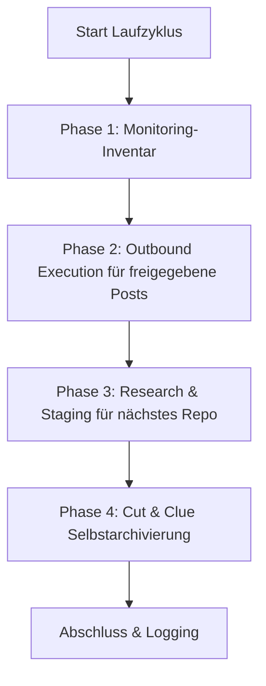

# Community Outreach & Solution Recommender

Uma skill neutra quanto a fornecedor, LLM e sistema operacional para a apresentação automatizada e orientada a soluções de software de código aberto, repositórios e ferramentas em comunidades de desenvolvedores, threads do Reddit, fóruns e comentários de vídeos.

---

## 🌟 Princípios Fundamentais & Garantias de Segurança

1. **Human-in-the-Loop e publicação fail-closed:**
   * Nenhuma publicação automática vai ao ar sem revisão humana.
   * Os rascunhos são apresentados em `POST-EINGANG.md`. A caixa `- [x] Genehmigt` permite apenas a tentativa de publicação.
   * Somente um `PublishReceipt` completo, vinculado à plataforma e à URL de destino, pode atualizar o histórico, a rotação, a saída e o registro de duplicatas. Sem um publisher conectado, a entrada permanece na fila.
2. **Anti-Spam & 100% de relevância (“Melhor nenhuma publicação do que uma inadequada”):**
   * Cada publicação resolve um problema técnico formulado concretamente no thread de destino.
   * Respeito estrito às regras de cada comunidade e plataforma (sem publicidade disfarçada, menção transparente como autor/maintainer).
3. **Proteção rigorosa contra duplicatas:**
   * `posts_history.json` e `POSTVERZEICHNIS.md` registram cada URL de destino comprovada por recibo.
   * Nenhum thread ou vídeo é jamais abordado duas vezes.
4. **Round-Robin justo & rotação de plataformas:**
   * Os projetos são rotacionados pelo maior tempo sem uso (cada repositório é contemplado de forma igualitária).
   * As plataformas se alternam (Reddit $\rightarrow$ YouTube $\rightarrow$ Dev.to / fóruns especializados $\rightarrow$ Reddit).
5. **Cut-and-Clue, autoarquivamento:**
   * As saídas históricas de publicações são arquivadas automaticamente em `_archive/` ao atingir um limite de tamanho e referenciadas no cabeçalho.

---

## 📂 Infraestrutura Padrão

A skill monta, em um diretório de destino (`<workspace_root>/.COMMUNITY_OUTREACH/` ou similar), a seguinte estrutura modular:

| Arquivo | Finalidade |
| :--- | :--- |
| `USECASES.md` | Visão geral de todos os repositórios, seus casos de uso e os problemas-alvo resolvidos |
| `usecases.json` | Banco de dados de rotação legível por máquina, com timestamps e metadados |
| `POST-EINGANG.md` | Fila de aprovação Human-in-the-Loop com caixas `- [ ] Genehmigt` |
| `POST-AUSGANG.md` | Monitoramento de publicações e feedback recebido da comunidade |
| `POSTVERZEICHNIS.md` | Índice global de proteção contra duplicatas de URL e thread |
| `ACCOUNTVERZEICHNIS.md` | Visão geral dos perfis autorizados e dos mecanismos de login SSO |
| `config.json` | Configuração da instância (repositórios, frequências, plataformas de destino) |

A descrição verificada de execução está em [`references/runtime-readme.md`](references/runtime-readme.md).

---

## 🔄 O Ciclo de Execução em 4 Fases



1. **Fase 1 (Inventário de monitoramento):** Conta as entradas publicadas do histórico como threads a serem verificados localmente. O core não busca respostas das plataformas; para isso seria necessário um adapter de entrada separado e autorizado.
2. **Fase 2 (Execução de saída):** Verifica as entradas aprovadas, as duplicatas exatas de URL e o publisher conectado. Somente um `PublishReceipt` verificado dispara alterações de estado locais. O adapter CLI incluído não publica nada por conta própria.
3. **Fase 3 (Solicitação de pesquisa):** Seleciona, por Round-Robin justo, o repositório há mais tempo sem uso e fornece `needs-action`. Somente uma pesquisa separada pode persistir uma URL de destino real, atual e ainda não utilizada, bem como um rascunho verificado em `POST-EINGANG.md`; não são gerados placeholders.
4. **Fase 4 (Autoarquivamento):** Arquiva as entradas completas mais antigas em `_archive/`, mantém as mais recentes ativas e é idempotente em caso de repetição.

Uma execução com `--dry-run` é apenas um cálculo de plano: não chama nenhum publisher, não altera nenhum arquivo e não cria nenhum diretório.

---

## ⚙️ Operação com Múltiplos Schedulers & Múltiplos Agentes

A skill oferece suporte a todos os ambientes comuns de scheduler e agentes:

### 1. Antigravity Sidecar / Scheduled Task
Registrada como sidecar nativo em `.gemini/config/sidecars/community-outreach/sidecar.json`.
* **Vantagem:** Executa apenas com o aplicativo aberto; controle total pelo painel gráfico.
* **Frequência:** p. ex. 1x por dia (`0 10 * * *`) ou 4x por dia (`0 8,12,16,20 * * *`).

### 2. Codex & Claude Code / Cron
* Chamada por meio de uma sessão CLI ou de um task runner existente:
  ```bash
  python scripts/outreach_engine.py --full-run
  ```

### 3. Windows Task Scheduler (`schtasks`)
* Opcional, para execução autônoma em segundo plano no sistema operacional:
  ```powershell
  python scripts/setup_scheduler.py --backend windows --schedule 09:00
  ```

## 📋 Início Rápido (Bootstrap)

1. **Inicializar o workspace:**
   ```bash
   python scripts/init_outreach_workspace.py --target-dir ./outreach_data --repo-list ./repos.json
   ```
2. **Projetar o adapter de runtime portátil:**
   ```bash
   python scripts/deploy_runtime.py --target ./outreach_data --json
   ```
   O deploy copia apenas o core, os adapters, o README do runtime e o smoke test do runtime; arquivos de dados e de fila permanecem intactos. `--check` verifica a projeção sem acesso de escrita.
3. **Executar um teste (Dry-Run):**
   ```bash
   python scripts/outreach_engine.py --workspace ./outreach_data --dry-run
   ```
   O status de retorno permanece `needs-action` enquanto faltar uma pesquisa real ou um publisher. Isso não é um erro nem um comprovante de publicação.
4. **Ativar o scheduler:**
   ```bash
   python scripts/setup_scheduler.py --backend antigravity --workspace ./outreach_data
   ```

---

## 🔒 Configuração Privada / Local

Caminhos específicos, credenciais e perfis SSO pessoais são armazenados em `config.private.json` ou `.env`. Esses arquivos são excluídos por `.gitignore` e nunca chegam a repositórios públicos.

---

## Changelog

### 1.1.0 (2026-08-29)
- Core canônico com adapter de runtime enxuto e caminhos de leitura compatíveis com os dois esquemas de dados anteriores.
- `PublishReceipt` fail-closed, proteção exata contra duplicatas, processamento da fila preservando bytes e projeção local retomável.
- Dry-run sem escrita, arquivamento idempotente baseado em entradas e status verdadeiro do `needs-action` para a Fase 3.

### 1.0.0 (2026-08-13)
- Versão inicial: skill universal Community Outreach & Solution Recommender.
- Engine de 4 fases com Human-in-the-Loop, proteção contra duplicatas, Round-Robin justo e arquivamento Cut-and-Clue.
- Suporte a múltiplos schedulers (Antigravity, Windows Task Scheduler, Cron, ellmos-scheduler, Codex, Claude Code).
