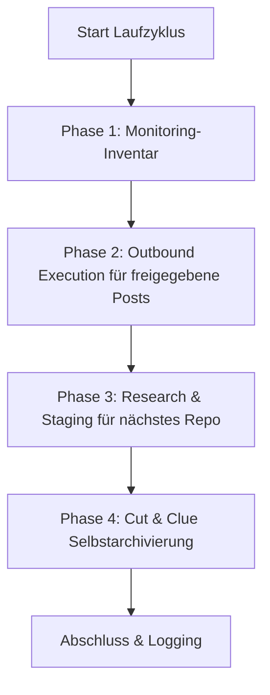

# Community Outreach & Solution Recommender

Навык, нейтральный к поставщику, LLM и операционной системе, для автоматизированного, ориентированного на решения представления программного обеспечения с открытым исходным кодом, репозиториев и инструментов в сообществах разработчиков, тредах Reddit, форумах и комментариях к видео.

---

## 🌟 Ключевые принципы и гарантии безопасности

1. **Human-in-the-Loop и fail-closed публикация:**
   * Ни один автоматический пост не публикуется без предварительного просмотра человеком.
   * Черновики представляются в `POST-EINGANG.md`. Галочка `- [x] Genehmigt` разрешает только попытку публикации.
   * Только полный `PublishReceipt`, привязанный к платформе и целевому URL, может обновлять историю, ротацию, выходные данные и реестр дубликатов. Без подключённого издателя запись остаётся в очереди.
2. **Анти-спам и 100% релевантность («Лучше без поста, чем с неподходящим»):**
   * Каждый пост решает конкретно сформулированную техническую проблему в целевом треде.
   * Строгое соблюдение правил соответствующего сообщества и платформы (никакой скрытой рекламы, прозрачное указание автора/maintainer).
3. **Строгая защита от дубликатов:**
   * `posts_history.json` и `POSTVERZEICHNIS.md` фиксируют каждый подтверждённый квитанцией целевой URL.
   * Ни один тред или видео никогда не адресуется дважды.
4. **Честный Round-Robin и ротация платформ:**
   * Проекты ротируются по принципу самого долгого отсутствия (каждый репозиторий получает равную очередь).
   * Платформы чередуются (Reddit $\rightarrow$ YouTube $\rightarrow$ Dev.to / профильные форумы $\rightarrow$ Reddit).
5. **Cut-and-Clue самоархивация:**
   * Исторические выходные записи при достижении предела размера автоматически выносятся в `_archive/` и указываются в заголовке.

---

## 📂 Стандартная инфраструктура

Навык создаёт в целевом каталоге (`<workspace_root>/.COMMUNITY_OUTREACH/` или аналогичном) следующую модульную структуру:

| Файл | Назначение |
| :--- | :--- |
| `USECASES.md` | Обзор всех репозиториев, их сценариев использования и решаемых целевых проблем |
| `usecases.json` | Машиночитаемая база ротации с метками времени и метаданными |
| `POST-EINGANG.md` | Очередь одобрения Human-in-the-Loop с чекбоксами `- [ ] Genehmigt` |
| `POST-AUSGANG.md` | Мониторинг опубликованных постов и входящей обратной связи сообщества |
| `POSTVERZEICHNIS.md` | Глобальный индекс защиты от дубликатов URL и тредов |
| `ACCOUNTVERZEICHNIS.md` | Обзор авторизованных профилей и механизмов SSO-входа |
| `config.json` | Конфигурация экземпляра (репозитории, частоты, целевые платформы) |

Проверенное описание времени выполнения находится в [`references/runtime-readme.md`](references/runtime-readme.md).

---

## 🔄 Четырёхфазный цикл выполнения



1. **Фаза 1 (Инвентарь мониторинга):** Подсчитывает опубликованные записи истории как локально проверяемые треды. Ядро не получает ответы платформ; для этого требуется отдельный, авторизованный адаптер входящих данных.
2. **Фаза 2 (Исходящее выполнение):** Проверяет одобренные записи, точные URL-дубликаты и подключённого издателя. Только проверенный `PublishReceipt` вызывает локальные изменения состояния. Поставляемый CLI-адаптер сам ничего не публикует.
3. **Фаза 3 (Исследовательское задание):** Через Fair Round-Robin выбирает репозиторий, который дольше всего не использовался, и выдаёт `needs-action`. Только отдельное исследование может сохранить реальный, актуальный и ещё не использованный целевой URL, а также проверенный черновик в `POST-EINGANG.md`; заглушки не создаются.
4. **Фаза 4 (Самоархивация):** Архивирует самые старые полные записи в `_archive/`, оставляет новейшие записи активными и идемпотентна при повторном запуске.

Запуск с `--dry-run` — это чистый расчёт плана: он не вызывает издателя, не изменяет файлы и не создаёт каталоги.

---

## ⚙️ Работа с несколькими планировщиками и агентами

Навык поддерживает все распространённые среды планировщиков и агентов:

### 1. Antigravity Sidecar / Scheduled Task
Регистрируется как нативный sidecar в `.gemini/config/sidecars/community-outreach/sidecar.json`.
* **Преимущество:** Работает только при открытом приложении, полный контроль через GUI-панель.
* **Частота:** например, 1 раз в день (`0 10 * * *`) или 4 раза в день (`0 8,12,16,20 * * *`).

### 2. Codex & Claude Code / Cron
* Вызов через CLI-сессию или существующий task runner:
  ```bash
  python scripts/outreach_engine.py --full-run
  ```

### 3. Windows Task Scheduler (`schtasks`)
* Опционально для автономного фонового выполнения в ОС:
  ```powershell
  python scripts/setup_scheduler.py --backend windows --schedule 09:00
  ```

## 📋 Быстрый старт (Bootstrap)

1. **Инициализация рабочего пространства:**
   ```bash
   python scripts/init_outreach_workspace.py --target-dir ./outreach_data --repo-list ./repos.json
   ```
2. **Проецирование портативного runtime-адаптера:**
   ```bash
   python scripts/deploy_runtime.py --target ./outreach_data --json
   ```
   Развёртывание копирует только ядро, адаптеры, README runtime и smoke-тест runtime; файлы данных и очереди не затрагиваются. `--check` проверяет проекцию без доступа на запись.
3. **Тестовый запуск (Dry-Run):**
   ```bash
   python scripts/outreach_engine.py --workspace ./outreach_data --dry-run
   ```
   Статус возврата остаётся `needs-action`, пока отсутствует реальное исследование или издатель. Это не ошибка и не подтверждение публикации.
4. **Активация планировщика:**
   ```bash
   python scripts/setup_scheduler.py --backend antigravity --workspace ./outreach_data
   ```

---

## 🔒 Приватная / локальная конфигурация

Конкретные пути, учётные данные и персональные профили SSO хранятся в `config.private.json` или `.env`. Эти файлы исключаются через `.gitignore` и никогда не попадают в публичные репозитории.

---

## Changelog

### 1.1.0 (2026-08-29)
- Каноническое ядро с тонким runtime-адаптером и совместимыми путями чтения для обеих прежних схем данных.
- Fail-closed `PublishReceipt`, точная защита от дубликатов, обработка очереди с сохранением байтов и восстанавливаемая локальная проекция.
- Dry-run без записи, идемпотентная архивация по записям и правдивый статус `needs-action` для Фазы 3.

### 1.0.0 (2026-08-13)
- Первоначальный релиз: универсальный навык Community Outreach & Solution Recommender.
- Движок из 4 фаз с Human-in-the-Loop, защитой от дубликатов, Fair Round-Robin и архивацией Cut-and-Clue.
- Поддержка нескольких планировщиков (Antigravity, Windows Task Scheduler, Cron, ellmos-scheduler, Codex, Claude Code).
