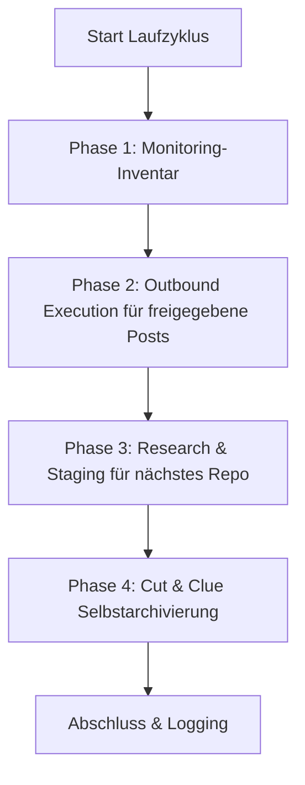

# 社区推广与解决方案推荐器

一个与供应商、LLM 及操作系统无关的技能，用于在开发者社区、Reddit 帖子串、论坛和视频评论中，以解决方案为导向、自动化地介绍开源软件、仓库和工具。

---

## 🌟 核心原则与安全保障

1. **人在回路与失败即关闭（fail-closed）的发布机制：**
   * 没有任何自动帖子可以在人工审核之前上线。
   * 草稿会提交至 `POST-EINGANG.md`。复选框 `- [x] Genehmigt` 仅允许发起发布尝试。
   * 只有完整的、绑定到平台和目标 URL 的 `PublishReceipt` 才可以更新历史记录、轮换状态、输出记录和重复项登记。若未连接发布器，条目将保留在队列中。
2. **反垃圾信息与 100% 相关性（“宁可不发，也不发不相关的帖子”）：**
   * 每条帖子都必须针对目标帖子串中具体表述的技术问题给出解决方案。
   * 严格遵守各社区和平台的规则（不做隐性广告，明确说明作者或维护者身份）。
3. **严格的重复项保护：**
   * `posts_history.json` 与 `POSTVERZEICHNIS.md` 记录每个经回执确认的目标 URL。
   * 任何帖子串或视频都不会被重复处理。
4. **公平轮询与平台轮换：**
   * 项目按照最长时间未被使用的顺序轮换（每个仓库均衡地获得机会）。
   * 平台交替使用（Reddit $\rightarrow$ YouTube $\rightarrow$ Dev.to / 专业论坛 $\rightarrow$ Reddit）。
5. **Cut-and-Clue 自归档：**
   * 历史发布记录达到大小上限时，会自动归档至 `_archive/`，并在头部中予以引用。

---

## 📂 标准基础结构

该技能会在目标目录（`<workspace_root>/.COMMUNITY_OUTREACH/` 或类似路径）中建立以下模块化结构：

| 文件 | 用途 |
| :--- | :--- |
| `USECASES.md` | 所有仓库、其用例及所解决的目标问题的概览 |
| `usecases.json` | 带时间戳和元数据的机器可读轮换数据库 |
| `POST-EINGANG.md` | 带有 `- [ ] Genehmigt` 复选框的人工审批队列 |
| `POST-AUSGANG.md` | 已发布帖子的监控与入站社区反馈 |
| `POSTVERZEICHNIS.md` | 全局 URL 与帖子串重复项保护索引 |
| `ACCOUNTVERZEICHNIS.md` | 已授权配置文件及 SSO 登录机制概览 |
| `config.json` | 实例配置（仓库、频率、目标平台） |

经验证的运行时说明位于 [`references/runtime-readme.md`](references/runtime-readme.md)。

---

## 🔄 四阶段运行周期



1. **阶段 1（监控清单）：** 将已发布的历史条目计为待在本地检查的帖子串。核心模块不获取平台回复；这需要一个单独的、经授权的入站适配器。
2. **阶段 2（出站执行）：** 检查已批准的条目、精确的 URL 重复项以及已连接的发布器。只有经验证的 `PublishReceipt` 才会触发本地状态变更。随附的 CLI 适配器本身不发布任何内容。
3. **阶段 3（调研任务）：** 通过公平轮询选择最长时间未被使用的仓库，并输出 `needs-action`。只有独立的调研才可以将真实、最新且尚未使用的目标 URL 以及经审核的草稿持久化到 `POST-EINGANG.md` 中；不生成占位符。
4. **阶段 4（自归档）：** 将最早的完整条目归档至 `_archive/`，保持最新条目在线，并且重复执行是幂等的。

使用 `--dry-run` 的运行仅进行纯粹的计划计算：它不调用发布器，不修改任何文件，也不创建目录。

---

## ⚙️ 多调度器与多代理运行

该技能支持所有常见的调度器和代理环境：

### 1. Antigravity Sidecar / 计划任务
注册为 `.gemini/config/sidecars/community-outreach/sidecar.json` 中的原生 sidecar。
* **优点：** 仅在应用打开时运行，可通过图形界面仪表板完全控制。
* **频率：** 例如每天 1 次（`0 10 * * *`）或每天 4 次（`0 8,12,16,20 * * *`）。

### 2. Codex 与 Claude Code / Cron
* 通过 CLI 会话或现有任务运行器调用：
  ```bash
  python scripts/outreach_engine.py --full-run
  ```

### 3. Windows 任务计划程序（`schtasks`）
* 可选，用于独立的操作系统后台执行：
  ```powershell
  python scripts/setup_scheduler.py --backend windows --schedule 09:00
  ```

## 📋 快速入门（引导）

1. **初始化工作区：**
   ```bash
   python scripts/init_outreach_workspace.py --target-dir ./outreach_data --repo-list ./repos.json
   ```
2. **投影便携式运行时适配器：**
   ```bash
   python scripts/deploy_runtime.py --target ./outreach_data --json
   ```
   部署仅复制核心、适配器、运行时 README 和运行时冒烟测试；数据与队列文件保持不变。`--check` 在不进行写入的情况下检查投影。
3. **执行测试运行（Dry-Run）：**
   ```bash
   python scripts/outreach_engine.py --workspace ./outreach_data --dry-run
   ```
   只要缺少真实调研或发布器，返回状态就保持为 `needs-action`。这不是错误，也不是发布凭证。
4. **启用调度器：**
   ```bash
   python scripts/setup_scheduler.py --backend antigravity --workspace ./outreach_data
   ```

---

## 🔒 私有 / 本地配置

特定路径、凭据和个人 SSO 配置文件存储在 `config.private.json` 或 `.env` 中。这些文件通过 `.gitignore` 排除，且永远不会进入公开仓库。

---

## 更新日志

### 1.1.0 (2026-08-29)
- 采用精简运行时适配器的规范核心，并为两种既有数据架构提供兼容的读取路径。
- 失败即关闭的 `PublishReceipt`、精确的重复项保护、保留字节的队列处理以及可断点续跑的本地投影。
- 免写入的 Dry-Run、基于条目的幂等归档，以及阶段 3 中如实反映状态的 `needs-action`。

### 1.0.0 (2026-08-13)
- 初始版本：通用社区推广与解决方案推荐器技能。
- 四阶段引擎，包含人在回路、重复项保护、公平轮询与剪切线索式归档。
- 多调度器支持（Antigravity、Windows 任务计划程序、Cron、ellmos-scheduler、Codex、Claude Code）。
