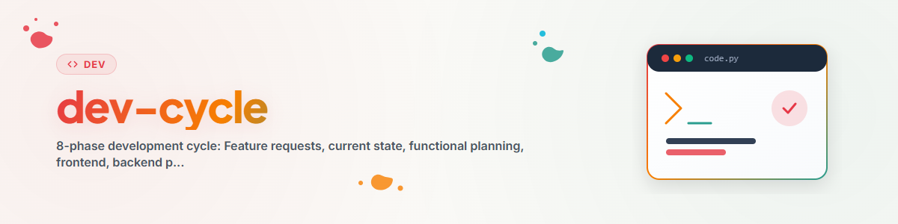

> **Deutsch** — Offizielle Deutsch-Version / Documento Oficial en Deutsch.

# উন্নয়ন চক্র (Dev Cycle) (Deutsch)

> **লক্ষ্য:** বৈশিষ্ট্য অনুরোধ থেকে যাচাইকৃত সিস্টেম পর্যন্ত একটি কাঠামোবদ্ধ প্রক্রিয়া।
> প্রতিটি উন্নয়ন এই ৮টি ফেজের মধ্য দিয়ে যায়।

> 📐 **সংযুক্তি:** `SCHALTPLAN-SOFTWAREENTWICKLUNG.html` —
> মানুষের পাঠযোগ্য „সফটওয়্যার উন্নয়নের সার্কিট ডায়াগ্রাম" (HTML, ব্রাউজারে খুলুন):
> ফেজ, নিয়ন্ত্রণ-লুপ, ভূমিকা, প্রক্রিয়া-শৃঙ্খল ও টেস্ট-গেটের গবেষণালব্ধ সামগ্রিক মানচিত্র
> (ওয়েব গবেষণা ০৮/২০২৬), যেখানে এই ৮-ফেজ চক্রটি স্থান পায়।

---

## সারসংক্ষেপ ও উদ্দেশ্য

```
  +--------------------------------------------------------------+
  |                    DEVELOPMENT CYCLE                           |
  +--------------------------------------------------------------+
  |                                                                |
  |  Phase 1   Feature Requests (functional requirements)          |
  |     |                                                          |
  |     v                                                          |
  |  Phase 2   Check Current State (What already exists?)          |
  |     |                                                          |
  |     v                                                          |
  |  Phase 3   Functional Planning                                 |
  |            (Workflows, Agents, Experts, Skills, Services)      |
  |     |                                                          |
  |     v                                                          |
  |  Phase 4   Implement Functional Frontend                       |
  |            (Skill files, workflow markdown, agent profiles)     |
  |     |                                                          |
  |     v                                                          |
  |  Phase 5   Plan and Align Backend                              |
  |            (CLI handlers, DB schema, API endpoints)            |
  |     |                                                          |
  |     v                                                          |
  |  Phase 6   Implement Backend Tasks                             |
  |            (Python code, tools, DB migrations)                 |
  |     |                                                          |
  |     v                                                          |
  |  Phase 7   Test Execution, Review Gate and Bugfixes           |
  |            (B/O/E tests, bugfix protocol, code review)          |
  |     |                                                          |
  |     v                                                          |
  |  Phase 8   Functional and Feature Test: USE CASES              |
  |            (End-to-end validation from user perspective)        |
  |                                                                |
  +--------------------------------------------------------------+

  Core principles throughout:
  - Functional description first (before code)
  - CLI First (everything controllable via terminal)
  - Clear separation of user data and system data
  - Shift-Left: tests are DESIGNED early (phases 1/3/5) and WRITTEN
    with the code (phase 6) - phase 7 only EXECUTES them
```


---

## ফেজ ১: বৈশিষ্ট্য অনুরোধ (কার্যকরী প্রয়োজনীয়তা)

**কী:** কার্যকরী প্রয়োজনীয়তা সংগ্রহ ও সুনির্দিষ্টভাবে লিপিবদ্ধ করা।

**ইনপুট:**
- ব্যবহারকারীর ইচ্ছা, ধারণা, সমস্যা
- অংশীদারদের পরামর্শ (LLM সহকারী)
- ব্যবহারের ক্ষেত্র থেকে প্রাপ্ত অন্তর্দৃষ্টি (প্রতিক্রিয়া লুপ!)

**আউটপুট:**
- কাজ-ব্যবস্থায় কাজসমূহ (যেমন issue, ticket বা TODO তালিকা হিসেবে)
- প্রয়োজনীয়তা বর্ণনা করে কী চাওয়া হচ্ছে, কীভাবে নয়
- প্রতিটি প্রয়োজনীয়তার সাথে পরীক্ষাযোগ্য গ্রহণযোগ্যতার মানদণ্ড থাকে (Shift-Left: এগুলো ফেজ ৮-এর ব্যবহারের ক্ষেত্র এবং গ্রহণযোগ্যতা তালিকায় পরিণত হয়)

**নিয়মাবলী:**
- সর্বদা কার্যকরীভাবে প্রয়োজনীয়তা লিখুন („ব্যবহারকারী X করতে পারবেন")
- প্রযুক্তিগতভাবে নয় („X-এর জন্য REST endpoint বাস্তবায়ন করুন")
- ব্যবহারের ক্ষেত্রকে প্রয়োজনীয়তার উৎস হিসেবে ব্যবহার করুন (ফেজ ৮ -> ফেজ ১)

---

## ফেজ ২: বর্তমান অবস্থা যাচাই

**কী:** বিদ্যমান কার্যকারিতার তালিকা তৈরি।

**চেকলিস্ট:**
```
  [ ] Search existing tools/scripts
  [ ] Check documentation/help on the topic
  [ ] Check existing skills/agents/services
  [ ] Check DB schema (if relevant)
  [ ] Check use cases - has something similar been tested?
```

**আউটপুট:**
- কী আছে, কী নেই, কী সম্প্রসারণ প্রয়োজন তার নথিভুক্তকরণ
- সদৃশতা এড়ানো

---

## ফেজ ৩: কার্যকরী পরিকল্পনা

**কী:** কার্যকরী স্তরে পরিকল্পনা করুন — তাৎক্ষণিকভাবে কোড লিখবেন না।

**পরিকল্পনা স্তর:**

| স্তর | প্রশ্ন | আর্টিফ্যাক্ট |
|------|--------|--------------|
| Workflow | সমন্বয় কখন/কীভাবে হয়? | workflows/*.md |
| Agent | কে কার্যকর করে? | agents/*.txt |
| Expert | কার কাছে ডোমেইন জ্ঞান আছে? | experts/*/ |
| Skill | কী করা হয়? | skills/*.md |
| Service | প্রযুক্তিগতভাবে কীভাবে করা হয়? | services/*/ |

**নিয়মাবলী:**
- প্রথমে কার্যকরীভাবে ভাবুন, তারপর প্রযুক্তিগতভাবে
- Shift-Left: প্রতিটি পরিকল্পনা স্তরের জন্য তার CHECK-ও পরিকল্পনা করুন — প্রয়োজনীয়তা → গ্রহণযোগ্যতার মানদণ্ড, service/interface → integration test, unit → unit test (টেস্ট-স্তর ও কৌশল নির্বাচন: [software-testing](../software-testing/SKILL.md))
- Workflow প্রক্রিয়া বর্ণনা করে, বাস্তবায়নের খুঁটিনাটি নয়
- প্রতিটি agent-এর একটি স্পষ্ট প্রোফাইল থাকতে হবে
- Service-গুলো ব্যবহারকারীর ডেটা ছাড়াও কাজ করতে হবে

---

## ফেজ ৪: কার্যকরী ফ্রন্টএন্ড বাস্তবায়ন

**কী:** Skill ফাইল, workflow markdown, agent প্রোফাইল তৈরি করুন।

এখানে „ফ্রন্টএন্ড" হলো কার্যকরী বর্ণনা স্তর:
- Workflow ফাইল (.md)
- Agent প্রোফাইল (.txt)
- Expert জ্ঞান
- Service বর্ণনা
- সহায়ক ফাইল

**আউটপুট:**
- সমস্ত কার্যকরী বর্ণনা বিদ্যমান
- একজন LLM অংশীদার workflow পড়ে বুঝতে পারে
- কার্যকরী স্তর সম্পূর্ণভাবে নথিভুক্ত

---

## ফেজ ৫: ব্যাকএন্ড পরিকল্পনা ও সমন্বয়

**কী:** কার্যকরী ফ্রন্টএন্ডের সাথে প্রযুক্তিগত স্থাপত্য সমন্বিত করুন।

**পরিকল্পনা ক্ষেত্র:**

| ক্ষেত্র | প্রশ্ন | অবস্থান |
|---------|--------|---------|
| CLI Handlers | কোন কমান্ডগুলো? | handlers/*.py |
| DB Schema | কোন টেবিল/কলাম? | schema/*.sql |
| API Endpoints | কোন GUI endpoint? | server.py |
| Tools | কোন Python স্ক্রিপ্ট? | tools/*.py |

**আউটপুট:**
- কার্যকরী ফ্রন্টএন্ডের সাথে সমন্বিত প্রযুক্তিগত পরিকল্পনা
- DB schema ডিজাইন
- CLI কমান্ড কাঠামো

---

## ফেজ ৬: ব্যাকএন্ড কাজ বাস্তবায়ন

**কী:** Python কোড, DB migration, CLI handler লিখুন।

**চেকলিস্ট (প্রতি কাজের জন্য):**
```
  [ ] Unit tests written (TDD: test before code) and green locally?
  [ ] Works without user data (empty DB)?
  [ ] CLI command available?
  [ ] Input can come from files/folders?
  [ ] Output goes to structured DB?
  [ ] Scan/import is repeatable (idempotent)?
  [ ] No hardcoded path?
  [ ] Tool registered and documented?
  [ ] Help file created?
```

---

## ফেজ ৭: পরীক্ষা কার্যকরকরণ, রিভিউ গেট ও বাগফিক্স

**কী:** প্রযুক্তিগত সঠিকতা নিশ্চিত করুন। পরীক্ষাগুলো ফেজ ১/৩/৫-এ ডিজাইন করা হয়েছিল এবং ফেজ ৬-এ লেখা হয়েছিল (Shift-Left) — ফেজ ৭ স্তরভিত্তিক, ব্লকিং গেটে সেগুলো কার্যকর করে: প্রতিটি commit-এ দ্রুত পরীক্ষা, ব্যয়বহুল পরীক্ষা (পূর্ণ regression, E2E, load) রাতে বা রিলিজের আগে। গেট ম্যাপিং ও পরীক্ষা নির্বাচন: [software-testing](../software-testing/SKILL.md)।

**পরীক্ষার ধরন (B/O/E):**

| ধরন | দৃষ্টিকোণ | বর্ণনা |
|-----|-----------|--------|
| B-Tests | বাহ্যিক/স্বয়ংক্রিয় | স্বয়ংক্রিয় পরীক্ষা, CI/CD |
| O-Tests | কার্যকরী (ইনপুট->আউটপুট) | ম্যানুয়াল কার্যকরী যাচাই |
| E-Tests | বিষয়গত/অভিজ্ঞতা | UX মূল্যায়ন, ergonomics |

**রিভিউ গেট (ফেজ ৮-এর আগে):**
- দ্বিতীয় একজনের দ্বারা কোড রিভিউ (peer, reviewer agent, বা advisor)
- রিভিউ ছাড়া কিছুই ব্যবহারের ক্ষেত্র যাচাইয়ে প্রবেশ করে না
- রিভিউয়ের ফলাফল পরিবর্তন অনুরোধ হিসেবে ফেজ ৬-এ ফিরে আসে

**বাগ পেলে:**
- বাগফিক্স প্রোটোকল প্রয়োগ করুন
- ২০-মিনিট নিয়ম মেনে চলুন (২০ মিনিট পর পদ্ধতি পরিবর্তন করুন)
- শিক্ষণীয় বিষয় নথিভুক্ত করুন

---

## ফেজ ৮: কার্যকরী ও বৈশিষ্ট্য পরীক্ষা — ব্যবহারের ক্ষেত্রসমূহ

**কী:** ব্যবহারকারীর দৃষ্টিকোণ থেকে এন্ড-টু-এন্ড যাচাই।

**ব্যবহারের ক্ষেত্র দুটি উদ্দেশ্য পূরণ করে:**
1. **বৈশিষ্ট্যের নির্দেশক** — কী চাওয়া হচ্ছে? কী সম্ভব হওয়া উচিত?
2. **পরীক্ষার পরিস্থিতি** — এটি সত্যিই শুরু থেকে শেষ পর্যন্ত কাজ করে কি না?

**ব্যবহারের ক্ষেত্রের বিন্যাস:**
```
  USECASE_NNN: Short Title

  PRECONDITION: What must be in place?
  INPUT:        What does the user enter / what data?
  EXPECTED:     What should the result be?
  TESTS:        Which components are tested?
```

**প্রতিক্রিয়া লুপ:**
- ব্যর্থ ব্যবহারের ক্ষেত্র -> ফেজ ১-এ নতুন কাজ
- সফল ব্যবহারের ক্ষেত্র -> যাচাইকৃত বৈশিষ্ট্য
- নতুন ব্যবহারের ক্ষেত্রের ধারণা -> কাজ হিসেবে নথিভুক্ত করুন

---

## সারসংক্ষেপ: চক্র

```
  Phase 8 (Use Cases)
       |
       | New requirements / bugs
       v
  Phase 1 (Feature Requests)  -->  Phase 2 (Current State)
       ^                                    |
       |                                    v
  Phase 7 (Tests/Bugs)         Phase 3 (Functional Planning)
       ^                                    |
       |                                    v
  Phase 6 (Backend Code)       Phase 4 (Functional Frontend)
       ^                                    |
       |                                    v
       +──────────────────── Phase 5 (Backend Planning)
```

চক্রটি একটি লুপ: ব্যবহারের ক্ষেত্র বৈশিষ্ট্য যাচাই করে এবং একই সাথে নতুন প্রয়োজনীয়তা তৈরি করে।

---

## নিয়ন্ত্রণ-লুপ (Regelkreise)

৮-ফেজ চক্রটি বাইরের নিয়ন্ত্রণ-লুপ। এর ভেতরে দ্রুততর লুপগুলো একসাথে চলে — লুপে যত ভেতরে, তার takt তত দ্রুত এবং সংশোধন তত সস্তা:

| লুপ | Takt | চক্রের কোথায় |
|-----|------|---------------|
| TDD (Red–Green–Refactor) | সেকেন্ড–মিনিট | ফেজ ৬-এর ভেতরে |
| Test execution / CI গেট | প্রতি commit < ১০ মিনিট | ফেজ ৭ → ব্যর্থ হলে ফেজ ৬ |
| রিভিউ গেট (৪-চোখ) | ঘণ্টা | ফেজ ৭ ও ফেজ ৮-এর মাঝে |
| বাগফিক্স লুপ | ঘণ্টা | ফেজ ৭ → ফেজ ৬ (বাগফিক্স প্রোটোকল) |
| ব্যবহারের ক্ষেত্র লুপ | প্রতি চক্রে | ফেজ ৮ → ফেজ ১ |
| অপারেশন প্রতিক্রিয়া | অবিরাম | মনিটরিং/ঘটনা → ফেজ ১ |

মোটা নিয়ম: commit থেকে প্রতিক্রিয়া পর্যন্ত সময় ১০ মিনিটের নিচে রাখুন — ধীর লুপ এড়িয়ে যাওয়া হয়। সব লুপের সময়সহ দৃশ্যমান মানচিত্র: সংযুক্ত `SCHALTPLAN-SOFTWAREENTWICKLUNG.html`, শিট BL-2।

---

## ফেজ-নির্দিষ্ট Skill

| ফেজ | বিশেষায়িত skill | ট্রিগার |
|-----|------------------|---------|
| ফেজ ১-৩ | Project bootstrapper (যদি উপলব্ধ থাকে) | নতুন প্রকল্প তৈরি (greenfield) |
| ফেজ ২ | [project-onboarding](../project-onboarding/SKILL.en.md) | বিদ্যমান প্রকল্প গ্রহণ |
| ফেজ ২-৩ | [docs-analysis](../docs-analysis/SKILL.en.md) | প্রয়োজনীয়তা নথি বনাম কোড যাচাই |
| ফেজ ৫-৬ | [pipeline-optimizer](../pipeline-optimizer/SKILL.en.md) | বিদ্যমান কাঠামো নবায়ন |
| ফেজ ৭ | [bugfix-protocol](../bugfix-protocol/SKILL.en.md) | পদ্ধতিগত ৬-ফেজ ডিবাগিং |
| ফেজ ৭-৮ | [bugsweep](../bugsweep/SKILL.en.md) | রিলিজের আগে অভিসারী বাগ স্ক্যান |
| ফেজ ১, ৩, ৭ | [software-testing](../software-testing/SKILL.md) | পরীক্ষার স্তর, ধরন ও ডিজাইন কৌশল নির্বাচন; CI/CD গেট ম্যাপিং |
| ফেজ ৮-এর পরে | [github-repo-care](../github-repo-care/SKILL.en.md) | রিলিজ: রিপোজিটরি প্রকাশ ও রক্ষণাবেক্ষণ |

আপনার skill সংগ্রহে যদি একটি skill index থাকে, সেখানে আরও ফেজ-নির্দিষ্ট skill খুঁজুন।

---

## পরিবর্তন লগ

### 1.2.0 (2026-08-22)
- Shift-Left প্রতিষ্ঠিত (সংযুক্ত ডায়াগ্রামের সাথে গবেষণা মিলিয়ে): গ্রহণযোগ্যতার মানদণ্ড ফেজ-১ আউটপুট হিসেবে, প্রতিটি পরিকল্পনা স্তরে পরীক্ষা-খসড়া ফেজ ৩-এ, Unit-টেস্ট (TDD) ফেজ-৬ চেকলিস্টের প্রথম আইটেম; ফেজ ৭ নামান্তরিত „Test Execution, Review Gate and Bugfixes" — পরীক্ষা সেখানে কার্যকর হয়, শুধু লেখা হয় না
- রিভিউ-গেট (৪-চোখ নীতি) ফেজ ৮-এর আগে একটি স্পষ্ট ধাপ
- নতুন বিভাগ „নিয়ন্ত্রণ-লুপ (Regelkreise)" takt-সময়সহ (TDD, CI, রিভিউ, বাগফিক্স, ব্যবহারের ক্ষেত্র, অপারেশন)
- ফেজ-Skill টেবিল প্রসারিত: software-testing (ফেজ ১/৩/৭), github-repo-care (ফেজ ৮-এর পরে); ফেজ ৩ ও ফেজ ৭-এ software-testing-এর উল্লেখ

### 1.1.1 (2026-08-22)
- সংযুক্তি `SCHALTPLAN-SOFTWAREENTWICKLUNG.html` (মানুষের পাঠযোগ্য সামগ্রিক মানচিত্র: ফেজ, নিয়ন্ত্রণ-লুপ, ভূমিকা, প্রক্রিয়া-শৃঙ্খল, টেস্ট-গেট — ওয়েব গবেষণা ০৮/২০২৬-এর সংশ্লেষণ) এবং ফাইলের শুরুতে উল্লেখ

### 1.1.0 (2026-06-13)
- নতুন „ফেজ-নির্দিষ্ট Skill" টেবিল, project-onboarding, docs-analysis, pipeline-optimizer, bugfix-protocol ও bugsweep-এর উল্লেখসহ

### 1.0.0 (2026-03-12)
- BACH থেকে পোর্ট করা হয়েছে (dev-zyklus v1.0.0)

---

*তৈরি: 2026-01-28 | পোর্ট: 2026-03-12*
