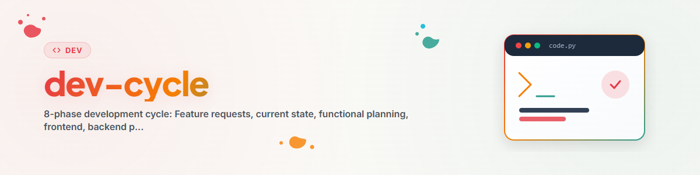

> **Français** — Version française officielle de la compétence `dev-cycle`.

# Cycle de Développement (Dev Cycle)

> **Objectif :** Processus structuré allant de la demande de fonctionnalité au système validé.
> Chaque développement suit ces 8 phases.

> 📐 **Annexe :** `SCHALTPLAN-SOFTWAREENTWICKLUNG.html` —
> « schéma de câblage du développement logiciel » lisible par l'humain (HTML, à ouvrir dans un navigateur) :
> carte globale documentée des phases, boucles de régulation, rôles, chaînes de processus et portes de test
> (recherche web 08/2026), dans laquelle s'inscrit ce cycle en 8 phases.

---

## Vue d'ensemble et Objectif

```
  +-------------------------------------------------------------------+
  |                    CYCLE DE DÉVELOPPEMENT                         |
  +-------------------------------------------------------------------+
  |                                                                   |
  |  Phase 1   Demandes de fonctionnalités (exigences fonctionnelles) |
  |     |                                                             |
  |     v                                                             |
  |  Phase 2   Vérifier l'état actuel (Qu'est-ce qui existe déjà ?)   |
  |     |                                                             |
  |     v                                                             |
  |  Phase 3   Planification fonctionnelle                            |
  |            (Workflows, Agents, Experts, Compétences, Services)    |
  |     |                                                             |
  |     v                                                             |
  |  Phase 4   Implémenter le Frontend fonctionnel                    |
  |            (Fichiers de compétences, Markdown de workflow,        |
  |             profils d'agents)                                     |
  |     |                                                             |
  |     v                                                             |
  |  Phase 5   Planifier et aligner le Backend                        |
  |            (Gestionnaires CLI, schéma de BDD, endpoints API)      |
  |     |                                                             |
  |     v                                                             |
  |  Phase 6   Implémenter les tâches Backend                         |
  |            (Code Python, outils, migrations de BDD)               |
  |     |                                                             |
  |     v                                                             |
  |  Phase 7   Exécution des tests, porte de revue et corrections     |
  |            (Tests B/O/E, protocole de bugfix, revue de code)      |
  |     |                                                             |
  |     v                                                             |
  |  Phase 8   Test fonctionnel et métier : CAS D'UTILISATION         |
  |            (Validation de bout en bout du point de vue usager)    |
  |                                                                   |
  +-------------------------------------------------------------------+

  Principes directeurs permanents :
  - Description fonctionnelle d'abord (avant le code)
  - CLI First (tout doit être pilotable via le terminal)
  - Séparation stricte des données utilisateur et des données système
  - Shift-Left : les tests sont CONÇUS tôt (phases 1/3/5) et ÉCRITS
    avec le code (phase 6) — la phase 7 se contente de les EXÉCUTER
```

---

## Phase 1 : Demandes de fonctionnalités (Exigences fonctionnelles)

**Quoi :** Recueillir et formuler les exigences fonctionnelles.

**Entrées :**
- Souhaits, idées et problèmes des utilisateurs
- Suggestions des partenaires (assistants LLM)
- Enseignements tirés des cas d'utilisation (boucle de rétroaction !)

**Sorties :**
- Tâches dans le système de gestion des tâches (ex. issue, ticket ou liste TODO)
- Les exigences décrivent CE qui est souhaité, pas COMMENT l'implémenter
- Chaque exigence comporte des critères d'acceptation testables (Shift-Left : ils deviennent
  les cas d'utilisation de la Phase 8 et la check-list de réception)

**Règles :**
- Toujours formuler les exigences de manière fonctionnelle (« L'utilisateur peut faire X »)
- Pas de formulation technique (« Implémenter un endpoint REST pour X »)
- Utiliser les cas d'utilisation comme source d'exigences (Phase 8 -> Phase 1)

---

## Phase 2 : Vérifier l'état actuel

**Quoi :** Inventorier les fonctionnalités existantes.

**Check-list :**
```
  [ ] Rechercher les outils/scripts existants
  [ ] Vérifier la documentation/l'aide sur le sujet
  [ ] Vérifier les compétences/agents/services existants
  [ ] Vérifier le schéma de base de données (si pertinent)
  [ ] Vérifier les cas d'utilisation — quelque chose de similaire a-t-il déjà été testé ?
```

**Sorties :**
- Documentation de ce qui existe, ce qui manque et ce qui doit être étendu
- Prévention des doublons

---

## Phase 3 : Planification fonctionnelle

**Quoi :** Planifier au niveau fonctionnel — ne PAS écrire de code tout de suite.

**Niveaux de planification :**

| Niveau | Question | Artefact |
|--------|----------|----------|
| Workflow | QUAND/COMMENT s'effectue la coordination ? | `workflows/*.md` |
| Agent | QUI exécute ? | `agents/*.txt` |
| Expert | QUI détient l'expertise métier ? | `experts/*/` |
| Compétence (Skill) | QUOI est réalisé ? | `skills/*.md` |
| Service | COMMENT cela est-il fait techniquement ? | `services/*/` |

**Règles :**
- Penser d'abord fonctionnel, puis technique
- Shift-Left : pour chaque niveau de planification, prévoir également sa VÉRIFICATION — exigence →
  critère d'acceptation, service/interface → test d'intégration, unité → test unitaire
  (sélection des niveaux et techniques de test : [software-testing](../software-testing/SKILL.md))
- Les workflows décrivent des processus, pas des détails d'implémentation
- Chaque agent doit disposer d'un profil clair
- Les services doivent fonctionner sans données utilisateur

---

## Phase 4 : Implémenter le Frontend fonctionnel

**Quoi :** Créer les fichiers de compétences, le Markdown des workflows et les profils d'agents.

Le « frontend » désigne ici la couche de description fonctionnelle :
- Fichiers de workflow (`.md`)
- Profils d'agents (`.txt`)
- Connaissances d'experts
- Descriptions de services
- Fichiers d'aide

**Sorties :**
- Toutes les descriptions fonctionnelles existent
- Un partenaire LLM peut lire et comprendre le workflow
- La couche fonctionnelle est entièrement documentée

---

## Phase 5 : Planifier et aligner le Backend

**Quoi :** Aligner l'architecture technique sur le frontend fonctionnel.

**Domaines de planification :**

| Domaine | Question | Emplacement |
|---------|----------|-------------|
| Gestionnaires CLI | Quelles commandes ? | `handlers/*.py` |
| Schéma de BDD | Quelles tables/colonnes ? | `schema/*.sql` |
| Endpoints API | Quels endpoints GUI ? | `server.py` |
| Outils | Quels scripts Python ? | `tools/*.py` |

**Sorties :**
- Plan technique aligné sur le frontend fonctionnel
- Conception du schéma de base de données
- Structure des commandes CLI

---

## Phase 6 : Implémenter les tâches Backend

**Quoi :** Écrire le code Python, les migrations de BDD et les gestionnaires CLI.

**Check-list (par tâche) :**
```
  [ ] Tests unitaires écrits (TDD : test avant le code) et verts en local ?
  [ ] Fonctionne sans données utilisateur (BDD vide) ?
  [ ] Commande CLI disponible ?
  [ ] L'entrée peut-elle provenir de fichiers/dossiers ?
  [ ] La sortie est-elle enregistrée dans une BDD structurée ?
  [ ] L'analyse/importation est-elle répétable (idempotente) ?
  [ ] Aucun chemin codé en dur ?
  [ ] Outil enregistré et documenté ?
  [ ] Fichier d'aide créé ?
```

---

## Phase 7 : Exécution des tests, porte de revue et corrections

**Quoi :** Garantir la justesse technique. Les tests ont été CONÇUS aux phases 1/3/5 et
ÉCRITS en phase 6 (Shift-Left) — la phase 7 les EXÉCUTE via des portes bloquantes étagées :
tests rapides à chaque commit, tests coûteux (régression complète, E2E, charge) la nuit
ou avant une release. Correspondance des portes et sélection des tests : [software-testing](../software-testing/SKILL.md).

**Types de tests (B/O/E) :**

| Type | Perspective | Description |
|------|-------------|-------------|
| Tests B | Externe/Automatisée | Tests automatisés, CI/CD |
| Tests O | Fonctionnelle (Entrée->Sortie) | Vérification fonctionnelle manuelle |
| Tests E | Subjective/Expérience | Évaluation UX, ergonomie |

**Porte de revue (avant la Phase 8) :**
- Revue de code par une seconde paire d'yeux (pair, agent réviseur ou conseiller)
- Rien n'entre en validation par cas d'utilisation sans avoir été relu
- Les constats de revue repartent en Phase 6 comme demandes de modification

**En cas de bugs :**
- Appliquer le protocole de correction de bugs (`bugfix-protocol`)
- Respecter la règle des 20 minutes (changer d'approche après 20 min)
- Documenter les enseignements tirés

---

## Phase 8 : Test fonctionnel et métier — CAS D'UTILISATION

**Quoi :** Validation de bout en bout du point de vue de l'utilisateur.

**Les cas d'utilisation remplissent DEUX rôles :**
1. **Indicateurs de fonctionnalités** — Qu'est-ce qui est souhaité ? Qu'est-ce qui doit être possible ?
2. **Scénarios de test** — Est-ce que cela fonctionne réellement de A à Z ?

**Format des cas d'utilisation :**
```
  USECASE_NNN: Titre court

  PRECONDITION: Ce qui doit être en place
  INPUT:        Ce que saisit l'utilisateur / les données d'entrée
  EXPECTED:     Le résultat attendu
  TESTS:        Les composants testés
```

**Boucle de rétroaction :**
- Cas d'utilisation échoués -> nouvelles tâches en Phase 1
- Cas d'utilisation réussis -> fonctionnalités validées
- Nouvelles idées de cas d'utilisation -> enregistrer comme tâches

---

## Résumé : Le Cycle

```
  Phase 8 (Cas d'utilisation)
       |
       | Nouvelles exigences / bugs
       v
  Phase 1 (Demandes)           -->  Phase 2 (État actuel)
       ^                                    |
       |                                    v
  Phase 7 (Tests/Bugs)         Phase 3 (Planification fonctionnelle)
       ^                                    |
       |                                    v
  Phase 6 (Code Backend)       Phase 4 (Frontend fonctionnel)
       ^                                    |
       |                                    v
       +──────────────────── Phase 5 (Planification Backend)
```

Le cycle est une boucle : les cas d'utilisation valident les fonctionnalités et génèrent
simultanément de nouvelles exigences.

---

## Boucles de régulation (Control Loops)

Le cycle en 8 phases constitue la boucle de régulation EXTERNE. À l'intérieur s'exécutent
des boucles plus rapides en parallèle — plus une boucle est interne, plus sa cadence est rapide
et plus le correctif est économique :

| Boucle | Cadence | Emplacement dans le cycle |
|--------|---------|---------------------------|
| TDD (Rouge–Vert–Refactor) | secondes–minutes | à l'intérieur de la Phase 6 |
| Exécution des tests / portes CI | < 10 min par commit | Phase 7 → Phase 6 si rouge |
| Porte de revue (4 yeux) | heures | entre la Phase 7 et la Phase 8 |
| Boucle de bugfix | heures | Phase 7 → Phase 6 (bugfix-protocol) |
| Boucle des cas d'utilisation | par cycle | Phase 8 → Phase 1 |
| Retours d'exploitation | continu | monitoring/incidents → Phase 1 |

Règle d'or : maintenir le délai entre commit et retour sous les 10 minutes — une boucle lente
finit par être contournée. Carte visuelle de toutes les boucles et cadences : annexe
`SCHALTPLAN-SOFTWAREENTWICKLUNG.html`, feuille BL-2.

---

## Compétences spécifiques par phase

| Phase | Compétence spécialisée | Déclencheur |
|-------|------------------------|-------------|
| Phases 1-3 | Project bootstrapper (si disponible) | Créer un nouveau projet (greenfield) |
| Phase 2 | [project-onboarding](../project-onboarding/SKILL.en.md) | Reprendre un projet existant |
| Phases 2-3 | [docs-analysis](../docs-analysis/SKILL.en.md) | Comparer les documents d'exigences au code |
| Phases 5-6 | [pipeline-optimizer](../pipeline-optimizer/SKILL.en.md) | Rénover des structures existantes |
| Phase 7 | [bugfix-protocol](../bugfix-protocol/SKILL.en.md) | Débogage systématique en 6 phases |
| Phases 7-8 | [bugsweep](../bugsweep/SKILL.en.md) | Chasse aux bugs convergente avant une release |
| Phases 1, 3, 7 | [software-testing](../software-testing/SKILL.md) | Choisir niveaux, types et techniques de test ; mappage des portes CI/CD |
| Après la Phase 8 | [github-repo-care](../github-repo-care/SKILL.en.md) | Release : publier et maintenir le dépôt |

Si votre collection de compétences dispose d'un index, recherchez-y d'autres compétences spécifiques par phase.

---

## Configuration & Modèles

- **Valeurs par défaut externes :** [dev-cycle-config.json](dev-cycle-config.json) regroupe les 8 phases, les cadences des boucles de régulation (`< 10 min` commit-vers-retour, seuil d'escalade bugfix à `20 min`) ainsi que les valeurs par défaut des types de tests `B`/`O`/`E`.
- **Modèles :** [templates/phase-checklist.template.md](templates/phase-checklist.template.md) et [templates/use-case-test.template.md](templates/use-case-test.template.md).

## Journal des modifications

### 1.3.0 (2026-11-27)
- Externalisation des paramètres de phases, boucles de régulation et types de tests dans `dev-cycle-config.json`.
- Ajout des modèles `templates/phase-checklist.template.md` et `templates/use-case-test.template.md`.

### 1.2.1 (2026-11-22)
- Mention linguistique corrigée.

### 1.2.0 (2026-08-22)
- Ancrage du Shift-Left (alignement avec le schéma de câblage joint) : critères d'acceptation en sortie
  de Phase 1, conception des tests par niveau de planification en Phase 3, tests unitaires (TDD) en premier
  point de la check-list de Phase 6 ; Phase 7 renommée en « Exécution des tests, porte de revue et
  corrections » — les tests y sont exécutés, et non rédigés tardivement.
- Porte de revue (principe des 4 yeux) ajoutée comme étape explicite avant la Phase 8.
- Nouvelle section « Boucles de régulation » avec cadences (TDD, CI, revue, bugfix, cas d'utilisation, exploitation).
- Tableau des compétences par phase étendu : `software-testing` (Phases 1/3/7), `github-repo-care`
  (après la Phase 8) ; renvois vers `software-testing` ajoutés en Phase 3 et Phase 7.

### 1.1.1 (2026-08-22)
- Annexe `SCHALTPLAN-SOFTWAREENTWICKLUNG.html` (carte globale lisible par l'humain : phases,
  boucles de régulation, rôles, chaînes de processus, portes de test — synthèse d'une recherche web 08/2026)
  et renvoi en tête de fichier.

### 1.1.0 (2026-06-13)
- Nouveau tableau « Compétences spécifiques par phase » avec références vers project-onboarding, docs-analysis, pipeline-optimizer, bugfix-protocol et bugsweep.

### 1.0.0 (2026-03-12)
- Portage depuis BACH (`dev-zyklus` v1.0.0).

---

*Créé : 2026-01-28 | Porté : 2026-03-12*
