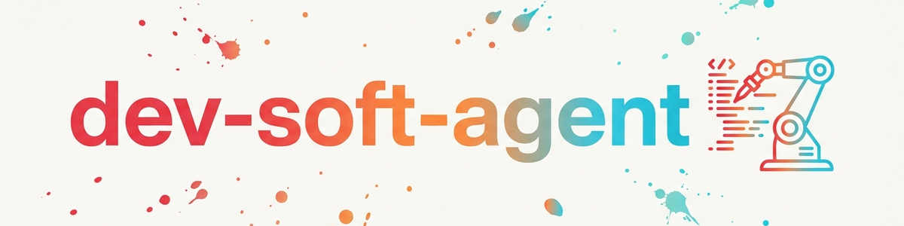

> **Français** — Version française officielle de la compétence `dev-soft-agent`.

# Dev Soft Agent

Pipeline automatisé de développement logiciel. Extrait de l'agent ATI de BACH,
il fonctionne de manière entièrement autonome avec la bibliothèque standard Python pure.

## Composants

```
scripts/
  config.py              Configuration (dossiers à scanner, préfixes de nommage, poids)
  project_manager.py     Analyse des projets + classification selon la convention de nommage
  task_engine.py          Parseur AUFGABEN.txt + scanner de code (TODO/FIXME)
  code_analyzer.py       Analyse statique (LOC, imports, classes, fonctions)
  dev_loop.py            Orchestrateur (DevLoop)
  policies/
    naming.py            Vérification snake_case / PascalCase / SCREAMING_SNAKE
    encoding.py          Application d'UTF-8 + détection BOM
    paths.py             Détection de chemins codés en dur
  prompt_templates/
    task_prompt.txt      Prompt LLM pour le traitement des tâches
    review_prompt.txt    Prompt LLM pour la revue de code
    analysis_prompt.txt  Prompt LLM pour l'analyse de projet
```

## Utilisation comme bibliothèque Python

```python
from scripts.dev_loop import DevLoop
from scripts.config import Config

config = Config()
loop = DevLoop(config)

# Scanner les projets
projects = loop.scan_projects()

# Sélectionner un projet (sélection aléatoire pondérée selon la convention de nommage)
project = loop.select_project()

# Analyser le code
analysis = loop.analyze_project()
print(f"{analysis.total_loc} LOC, {analysis.todo_count} TODOs")

# Charger et prioriser les tâches
tasks = loop.get_tasks()
for task in tasks:
    print(f"[{task.task_type.name}] {task.description} (Prio: {task.priority})")

# Session complète de développement
result = loop.run_session()
loop.save_session()
```

## Utilisation en CLI

```bash
cd scripts
python -m devSoftAgent scan ~/projects
python -m devSoftAgent select
python -m devSoftAgent analyze /chemin/vers/projet
python -m devSoftAgent tasks /chemin/vers/projet
python -m devSoftAgent session --project mon-projet
python -m devSoftAgent status
```

## Convention de nommage (classification des projets)

Les projets sont classés en fonction du nom de leur dossier :

| Préfixe | Libellé | Poids | Signification |
|---------|---------|-------|---------------|
| `RDY` | Ready | 1.0 | Priorité maximale |
| `RDY_FAST` | Fast Ready | 0.5 | Rapide à terminer |
| `FAST` | Fast | 0.33 | Petite tâche |
| `DEV` | Development | 0.17 | En cours de développement |
| `REL` | Released | 0.0 | Terminé, aucun travail requis |
| `ARC` | Archived | 0.0 | Archivé |

Le poids détermine la probabilité lors de la sélection aléatoire.

## Format AUFGABEN.txt

```markdown
# AUFGABEN - NomDuProjet
# État : 2026-03-12

## OUVERT
- [ ] [BUG] Description du bug
- [ ] [FEATURE] Nouvelle fonctionnalité

## EN COURS
- [-] [REFACTOR] Réorganisation du code

## TERMINÉ
- [x] [BUG] Bug corrigé -- DONE 2026-03-01
```

## Règles de qualité (Policies)

Règles de qualité vérifiables automatiquement sur le code :

- **NamingPolicy :** `snake_case` pour les modules/fonctions, `PascalCase` pour les classes
- **EncodingPolicy :** imposer UTF-8, détecter le BOM, signaler les CRLF
- **PathPolicy :** détecter et signaler les chemins absolus codés en dur

## Journal des modifications

### 0.1.1 (2026-11-22)
- Mention linguistique corrigée.

### 0.1.0 (2026-03-12)
- Migration depuis `MODULAR_AGENTS/devSoftAgent` vers la bibliothèque de compétences
- Scanner de projets, moteur de tâches, analyseur de code, `DevLoop`
- 3 politiques (Naming, Encoding, Paths)
- 3 modèles de prompts (Task, Review, Analysis)
