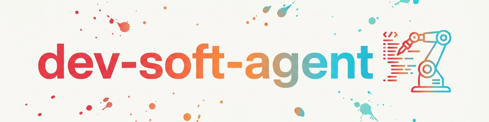

# Dev Soft Agent

Pipeline automatizado de desenvolvimento de software. Extraído do agente ATI do BACH,
funciona totalmente de forma independente, apenas com a biblioteca padrão do Python.

## Componentes

```
scripts/
  config.py              Konfiguration (Scan-Ordner, Naming-Prefixes, Gewichte)
  project_manager.py     Projekt-Scan + Klassifizierung nach Naming-Konvention
  task_engine.py          AUFGABEN.txt Parser + Code-Scanner (TODO/FIXME)
  code_analyzer.py       Statische Analyse (LOC, Imports, Klassen, Funktionen)
  dev_loop.py            Orchestrator (DevLoop)
  policies/
    naming.py            snake_case / PascalCase / SCREAMING_SNAKE Pruefung
    encoding.py          UTF-8 Enforcement + BOM Detection
    paths.py             Hardcoded-Path-Erkennung
  prompt_templates/
    task_prompt.txt      LLM-Prompt fuer Task-Bearbeitung
    review_prompt.txt    LLM-Prompt fuer Code-Review
    analysis_prompt.txt  LLM-Prompt fuer Projekt-Analyse
```

## Uso como biblioteca Python

```python
from scripts.dev_loop import DevLoop
from scripts.config import Config

config = Config()
loop = DevLoop(config)

# Projekte scannen
projects = loop.scan_projects()

# Projekt auswaehlen (gewichtete Zufallsauswahl nach Naming-Konvention)
project = loop.select_project()

# Code analysieren
analysis = loop.analyze_project()
print(f"{analysis.total_loc} LOC, {analysis.todo_count} TODOs")

# Tasks laden und priorisieren
tasks = loop.get_tasks()
for task in tasks:
    print(f"[{task.task_type.name}] {task.description} (Prio: {task.priority})")

# Komplette Dev-Session
result = loop.run_session()
loop.save_session()
```

## Uso como CLI

```bash
cd scripts
python -m devSoftAgent scan ~/projects
python -m devSoftAgent select
python -m devSoftAgent analyze /pfad/zum/projekt
python -m devSoftAgent tasks /pfad/zum/projekt
python -m devSoftAgent session --project mein-projekt
python -m devSoftAgent status
```

## Convenção de nomenclatura (classificação de projetos)

Os projetos são classificados a partir do nome de sua pasta:

| Prefixo | Rótulo | Peso | Significado |
|--------|-------|---------|-----------|
| `RDY` | Ready | 1.0 | Prioridade mais alta |
| `RDY_FAST` | Fast Ready | 0.5 | Rápido de concluir |
| `FAST` | Fast | 0.33 | Tarefa pequena |
| `DEV` | Development | 0.17 | Em desenvolvimento |
| `REL` | Released | 0.0 | Concluído, sem trabalho |
| `ARC` | Archived | 0.0 | Arquivado |

O peso determina a probabilidade na seleção aleatória.

## Formato do AUFGABEN.txt

```markdown
# AUFGABEN - Projektname
# Stand: 2026-03-12

## OFFEN
- [ ] [BUG] Beschreibung des Fehlers
- [ ] [FEATURE] Neues Feature

## IN ARBEIT
- [-] [REFACTOR] Code-Umbau

## ERLEDIGT
- [x] [BUG] Behobener Fehler -- DONE 2026-03-01
```

## Políticas

Políticas de qualidade que podem ser verificadas automaticamente no código:

- **NamingPolicy:** snake_case para módulos/funções, PascalCase para classes
- **EncodingPolicy:** impor UTF-8, detectar BOM, sinalizar CRLF
- **PathPolicy:** detectar e reportar caminhos absolutos fixos (hardcoded)

## Changelog

### 0.1.0 (2026-03-12)
- Migração de MODULAR_AGENTS/devSoftAgent para a biblioteca de skills
- Scanner de projetos, motor de tarefas, analisador de código, DevLoop
- 3 políticas (Naming, Encoding, Paths)
- 3 templates de prompt (Task, Review, Analysis)
