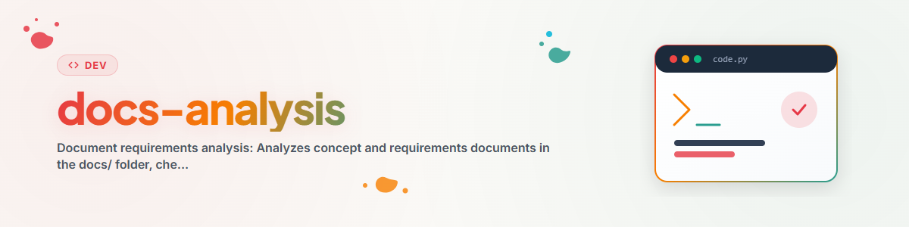

> **Français** — Version française officielle de la compétence `docs-analysis`.

# Analyse Documentaire des Exigences

> Analyse l'ensemble des documents de conception et d'exigences, vérifie leur réalisation par rapport au code actuel et produit un rapport de différences consolidé.

---

## Objectif

Analyse tous les documents de conception et d'exigences dans le dossier `../docs/`, vérifie leurs exigences face au code actuel et génère un rapport d'écarts consolidé.

---

## Choix du mode

- **Analyse des exigences (par défaut) :** vérifier les exigences face au code ; utiliser le déroulement
  et les sorties décrits ci-dessous.
- **Consolidation de plans / Synthèse documentaire :** pour « fusionner plusieurs plans »,
  « plan actuel avec points ouverts » ou « archiver ce qui est terminé », lire
  [Plan consolidation](references/plan-consolidation.md) et suivre cette branche.
  Elle s'appuie sur `folder-organization` pour l'archivage et le Cut-and-Clue, et convient
  également aux projets sans code. Le seuil en pourcentage et le renommage du mode standard
  ne s'appliquent pas dans cette branche.

Les sections suivantes décrivent exclusivement le mode standard.

### Convention de nommage du mode standard

### Préfixe et suffixe
Tous les documents analysés reçoivent :
- **Préfixe :** `conN_` où `N` = version de l'analyse (1, 2, 3, ...)
- **Suffixe :** `_XX` où `XX` = taux de réalisation en pourcentage (arrondi à la dizaine)

### Seuil d'archivage
- **>= 75% réalisé :** le document est déplacé vers `../docs/_archive/`
- **< 75% réalisé :** le document reste dans `../docs/` avec son préfixe/suffixe
- **Seuil configurable** (par défaut : 75)

---

## Déroulement

### Phase 1 : Collecter les documents
- Lister tous les fichiers `*.md` et `*.txt` dans `../docs/` (racine)
- Exclure `README.txt`

### Phase 2 : Extraire les exigences
Pour chaque document :
- Lire le contenu
- Identifier les exigences (check-lists, tableaux, marqueurs `FEHLT`/`MISSING`/`TODO`)
- Catégoriser : Structure, Code, API, Schéma de BDD, CLI, Fonctionnalité

### Phase 3 : Vérification dans le code
Pour chaque exigence :
- Déterminer la méthode de vérification (`Glob`, `Grep`, `Read`)
- Exécuter la vérification
- Marquer comme : `ERFÜLLT` (réalisé), `TEILWEISE` (partiel), `FEHLT` (manquant)

### Phase 4 : Évaluation
- Compter les exigences réalisées par rapport aux exigences ouvertes
- Calculer le taux de réalisation (%)
- Décider : archiver (>= 75 %) ou conserver (< 75 %)

### Phase 5 : Générer les sorties
- Créer `ANFORDERUNGSANALYSE.md` (résumé)
- Créer `consense_diff.md` (uniquement les exigences ouvertes, par priorité)

### Phase 6 : Versionnage
- Rechercher le préfixe `conN_` le plus élevé
- Nouvelle version = la plus élevée + 1

### Phase 7 : Renommer et déplacer
- Appliquer le nouveau préfixe/suffixe aux documents
- Archiver ou conserver sur place

---

## Sorties

| Fichier | Description |
|---------|-------------|
| `conN_ANFORDERUNGSANALYSE.md` | Analyse complète (version N) |
| `consense_diff_N.md` | Exigences ouvertes consolidées |
| `_archive/conN_*_XX.*` | Documents archivés (>=75 %) |

---

## Classification des priorités

| Priorité | Critères |
|:--------:|----------|
| P1 | Fonctionnalité centrale manquante, système inutilisable |
| P2 | Fonctionnalité importante manquante, contournement possible |
| P3 | Souhaitable (nice-to-have), améliore l'expérience utilisateur |
| P4 | Cosmétique, documentation, qualité de code |

---

## Journal des modifications

### 1.1.1 (2026-11-22)
- Mention linguistique corrigée.

### 1.1.0 (2026-10-15)
- Mode optionnel de consolidation de plans avec `folder-organization`, couverture des sources et
  archivage fondé sur des preuves ; l'analyse des exigences reste le mode par défaut.

### 1.0.0 (2026-03-15)
- Portage depuis BACH v3.8.0.

---

*Porté depuis BACH v3.8.0 | Version autonome*
