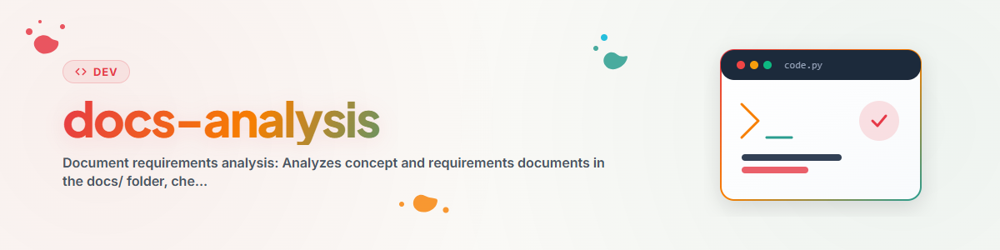

# Análise de Requisitos de Documentos

> Analisa todos os documentos de conceito e de requisitos, verifica os seus requisitos em relação ao código atual e cria um relatório consolidado de diferenças.

---

## Finalidade

Analisa todos os documentos de conceito e de requisitos na pasta ../docs/, verifica os seus requisitos em relação ao código atual e cria um relatório consolidado de diferenças.

---

## Convenção de Nomenclatura

### Prefixo e Sufixo
Todos os documentos analisados recebem:
- **Prefixo:** `conN_` onde N = versão da análise (1, 2, 3, ...)
- **Sufixo:** `_XX` onde XX = grau de cumprimento em percentagem (arredondado às dezenas)

### Limiar de Arquivamento
- **>= 75% cumprido:** o documento é movido para `../docs/_archive/`
- **< 75% cumprido:** o documento permanece em `../docs/` com prefixo/sufixo
- **Limiar configurável** (padrão: 75)

---

## Fluxo

### Fase 1: Recolher documentos
- Listar todos os ficheiros *.md e *.txt em ../docs/ (raiz)
- Excluir README.txt

### Fase 2: Extrair requisitos
Para cada documento:
- Ler o conteúdo
- Identificar requisitos (listas de verificação, tabelas, marcadores FEHLT/TODO)
- Categorizar: Estrutura, Código, API, Esquema de BD, CLI, Funcionalidade

### Fase 3: Verificação de código
Para cada requisito:
- Determinar o método de verificação (Glob, Grep, Read)
- Executar a verificação
- Marcar como: ERFUELLT, TEILWEISE, FEHLT

### Fase 4: Avaliação
- Contar requisitos cumpridos vs. em aberto
- Calcular o grau de cumprimento (%)
- Decidir: arquivar (>= 75%) ou manter (< 75%)

### Fase 5: Gerar saída
- Criar ANFORDERUNGSANALYSE.md (resumo)
- Criar consense_diff.md (apenas requisitos em aberto, por prioridade)

### Fase 6: Versionamento
- Analisar o prefixo conN_ mais elevado
- Nova versão = mais elevada + 1

### Fase 7: Renomear e mover
- Atribuir o novo prefixo/sufixo aos documentos
- Arquivar ou manter

---

## Saída

| Ficheiro | Descrição |
|-------|--------------|
| `conN_ANFORDERUNGSANALYSE.md` | Análise completa (versão N) |
| `consense_diff_N.md` | Requisitos em aberto consolidados |
| `_archive/conN_*_XX.*` | Documentos arquivados (>=75%) |

---

## Classificação de Prioridade

| Prioridade | Critérios |
|:----------:|-----------|
| P1 | Funcionalidade central em falta, sistema não utilizável |
| P2 | Funcionalidade importante em falta, existe solução alternativa |
| P3 | Desejável, melhora a UX |
| P4 | Cosmético, documentação, qualidade do código |

---

## Registo de Alterações

### 1.0.0 (2026-03-15)
- Portado do BACH v3.8.0

---

*Portado do BACH v3.8.0 | Versão standalone*
