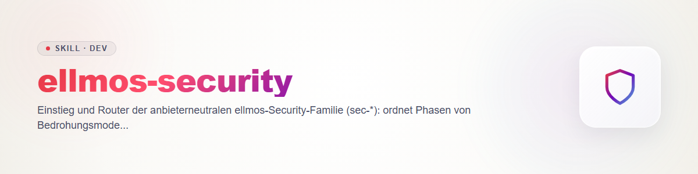

# ellmos-security - punto de entrada de la familia de seguridad

La familia revisa tu propio código en busca de vulnerabilidades y lleva cada hallazgo desde la sospecha hasta una corrección registrada y verificada. Todos los skills comparten un único contrato (formatos de archivo, ciclo de vida, severidad, reglas): `sec-scan/references/contract.md`. Funcionan en Claude, Codex, Gemini y Kimi y no dependen de ningún escáner específico de un proveedor; tales escáneres son solo adaptadores (tabla más abajo).

## Fases

| Fase | Skill | Cuándo |
|---|---|---|
| Modelo | `sec-threat-model` | antes del primer escaneo: activos, límites de confianza, puntos de entrada |
| Escaneo | `sec-scan` | repo completo o una ruta |
| Escaneo (cambio) | `sec-diff-scan` | pull request, rango de commits, diff |
| Validación | `sec-validate` | confirmar o refutar cada `candidate` de forma independiente |
| Triaje | `sec-triage` | severidad y prioridad según la política |
| Corrección | `sec-fix` | solo a petición, parche como archivo |
| Verificación | `sec-verify-fix` | ¿el parche cierra la brecha?, riesgo de regresión |
| Seguimiento | `sec-track` | ticket, issue o borrador de advisory |
| Informe | `sec-report` | `report.md` y `findings.sarif` |

Transversales: `sec-policy` (SECURITY.md), `sec-hardening` (medidas estructurales), `sec-writeup` (informe de divulgación), `sec-supplychain` (código de terceros antes de instalarlo).

## ¿Qué quiero hacer?

- Revisar un repo -> `sec-scan` (para un proyecto nuevo, antes `sec-threat-model`)
- Revisar un PR o diff -> `sec-diff-scan`
- Dar seguimiento a un hallazgo existente -> `sec-validate` -> `sec-triage` -> `sec-fix` -> `sec-verify-fix` -> `sec-track`
- Resultados como informe -> `sec-report`
- Definir o revisar las reglas de un repo -> `sec-policy`
- Resolver de raíz clases de hallazgos recurrentes -> `sec-hardening`
- Notificar o divulgar una vulnerabilidad -> `sec-writeup`
- Instalar un skill, plugin, servidor MCP o hook de terceros -> `sec-supplychain`

## Skills vecinos (mantenidos por separado, parte de la familia)

- `security-tech-stack-check` + `tech-detect`: dependencias y CVE frente al stack tecnológico medido.
- `protection-shield`: defensa aguda y comprobaciones periódicas de logs/stack en tus propios sistemas.
- `repo-publish-check`: puerta de publicación antes de hacer público un repo.
- Si existen en tu sistema: una guía de seguridad propia y un skill para cuentas/datos personales (no código). No forman parte de esta familia pública.

## Adaptadores de proveedor (contrato §7)

| Proveedor | Herramienta de escaneo nativa | Cómo se integra | Nota de coste |
|---|---|---|---|
| Claude | plugin `/claude-security` | escanear con él, mapear su carpeta de salida a `findings.json`/`coverage.json` | escaneo de plugin multiagente: estimar y avisar primero (regla 5); atención al egress (regla 6) |
| Codex | plugin `codex-security` | igual, a partir de su salida de escaneo | igual que arriba |
| Gemini, Kimi | ninguna | procedimiento propio de `sec-scan` | tokens de la sesión en curso; estimar antes los escaneos `deep` |

Los adaptadores nunca omiten la validación: los hallazgos mapeados empiezan como `candidate`. Pasos exactos de mapeo: `sec-scan`, sección Adapter.

## Inicio rápido

**Repo completo:** `sec-threat-model` (breve) -> `sec-scan` -> `python scripts/secfind.py validate findings.json coverage.json` (script en `sec-scan`) -> `sec-validate` con otro proveedor -> `sec-triage` -> `sec-report`.

**Pull request:** `sec-diff-scan` sobre el diff -> los hallazgos en el PR van directamente a la persona autora; si se confirman, `sec-validate` y luego como arriba. Comprobar la cobertura en `coverage.json`: haber visto solo el diff no significa «el código es seguro».

**Un hallazgo confirmado hasta el ticket:** `sec-triage` (severidad según `SECURITY.md`) -> a petición `sec-fix` -> `sec-verify-fix` con otro revisor -> `sec-track` (vista previa, confirmación, escribir de vuelta `finding.ticket`).

## Reglas comunes (forma breve; es autoritativo el §6 del contrato)

Solo código propio · bloqueo antes de cada escritura · parches en lugar de commits · ningún valor secreto en las salidas · aviso de coste y egress antes de ejecuciones grandes · validación independiente · un resultado sin `coverage.json` no es un resultado.

## Changelog

### 0.1.0 (2026-10-31)
- Versión inicial del enrutador.
