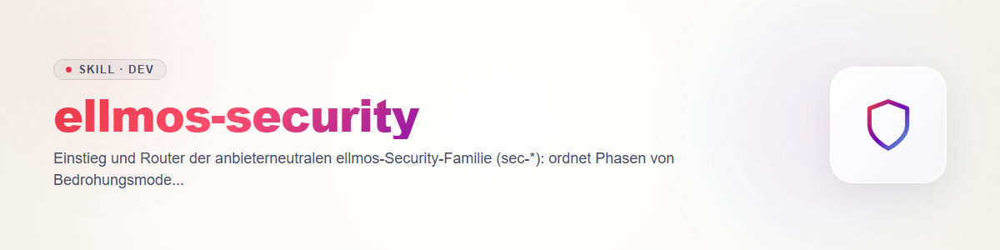

# ellmos-security - точка входа семейства навыков безопасности

Семейство проверяет ваш собственный код на уязвимости и проводит каждую находку от подозрения до отслеживаемого, проверенного исправления. Все навыки опираются на один общий контракт (форматы файлов, жизненный цикл, серьёзность, правила): `sec-scan/references/contract.md`. Они работают в Claude, Codex, Gemini и Kimi и не зависят от сканера какого-либо одного провайдера; такие сканеры - лишь адаптеры (таблица ниже).

## Фазы

| Фаза | Навык | Когда |
|---|---|---|
| Модель | `sec-threat-model` | перед первым сканированием: активы, границы доверия, точки входа |
| Сканирование | `sec-scan` | весь репозиторий или путь |
| Сканирование (изменение) | `sec-diff-scan` | pull request, диапазон коммитов, diff |
| Валидация | `sec-validate` | независимо подтвердить или опровергнуть каждый `candidate` |
| Триаж | `sec-triage` | серьёзность и приоритет в соответствии с политикой |
| Исправление | `sec-fix` | только по запросу, патч в виде файла |
| Проверка | `sec-verify-fix` | закрывает ли патч брешь, риск регрессии |
| Отслеживание | `sec-track` | тикет, issue или черновик advisory |
| Отчёт | `sec-report` | `report.md` и `findings.sarif` |

Сквозные: `sec-policy` (SECURITY.md), `sec-hardening` (структурные меры), `sec-writeup` (отчёт для раскрытия), `sec-supplychain` (сторонний код перед установкой).

## Что мне нужно?

- Проверить репозиторий -> `sec-scan` (для нового проекта сначала `sec-threat-model`)
- Проверить PR или diff -> `sec-diff-scan`
- Довести существующую находку -> `sec-validate` -> `sec-triage` -> `sec-fix` -> `sec-verify-fix` -> `sec-track`
- Результаты в виде отчёта -> `sec-report`
- Задать или пересмотреть правила репозитория -> `sec-policy`
- Системно устранить повторяющиеся классы находок -> `sec-hardening`
- Сообщить об уязвимости или раскрыть её -> `sec-writeup`
- Установить сторонний навык, плагин, MCP-сервер или хук -> `sec-supplychain`

## Соседние навыки (поддерживаются отдельно, входят в семейство)

- `security-tech-stack-check` + `tech-detect`: зависимости и CVE относительно измеренного технологического стека.
- `protection-shield`: срочная защита и периодические проверки журналов/стека на ваших собственных системах.
- `repo-publish-check`: проверка перед публикацией, прежде чем сделать репозиторий публичным.
- Если они есть в вашей системе: собственный указатель по безопасности и навык для личных аккаунтов/данных (не для кода). В это публичное семейство они не входят.

## Адаптеры провайдеров (контракт §7)

| Провайдер | Нативный инструмент сканирования | Как подключается | Примечание о стоимости |
|---|---|---|---|
| Claude | плагин `/claude-security` | сканировать им, вывод из его папки сопоставить с `findings.json`/`coverage.json` | многоагентное сканирование плагином: сначала оценить и предупредить (правило 5); учитывать egress (правило 6) |
| Codex | плагин `codex-security` | так же, по его результатам сканирования | как выше |
| Gemini, Kimi | нет | собственная процедура из `sec-scan` | токены текущей сессии; сканирования `deep` сначала оценить |

Адаптеры никогда не пропускают валидацию: сопоставленные находки начинаются как `candidate`. Точные шаги сопоставления: `sec-scan`, раздел Adapter.

## Быстрый старт

**Весь репозиторий:** `sec-threat-model` (кратко) -> `sec-scan` -> `python scripts/secfind.py validate findings.json coverage.json` (скрипт в `sec-scan`) -> `sec-validate` с другим провайдером -> `sec-triage` -> `sec-report`.

**Pull request:** `sec-diff-scan` по diff -> находки в PR сразу передаются автору; при подтверждении `sec-validate`, далее как выше. Проверять покрытие в `coverage.json`: то, что просмотрен лишь diff, не означает «код безопасен».

**Одна подтверждённая находка до тикета:** `sec-triage` (серьёзность по `SECURITY.md`) -> по запросу `sec-fix` -> `sec-verify-fix` с другим ревьюером -> `sec-track` (предпросмотр, подтверждение, обратная запись `finding.ticket`).

## Общие правила (краткая форма, авторитетен §6 контракта)

Только собственный код · блокировка перед каждой записью · патчи вместо коммитов · никаких секретных значений в выводе · предупреждение о стоимости и egress перед крупными запусками · независимая валидация · результат без `coverage.json` не является результатом.

## Changelog

### 0.1.0 (2026-10-31)
- Первая версия маршрутизатора.
