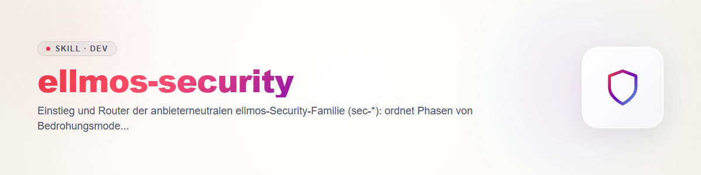

# ellmos-security - 安全技能家族的入口

这个家族检查你自己代码中的漏洞，并把每一个发现从怀疑一路推进到被跟踪、经核验的修复。所有技能共用一份契约（文件格式、生命周期、严重度、规则）：`sec-scan/references/contract.md`。它们可在 Claude、Codex、Gemini 和 Kimi 上运行，不依赖任何特定供应商的扫描器；这类扫描器仅作为适配器接入（见下表）。

## 阶段

| 阶段 | 技能 | 何时使用 |
|---|---|---|
| 建模 | `sec-threat-model` | 第一次扫描之前：资产、信任边界、入口点 |
| 扫描 | `sec-scan` | 整个仓库或某个路径 |
| 扫描（变更） | `sec-diff-scan` | 拉取请求、提交范围、diff |
| 验证 | `sec-validate` | 独立地确认或反驳每一个 `candidate` |
| 分类 | `sec-triage` | 依据策略确定严重度与优先级 |
| 修复 | `sec-fix` | 仅在请求时，以文件形式输出补丁 |
| 核验 | `sec-verify-fix` | 补丁是否堵住了漏洞，回归风险如何 |
| 跟踪 | `sec-track` | 工单、issue 或安全公告草稿 |
| 报告 | `sec-report` | `report.md` 和 `findings.sarif` |

贯穿各阶段：`sec-policy`（SECURITY.md）、`sec-hardening`（结构性措施）、`sec-writeup`（披露报告）、`sec-supplychain`（安装之前检查第三方代码）。

## 我想做什么？

- 检查一个仓库 -> `sec-scan`（新项目先做 `sec-threat-model`）
- 检查一个 PR 或 diff -> `sec-diff-scan`
- 跟进一个已有的发现 -> `sec-validate` -> `sec-triage` -> `sec-fix` -> `sec-verify-fix` -> `sec-track`
- 把结果做成报告 -> `sec-report`
- 设定或审查仓库的规则 -> `sec-policy`
- 从根本上解决反复出现的发现类别 -> `sec-hardening`
- 报告或披露一个缺陷 -> `sec-writeup`
- 安装第三方技能、插件、MCP 服务器或 hook -> `sec-supplychain`

## 相邻技能（单独维护，属于该家族）

- `security-tech-stack-check` + `tech-detect`：依据实测的技术栈检查依赖与 CVE。
- `protection-shield`：针对你自己系统的紧急防御以及周期性的日志/技术栈检查。
- `repo-publish-check`：仓库转为公开之前的发布关卡。
- 如果你的系统上存在：一份自己的安全指引，以及一个针对个人账户/数据（不是代码）的技能。它们不属于这个公开的家族。

## 供应商适配器（契约 §7）

| 供应商 | 原生扫描工具 | 如何接入 | 成本提示 |
|---|---|---|---|
| Claude | `/claude-security` 插件 | 用它扫描，把它的输出文件夹映射到 `findings.json`/`coverage.json` | 多代理的插件扫描：先估算并警告（规则 5）；注意数据外传（规则 6） |
| Codex | `codex-security` 插件 | 同上，来自它的扫描输出 | 同上 |
| Gemini、Kimi | 无 | 采用 `sec-scan` 中的自有流程 | 消耗当前会话的 token；先估算 `deep` 扫描 |

适配器绝不跳过验证：映射得到的发现一律以 `candidate` 开始。具体的映射步骤：`sec-scan`，适配器一节。

## 快速开始

**整个仓库：** `sec-threat-model`（简短）-> `sec-scan` -> `python scripts/secfind.py validate findings.json coverage.json`（脚本位于 `sec-scan`）-> 用另一个供应商做 `sec-validate` -> `sec-triage` -> `sec-report`。

**拉取请求：** 对 diff 运行 `sec-diff-scan` -> PR 中的发现直接交给作者；如已确认则 `sec-validate`，然后同上。检查 `coverage.json` 中的覆盖范围：只看过 diff，并不意味着「代码是安全的」。

**把一个已确认的发现变成工单：** `sec-triage`（依据 `SECURITY.md` 确定严重度）-> 按请求 `sec-fix` -> 由另一位审查者执行 `sec-verify-fix` -> `sec-track`（预览、确认、写回 `finding.ticket`）。

## 共同规则（简要形式，以契约 §6 为准）

只检查自有代码 · 每次写入前先加锁 · 用补丁代替提交 · 输出中不含密钥值 · 大规模运行前给出成本与数据外传警告 · 独立验证 · 没有 `coverage.json` 的结果不算结果。

## 变更日志

### 0.1.0 (2026-10-31)
- 路由器的初始版本。
