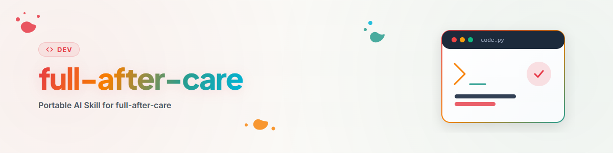

# Full After Care — la ronde approfondie (synonyme : Deep After Care)

## Quand cette compétence s'applique

Utilisez-la lorsqu'un dépôt publié doit être parcouru **en profondeur** : non vérifié depuis longtemps, avant une version majeure, pour des sujets juridiquement pertinents, ou lorsque la coordination avec les autres projets personnels est en jeu.

La différence avec la ronde légère tient à l'effort, pas à la rigueur : le niveau 2 dépasse les limites du dépôt individuel. Il interroge des sources externes (situation juridique), inventorie **toutes** les organisations et intervient dans l'application elle-même (langues). C'est pourquoi elle est exécutée plus rarement — typiquement une fois par dépôt et par an, ou selon les besoins.

## Déroulement

### D'abord le niveau 1 en entier

Exécutez **`surface-after-care` entièrement** — y compris l'étape 0 (surfaces de distribution), la porte de confidentialité, l'intention de publication, la bannière, la comparaison état actuel/cible, les langues du README, la visibilité, l'entrée d'organisation, les issues et PR, ainsi que le commit, le push et la parité des surfaces. Rien de tout cela n'est répété ou abrégé ici.

Les trois étapes suivantes s'ajoutent à cela. Elles produisent à leur tour des modifications de documentation et de code — poussez-les au même rythme que décrit pour le niveau 1, en commits thématiques distincts.

---

### 5. Première évaluation juridique avec relance annuelle

#### D'abord : une évaluation est-elle même due ?

Consultez `_after-care/RECHTSCHECK.md` (le dossier est gitignoré, voir ci-dessous). Si une date de vérification y figure et qu'elle remonte à **moins d'un an**, cette étape est **sautée** — même dans la ronde approfondie. Obtenir à nouveau une évaluation fraîche coûte du temps et de l'argent sans rien apporter de nouveau.

Si la date est **antérieure à un an** ou si le fichier n'existe pas, une vérification est effectuée. La raison de la relance n'est pas que l'expertise se dégrade, mais que la **situation juridique** évolue : nouveaux règlements, seuils modifiés, nouvelle jurisprudence, règles de plateforme changeantes. Une expertise vieille de deux ans peut être formellement correcte et pratiquement dépassée.

En dehors du rythme annuel, une réévaluation est nécessaire lorsque l'**objet** a changé : nouvelles catégories de données, nouveau canal de distribution, nouveau modèle économique, changement de licence, nouvelle dépendance copyleft, extension à un autre espace juridique.

#### Le dépôt est-il juridiquement pertinent ?

Tous les projets n'en ont pas besoin. Les déclencheurs incluent notamment :

- traitement de données personnelles, même uniquement en local
- accès à des services, sites ou interfaces tiers (conditions d'utilisation, scraping)
- fourniture d'informations dans des domaines réglementés (droit, médecine, impôts, finance)
- utilisation de marques, noms ou logos tiers dans le nom, la documentation ou l'interface
- dépendances copyleft ou à licence floue, ou livraison de contenus tiers
- public mineur, traitement de paiements, ou soumission aux règles d'exportation/cryptographie
- décisions automatisées concernant des personnes, ou classification comme système d'IA

Si rien de cela ne s'applique, consignez dans le journal d'exécution **que la vérification a été faite et écartée** — sinon la ronde suivante posera à nouveau la même question depuis le début.

#### Obtenir une évaluation

Utilisez les vérificateurs juridiques (compétence `law-checker`, module `law-checker`) et soumettez-leur l'état de fait concret : ce que fait l'application, quelles données elle touche, par quels canaux elle est distribuée, quelles licences s'appliquent, à qui elle s'adresse. Plus l'état de fait est concret, plus les sources trouvées sont utiles. Le résultat est une première évaluation avec des références aux articles de loi — **pas un conseil juridique** ; en cas de risque sérieux, le résultat est la recommandation de faire vérifier le cas par un avocat, et non le jugement lui-même.

#### Archivage

```
_after-care/
├── LOG.md                    # Laufprotokoll beider Stufen
└── RECHTSCHECK.md            # Datum, Gegenstand, Ergebnis, Auflagen, Wiedervorlage
```

`_after-care/` appartient à `.gitignore`. Il ne s'agit pas de dissimulation, mais de la même règle que l'étape 2b du niveau 1 : les documents de travail internes ne font pas partie du contenu du dépôt. Pour une expertise, il faut ajouter qu'une analyse de risques livrée publiquement peut être lue comme un aveu et fournir une carte aux attaquants. L'archivage peut aussi se faire hors du dépôt, dans un dossier dédié — l'important est qu'il reste **retrouvable** lors de la prochaine exécution, faute de quoi la règle annuelle ne fonctionne pas.

En-tête du fichier, à garder lisible par machine :

```markdown
# Rechtscheck — <Projekt>
geprüft: 2026-07-24
gegenstand: lokale Dateiverwaltung, keine Cloud, keine personenbezogenen Daten Dritter
ergebnis: unbedenklich
auflagen: Hinweis auf MIT-Lizenz der eingebetteten Bibliothek X im README
wiedervorlage: 2027-07-24
```

Seules les **conséquences** de l'évaluation deviennent **publiques** : une mention de licence, une clause de non-responsabilité, une remarque sur la protection des données, une description précisée de ce que fait l'application. Ces modifications appartiennent au dépôt — pas la justification qui les sous-tend.

---

### 9. Références croisées à travers toutes les organisations

Le niveau 1 demande seulement si le dépôt figure sur les pages des organisations. Le niveau 2 descend d'un cran : **quels dépôts individuels de toutes les organisations propres sont liés à celui-ci — et les deux côtés le savent-ils ?**

```bash
gh api user/orgs --jq '.[].login'
for ORG in $(gh api user/orgs --jq '.[].login'); do
  gh repo list "$ORG" --limit 200 --json name,description,updatedAt,isArchived,primaryLanguage
done
```

Le bénéfice ne vient pas de l'énumération, mais de la reconnaissance des relations. Types pertinents :

- **utilise / est utilisé par** — dépendance technique réelle dans les deux sens
- **appartient à la même famille** — même ligne de produits, même préfixe, même architecture
- **résout le même problème autrement** — un utilisateur arrivé sur l'un cherche souvent l'autre
- **prédécesseur / successeur** — les projets remplacés ont besoin d'un renvoi, sinon les utilisateurs restent sur une version morte
- **composant / composition** — bibliothèque et application qui l'utilise

Placez les références **dans les deux sens**. Le sens unique est l'erreur la plus fréquente de cette étape : on ajoute dans le dépôt entretenu une liste de projets liés, et les projets liés ne mentionnent rien. Qui y arrive ne trouve jamais le chemin du retour.

Le renvoi en retour est donc réellement placé dans le dépôt opposé — selon la **règle de l'arbre sale** de l'étape 11 du niveau 1, résumée ainsi : arbre propre → commit et push propres ; sale dans d'autres fichiers → commit ciblé par chemin, sans push ; sale dans le fichier cible ou verrou actif → ne pas y toucher. Si le renvoi n'est pas placé, il va dans la liste des tâches du dépôt cible (`AUFGABEN.txt`/`TODO.md`), et en cas de verrou seulement dans le journal d'exécution personnel. Ainsi la ronde reste cohérente, sans mettre en danger les états de travail étrangers et sans que le renvoi se perde.

Formulez les références en fonction de l'utilité, non comme une liste de noms : « **projet-b** — lit les exports produits par cet outil et en fait des rapports » est utile, « voir aussi : projet-b » ne l'est pas.

Les dépôts archivés et manifestement morts ne sont pas liés — sauf comme indication explicite de successeur dans l'autre sens.

Cet inventaire est la partie la plus coûteuse de la ronde. Lorsque beaucoup d'organisations et de dépôts doivent être examinés, il vaut la peine de consigner le résultat de l'inventaire des dépôts dans le journal d'exécution, afin que la prochaine ronde approfondie d'un autre dépôt puisse s'appuyer dessus.

---

### Mettre à jour toutes les langues au niveau de l'application

Le niveau 1 s'occupe des versions linguistiques du README. Ici, il s'agit du **produit lui-même** : textes d'interface, messages, aides, sorties CLI, messages d'erreur, descriptions des stores et registres.

Déterminez d'abord quelles langues l'application gère déjà techniquement et comment elle les gère :

```bash
rg -l "gettext|i18n|locale|translations|LC_MESSAGES|\.po$|messages\.json" --hidden
fd -e po -e pot -e ftl . 2>/dev/null; ls locales/ i18n/ lang/ translations/ 2>/dev/null
```

Comblez ensuite les lacunes, selon trois questions :

1. **Des langues manquent-elles** que le projet devrait avoir ? Les langues standard sont l'allemand, l'anglais, l'espagnol, le chinois simplifié, le japonais, le russe — pour les applications destinées aux utilisateurs. Pour les bibliothèques destinées aux développeurs, l'anglais seul est souvent la bonne réponse ; une langue superflue représente une charge de maintenance permanente, pas un gain.
2. **Les langues existantes sont-elles complètes ?** Après chaque cycle de fonctionnalités, les langues secondaires accusent du retard. Les nouvelles clés sans traduction retombent souvent en production sur la langue de référence, et ce problème passe alors inaperçu — c'est pourquoi il faut comparer de façon ciblée avec la langue de référence plutôt que de se fier à une impression.
3. **Le choix de la langue est-il accessible à l'utilisateur ?** Une traduction complète que personne ne peut activer ne vaut rien. Sélecteur présent, choix persistant, langue du système détectée comme valeur par défaut ?

Tenez-vous au mécanisme i18n établi dans le projet et n'en introduisez pas un second à côté. Vérifiez les résultats dans l'**interface réelle**, pas seulement dans le fichier de ressources : des chaînes trop longues cassent la mise en page, et l'absence de prise en charge des jeux de caractères n'apparaît qu'au rendu (les glyphes CJK manquants s'affichent comme des cases vides).

Pour finir, prenez en compte les surfaces de l'étape 0 du niveau 1 : les descriptions des stores et registres ont leurs propres champs de langue, qui ne suivent pas automatiquement la traduction de l'application.

## Journal d'exécution

Ajoutez à `_after-care/LOG.md` une entrée avec le niveau `full` :

```markdown
## 2026-07-24 — full
- Stufe 1 vollständig gelaufen (siehe Eintrag oben)
- Rechtscheck: fällig (letzter 2025-06-02) -> neu eingeholt, Ergebnis unbedenklich,
  Auflage Lizenzhinweis Bibliothek X umgesetzt, Wiedervorlage 2027-07-24
- Querverweise: 4 Orgas / 38 Repos geprüft, 3 Beziehungen gefunden,
  bidirektional gesetzt; Rückverweis in repo-y offen (dort aktiver Lock)
- Sprachen App-Ebene: ES ergänzt (312 Schlüssel), JA auf Stand gebracht,
  Umschalter war vorhanden aber nicht persistent -> gefixt
```

## Erreurs fréquentes

| Erreur | Correction |
|---|---|
| Vérification juridique refaite alors que la dernière datait de 3 mois | Lire d'abord la date dans `RECHTSCHECK.md` — en dessous d'un an, on saute |
| Vérification juridique sautée parce que « rien n'a changé » | La situation juridique évolue indépendamment du projet ; à partir d'un an, on vérifie |
| Expertise commitée dans le dépôt | `_after-care/` appartient à `.gitignore` ; seules les conséquences deviennent publiques |
| Pertinence juridique écartée non documentée | Un « non pertinent » est aussi un constat et doit figurer dans le journal |
| Références croisées placées seulement dans le dépôt entretenu | Les placer dans les deux sens, sinon c'est une voie à sens unique |
| Seule la propre organisation vérifiée | Le niveau 2 concerne toutes les organisations — c'est ce qui le distingue du niveau 1 |
| Références sous forme de simple liste de noms | Expliquer l'utilité en une demi-phrase, sinon personne ne clique |
| Nouvelle langue créée mais inaccessible dans l'UI | Vérifier le sélecteur, la persistance et la détection de la langue du système |
| Traduction vérifiée seulement dans le fichier de ressources | Vérifier dans l'interface réelle — les ruptures de mise en page et les glyphes manquants n'apparaissent que là |
| Champs de langue des stores/registres oubliés | Ils ne suivent pas la traduction de l'application |

## Liste de contrôle finale

- [ ] `surface-after-care` entièrement parcouru (y compris push et parité des surfaces).
- [ ] Pertinence juridique vérifiée ; résultat documenté — même si écartée.
- [ ] Vérification juridique due ? Si oui : obtenue, obligations mises en œuvre, relance programmée.
- [ ] `_after-care/` dans `.gitignore`, expertise non suivie par Git.
- [ ] Toutes les organisations inventoriées, relations déterminées.
- [ ] Références croisées placées dans les deux sens, commitées et poussées dans les dépôts opposés.
- [ ] Dépôts opposés ignorés à cause d'un arbre sale ou d'un verrou notés comme points ouverts.
- [ ] Langues de l'application complètes, sélecteur accessible, vérifié dans l'interface.
- [ ] Champs de langue des stores/registres mis à jour.
- [ ] Entrée du journal d'exécution rédigée avec le niveau `full`.

## Journal des modifications

### 1.0.0 (2026-07-24)
- Version initiale. Niveau 2 de la maintenance des dépôts, s'appuyant sur `surface-after-care`.
