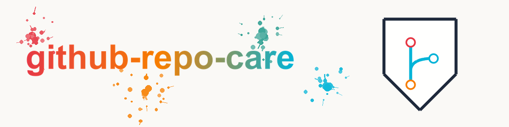

> **Français** — Version française officielle de la compétence `github-repo-care`.

# GitHub Repo Care — Publier et maintenir proprement un dépôt

## Quand utiliser cette compétence

Utilisez cette compétence lorsqu'un dépôt GitHub doit être créé, publié, diffusé en release, audité ou entretenu a posteriori. Elle est particulièrement importante avant le premier push public, lors de la création de tags de release, lors de modifications des métadonnées du dépôt, sur les profils d'organisation et pour les contrôles de confidentialité.

Elle ne s'applique pas au simple développement de code sans étape de publication GitHub. Dans ce cas, utilisez d'abord la compétence de développement ou de débogage adaptée, puis activez celle-ci uniquement à l'étape de publication.

## Règle fondamentale

Préparez le dépôt avant le premier push public. Un `.gitignore` correct, un contrôle de confidentialité strict (Privacy-Gate), une licence, un README, des métadonnées et une présentation de release sont nettement plus simples à mettre en place avant qu'un historique public n'existe.

## Déroulement

1. **Lire les règles locales.** Vérifiez `AGENTS.md`, `CLAUDE.md`, `START.md`, la politique de release, la politique de nommage et la politique de verrouillage si elles existent.
2. **Vérifier les verrous.** Si `LOCK.txt` ou un fichier `LOCK.*.txt` correspondant est actif, ne modifiez pas ce périmètre.
3. **Définir l'identité du dépôt et vérifier le contrôle de nommage.** Fixer le nom, l'organisation, la visibilité, la licence et l'objectif en une phrase. **Contrôle mécanique de nommage pour les créations (`[U 2026-11-21]`) :** vérifiez de manière insensible à la casse qu'un **nouveau** dépôt, paquet ou module ne contient pas `ellmos` (`python -c "import sys; s=sys.argv[1]; sys.exit(1 if 'ellmos' in s.lower() else 0)" "<slug>"`). En cas de correspondance, **arrêtez immédiatement** et orientez vers le registre local de nommage/espace de noms ou un nom de remplacement validé (les dépôts `ellmos-*` existants et l'organisation d'arrière-plan `ellmos-ai` bénéficient d'une clause de maintien des droits acquis).
4. **Créer `.gitignore` avant `git add`.** Exclure secrets, données locales, bases de données, artefacts de build, environnements virtuels, caches, fichiers d'IDE et notes privées.
5. **Ajouter les fichiers publics de base.** Typiquement : `README.md`, `LICENSE`, `CHANGELOG.md`, `SECURITY.md`, `CONTRIBUTING.md`, `CODE_OF_CONDUCT.md`, `llms.txt` et CI.
6. **Rédiger le README pour la découverte.** Premier écran : objectif, installation, utilisation, modèle de confidentialité, structure du projet, licence et nom canonique du dépôt.
7. **Ajouter des signaux visuels.** Compléter avec une bannière, un logo ou une capture d'écran s'ils rendent l'utilité plus lisible. Pas de décoration générique lorsqu'une vraie image du produit ou un schéma conceptuel clair est possible.
8. **Planifier le multilinguisme avec soin.** Minimum : anglais plus la langue du projet. Pour les modules orientés utilisateur, privilégier : allemand, anglais, espagnol, chinois simplifié, japonais et russe.
9. **Exécuter les tests et vérifications de fumée.** Valider en local avant de déclarer le succès ou de créer une release.
10. **Exécuter le Privacy-Gate.** Contrôler l'ensemble indexé ou suivi (`staged`/`tracked`) : secrets, chemins locaux, données personnelles (PII), `.env`, bases de données, documents privés, artefacts générés et mojibake.
11. **Commiter et pousser.** Ne commiter qu'après réussite du contrôle. Ensuite créer ou relier le dépôt GitHub, pousser et vérifier l'état distant.
12. **Configurer les métadonnées.** Vérifier description, topics, page d'accueil, visibilité et branche par défaut.
13. **Créer la release.** Créer le tag et la release GitHub ; vérifier la CI pour la branche et le tag.
14. **Mettre à jour les surfaces de découverte.** Ajouter les liens depuis le profil d'organisation, `llms.txt`, les registres centraux, les index locaux de modules et les README de l'écosystème. **Publish ⇒ page de profil (`T-20260926-796851315`) :** si le dépôt possède une bannière, vérifier mécaniquement s'il figure déjà sur la page de profil de l'organisation (`<org>/.github/profile/README.md`) — `python org_profile_gate.py --org <org>` (`.AI/.SKILLS/testing/`). S'il manque, le script fournit un extrait Markdown prêt à insérer.
    **Ajouter sa propre étoile (`T-20260926-299328659`) :** l'aftercare vérifie pour chaque dépôt public propre si le compte lui-même y a déjà mis une étoile, et l'ajoute sinon — via votre outil de maintenance GitHub s'il existe (chemin et appel via la configuration locale, ex. un drapeau `--self-star` : sans argument de dépôt pour un rattrapage sur toutes les organisations configurées, avec argument pour un passage ciblé juste après cette publication). Ne jamais retirer automatiquement une étoile.
    **Suivi des stargazers :** suivre les nouveaux stargazers et attribuer une étoile en retour à leur meilleur projet en cas de réelle qualité — si votre outil de maintenance GitHub dispose déjà d'un module de réciprocité, l'utiliser (il évalue la pertinence thématique et propose de renvoyer une étoile / inviter / examiner / ignorer ; il exécute le suivi avec plafonds de débit, temps de recharge et filet de sécurité dry-run/apply/confirm). Ne pas le reconstruire s'il existe déjà ; le module consigne lui-même ses décisions. Ne jamais se désabonner ni retirer d'étoile automatiquement.
15. **Vérification finale.** Contrôler le README distant, la page de release, les topics, la CI et les liens.

## Privacy-Gate

Inspectez l'ensemble indexé (`staged`) ou suivi (`tracked`), pas seulement l'arborescence de travail visible.

```bash
git diff --cached --check
git ls-files
rg -n "C:\\\\Us[e]rs\\\\|C:/Us[e]rs/|/c/Us[e]rs/|s[k]-[A-Za-z0-9]|gh[p]_|gh[o]_|API[_-]?KEY|TO[K]EN|PASS[W]ORD|SEC[R]ET|\\x{C3}|\\x{C2}|\\x{FFFD}" .
```

Pour les modules publics, documentez en plus un fichier `RELEASE_GATE.md` ou équivalent : date, commandes vérifiées, résultat, avertissements résiduels et exceptions délibérées. Si un secret a un jour été commité, le supprimer de `HEAD` ne suffit pas ; il faut renouveler (révoquer/rotater) le secret.

**Vérifier la visibilité des dépôts liés.** Une analyse de chemins ou de jetons ne détecte pas les
liens vers des dépôts GitHub privés dans des README publics (cas d'école
`T-20260926-820252321` : `ellmos-ai/ellmos-core` figurait discrètement dans un tableau
de README alors que le dépôt est privé). S'il est présent dans le dépôt, exécutez le
contrôle réutilisable :

```bash
python testing/repo_link_visibility_gate.py --repo .
```

Le contrôle n'est tolérant (fail-open) qu'en cas d'incertitude réelle (panne réseau, limite de débit
403/429 — simple avertissement, pas de blocage) ; un code 404 bloque au même titre qu'un
`private: true` confirmé, car les deux signifient que le lien est irrésoluble pour un tiers
(privé ou inexistant). Sans ce script (le dépôt ne possède pas sa propre copie du contrôle) :
vérifier par sondage chaque lien vers un dépôt tiers ou frère dans le README avec
`gh api repos/ORG/REPO --jq .private`.

## Métadonnées GitHub

Après le push, définissez explicitement les métadonnées et la release.

```bash
gh repo edit ORG/REPO --description "Courte description concrète" \
  --add-topic local-first --add-topic python --add-topic llm
git tag -a v1.0.0 -m "v1.0.0"
git push origin v1.0.0
gh release create v1.0.0 --repo ORG/REPO --title "v1.0.0" --notes "..."
```

Puis vérifiez :

```bash
gh repo view ORG/REPO --json nameWithOwner,visibility,description,repositoryTopics,url
gh release view v1.0.0 --repo ORG/REPO --json tagName,url,isDraft,isPrerelease
gh run list --repo ORG/REPO --limit 5
```

Si la CI est rouge après une release, le dépôt n'est pas encore considéré comme proprement publié. Pour une release initiale tout juste créée, il est acceptable de déplacer immédiatement et délibérément le tag récent vers le commit corrigé.

## Erreurs fréquentes

| Erreur | Correction |
|---|---|
| `.gitignore` créé seulement après `git add` | Désindexer d'abord, corriger les règles d'exclusion, puis ré-indexer |
| README monolingue alors que l'UI ou la compétence est multilingue | Ajouter des liens de langue ou des README localisés |
| Pas de bannière, pas de topics, pas de description | Compléter les ressources de découverte avant l'annonce |
| Tag de release présent, mais CI rouge | Corriger la CI et vérifier la nouvelle exécution |
| README d'organisation mis à jour, mais `llms.txt` oublié | Mettre à jour les deux surfaces, humaine et lisible par machine |
| Chemin local présent dans la documentation publique | Remplacer par des chemins relatifs ou des exemples génériques |
| Dépôt public contenant une base de test ou une boîte de réception de notebooks | Retirer du suivi Git, ajouter une règle d'exclusion, relancer le contrôle |

## Check-list finale

- [ ] Règles locales et verrous vérifiés.
- [ ] Contrôle de nommage pour les créations réussi (pas de `ellmos` dans le nom d'un nouveau dépôt/paquet ; maintien des droits acquis respecté pour l'existant).
- [ ] `.gitignore` existait avant le premier `git add`.
- [ ] Documents publics, licence, sécurité, contribution, journal des modifications et `llms.txt` présents.
- [ ] README contenant nom du dépôt, objectif, installation, utilisation, confidentialité et licence.
- [ ] Attentes i18n satisfaites.
- [ ] Bannière, logo ou capture d'écran présents si pertinent.
- [ ] Tests et vérifications de fumée réussis.
- [ ] Analyses confidentialité, chemins, secrets, bases de données et mojibake propres.
- [ ] Description GitHub, topics, tag, release et CI vérifiés.
- [ ] Profil d'organisation, registre et liens écosystème mis à jour.
- [ ] Bannière présente ? `org_profile_gate.py --org <org>` exécuté sans constat pour ce dépôt.

## Journal des modifications

### 1.4.0 (2026-11-22)
- Ajout du contrôle mécanique de nommage pour les créations à l'étape 3 et dans la check-list finale (pas de `ellmos`, insensible à la casse, avec consigne d'arrêt et maintien des droits acquis pour les dépôts/l'organisation existants).

### 1.3.2 (2026-11-22)
- Mention linguistique corrigée.

### 1.3.1 (2026-09-27)
- Correctif de documentation : la sémantique du code 404 dans la description du Privacy-Gate était erronée.
  Selon `testing/repo_link_visibility_gate.py`, un 404 (privé ou inexistant) bloque au même titre
  qu'un `private: true` confirmé ; le fail-open ne s'applique qu'aux pannes réseau et limites de débit
  (403/429). Corrigé dans la section Privacy-Gate et dans l'entrée 1.2.0 du journal des modifications.

### 1.3.0 (2026-09-27)
- Étape 14 étendue (`T-20260926-299328659`, demande utilisateur) : vérifier/ajouter sa propre étoile
  sur ses dépôts publics ainsi que le suivi des stargazers (suivi + étoile en retour qualitative),
  via son propre outil de maintenance GitHub s'il existe — aucun outil précis imposé. Ne jamais
  se désabonner ni retirer d'étoile automatiquement.

### 1.2.0 (2026-09-26)
- Nouvelle étape de Privacy-Gate (`T-20260926-820252321`) : vérifier la visibilité des dépôts GitHub
  liés (`testing/repo_link_visibility_gate.py --repo .`, fail-open en cas d'indisponibilité réseau/limite
  de débit, bloquant en cas de 404 ou de `private: true` confirmé). Origine :
  `ellmos-ai/ellmos-core` (dépôt privé) figurait discrètement dans un tableau de README.

### 1.1.0 (2026-09-26)
- Ajout de l'étape « Publish ⇒ page de profil » (`T-20260926-796851315`) : un dépôt doté d'une bannière
  doit être vérifié mécaniquement face au README de profil de son organisation (`<org>/.github/profile/README.md`)
  via `.AI/.SKILLS/testing/org_profile_gate.py`, sans se fier à la mémoire. Origine : la bannière
  de `zombie-killer-tray` n'avait jamais été ajoutée sur la page de l'organisation `dev-bricks` après publication.

### 1.0.0 (2026-06-18)
- Version initiale créée en tant que protocole de maintenance et de publication de dépôts.
