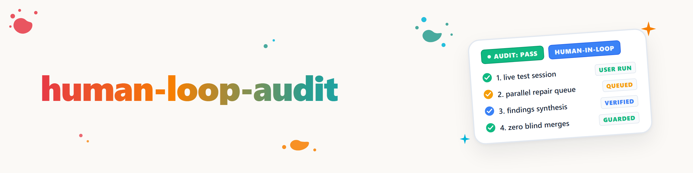

# Human-Loop-Audit

> **À ne pas confondre avec `reissverschluss-merge` :** le nom partage l'image de la « fermeture éclair », mais `reissverschluss-merge` est une **procédure de fusion Git** (fusionner par sections deux branches de code). `human-loop-audit` n'a ici aucun rapport avec Git — c'est une **procédure de test/audit avec l'utilisateur**. Les deux compétences n'utilisent la fermeture éclair que comme même idée de base (entrelacer deux flux dent par dent, et non l'un après l'autre).

## Objectif & répartition des rôles

Le temps de l'utilisateur est le **goulot d'étranglement séquentiel** : lui seul peut réellement utiliser une application en direct et dire en quelques secondes si elle se comporte correctement. Tout le reste — ouvrir les objets, saisir le retour de manière structurée, lancer les réparations — est pris en charge par l'agent, et ce **pendant** que l'utilisateur est déjà sur l'objet suivant, et non après. L'agent est à la fois opérateur du cockpit et évaluateur.

**Le cœur de la méthode est le chevauchement, non l'ordre lui-même :** un enchaînement purement séquentiel « ouvrir l'app → attendre → évaluer → ouvrir l'app suivante » gaspille le temps d'attente pendant lequel l'utilisateur teste. Human-Loop-Audit exploite précisément cette fenêtre.

## Déroulement

1. **« start »** de l'utilisateur → l'agent ouvre le **premier** objet d'essai. Il suffit de lancer le processus (par ex. `Start-Process <exe>` ou la commande de démarrage correspondante de l'objet) — **aucune prise de contrôle du bureau n'est nécessaire**, l'utilisateur opère lui-même. Confirmer brièvement que l'objet est ouvert.
2. **L'utilisateur teste et écrit son retour dans le chat** — de courtes notes suffisent ; ne rien reformuler de manière à en modifier le sens.
3. **Dès que le retour arrive, deux actions se déroulent en parallèle, et non l'une après l'autre :**
   - L'agent **ouvre immédiatement l'objet d'essai suivant**, afin que l'utilisateur puisse poursuivre sans attente.
   - **Simultanément**, l'agent évalue le retour reçu : consigner le constat par objet de manière structurée (**Fonctionne** / **Défaut** / **Souhait**, avec une brève description), et en cas de défaut ou de souhait clair, **déléguer immédiatement un ordre de réparation à un worker** (ne pas accumuler et mandater « plus tard » — la réparation doit s'exécuter pendant que l'utilisateur continue de tester).
4. **Répéter** jusqu'à ce que tous les objets soient passés (retour aux étapes 2/3 pour chaque objet supplémentaire).
5. **Conclusion :** présenter à l'utilisateur la liste des constats (par objet : Fonctionne/Défaut/Souhait) ainsi que la liste des réparations lancées (worker/ordre/statut).

## Structure des constats (par objet d'essai)

| Objet | Statut | Constat | Réparation déléguée à |
|---|---|---|---|
| `<App/Objekt-Name>` | Fonctionne / Défaut / Souhait | courte note, reprise telle quelle de la formulation de l'utilisateur | Nom du worker/session, si délégué |

Un objet peut recevoir plusieurs lignes (plusieurs constats). Rien n'est résumé silencieusement — la conclusion se lit dans ce tableau, et non de mémoire.

## Délimitation par rapport aux compétences voisines

- **`reissverschluss-merge`** (voir la remarque ci-dessus) — procédure de fusion Git pure, sans recoupement de contenu malgré l'image de nom identique.
- Des cycles de test par vagues/soumissions au store, plus étroits, avec des phases supplémentaires câblées en dur (revue des assets, fiches de soumission, réinscription des identifiants) et une mise en œuvre **séquentielle** (« la mise en œuvre des points se fait séparément ») existent sous forme de procédures propres aux projets. `human-loop-audit` est volontairement la procédure **générique** pour **toute** série d'applications/GUI et délègue les réparations **immédiatement et en parallèle**, et non comme étape ultérieure séparée.
- **`bugsweep` / `bugfix-protocol`** — le travail de réparation proprement dit, auquel `human-loop-audit` délègue ; cette compétence elle-même ne répare rien.

## Pièges

- **Ne pas attendre l'évaluation avant d'ouvrir l'objet suivant** — un enchaînement purement séquentiel « attendre, évaluer, puis ouvrir le suivant » annule précisément le chevauchement qui fait l'intérêt de cette compétence.
- **Consigner immédiatement le retour de manière structurée**, sans le laisser dans l'historique du chat — en cas d'interruption de session, il serait sinon perdu.
- **Ne pas lancer les objets à l'aveugle** lorsqu'un objet est connu pour être instable — vérifier brièvement qu'il démarre avant que l'utilisateur ne soit assis devant en direct.
- **Déléguer immédiatement, et non en bloc à la fin** — sinon la réparation ne démarre qu'après que l'utilisateur a fini de tester, et l'avantage de temps de la procédure disparaît.

## Exemples de déclencheurs

- « human-loop-audit »
- « Testons les apps en fermeture éclair. »
- « Je teste, tu évalues et répares. »
- « start » (après une annonce préalable d'un Human-Loop-Audit, comme signal de départ de l'étape 1)

## Journal des modifications

### 1.0.0 (2026-08-18)
- Version initiale. Procédure reprise d'une définition de l'utilisateur datée du 2026-08-18 : audit en fermeture éclair avec évaluation parallèle + délégation immédiate des réparations, délimitée par rapport à `reissverschluss-merge` (fusion Git, même image de nom, sans rapport) et par rapport aux cycles de test par vagues, plus étroits et propres aux projets (mise en œuvre séquentielle au lieu de parallèle).
