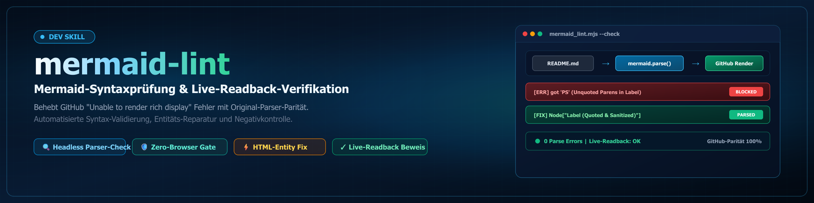

# mermaid-lint

構文エラーのあるMermaidダイアグラムは、GitHub上ではグラフィックの代わりに
**「Unable to render rich display」**というボックスを表示します。ローカルではこれが気づかれにくいのは、
ブロックを検査するツールがないためです。このスキルはその隙間を埋めます。

## 使用する場面

- READMEやドキュメントが、ダイアグラムの代わりにGitHub上でレンダリングエラーを表示している。
- ダイアグラムを含むドキュメントを公開またはリリースする前。
- Mermaidブロックに影響するMarkdownを変更した後のたび。
- 複数のリポジトリにまたがって、どこが壊れているかわからないとき。

## 2つのツール

### 1. `mermaid_lint.mjs` — ブラウザを使わない構文チェック

```
node mermaid_lint.mjs <repo-pfad> [...] [--json]
node mermaid_lint.mjs --from <liste.txt> [--json]
```

再帰的にすべての`.md`ファイルを探し、各```mermaidブロックを抽出して
`mermaid.parse()`に通します。これは**GitHubがブラウザで使っているのと同じパーサー**です。
終了コード0 = すべて解析成功、終了コード1 = 少なくとも1つのブロックが不正。出力にはファイル、
ブロック番号、行、そしてパーサーの原文のエラーが示されます。

`--from <datei>`はパスのリストを1行に1つずつ読み込みます。多数の引数を渡す代わりにこれを使ってください。
Bashシェルでは、バックスラッシュを含むWindowsパスが黙って壊されます
（`D:\code\my-repo`が`D:codemy-repo`になります）。パスはスラッシュで書いてください。

Mermaidは一度しか読み込まれないため、1つのプロセスで数百のリポジトリを処理できます。
Puppeteerも、Chromiumのダウンロードも不要です。

### 2. `readback.mjs` — 稼働中のページでの確認

```
node readback.mjs <github-url> [...]
```

既存のEdgeでページを開き（ブラウザのダウンロードなし）、実際のレンダリングエラーの数を数えます。
各ページの判定は、`OK`、`DEFEKT`、`UNKLAR`、または`KEIN-MERMAID`のいずれかです。

## このスキルが必要になる3つの落とし穴

**GitHubはMermaidを`viewscreen.githubusercontent.com`のサンドボックス化されたiframe内でレンダリングします。**
メインページからはその内容が見えません。`document.body.innerText`または
`msedge --dump-dom`だけを確認すると、壊れていることが確実なページでも**すべての**ページでエラーがゼロと報告されてしまいます。
そのため`readback.mjs`はすべてのフレームを確認します。

**1回だけのDEFEKT判定は信頼できません。** 読み込み中、GitHubは一時的にレンダリングエラーのように見えるプレースホルダーを表示することがあります。
2026-09-20の計測では、同じページが最初は`ERR=1`、その後2回`ERR=0`と報告しました。
`readback.mjs`は否定的な判定を自動的に再試行します。`OK`は決して再試行されません。

**`mermaid.parse()`にはDOMが必要です。** ないと`DOMPurify.addHook`で失敗し、
有効なフローチャートを誤って壊れていると報告してしまいます。`mermaid_lint.mjs`は事前にjsdomウィンドウを用意します。
それでも環境エラーが残った場合は、`envIssues`の下に別途記録され、構文エラーとしては**数えられません**。

## 緑の結果を信じる前に、必ず否定的対照で確認する

緑の結果を信じる前に、壊れていることがわかっている状態、たとえば修正前のコミットに対してツールを一度実行してください：

```
node readback.mjs "https://github.com/<org>/<repo>/blob/<alter-sha>/README.md"
```

それも`OK`を報告するなら、あなたの確認は何も測定していません。上記のiframeの落とし穴はまさにこのようにして発見されました。

## よくあるエラーの原因と最小限の修正

| パーサーエラーの症状 | 原因 | 修正 |
|---|---|---|
| `Expecting '+', '-', '()', 'ACTOR', got 'loop'` | 参加者の名前が予約語と同じ：`loop`、`alt`、`opt`、`par`、`end`、`critical`、`break`、`rect`、`note` | エイリアスを宣言する：`participant L as Loop`、メッセージでは`L`を使う。**表示名は残す**。名前は変更しないこと。 |
| フローチャートの`got 'PS'` | ノードラベル内の丸括弧 | ラベルを引用符で囲む：`A["Start (hier)"]` |
| `Lexical error ... Unrecognized text` | ラベル内のバッククォートやコロン | ラベルを引用符で囲み、バッククォートを削除する |
| `Expecting 'SEMI', 'NEWLINE', 'EOF'`（`graph`/`flowchart`内） | `Note:`はシーケンス図とクラス図にしかない | 注記テキストをブロックから取り出し、その下にMarkdownの行として置き、情報が見えるようにする |
| シーケンス図の`Expecting 'SOLID_OPEN_ARROW' ... got 'NEWLINE'` | メッセージ本文中の**HTMLエンティティ**（`&lambda;`、`&Delta;`、`&ge;`）。ここでは括弧や`=`は問題になりません。エンティティ末尾の`;`を字句解析器がステートメントの終端と解釈し、その後ろが新しい文として扱われます。 | エンティティをリテラル文字（λ、Δ、≥）に置き換える。それ以外のテキストは変えない。括弧は残してよい。数値とその表記は決して変えないこと。 |
| シーケンスメッセージ内のセミコロン | ステートメントの終わりとして読まれる | ` - `に置き換える |

**引用符で囲まれたフローチャートのラベル**内では、エンティティは問題ありません。このルールはシーケンスメッセージにのみ適用されます。
`mermaid_lint.mjs`は、そのようなエンティティを、パーサーエラーに加えて独自の`[WARN]`行として報告します
（JSONのフィールド`warnings`）。パーサーは`got 'NEWLINE'`とだけ言い、原因は示しません。

**原則:** 最小限の変更にとどめます。レイアウト、ノードID、順序、表示テキストは、可能な限り変更しません。
科学系リポジトリでは、特に数値とその表記は変更しないでください。EN/DEの対応を保つ場合は、両方の版の構造を揃えてください。

## 複数リポジトリでの手順

1. `gh repo list <org> --limit 200 --json name,isArchived,isPrivate,defaultBranchRef`で一覧を作成する。
2. クローンは**リモートの状態に更新**し、差分を重視してください。古いクローンに対するlintは誤った状態を測定します。`git pull --ff-only`が失敗したら、
   作業ツリーではなく`origin`に対して確認してください：
   `git archive origin/<branch> | tar -x -C <tempdir>`を実行し、一時フォルダをlintします。
3. **異なる組織の同名リポジトリ**（典型的には`.github`）は、同じクローンに対応付けてはいけません。そうしないと同じリポジトリを9回確認することになります。名前が重複する場合は、`<org>__<repo>`にフラットにクローンし、新しい状態をlintしてください。
4. 変更の前にロックを確認し（クローン内の**および**OneDriveのプロジェクトパスの`lock_scan.py`、`LOCK*.txt`）、自分のロックを設定し、プッシュ後に削除します。
   **存在だけでなくスコープを読むこと:** 期限切れの`expires_after`がある`LOCK.team.*`は無視してかまいません。`LOCK.user.zenodo-upload.txt`は外部のZenodoへの書き込み操作**だけ**をロックし、ドキュメントの変更は明示的に許可しています。
   一方、`LOCK.user.until-winners-announcement.txt`（審査中）はすべてのプッシュをロックします。そこでは読み取りのみで確認し、結果をチケットとして残してください。
5. 修正し、緑になるまでlintし、コミットし、`git pull --rebase`し、プッシュする。
6. 否定的対照を伴う読み戻し確認。その後で初めて完了とみなす。

## セットアップ

```
npm install mermaid jsdom playwright-core
```

スクリプトのフォルダ内、またはグローバルに配置します。`playwright-core`はインストール済みのEdge（`channel: 'msedge'`）を使い、独自のブラウザはダウンロードしません。読み戻し確認にのみ必要です。構文チェックはこれなしで動作します。

## 関連

- GithubBotの`_tools/lint_mermaid.py`：`--fix`を用いた、旧式の正規表現ベースのリンター。既知のパターンを自動修正しますが、**予約語は認識せず**、このスキルの代わりにはなりません。推奨順序は、まず`mermaid_lint.mjs`で診断し、必要に応じて大量のパターンには`lint_mermaid.py --fix`を使い、その後で再度lintすることです。
- `github-repo-care`：リポジトリの保守と公開のための全体的な手順書。
