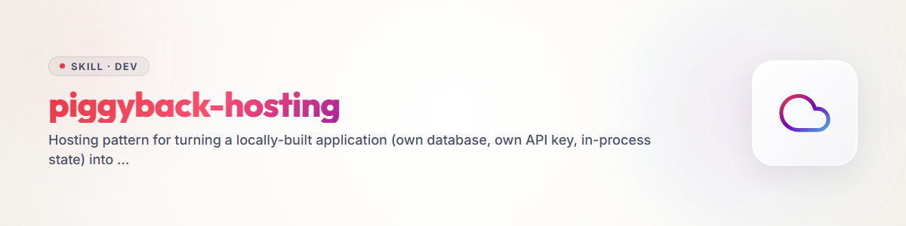

# piggyback-hosting

**もともと他人のデータを一切受け付けないアプリケーションのためのホスティングパターン。**

> 2026-08-02、3つの通話エージェントを構築した際に作成された青写真。
> 単一のローカルユーザー向けに設計されたあらゆるアプリケーションに再利用できるが、他者にもホストできることを目指す場合にも使える。

## 名称について

英語ではこのパターンを**piggyback**と呼ぶ。他人のインフラに便乗することは、そこではすでに専門用語として使われている。そのため、このスキル内の英語の本文では *piggyback* と記述する。**「huckepack(ハッケパック)」はドイツ語の作業上のタイトルであり、このパターンを構築した際の名称であり、また本スキルが移行元としたリポジトリの名称でもある。** **文字通りのモード値は依然として`huckepack-gift`および`huckepack-only-host`である**。これらはコードや設定に出荷される形そのものであり、周囲の本文がどの言語で書かれていても、そのまま記述される。

## 課題

アプリケーションはローカルで構築される。データベース、APIキー、プロセス内に存在する状態を持つ。自分のマシン上では、それは単純に正しい。しかし、それを他者向けにホストした途端、この3つの前提のそれぞれがバグになる。すべての訪問者が同じ状態、同じデータベース、同じキーを共有することになる。ページを開いた者は、他のすべての人のデータを見ることになる。

一般的な解決策はユーザー管理である。アカウント、ログイン、アクセス制御、削除期限、プライバシーポリシー、データ処理契約。しばしばアプリケーション本体よりも大きな取り組みになる。

## 発想

**訪問者はすべてを自分のデバイス上に保持する。ホストは何も保持しない。**

これはユーザー管理を解決するのではなく、**不要にする**。他人のデータがサーバー上に存在しなければ、訪問者同士を隔離する必要も、スケジュールに従って削除する必要もなく、プライバシーポリシーはサービスが実際に行うことにまで縮小される。

## 3つのモード

| モード | APIキー | データ | ユーザー管理 |
|---|---|---|---|
| **`huckepack-gift`** | ホストが提供 | 訪問者のデバイス上 | 不要 |
| **`huckepack-only-host`** | 訪問者が提供 | 訪問者のデバイス上 | 不要 |
| **`pay-membership`** | ホストのもの、課金される | サーバー | 必要 |

- **`huckepack-gift`** — ホストが自身のキーを提供し、実行を贈り物として提供する。ツールを試すよう誘うための手軽な招待である。
- **`huckepack-only-host`** — 訪問者が自身のキーを持ち込む。ホストは費用を負担せず、何も保存しない。
- **`pay-membership`** — 意図的にスタブのまま残す。ここでは、他の2つが避けているもの、すなわちアカウント、課金、サーバー側の保存がすべて再び必要になる。切り替えスイッチではなく、独立した取り組みである。

常に**`local`**というデフォルトがある。何も設定しない場合、アプリケーションは以前と同じく、自分のマシン上で動作する形で提供される。

## 構成要素

| 構成要素 | 目的 |
|---|---|
| インストール時設定としてのモード | セッションの性質ではなく、デプロイの性質 |
| 差し替え可能なストレージ層 | 同じデータベース、保存場所だけが異なる |
| ブラウザ内のSQLite(WASM + OPFS) | 同じスキーマ、同じクエリ、実行場所だけが異なる |
| マスクされたキー欄 | `only-host`モードのみ、決してログに記録しない |
| エクスポートとインポート | **任意ではない** — ブラウザのデータは揮発性である |
| ダウンロード可能なファイルとしての証憑、保存先フォルダを選択可能 | 配信にサーバーが関与しない |

実際のエンジニアリング上の負担は、ストレージ層を差し替え可能にすることにある。アプリケーションはどちらの場合もSQLiteに書き込むが、中間層が、その書き込みをサーバー上に行うか、訪問者のブラウザ上に行うかを決定する(`sql.js` / 公式のSQLite-WASMビルド、Origin Private File Systemを介して永続化)。WASMが重い場合は、ブラウザのストレージ選択肢を重さの順に並べる: SQLite-WASM + OPFS(本物のデータベース、最大容量)> IndexedDB(構造化、独自のクエリモデル)> `localStorage`(言語やテーマのような些細なものにのみ適する)。

## このパターンが解決しないこと — 率直に述べる

- **ブラウザのデータを削除すると、すべてが失われる。** サーバー側にコピーは存在しない。そのため、エクスポートは利便性ではなく必須条件である。
- **エクスポートとインポートなしではデバイスを変更できない。**
- **ブラウザ上に存在するキー**(`only-host`)は、サーバー上にあるものより保護が弱い。ただし、それは訪問者のものであり、代替案はそれをホストに引き渡すことであるが、そちらが明らかに安全な選択とは言えない。
- **実行は依然としてホストを経由して行われる。** 電話の発信のように第三者に到達するサービスでは、訪問者自身の記録がどこにあるかにかかわらず、ホストはその第三者のデータを処理する。そのため、プライバシーポリシーは不要にはならず、短くなるだけである。

## 法的審査の結果

法的な初期評価(`references/RECHT.md`、ドイツ語 — ドイツおよびEUの規制を審査するため、翻訳による引用は精度が下がるだけで、利用しやすさが増すわけではないであろう)が、このパターンをDSGVO、TDDDG、UWGに照らして審査した。**出典付きの初期評価であり、法的助言ではない。** 各1行の3つの所見は以下のとおり。

- **ホストは、何も保存しなくても管理者(コントローラー)のままである。** 第4条(7)DSGVOは、責任を保存ではなく、目的と手段の決定に結び付けている。EuGHもこれを明示的にそのように述べた(C-683/21)。不要になるのは**ユーザー管理**であり、責任ではない。
- **連絡を受ける人物にとっては何も縮小しない。** 第14条に基づく情報提供義務、法的根拠の文書化された比較衡量、連絡を実行するサービスとの委託処理契約 — これらは通常、プライバシーポリシーの中で最も長い部分であり、このパターンはそれらに触れない。
- **家庭内例外は訪問者を助けるが、ホストは助けない。** それは自然人による純粋に私的な利用を対象とする。他者に提供されるサービスは、純粋に私的な活動ではない。まさにそこからピギーバック・ホスティングが始まる。

利点は、義務の**種類**ではなく、義務の**範囲**と攻撃対象領域の**大きさ**にある — これはこのパターンについての、より誠実な記述でもある。

## このパターンの適用方法

1. `references/DATA-FLOW-TEMPLATE.md`を読み、実際のアプリケーションに対して、根拠に基づいて記入する。すべての行には`file:line`または「見つからない」が必要である。これにより、コードを変更する前に、複数訪問者のホスティングの下でどのローカルな前提が破綻するかが正確に明らかになる。
2. アプリケーションが実際に必要とするモードを決定する — `local`は常にデフォルトである。`huckepack-gift`と`huckepack-only-host`は、ユーザー管理を避ける2つのモードである。`pay-membership`は、実際のアカウントが必要な具体的理由がない限り、スタブのままとする。
3. ストレージ層を差し替え可能にし(上記の中核ステップ)、`only-host`のためのマスクされたキー欄を追加し、何かを出荷する前にエクスポート/インポートを接続する — それは揮発性のブラウザストレージのための安全網である。
4. 具体的なデプロイのために`references/PRIVACY-TEMPLATE.md`を記入する。該当しないブロックは削除し、各プロバイダの記載を現行の契約と照合し、実データを処理する前に、事案に応じた法的審査を受ける。テンプレートは出発点であり、完成したプライバシーポリシーではない。
5. 実在の第三者(電話の発信、自ら登録していない人物へのメッセージ)に影響するインストール、または`references/RECHT.md`の推奨事項を承認ではなくチェックリストとして扱う研究参加者が関わる場合は、最初の公開実行の前に弁護士を関与させる。

## 参考資料

- `references/DATA-FLOW-TEMPLATE.md` — データフロー計画のテンプレートと手順。すべての行にfile:lineが必要であり、そうでなければ所見ではなく推測である。
- `references/PRIVACY-TEMPLATE.md` — ピギーバック・インストールのための、マークされたプレースホルダを含むサンプルのプライバシーポリシー。
- `references/RECHT.md` — DSGVO、TDDDG、UWGの出典を含む法的初期評価(ドイツ語)。

両テンプレートとも**ひな形であり、法的助言ではない**。アプリケーションをホストする者は、それを適合させ、その結果について責任を負う。

## 由来

HungryCall、Ringedingeding、ResearchCallの構築時に生まれた — 3つの通話エージェントで、データフロー監査により、変更しないままホストすれば、名前付きのデータ保護事故になっていたことが判明した。独立した`huckepack`リポジトリから、このスキルライブラリに移行された。
