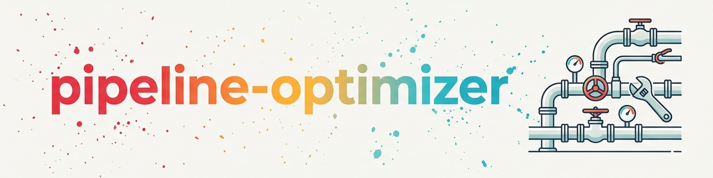

> **Français** — Version française officielle de la compétence `pipeline-optimizer`.

# Optimiseur de pipeline / Optimiseur de dossier de projet

**Rénovation en 6 étapes sans incompatibilités** — applicable à deux échelles :

| Nom déclencheur | Domaine d'application | Exemple |
|---|---|---|
| **Pipeline-Optimizer** | Pipelines complets, stacks, structures documentaires | Vos pipelines thématiques, par ex. `software/`, `research/`, `games/`, un système d'agents |
| **Projekt-Ordner-Optimizer** | Dossiers de projet individuels au sein d'un pipeline | Un outil logiciel, un projet de publication, un projet de jeu |

Un **pipeline** désigne ici une structure thématique de premier niveau dans laquelle plusieurs projets coexistent selon des conventions communes (par ex. un pipeline logiciel avec des règles de release, un pipeline de recherche avec des procédures de publication).

Les deux utilisent exactement le même flux en 6 étapes — la seule différence réside dans le **périmètre** (échelle du pipeline vs projet individuel) et donc dans la profondeur de l'inventaire du bâti existant à l'étape A.

## Quand cette compétence s'applique

La compétence s'applique dès que vous devez améliorer, transformer ou étendre une structure **existante** — pas pour une construction ex nihilo (greenfield). Déclencheurs concrets :

**Niveau pipeline** (périmètre : pipeline complet) :
- « Améliorer le pipeline X »
- « Optimiser le stack »
- « Rénovation du pipeline logiciel »
- « Consolidation documentaire dans le pipeline de recherche »
- Intervention substantielle sur un pipeline thématique, des `_tools/` centraux ou des composants système

**Niveau dossier de projet** (périmètre : dossier de projet individuel) :
- « Nettoyer/optimiser le dossier de projet X »
- « Améliorer la structure des dossiers dans Y »
- « Refactoriser un outil individuel »
- « Harmoniser la configuration d'un projet de publication »
- « Aligner un dossier de projet de jeu sur le standard du pipeline »

**Transversal :**
- « Transformer X / l'intégrer dans l'existant Y »
- « Refactoring », « Consolidation »
- « Harmoniser les conventions »
- « Intégrer dans le système existant »

## La métaphore du bâti existant

Rénover une maison exige d'abord de savoir **de quoi elle est faite** (pierre, bois, plastique), **à quoi elle sert** (refuge de montagne, forge logicielle) et **où elle remplit déjà des fonctions**. La même discipline vaut pour les pipelines.

---

## Procédure — 6 étapes (NE PAS sauter, NE PAS réordonner)

### Étape A — Inventorier le bâti existant

**Question :** De quoi la maison est-elle faite ?

**Périmètre pipeline** (toutes les documentations racine + outils + modèles) :
- [ ] **Lire intégralement tous les documents racine** (pas seulement des extraits ou points d'insertion)
- [ ] Parcourir les dossiers de modèles (`_templates/`, `_TEMPLATES/`) et d'outils (`_tools/`)
- [ ] Fichiers de règles : par ex. GITHUB-POLICY.md, RELEASE-MANAGEMENT.md, QUALITY_RULES.md, NAMING-SYSTEM.md, procédures de publication, …
- [ ] Instantanés d'état : par ex. PROJECT_STATUS.md, vues d'ensemble d'état, releases.json, fichiers de registre
- [ ] Check-lists : par ex. check-lists de release, check-lists de build/PDF
- [ ] Flux de travail : AGENTS.md, GUIDE.md, SKILL.md
- [ ] Fichiers de retours d'expérience : LESSONS_LEARNED.md, MEMORY.md, fichiers d'état de boucle

**Périmètre dossier de projet** (substance du projet individuel + conventions du pipeline pertinent) :
- [ ] **Lire tous les fichiers Markdown et de pilotage du dossier de projet** (README, CHANGELOG, AUFGABEN/TODO, DONE, KONZEPT, AKTIONSPLAN, notes de preuve, …)
- [ ] **Inventorier la structure du code :** `src/`, `tests/`, configuration de build (`pyproject.toml`, `requirements.txt`, manifestes de projet, fichiers d'outillage, …)
- [ ] **Prendre en compte les conventions du pipeline parent** (par ex. pour un projet logiciel : politique GitHub, système de nommage, gestion des releases, modèles)
- [ ] **Scanner les outils/scripts existants dans le projet** (`_tools/`, `_scripts/`, `build_*.bat`, scripts START)
- [ ] **Fichiers de configuration :** `.gitignore`, LICENSE, NOTICE, SECURITY.md, CODE_OF_CONDUCT.md

**Anti-pattern :** Utiliser `grep -l "<keyword>"` pour trouver des points d'insertion et y coller du contenu sans connaître le contexte du fichier.

**Sortie :** Note d'inventaire recensant toutes les conventions, outils et modèles pertinents pour le périmètre choisi.

### Étape B — Identifier la finalité

**Question :** Pourquoi la maison existe-t-elle ?

Formuler explicitement la finalité en 1 à 2 phrases.

**Exemples pour un pipeline :**

| Pipeline | Finalité |
|---|---|
| Pipeline logiciel | Développer, tester et publier des applications desktop et outils navigateur dans les stores / sur GitHub |
| Pipeline de recherche | Rédiger des articles scientifiques, les faire relire par les pairs, les publier sur des dépôts / serveurs de prépublications |
| Pipeline jeux | Développer des jeux et les publier sur la plateforme cible |
| Système d'agents | Système LLM dédié à l'orchestration multi-agents |

**Exemples pour un dossier de projet :**

| Dossier de projet | Finalité |
|---|---|
| `software/PlannerApp` | Application desktop de planification, commerciale, dépôt privé |
| `research/CosmologyModel` | Série d'articles de modélisation + calculs numériques |
| `games/SortingChaos` | Jeu de tri, phase alpha, progression de niveaux |

La finalité **guide chaque intervention** — les mesures qui ne servent pas cette finalité sont écartées.

### Étape C — Concevoir l'image idéale

**Question :** À quoi ressemblerait une maison parfaite pour cette finalité ?

- Esquisser selon son propre point de vue (bref, max. 10 points)
- S'appuyer sur les meilleures pratiques comparables (par ex. stack Vercel pour le SaaS, stack Python scientifique pour la recherche)
- Ne pas entrer dans l'optimisation de détail — une esquisse de haut niveau suffit

**Sortie :** 5 à 10 points d'« état idéal par pipeline »

### Étape D — Analyse des écarts + Plan

**Quatre questions par pipeline :**

1. **Qu'est-ce que la maison possède déjà ?** — Même si résolu différemment de l'idéal, mais **fonctionnellement équivalent**.
   *Exemple :* L'idéal indique « pip-licenses pour les licences tierces ». En réalité, un script générateur maison encapsule déjà cela → fonctionnellement équivalent, aucune intervention requise.

2. **Qu'est-ce qui entrave le fonctionnement ?** — Structures existantes qui provoquent aujourd'hui des ruptures ou un surcroît de travail.

3. **Qu'est-ce qui n'est pas fonctionnel ?** — Code mort, conventions obsolètes, outils inutilisés.

4. **Qu'est-ce qui améliorerait les fonctions de manière mesurable ?** — Interventions concrètes avec bénéfice attendu.

→ En déduire un **plan concret** :
- Que va-t-on **construire à neuf** ?
- Que va-t-on **étendre** ?
- Que va-t-on **démolir** ?
- Qu'est-ce qui reste **inchangé** (important à nommer explicitement !) ?

**Sortie :** Tableau de planification avec colonnes *Intervention* / *Existant* / *Mesure* / *Justification*

### Étape E — Travailler empiriquement

Ne pas planifier uniquement de manière descendante — recueillir les points de friction :

- [ ] **Bugs connus :** Suivi d'issues, fichiers AUFGABEN/TODO/DONE
- [ ] **Historique des erreurs :** Fichiers de retours d'expérience, journaux de correctifs, registres de contrôle
- [ ] **Ruptures d'automatisation :** « Que dois-je toujours faire manuellement ? »
- [ ] **Entretien utilisateur :** Poser des questions ciblées — irritants, souhaits, contournements
- [ ] **Auto-test :** Parcourir le pipeline (créer un nouveau projet, exécuter le build, simuler une release) — où cela casse-t-il ?

Les points de friction trouvés empiriquement **priorisent le plan** issu de l'étape D.

### Étape F — Retests après mise en œuvre

- [ ] Missionner des **sous-agents neufs** (non biaisés par le contexte de rénovation) pour exécuter le flux modifié
- [ ] **Valeurs comparatives mesurables** avant/après : temps d'installation, taux d'erreur, nombre d'étapes manuelles, temps de build
- [ ] **Contrôle anti-régression :** Les flux de travail existants continuent-ils de fonctionner après la modification ?
- [ ] En cas d'**absence d'amélioration mesurable** ou de régression : **annuler** la rénovation ou la réajuster

## Anti-patterns (interdits)

| Anti-pattern | Préjudice | Remède |
|---|---|---|
| Chercher des points d'insertion au lieu de lire la doc | Standards parallèles | Étape A complète |
| Transposer 1:1 une « bonne pratique de X » | Incompatibilité | L'étape D compare au niveau fonctionnel |
| Créer un nouveau fichier sans vérifier la convention | Duplication (ex. NOTICE.md ↔ THIRD_PARTY_LICENSES.txt) | Étape A + Étape D |
| Planifier top-down sans empirie | Solution inadaptée au point de friction | Étape E avant de clore le plan |
| Ne pas tester sa propre modification | Régression non détectée | Étape F avec un agent neuf |
| « Clarification plus tard » avec statut flou | L'utilisateur découvre le conflit après coup | En cas de doute, revoir l'étape D avec l'utilisateur |

## Cas d'école — L'incident NOTICE.md

**Mission :** Mettre en œuvre des améliorations de pipeline dans plusieurs pipelines thématiques (logiciel, recherche, jeux).

**Erreur :** Étape A sautée — seuls des points d'insertion ont été recherchés au lieu de lire intégralement les fichiers de règles.

**Conséquence :** `NOTICE.md` introduit comme « nouveau fichier de licences » dans 7 fichiers, alors que `THIRD_PARTY_LICENSES.txt` + un générateur de licences dédié (wrapper autour de `pip-licenses`) étaient déjà établis — documentés dans la politique GitHub du pipeline (fichiers obligatoires + check-list de licences). Tous les projets logiciels possédaient déjà des fichiers THIRD_PARTY.

**Détection :** Seulement après question de l'utilisateur (« je suis presque sûr que nous avions déjà une gestion des droits »).

**Correction :** Suppression de `NOTICE.md` du modèle de projet, adaptation de 6 autres fichiers, référencement du générateur de licences existant à la place de `pip-licenses`.

**Leçon :** Si l'étape A avait été exécutée intégralement, le conflit aurait été détecté avant toute écriture.

## Règles empiriques

1. **Pour « améliorer le pipeline », lire d'abord aussi longtemps qu'on écrit.**
2. **Aucun nouveau standard sans preuve qu'aucun standard existant ne convient.**
3. **Utiliser les outils/wrappers existants plutôt que d'en créer de nouveaux en parallèle.**
4. **« Plus de la même chose » est généralement pire que « étendre l'existant ».**
5. **En cas de conflit, revenir en arrière** vaut toujours mieux que laisser tourner deux standards en parallèle.

## Check-list de clôture

Avant de déclarer une rénovation de pipeline « terminée » :

- [ ] Étape A : Tous les documents racine pertinents ont-ils été lus ?
- [ ] Étape B : La finalité du pipeline est-elle formulée en 1 à 2 phrases ?
- [ ] Étape C : L'image idéale est-elle esquissée (5 à 10 points) ?
- [ ] Étape D : L'analyse des écarts comporte-t-elle un tableau (ce qui reste / est étendu / est neuf / est retiré) ?
- [ ] Étape E : L'empirie a-t-elle été vérifiée (bugs, leçons, auto-test, entretien utilisateur) ?
- [ ] Le plan a-t-il été validé avec l'utilisateur ?
- [ ] Étape F : Testé avec un sous-agent neuf — l'amélioration est-elle mesurable ?
- [ ] Aucun standard parallèle introduit ?
- [ ] En cas de conflits, retour arrière effectué ou compte rendu honnête établi ?

## Structure optimale d'un dossier de projet (pour Projekt-Ordner-Optimizer)

Lorsque la compétence est appliquée à **un dossier de projet individuel**, la recommandation combinée suivante sert de référence idéale (étape C) :

### Standard Anthropic (Claude Code)

| Fichier/Dossier | Fonction |
|---|---|
| `CLAUDE.md` (racine) | Chargé automatiquement par Claude Code, instructions spécifiques au projet |
| `.claude/settings.json` | Permissions, variables d'environnement, choix du modèle (committé) |
| `.claude/settings.local.json` | Surcharges locales (NE PAS committer, dans `.gitignore`) |
| `.claude/commands/*.md` | Commandes slash personnalisées |
| `.claude/agents/*.md` | Sous-agents personnalisés |
| `.claude/skills/<name>/SKILL.md` | Compétences du projet |

### Modèle personnel de documentation de projet (recommandé)

Si vous maintenez votre propre modèle de documentation de projet (par ex. sous `<votre-workspace>/_templates/project-docs/`), **trois profils d'extension** sont pertinents. Répartition exemple : **MINIMAL** fournit le jeu de base de session avec 7 fichiers racine (`AGENTS.md`, `CLAUDE.md`, `README.md`, `START.md`, `STATE.md`, `TODO.md`, `DONE.md`) plus `_tools/`. **STANDARD** ajoute `CHANGELOG.md`, `DECISIONS.md` et `PATTERNS.md`. **FULL** étend à 14 fichiers racine en ajoutant `ARCHITECTURE.md`, `WORKFLOWS.md`, `TOOLS.md`, `GLOSSARY.md` ainsi que `workflows/` et `.github/`.

→ **Pour les nouveaux projets, utiliser un tel modèle comme base** (copier au lieu de créer manuellement).

### Compléments spécifiques au pipeline (exemples)

Selon le pipeline, d'autres fichiers obligatoires s'ajoutent — motifs typiques :

- **Projet logiciel :** `LICENSE`, `CODE_OF_CONDUCT.md`, `SECURITY.md`, `CONTRIBUTING.md`, `THIRD_PARTY_LICENSES.txt` (généré), `pyproject.toml`/`requirements.txt`, entrée dans le registre central des releases du pipeline. → Si disponible : utiliser le modèle Cookiecutter du pipeline.
- **Projet de recherche :** document de concept, plan d'action, plan de publication, dossiers d'archives/sources/résultats/données (`_archive/`, `_sources/`, `_results/`, `_data/`), `paper/` pour LaTeX. Pour les projets de démonstration : un fichier de note de preuve avec chaîne de démonstration et statut.
- **Projet de jeu :** manifeste de projet et fichiers de chaîne d'outils du moteur (par ex. pour Roblox/Rojo : `default.project.json`, `rokit.toml`, `wally.toml`, `selene.toml`), document de game design, `src/{server,client,shared}/` selon la convention du moteur.

### Référence détaillée complète

→ Voir **`references/optimal-project-structure.md`** dans ce dossier de compétence. Contient :
- Exemple de `settings.json` (schéma Anthropic)
- Entrées obligatoires du `.gitignore`
- Anti-patterns (ce qu'il NE FAUT PAS mettre dans le dossier de projet)
- Flux de travail recommandés par type de pipeline (logiciel/recherche/jeu)
- Convention d'en-tête YAML pour les fichiers de documentation
- Esquisse d'auto-vérification

## Compétences apparentées (quand les utiliser plutôt que celle-ci ?)

| Compétence | Quand l'utiliser |
|---|---|
| **`project-onboarding`** | Intégrer un dépôt EXTERNE existant dans son propre système |
| Projekt-Bootstrapper (si présent) | Créer un NOUVEAU projet dans un pipeline existant (greenfield, pas de refonte) |
| Pipeline-Bootstrapper (si présent) | Créer un pipeline COMPLÈTEMENT NOUVEAU (cas rare) |
| System-Onboarding (si présent) | Configurer un nouvel ordinateur |

**Pipeline-Optimizer** est responsable de la **rénovation**, pas de la construction neuve ni de la reprise. Si votre collection de compétences dispose d'un index, recherchez-y les compétences de bootstrapping adaptées.

## Références croisées

- Référence détaillée : `references/optimal-project-structure.md` (dans ce dossier de compétence)
- Documentation Anthropic Claude Code : `https://docs.claude.com/en/docs/claude-code`
- Si disponibles : règles utilisateur globales (par ex. une section « Transformations/Rénovations » dans votre `~/CLAUDE.md`) et descriptions de stack spécifiques au pipeline

## Choix du périmètre : pipeline vs dossier de projet

S'il n'est pas clair quel périmètre est visé, **clarifier avant l'étape A** :

| Indice | Périmètre |
|---|---|
| « Améliorer tout le pipeline logiciel » | Pipeline |
| « Nettoyer le dossier de l'outil X » | Dossier de projet |
| « Synchroniser le registre central des releases » | Pipeline (actif central) |
| « Refactoriser l'AssetBuilder dans le jeu Y » | Dossier de projet |
| « Introduire une convention de vérification à l'échelle du pipeline » | Pipeline |
| « Créer un fichier de vérification dans le projet Z » | Dossier de projet |

Pour le **périmètre dossier de projet**, toujours vérifier brièvement les conventions du pipeline supérieur (étape A étendue) afin que l'intervention reste compatible avec le pipeline.

---

## Journal des modifications

### 1.2.1 (2026-11-22)
- Indication de langue corrigée

### 1.2.0 (2026-06-13)
- Publication initiale dans la bibliothèque de compétences : chemins personnels, noms concrets de pipelines/projets et références à des compétences privées remplacés par des exemples génériques ; procédure (6 étapes, anti-patterns, cas d'école, check-lists) inchangée

### 1.1.1 (2026-06-01) et antérieures
- Versions internes (répertoire privé de compétences, avant publication)
