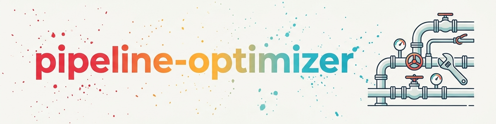

# Otimizador de Pipeline (Pipeline-Optimizer) / Otimizador de Pasta de Projeto (Projekt-Ordner-Optimizer)

**Renovação em 6 passos sem incompatibilidades** — aplicável em duas escalas:

| Nome de acionamento | Escopo | Exemplo |
|---|---|---|
| **Pipeline-Optimizer** | Pipelines inteiras, stacks, estruturas de documentação | Suas pipelines temáticas, por exemplo `software/`, `research/`, `games/`, um sistema de agentes |
| **Otimizador de Pasta de Projeto** (Projekt-Ordner-Optimizer) | Pastas de projetos individuais dentro de uma pipeline | Uma ferramenta de software, um projeto de artigo, um projeto de jogo |

Uma **pipeline** designa aqui uma estrutura de nível superior temática, na qual vários projetos vivem sob convenções comuns (por exemplo, uma pipeline de software com regras de release, uma pipeline de pesquisa com procedimentos de publicação).

Ambas usam o mesmo fluxo de 6 passos — a diferença está apenas no **escopo** (em toda a pipeline ou em um projeto individual) e, correspondentemente, na profundidade do levantamento da base existente no passo A.

## Quando esta skill se aplica

A skill se aplica assim que você precisa melhorar, reformar ou ampliar uma estrutura **existente** — não na construção do zero (greenfield). Gatilhos concretos:

**Nível de pipeline** (escopo: pipeline inteira):
- „Melhorar a pipeline X"
- „Otimizar o stack"
- „Renovação da pipeline de software"
- „Consolidação de documentação na pipeline de pesquisa"
- Intervenção substancial em uma pipeline temática, em `_tools/` central ou em componentes do sistema

**Nível de pasta de projeto** (escopo: uma pasta de projeto):
- „Limpar/otimizar a pasta do projeto X"
- „Melhorar a estrutura de pastas em Y"
- „Refatorar uma ferramenta individual"
- „Padronizar a configuração de um projeto de artigo"
- „Adaptar a pasta de um projeto de jogo ao padrão da pipeline"

**Transversal:**
- „Reformar/integrar X em Y existente"
- „Refatoração", „consolidação"
- „Unificar convenções"
- „integrar em sistema existente"

## A metáfora da base construtiva

Para renovar uma casa é preciso primeiro saber **do que ela é feita** (pedra, madeira, plástico), **para que serve** (cabana na montanha, oficina de software) e **onde já cumpre funções**. A mesma disciplina vale para pipelines.

---

## Procedimento — 6 passos (NÃO pular, NÃO reordenar)

### Passo A — Levantar a base construtiva

**Pergunta:** De que é feita a casa?

**Escopo de pipeline** (todos os documentos raiz + ferramentas + templates):
- [ ] **Ler integralmente todos os documentos raiz** (não apenas trechos/pontos de inserção)
- [ ] Percorrer as pastas de templates (`_templates/`, `_TEMPLATES/`) e de ferramentas (`_tools/`)
- [ ] Arquivos de política: p. ex. GITHUB-POLICY.md, RELEASE-MANAGEMENT.md, QUALITY_RULES.md, NAMING-SYSTEM.md, procedimentos de publicação, …
- [ ] Snapshots de status: p. ex. PROJECT_STATUS.md, visões gerais de status, releases.json, arquivos de registro
- [ ] Checklists: p. ex. checklists de release, checklists de build/PDF
- [ ] Fluxos de trabalho: AGENTS.md, GUIDE.md, SKILL.md
- [ ] Arquivos de lições aprendidas: LESSONS_LEARNED.md, MEMORY.md, arquivos de estado de loop

**Escopo de pasta de projeto** (base do projeto individual + convenções relevantes da pipeline):
- [ ] **Ler todos os arquivos Markdown e de controle na pasta do projeto** (README, CHANGELOG, AUFGABEN/TODO, DONE, KONZEPT, AKTIONSPLAN, notas de prova, …)
- [ ] **Levantar a estrutura do código:** src/, tests/, configuração de build (pyproject.toml, requirements.txt, manifestos do projeto, arquivos de toolchain, …)
- [ ] **Considerar as convenções da pipeline superior** (p. ex., para um projeto de software: GitHub-Policy, sistema de nomenclatura, gestão de releases, templates)
- [ ] **Escanear ferramentas/scripts existentes no projeto** (`_tools/`, `_scripts/`, build_*.bat, scripts START)
- [ ] **Arquivos de configuração:** `.gitignore`, LICENSE, NOTICE, SECURITY.md, CODE_OF_CONDUCT.md

**Anti-padrão:** Localizar pontos de inserção com `grep -l "<keyword>"` e inserir ali sem conhecer o contexto do arquivo.

**Saída:** Nota de inventário com todas as convenções, ferramentas e templates relevantes no escopo escolhido.

### Passo B — Identificar o propósito

**Pergunta:** Para que existe a casa?

Formular o propósito explicitamente em 1–2 frases.

**Exemplos de pipeline:**

| Pipeline | Propósito |
|---|---|
| Pipeline de software | Desenvolver, testar e publicar releases de aplicações desktop e ferramentas de navegador em lojas/no GitHub |
| Pipeline de pesquisa | Escrever, revisar por pares e publicar artigos científicos em repositórios/servidores de preprint |
| Pipeline de jogos | Desenvolver jogos e publicá-los na plataforma-alvo |
| Sistema de agentes | Sistema LLM para orquestração multiagente |

**Exemplos de pasta de projeto:**

| Pasta de projeto | Propósito |
|---|---|
| `software/PlannerApp` | App desktop de planejamento, comercial, repositório privado |
| `research/CosmologyModel` | Série de artigos sobre modelos + cálculos numéricos |
| `games/SortingChaos` | Jogo de classificação, estágio alpha, progressão de níveis |

O propósito **orienta toda intervenção** — medidas que não servem ao propósito são descartadas.

### Passo C — Esboçar a imagem ideal

**Pergunta:** Como seria uma casa perfeita para este propósito?

- Esboçar a partir do próprio ponto de vista (breve, no máx. 10 pontos)
- Recorrer a uma comparação com boas práticas (p. ex., o stack Vercel para SaaS, o scientific-python-stack para pesquisa)
- Não entrar em otimização de detalhes — um esboço de nível superior basta

**Saída:** 5–10 pontos „estado ideal por pipeline"

### Passo D — Análise de lacunas + plano

**Quatro perguntas por pipeline:**

1. **O que a casa já tem?** — Mesmo que resolvido de outra forma que no ideal, mas **funcionalmente equivalente**.
   *Exemplo:* O ideal diz „pip-licenses para licenças de terceiros". Na prática: um script gerador próprio que envolve isso → funcionalmente equivalente, nenhuma intervenção necessária.

2. **O que atrapalha a função?** — Estruturas existentes que hoje causam quebras ou esforço extra.

3. **O que não é funcional?** — Código morto, convenções desatualizadas, ferramentas não utilizadas.

4. **O que melhoraria as funções de forma mensurável?** — Intervenções concretas com benefício esperado.

→ Disso resulta um **plano concreto**:
- O que será **construído do zero**?
- O que será **ampliado**?
- O que será **demolido**?
- O que permanece **inalterado** (importante nomear!)

**Saída:** Tabela de plano com colunas *Intervenção* / *Existente* / *Medida* / *Justificativa*

### Passo E — Trabalhar empiricamente

Não planejar apenas de cima para baixo — coletar pontos de dor:

- [ ] **Bugs conhecidos**: rastreador de issues, arquivos AUFGABEN/TODO/DONE
- [ ] **Histórico de falhas**: arquivos de lições aprendidas, logs de correções de bugs, registros de verificação
- [ ] **Quebras de automação**: „O que eu sempre tenho que fazer manualmente?"
- [ ] **Entrevista com usuários**: perguntar de forma direcionada — pontos de dor, desejos, contornos
- [ ] **Autoteste**: percorrer a pipeline (criar novo projeto, executar o build, simular um release) — onde ela quebra?

Os pontos de dor encontrados empiricamente **priorizam o plano** do passo D.

### Passo F — Novos testes após a implementação

- [ ] **Designar subagentes frescos** (não contaminados pelo contexto da renovação) para percorrer o fluxo de trabalho alterado
- [ ] **Valores comparativos mensuráveis** antes/depois: tempo de configuração, taxa de erros, número de passos manuais, tempo de build
- [ ] **Verificação de não regressão**: os fluxos de trabalho existentes continuam funcionando após a mudança?
- [ ] Se **nenhuma melhoria mensurável** ou houver regressão: **reverter** a renovação ou ajustá-la

## Anti-padrões (proibidos)

| Anti-padrão | Dano | Antídoto |
|---|---|---|
| Procurar pontos de inserção em vez de ler a documentação | Padrões paralelos | Passo A completo |
| Transferir „best practice de X" 1:1 | Incompatibilidade | Passo D compara funcionalmente |
| Criar novo arquivo sem verificar a convenção | Duplicação (p. ex. NOTICE.md ↔ THIRD_PARTY_LICENSES.txt) | Passo A + passo D |
| Planejar de cima para baixo sem empiria | Solução não se encaixa no ponto de dor | Passo E antes de concluir o plano |
| Não testar a própria mudança | Regressão não detectada | Passo F com agente fresco |
| „Esclarecer depois" com status indefinido | Usuário descobre o conflito depois | Em caso de dúvida, repetir o passo D com o usuário |

## Exemplo didático — incidente NOTICE.md

**Tarefa:** Implementar melhorias de pipeline em várias pipelines temáticas (software, pesquisa, jogos).

**Erro:** Passo A pulado — procurados apenas pontos de inserção, em vez de ler integralmente os arquivos de política.

**Consequência:** `NOTICE.md` foi introduzido como „novo arquivo de licença" em 7 arquivos, embora `THIRD_PARTY_LICENSES.txt` e um gerador de licenças próprio (um wrapper em torno de `pip-licenses`) já estivessem estabelecidos — documentado na GitHub-Policy da pipeline (arquivos obrigatórios + checklist de licenças). Todos os projetos de software já tinham arquivos THIRD_PARTY.

**Detecção:** Somente após pergunta do usuário („tenho bastante certeza de que já tínhamos uma gestão de direitos").

**Correção:** NOTICE.md removido do template do projeto, 6 outros arquivos ajustados, e referência ao gerador de licenças existente em vez de `pip-licenses`.

**Lição:** Se o passo A tivesse sido executado por completo, o conflito teria sido identificado antes da escrita.

## Regras práticas

1. **Em „melhorar a pipeline", ler tanto quanto escrever.**
2. **Nenhum novo padrão sem prova de que não existe um já estabelecido.**
3. **Usar ferramentas/wrappers existentes em vez de criar paralelos.**
4. **„Mais do mesmo" costuma ser pior do que „ampliar o existente".**
5. **Em caso de conflito, reverter** é sempre melhor do que deixar dois padrões paralelos em funcionamento.

## Checklist de conclusão

Antes de declarar uma renovação de pipeline como „concluída":

- [ ] Passo A: todos os documentos raiz relevantes foram lidos?
- [ ] Passo B: propósito da pipeline formulado em 1–2 frases?
- [ ] Passo C: imagem ideal esboçada (5–10 pontos)?
- [ ] Passo D: análise de lacunas com tabela (o que fica / o que é ampliado / o que é novo / o que sai)?
- [ ] Passo E: empiria verificada (bugs, lições, autoteste, entrevista com usuário)?
- [ ] Plano alinhado com o usuário?
- [ ] Passo F: testado com subagente fresco — melhoria mensurável?
- [ ] Nenhum padrão paralelo introduzido?
- [ ] Em caso de conflitos, revertido ou prestado contas de forma honesta?

## Estrutura ideal de pasta de projeto (para o Otimizador de Pasta de Projeto / Projekt-Ordner-Optimizer)

Ao aplicar a skill a **uma única pasta de projeto**, a referência ideal (passo C) é a seguinte recomendação combinada:

### Padrão Anthropic (Claude Code)

| Arquivo/pasta | Função |
|---|---|
| `CLAUDE.md` (raiz) | Carregado automaticamente pelo Claude Code, instruções específicas do projeto |
| `.claude/settings.json` | Permissões, variáveis de ambiente, seleção de modelo (versionado) |
| `.claude/settings.local.json` | Overrides locais (NÃO versionar, em `.gitignore`) |
| `.claude/commands/*.md` | Comandos de barra personalizados |
| `.claude/agents/*.md` | Subagentes personalizados |
| `.claude/skills/<name>/SKILL.md` | Skills do projeto |

### Template próprio de documentação de projeto (recomendado)

Se você mantém um template próprio de documentação de projeto (p. ex., em `<dein-workspace>/_templates/project-docs/`), valem **três perfis de expansão**. Exemplo de divisão: **MINIMAL** fornece o conjunto central de sessão com 7 arquivos raiz (`AGENTS.md`, `CLAUDE.md`, `README.md`, `START.md`, `STATE.md`, `TODO.md`, `DONE.md`) mais `_tools/`. **STANDARD** acrescenta `CHANGELOG.md`, `DECISIONS.md` e `PATTERNS.md`. **FULL** amplia para 14 arquivos raiz e acrescenta ainda `ARCHITECTURE.md`, `WORKFLOWS.md`, `TOOLS.md`, `GLOSSARY.md`, bem como `workflows/` e `.github/`.

→ **Para novos projetos, use um desses templates como base** (copiar em vez de criar manualmente).

### Complementos específicos da pipeline (exemplos)

Dependendo da pipeline, surgem outros arquivos obrigatórios — padrões típicos:

- **Projeto de software:** LICENSE, CODE_OF_CONDUCT.md, SECURITY.md, CONTRIBUTING.md, THIRD_PARTY_LICENSES.txt (gerado), pyproject.toml/requirements.txt, entrada no registro central de releases da pipeline. → Se disponível: usar o template cookiecutter da pipeline.
- **Projeto de pesquisa:** documento de conceito, plano de ação, plano de publicação, pastas de arquivo/fontes/resultados/dados (`_archive/`, `_sources/`, `_results/`, `_data/`), `paper/` para LaTeX. Em projetos de prova: um arquivo de notas de prova com cadeia de prova e status.
- **Projeto de jogo:** manifesto do projeto e arquivos de toolchain da engine (p. ex., no Roblox/Rojo: default.project.json, rokit.toml, wally.toml, selene.toml), documento de game design, `src/{server,client,shared}/` conforme a convenção da engine.

### Referência detalhada completa

→ Veja **`references/optimal-project-structure.md`** nesta pasta da skill. Contém:
- Exemplo de `settings.json` (esquema Anthropic)
- Entradas obrigatórias de `.gitignore`
- Anti-padrões (o que NÃO deve estar na pasta do projeto)
- Fluxos de trabalho recomendados por tipo de pipeline (software/pesquisa/jogos)
- Convenção de cabeçalho YAML para arquivos de documentação
- Esboço de verificação automática

## Skills relacionadas (quando usar em vez desta?)

| Skill | Quando usar |
|---|---|
| **`project-onboarding`** | Incorporar um repositório EXTERNO existente ao seu sistema |
| Bootstrapper de projeto (Projekt-Bootstrapper, se disponível) | Criar um NOVO projeto numa pipeline existente (greenfield, sem reforma) |
| Bootstrapper de pipeline (Pipeline-Bootstrapper, se disponível) | Criar uma pipeline COMPLETAMENTE NOVA (caso raro) |
| Onboarding do sistema (System-Onboarding, se disponível) | Configurar uma nova máquina |

O **Pipeline-Optimizer** é responsável pela **renovação**, não pela construção nova nem pela assunção de projetos. Se sua coleção de skills tiver um índice, procure ali skills de bootstrapping adequadas.

## Referências cruzadas

- Referência detalhada: `references/optimal-project-structure.md` (nesta pasta da skill)
- Documentação do Anthropic Claude Code: `https://docs.claude.com/en/docs/claude-code`
- Se disponíveis: regras globais do usuário (p. ex., uma seção „Reformas/renovações" no seu `~/CLAUDE.md`) e descrições de stack específicas da pipeline

## Escolha de escopo: pipeline vs. pasta de projeto

Se não estiver claro qual escopo é pretendido, **esclarecer antes do passo A**:

| Indício | Escopo |
|---|---|
| „Melhorar toda a pipeline de software" | Pipeline |
| „Limpar a pasta da ferramenta X" | Pasta de projeto |
| „Sincronizar o registro central de releases" | Pipeline (recurso central) |
| „Refatorar o AssetBuilder no jogo Y" | Pasta de projeto |
| „Introduzir uma convenção de verificação em toda a pipeline" | Pipeline |
| „Criar um arquivo de verificação no projeto Z" | Pasta de projeto |

Com **escopo de pasta de projeto**, verificar sempre também brevemente as convenções da pipeline superior (passo A ampliado), para que a intervenção permaneça compatível com a pipeline.

---

## Changelog

### 1.2.0 (2026-06-13)
- Primeira publicação na biblioteca de skills: caminhos pessoais, nomes concretos de pipelines/projetos e referências a skills privadas substituídos por exemplos genéricos; procedimento (6 passos, anti-padrões, exemplo didático, checklists) inalterado

### 1.1.1 (2026-06-01) e anteriores
- Versões internas (diretório privado de skills, antes da publicação)
