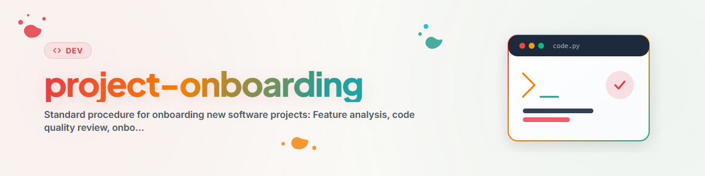

> **Français** — Version française officielle de la compétence `project-onboarding`.

# Procédure standard d'intégration pour les nouveaux projets logiciels

**Version :** 1.0
**État :** 2026-03-12

---

## Vue d'ensemble

Cette procédure définit les étapes à exécuter pour les dossiers logiciels nouvellement découverts avant leur intégration dans un système de gestion des tâches.

```
┌─────────────────────────────────────────────────────────┐
│        PROCÉDURE STANDARD D'INTÉGRATION                 │
├─────────────────────────────────────────────────────────┤
│  1. Rédiger l'analyse des fonctionnalités               │
│  2. Contrôle qualité du code (tests standard)           │
│  3. Créer AUFGABEN.txt                                  │
│  4. Transférer dans la gestion des tâches               │
└─────────────────────────────────────────────────────────┘
```

---

## Phase 1 : Analyse des fonctionnalités

**Objectif :** Comprendre l'outil, ses fonctionnalités et son niveau de maturité.

**Fichier à créer :** `Feature_Analyse_<ToolName>.md`

### Modèle

```markdown
# Analyse des fonctionnalités : <ToolName>

## Description courte
Une phrase courte décrivant ce que fait l'outil.

---

## Points forts

| Fonctionnalité | Description |
|----------------|-------------|
| **Fonctionnalité 1** | Description |
| **Fonctionnalité 2** | Description |

---

## Évaluation du niveau d'avancement

### État actuel : **<Statut> (<X>%)**

Statuts possibles :
- Prototype (0-30%)
- Alpha (30-60%)
- Beta (60-85%)
- Production Ready (85-95%)
- Release (95-100%)

| Catégorie | Note (1-5) | Détails |
|-----------|:----------:|---------|
| **Périmètre fonctionnel** | 3 | |
| **UI/UX** | 3 | |
| **Stabilité** | 3 | |
| **Documentation** | 3 | |

---

## Extensions recommandées

### Priorité : Haute
1. ...

### Priorité : Moyenne
2. ...

### Priorité : Basse
3. ...

---

## Détails techniques

Framework :      <Framework>
Taille fichier : <X> lignes Python
Fichier principal : <main.py>

---
*Analyse créée : <Date>*
```

---

## Phase 2 : Contrôle qualité du code

**Objectif :** Garantir la qualité technique et identifier les problèmes connus.

### Vérifications recommandées

| Test | Outil | Description |
|------|-------|-------------|
| **Encodage** | Vérificateur d'encodage (ex. `chardet`, `file`) | Garantir l'UTF-8 |
| **Analyse des méthodes** | Linter (ex. `pylint`, `flake8`) | Repérer les méthodes volumineuses |
| **Indentation** | Formateur (ex. `black`, `autopep8`) | Vérifier la cohérence |
| **Imports** | Vérificateur d'imports (ex. `isort`, `pylint`) | Détecter les imports inutilisés |

### Points de contrôle

- [ ] Tous les fichiers `.py` encodés en UTF-8 ?
- [ ] Aucune méthode anormalement longue (>100 lignes) ?
- [ ] Indentation cohérente (espaces vs tabulations) ?
- [ ] Imports inutilisés supprimés ?
- [ ] Docstrings présentes ?

### Documenter les résultats

Inscrire les problèmes dans `AUFGABEN.txt` sous « CONTRÔLE QUALITÉ ».

---

## Phase 3 : Créer AUFGABEN.txt

**Objectif :** Recenser les tâches ouvertes de manière structurée.

**Fichier à créer :** `AUFGABEN.txt` dans le dossier du projet

### Modèle

```
TÂCHES - <ToolName> V<Version>
==============================
Statut : <Statut>
Date : <Date>

TÂCHES OUVERTES :
[ ] <Tâche 1> - Effort : <FAIBLE|MOYEN|ÉLEVÉ>
[ ] <Tâche 2> - Effort : <FAIBLE|MOYEN|ÉLEVÉ>

---
TERMINÉ (Archive) :
- <Tâche terminée> (<Version>, <Date>)
```

### Valeurs de statut

| Statut | Signification |
|--------|---------------|
| NOUVELLEMENT DÉCOUVERT | Pas encore analysé |
| ANALYSE NÉCESSAIRE | Analyse des fonctionnalités en cours |
| CONTRÔLE QUALITÉ | Tests de code en cours |
| VALIDÉ & PRÊT | Prêt pour les fonctionnalités |
| MVP | Minimum Viable Product |
| COMPILATION UNIQUEMENT | Seule la compilation reste nécessaire |
| BLOQUÉ | En attente de test ou décision utilisateur |

---

## Phase 4 : Intégration dans la gestion des tâches

À l'issue des phases 1 à 3 :

1. **Transférer les tâches :** Créer les entrées de `AUFGABEN.txt` sous forme de tâches/issues
2. **Vérifier :** Toutes les tâches sont-elles correctement catégorisées ?
3. **Catégorisation :** Classer le projet dans la catégorie appropriée (Single-Tool, Suite, Library, etc.)

### Tâches d'onboarding automatiques

Pour les nouveaux projets, créer les tâches standard suivantes :

| Tâche | Libellé | Effort |
|-------|---------|--------|
| onb_1 | Créer l'analyse des fonctionnalités | moyen |
| onb_2 | Contrôle qualité du code | faible |
| onb_3 | Créer AUFGABEN.txt | faible |

Les tâches ont des dépendances : `onb_2` dépend de `onb_1`, `onb_3` dépend de `onb_2`.

---

## Check-list rapide

```
[ ] 1. Feature_Analyse_<Name>.md créé
[ ] 2. Contrôle qualité du code effectué (linter, encodage, imports)
[ ] 3. AUFGABEN.txt créé avec statut
[ ] 4. Tâches transférées dans la gestion des tâches
```

---

## Exemple : Nouvel outil « MyTool »

```bash
# 1. Analyse des fonctionnalités
# -> Créer Feature_Analyse_MyTool.md (voir modèle)

# 2. Qualité du code
pylint MyTool/main.py
flake8 MyTool/main.py
file -i MyTool/main.py  # Vérifier l'encodage

# 3. AUFGABEN.txt
# -> Créer dans le dossier de l'outil avec le statut "CONTRÔLE QUALITÉ"

# 4. Créer les tâches
# -> Enregistrer les entrées de AUFGABEN.txt comme issues/tickets
```

---

*Créé : 2026-01-10 | Porté : 2026-03-12*

## Journal des modifications

### 1.0.1 (2026-11-22)
- Indication de langue corrigée
