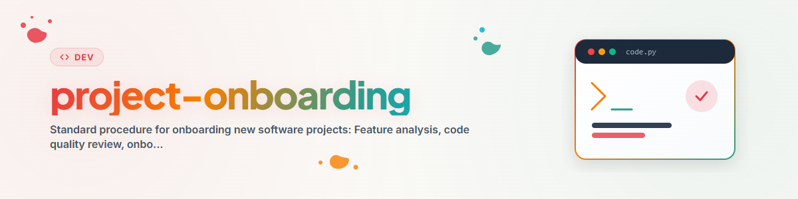

# नए सॉफ़्टवेयर-प्रोजेक्ट्स के लिए मानक आरंभ-प्रक्रिया

**संस्करण:** 1.0
**स्थिति:** 2026-03-12

---

## अवलोकन

यह प्रक्रिया परिभाषित करती है कि नवीन खोजे गए सॉफ़्टवेयर-फ़ोल्डरों को टास्क-प्रबंधन प्रणाली में जोड़ने से पहले कौन-से चरण पूरे किए जाने चाहिए।

```
┌─────────────────────────────────────────────────────────┐
│           STANDARDAUFNAHMEVERFAHREN                     │
├─────────────────────────────────────────────────────────┤
│  1. Feature-Analyse erstellen                           │
│  2. Code-Qualitaetspruefung (Standard-Tests)            │
│  3. AUFGABEN.txt erstellen                              │
│  4. In Task-Management uebernehmen                      │
└─────────────────────────────────────────────────────────┘
```

---

## चरण 1: फ़ीचर-विश्लेषण

**उद्देश्य:** टूल, उसके कार्यों और विकास की स्थिति को समझना।

**फ़ाइल बनाएँ:** `Feature_Analyse_<ToolName>.md`

### टेम्पलेट

```markdown
# Feature-Analyse: <ToolName>

## Kurzbeschreibung
Ein kurzer Satz der beschreibt was das Tool macht.

---

## Highlights

| Feature | Beschreibung |
|---------|-------------|
| **Feature 1** | Beschreibung |
| **Feature 2** | Beschreibung |

---

## Bewertung der Ausbaustufe

### Aktueller Stand: **<Status> (<X>%)**

Moegliche Status:
- Prototype (0-30%)
- Alpha (30-60%)
- Beta (60-85%)
- Production Ready (85-95%)
- Release (95-100%)

| Kategorie | Bewertung (1-5) | Details |
|-----------|:---------------:|---------|
| **Funktionsumfang** | 3 | |
| **UI/UX** | 3 | |
| **Stabilitaet** | 3 | |
| **Dokumentation** | 3 | |

---

## Empfohlene Erweiterungen

### Prioritaet: Hoch
1. ...

### Prioritaet: Mittel
2. ...

### Prioritaet: Niedrig
3. ...

---

## Technische Details

Framework:      <Framework>
Dateigroesse:   <X> Zeilen Python
Hauptdatei:     <main.py>

---
*Analyse erstellt: <Datum>*
```

---

## चरण 2: कोड-गुणवत्ता जाँच

**उद्देश्य:** तकनीकी गुणवत्ता सुनिश्चित करना और ज्ञात समस्याओं की पहचान करना।

### अनुशंसित जाँचें

| परीक्षण | उपकरण | विवरण |
|------|----------|--------------|
| **एन्कोडिंग** | एन्कोडिंग-चेकर (जैसे `chardet`, `file`) | UTF-8 सुनिश्चित करें |
| **मेथड-विश्लेषण** | लिंटर (जैसे `pylint`, `flake8`) | बड़े मेथड खोजें |
| **इंडेंटेशन** | फ़ॉर्मेटर (जैसे `black`, `autopep8`) | एकरूपता जाँचें |
| **इम्पोर्ट** | इम्पोर्ट-चेकर (जैसे `isort`, `pylint`) | अप्रयुक्त इम्पोर्ट खोजें |

### जाँच-बिंदु

- [ ] क्या सभी .py फ़ाइलें UTF-8 में एन्कोडेड हैं?
- [ ] क्या कोई असामान्य रूप से बड़े मेथड नहीं हैं (>100 पंक्तियाँ)?
- [ ] क्या इंडेंटेशन एकरूप है (स्पेस बनाम टैब)?
- [ ] क्या अप्रयुक्त इम्पोर्ट हटा दिए गए हैं?
- [ ] क्या डॉकस्ट्रिंग मौजूद हैं?

### परिणाम दर्ज करें

समस्याओं को AUFGABEN.txt में "QUALITAETSPRUEFUNG" के अंतर्गत दर्ज करें।

---

## चरण 3: AUFGABEN.txt बनाएँ

**उद्देश्य:** खुले कार्यों को संरचित रूप से दर्ज करना।

**फ़ाइल बनाएँ:** प्रोजेक्ट-फ़ोल्डर में `AUFGABEN.txt`

### टेम्पलेट

```
AUFGABEN - <ToolName> V<Version>
==============================
Status: <Status>
Stand: <Datum>

OFFENE AUFGABEN:
[ ] <Aufgabe 1> - Aufwand: <NIEDRIG|MITTEL|HOCH>
[ ] <Aufgabe 2> - Aufwand: <NIEDRIG|MITTEL|HOCH>

---
ERLEDIGT (Archiv):
- <Erledigte Aufgabe> (<Version>, <Datum>)
```

### स्थिति-मान

| स्थिति | अर्थ |
|--------|-----------|
| NEU ENTDECKT | अभी तक विश्लेषित नहीं |
| ANALYSE NOETIG | फ़ीचर-विश्लेषण जारी है |
| QUALITAETSPRUEFUNG | कोड-परीक्षण चल रहे हैं |
| VALIDIERT & BEREIT | फ़ीचर्स के लिए तैयार |
| MVP | न्यूनतम व्यवहार्य उत्पाद |
| NUR KOMPILIEREN | केवल संकलन शेष |
| GESPERRT | उपयोगकर्ता-परीक्षण/निर्णय की प्रतीक्षा |

---

## चरण 4: टास्क-प्रबंधन एकीकरण

चरण 1-3 पूरे होने के बाद:

1. **कार्य स्थानांतरित करें:** AUFGABEN.txt की प्रविष्टियों को Tasks/Issues के रूप में बनाएँ
2. **जाँचें:** क्या सभी कार्य सही वर्गीकृत हैं?
3. **वर्गीकरण:** प्रोजेक्ट को उपयुक्त श्रेणी में रखें (Single-Tool, Suite, Library आदि)

### स्वचालित ऑनबोर्डिंग-टास्क

नए प्रोजेक्ट्स के लिए ये मानक टास्क बनाएँ:

| टास्क | कार्य | प्रयास |
|------|---------|---------|
| onb_1 | फ़ीचर-विश्लेषण बनाएँ | मध्यम |
| onb_2 | कोड-गुणवत्ता जाँच | निम्न |
| onb_3 | AUFGABEN.txt बनाएँ | निम्न |

टास्क्स में निर्भरताएँ हैं: onb_2 onb_1 पर निर्भर है, onb_3 onb_2 पर निर्भर है।

---

## त्वरित चेकलिस्ट

```
[ ] 1. Feature_Analyse_<Name>.md erstellt
[ ] 2. Code-Qualitaetspruefung durchgefuehrt (Linter, Encoding, Imports)
[ ] 3. AUFGABEN.txt erstellt mit Status
[ ] 4. Tasks in Task-Management uebernommen
```

---

## उदाहरण: नया टूल "MyTool"

```bash
# 1. Feature-Analyse
# -> Feature_Analyse_MyTool.md erstellen (siehe Template)

# 2. Code-Qualitaet
pylint MyTool/main.py
flake8 MyTool/main.py
file -i MyTool/main.py  # Encoding pruefen

# 3. AUFGABEN.txt
# -> Im Tool-Ordner erstellen mit Status "QUALITAETSPRUEFUNG"

# 4. Tasks anlegen
# -> Eintraege aus AUFGABEN.txt als Issues/Tickets erfassen
```

---

*निर्मित: 2026-01-10 | पोर्ट किया गया: 2026-03-12*
