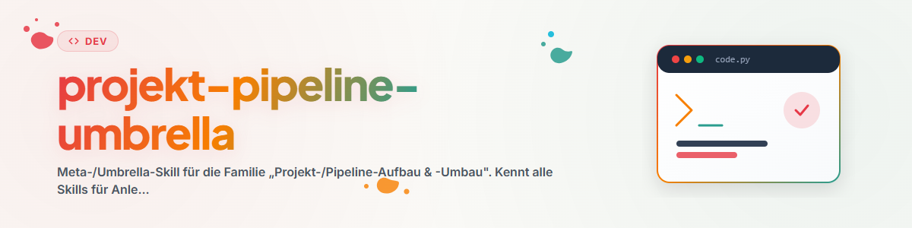

# प्रोजेक्ट-/पाइपलाइन-निर्माण और -पुनर्निर्माण — अम्ब्रेला

## उद्देश्य

"प्रोजेक्ट-/पाइपलाइन-निर्माण और -पुनर्निर्माण" परिवार के लिए प्रवेश बिंदु। इसके सदस्य दो अक्षों के साथ
स्वयं को व्यवस्थित करते हैं: **ग्रीनफील्ड बनाम ब्राउनफ़ील्ड (मौजूदा)** और **प्रोजेक्ट-स्तर बनाम पाइपलाइन-स्तर**। यह अम्ब्रेला
"bootstrap" बनाम "optimize" बनाम "onboard" की आम भ्रांति को रोकता है।

## सदस्य और रूटिंग

| स्किल | किसलिए | दूसरों के बजाय इसे कब चुनें |
|-------|--------|-------------------|
| `/project-bootstrapper` | मौजूदा पाइपलाइन **के भीतर** नया प्रोजेक्ट बनाना | ग्रीनफील्ड, प्रोजेक्ट-स्तर |
| `/pipeline-bootstrapper` | पूरी तरह नई टॉप-लेवल पाइपलाइन बनाना | ग्रीनफील्ड, पाइपलाइन-स्तर (दुर्लभ) |
| `/project-onboarding` | मौजूदा प्रोजेक्ट को दर्ज/कैप्चर करना | ब्राउनफ़ील्ड (मौजूदा), प्रोजेक्ट-स्तर |
| `/pipeline-optimizer` | मौजूदा पाइपलाइन/संरचना का नवीनीकरण (6-चरण प्रक्रिया) | ब्राउनफ़ील्ड (मौजूदा), पुनर्निर्माण |
| `/docs-analysis` | आवश्यकता-/अवधारणा-दस्तावेज़ों की वर्तमान कोड से जाँच | ब्राउनफ़ील्ड (मौजूदा), विश्लेषण (कोई पुनर्निर्माण नहीं) |
| `/dev-cycle` | वास्तविक निर्माण के लिए 8-चरण विकास ढाँचा | सर्व-व्यापी/क्रॉस-कटिंग: विकास का 'कैसे' |

> रूटिंग नियम: **नया + प्रोजेक्ट** → `/project-bootstrapper` · **नया + पाइपलाइन** →
> `/pipeline-bootstrapper` · **ब्राउनफ़ील्ड (मौजूदा) दर्ज करना** → `/project-onboarding` · **ब्राउनफ़ील्ड (मौजूदा) पुनर्निर्मित करना** →
> `/pipeline-optimizer` · **केवल जाँचना** → `/docs-analysis` · **बनाना** → `/dev-cycle`.

## अच्छी तरह जुड़े संयोजन

- `/project-onboarding` (पहले: मौजूदा दर्ज करें) → `/pipeline-optimizer` (बाद में: लक्षित पुनर्निर्माण) —
  पहले समझें, फिर नवीनीकरण करें (6-चरण सिद्धांत "पहले पढ़ें, फिर लिखें" को कवर करता है)।
- `/docs-analysis` (अंतराल खोजें) → `/dev-cycle` (अंतराल भरें)।
- `/project-bootstrapper` (ढाँचा) → `/dev-cycle` (सामग्री विकसित करें)।

## साझा परंपराएँ

- मौजूदा पाइपलाइन परंपराएँ हमेशा पहले (रजिस्ट्री, टेम्पलेट, CLAUDE.md) पढ़ें — समानांतर मानक न बनाएं।
- ग्रीनफील्ड स्किलें बनाती हैं, ब्राउनफ़ील्ड (मौजूदा) स्किलें पुनर्निर्मित करती हैं — इन्हें मिलाएं नहीं।
- लागू करने से पहले व्यक्तिगत स्किलों की लाइव फ़ाइलें पढ़ें।

## परिवर्तन-लॉग

### 0.1.0 (2026-06-17)
- प्रारंभिक संस्करण। प्रोजेक्ट-/पाइपलाइन परिवार के लिए ऑडिट-मोड (3c1) द्वारा निर्मित।
