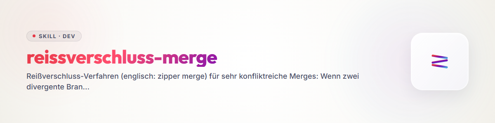

# Reißverschluss-Merge (zipper merge)

## কখন এই পদ্ধতি

একই রিপোর দুটি শাখা **তীব্রভাবে ভিন্নমুখী** এবং **উভয়েরই মূল্য আছে** —
সাধারণত: `main` বনাম `master` সমান্তরাল রক্ষণাবেক্ষণের পর, একটি পুরোনো PR বনাম অগ্রসর হওয়া লক্ষ্য শাখা,
প্রতিটির নিজস্ব ফিক্স সহ দুটি এজেন্ট-/দলীয় অবস্থা।
একটি সাধারণ মার্জ হয় একপক্ষকে মুছে ফেলবে ("ours"/"theirs"), নয়তো একটি জটিল সংঘর্ষের জট তৈরি করবে। Reißverschluss-পদ্ধতি এটি সমাধান করে
দুই পক্ষের দাঁতগুলোকে **অংশভিত্তিকভাবে একে অপরের মধ্যে ঢোকাতে দিয়ে**:
প্রতিটি অংশে প্রমাণিতভাবে উন্নততর সংস্করণ জেতে — অথবা একটি যুক্তিসম্মত মিশ্রণ।

সহজ সংঘর্ষে **প্রয়োজন নেই** (একপক্ষ স্পষ্টতই পুরোনো,
কয়েকটি hunk): তখন স্বাভাবিকভাবে মার্জ করুন। একাধিক ফাইল/অংশের জন্য গুরুত্বসহকারে ওজন করতে হলে এই পদ্ধতি কার্যকর।

## ধাপ 0 — পরিস্থিতি-চিত্র ও ভিত্তি নির্বাচন

1. **উভয় পক্ষ সম্পূর্ণভাবে পর্যালোচনা করুন** (শুধু সংঘর্ষ চিহ্নগুলো নয়):
   `git log --oneline A..B` এবং `B..A`, `git diff A...B --stat`, তারপর উভয় সংস্করণের ভিন্ন ফাইলগুলো পড়ুন।
2. **ভিত্তি বেছে নিন — তারিখ নয়, বাস্তবতা অনুযায়ী।** ভিত্তি হবে সেই শাখা,
   যা **প্রকাশিত বাস্তবতার** সঙ্গে মেলে: Registry-অবস্থা
   (npm/PyPI/…), মোতায়েনকৃত সংস্করণ, সবুজ CI, রিলিজ ট্যাগ। নতুন তারিখের শাখা, কিন্তু বাইরের জগতের সঙ্গে মিল নেই — সেটি উপাদান, ভিত্তি নয়।
3. **উভয় পক্ষের সামঞ্জস্য যাচাই করুন** — প্রায়ই উভয়েই নিজের মধ্যে অসঙ্গত
   (যেমন ভিত্তিতে সংস্করণ X আছে কিন্তু উপযুক্ত Changelog নেই, অপর পক্ষ Changelog রক্ষণাবেক্ষণ করে, তবে সংস্করণে পিছিয়ে)। এমন ফলাফল সারণিতে যাবে, কার্পেটের নিচে লুকানো হবে না।

## ধাপ 1 — সিদ্ধান্ত সারণি (মূল অংশ)

প্রতিটি ভিন্ন অংশের জন্য (ফাইল, ব্লক, ক্ষেত্র — যতটা সূক্ষ্ম প্রয়োজন) একটি সারি:

| অংশ | নিন | কেন |
|---|---|---|
| `package.json` → version | ভিত্তি | Registry-র সঙ্গে মেলে |
| `overrides`-Block | অপর পক্ষ | এতে নিরাপত্তা আপডেট আছে যা ভিত্তিতে নেই |
| ↳ তার মধ্যে এন্ট্রি `X` | **মেশান** | অপর পক্ষের এন্ট্রি নিন, কিন্তু ভিত্তির নতুন সংস্করণে তুলুন |
| Changelog `[Unreleased]` | **মেশান** | উভয় ব্লক একত্র করুন, ডুপ্লিকেট বাদ দিন |

নিয়মাবলী:

- **অনুমানের বদলে তথ্য।** প্রতিটি "কেন"-ঘরে এমন কিছু থাকবে যা যাচাইযোগ্য: Registry-প্রশ্ন, পরীক্ষা-চালনা, Advisory-ডেটাবেস, বিতর্কিত ফাইলের বিচ্ছিন্ন ট্রায়াল-ইনস্টলেশন। যে অনুমান করে, সে অনুমান মেশায়।
- **"মেশানো" একটি বৈধ রায়** — Reißverschluss একটি অংশের ভেতরে উভয় দাঁত ধরতে পারে।
- **বাতিল করাও একটি বৈধ রায়** — যা কোনো পক্ষেই টেকে না (মৃত ব্যাজ, অর্ধেক প্রবর্তিত ফিচার), তা বাদ যায়। মধ্যবর্তী অবস্থা ("ফিচার অর্ধেক ভেতরে") সবচেয়ে খারাপ বিকল্প: হয় পুরোপুরি ভেতরে, নয় পুরোপুরি বাইরে।
- সম্পূর্ণ সারণি বাস্তবায়নের **চুক্তিপত্র** — সেশন বদল বা হস্তান্তরে এটি যান্ত্রিকভাবে এগিয়ে যেতে যথেষ্ট।

## ধাপ 2 — বাস্তবায়ন: অংশভিত্তিক কমিট, শেষে পুশ

1. ভিত্তিতে একটি প্রকৃত মার্জ শুরু করুন: `git merge <gegenseite>`
   (ইচ্ছাকৃতভাবে `-X ours/theirs` নয় — সংঘর্ষগুলো ইচ্ছাকৃতভাবে দৃশ্যমান থাকবে)।
2. সংঘর্ষগুলো **অংশ অংশ** সারণি অনুযায়ী সুনির্দিষ্টভাবে সমাধান করুন।
3. **প্রতি যৌক্তিক অংশে একটি কমিট** (অথবা একটি একক মার্জ-কমিট হলে:
   প্রতি অংশে কমিট-বার্তায় একটি নথিভুক্ত সমাধান-ধাপ)।
   প্রতিটি কমিট-বার্তায় সারণির রায় উল্লেখ থাকবে ("overrides: অপর পক্ষ + vitest ভিত্তি-অবস্থায় তোলা হয়েছে")। এভাবে প্রতিটি Reißverschluss-দাঁত আলাদাভাবে অনুসরণযোগ্য ও ফেরতযোগ্য থাকে।
4. **বাস্তবায়নের পর পরীক্ষা** (স্যুট, বিল্ড, ইনস্টলযোগ্যতা) — আগে সবুজ, তারপর এগোন।
5. **শুধু শেষে পুশ করুন** — পদ্ধতি চলাকালীন স্থানীয় ইতিহাস পুনর্গঠিত হতে পারে, রিমোট শুধু চূড়ান্ত ফলাফল দেখবে।
6. **মোছা ছাড়া বিভাজন বন্ধ করুন:** পরাজিত শাখাটিকে Fast-Forward দিয়ে ফলাফলে সেট করুন (`git checkout <gegenseite> &&
   git merge --ff-only <basis>`)। এরপর উভয় নাম একই অবস্থা দেখায়; কোনো ইতিহাস হারায় না।

## Eskalationspfad — মার্জের বদলে পুনর্নির্মাণ (শেষ ধাপ)

যখন Reißverschluss আর কাজ করে না, তখন **মার্জ নয়, পুনর্নির্মাণ** করা হয়: শাখা/PR-এর **উদ্দেশ্য/কার্যকারিতা** (কী অর্জন করতে চেয়েছিল — কীভাবে নয়) নিষ্কাশন করে বর্তমান অবস্থায় নতুনভাবে বাস্তবায়ন করা হয়। পুরোনো শাখা/PR পুনর্নির্মাণের উল্লেখসহ বন্ধ করা হয়।

এসকেলেশনের ট্রিগার (একটিই যথেষ্ট):

- অপর পক্ষ **প্রমাণিতভাবে ত্রুটিপূর্ণ** (যেমন কখনো ইনস্টলযোগ্য ছিল না, বিল্ড ভেঙে যায়) — তখন মার্জ করার মতো কার্যকর অবস্থা কখনো ছিলই না।
- সংঘর্ষের পরিমাণ ≫ মূল বিষয়: পরিবর্তনটি ছোট, কিন্তু শত শত সরানো লাইনে ছড়ানো (মাঝখানে Rename-/Format-তরঙ্গ)।
- ইতিহাস বিষাক্ত (যেমন উভয় পক্ষে **ভিন্ন** বিষয়বস্তুর জন্য একই সংস্করণ নম্বর) — মার্জ সেই মিথ্যা উত্তরাধিকারে নেবে।
- PR এত পুরোনো যে তার প্রসঙ্গ (API, কাঠামো) আর নেই।

পদ্ধতি: উদ্দেশ্য 2–5 বাক্যে লিখুন (PR-বর্ণনা, কমিট, Diff-এর মূল বিষয় থেকে) → বর্তমান অবস্থায় নতুনভাবে বাস্তবায়ন → পরীক্ষা → পুরোনো PR/শাখায় নথিভুক্ত করুন কী গৃহীত হয়েছে এবং কী ইচ্ছাকৃতভাবে গৃহীত হয়নি, তারপর বন্ধ করুন। কমিট/PR-পাঠে ধারণার উৎস-কৃতিত্ব উল্লেখ করুন।

## ফাঁদসমূহ (মূল সেশন থেকে, ব্যয়বহুল শিক্ষা)

- **দ্বিগুণ `[Unreleased]`-Changelog-ব্লক** সমান্তরালে রক্ষিত শাখায় সবচেয়ে সাধারণ হটস্পট — সবসময় একত্র করুন, কখনো নীরবে একটি বাদ দেবেন না।
- **উভয় পক্ষ ভিন্ন বিষয়বস্তুর জন্য একই সংস্করণ নম্বর দিয়েছে:** মার্জের আগে স্পষ্ট করুন Registry কোন নম্বর চেনে; অপর পক্ষ একত্রিত Changelog-এ একটি সংশোধন পাবে।
- **মার্জ একটি নিরীক্ষার সুযোগ:** অংশভিত্তিক পাঠে এমন জিনিস চোখে পড়ে যা কোনো শাখা দেখেনি (খোলা Advisory, মৃত লিংক, অসঙ্গত Pin)। সেগুলো নিন, কিন্তু আলাদা কমিটে — Reißverschluss-সিদ্ধান্তের সঙ্গে মেশাবেন না।
- **"নতুন বলে গ্রহণ":** তারিখ কোনো যুক্তি নয়। প্রতিটি গ্রহণের জন্য যাচাইযোগ্য কারণ লাগে।
- **Force-Push-প্রতিক্রিয়া:** পদ্ধতিটি Force-Push ছাড়াই চলে (Merge + Fast-Forward)। যদি Force প্রয়োজন মনে হয়, সাধারণত ভিত্তি-নির্বাচনটিই ভুল।

## লাল পতাকা

| চিন্তা | বাস্তবতা |
|---|---|
| "আমি সহজভাবে নতুন পক্ষটি নেব" | তারিখ ≠ গুণমান। সারণি তৈরি করুন। |
| "সংঘর্ষগুলো একবারে সমাধান করব" | একটি সম্মিলিত কমিট প্রতিটি সিদ্ধান্তকে অপ্রত্যাহারযোগ্য করে। |
| "মাঝে মাঝে পুশ করে ফেলি" | রিমোটে অর্ধসমাপ্ত Reißverschluss প্রত্যেক পাঠককে বিভ্রান্ত করে। শেষে পুশ করুন। |
| "মার্জ তো যেকোনোভাবে হয়ে যায়" | ত্রুটিপূর্ণ বিপরীত পক্ষ বা বিষাক্ত ইতিহাসে পুনর্নির্মাণই সৎ ও দ্রুত। |
| "সারণিটা বাড়াবাড়ি" | সারণি ছাড়া তৃতীয় ফাইলের পর ভুলে যাবেন কেন অংশ 1 এভাবে সিদ্ধান্ত হয়েছিল। |

## সম্পর্কিত দক্ষতা

- `bugfix-protocol` — মার্জ যদি প্রকৃত ত্রুটি প্রকাশ করে, সেখানে এগিয়ে যান।
- `skill-extractor` — এই দক্ষতার উৎস (লাইভ-সেশনের সারাংশ)।
- `human-loop-audit` — শুধু Reißverschluss-চিত্রটি ভাগ করে, Git-মার্জের সঙ্গে এর কোনো সম্পর্ক নেই (ব্যবহারকারীর সঙ্গে ইন্টারঅ্যাক্টিভ অ্যাপ/GUI-পরীক্ষা পদ্ধতি)।

## Changelog

### 1.0.0 (2026-08-07)
- প্রাথমিক সংস্করণ। 2026-08-06 তারিখের একটি লাইভ-মার্জ সেশন থেকে নিষ্কাশিত
  (একাধিক রিপোর main/master একত্রীকরণ সিদ্ধান্ত সারণি সহ, কখনো ইনস্টলযোগ্য না হওয়া একটি বিপরীত পক্ষের সন্ধান, Fast-Forward সমাপ্তি; এসকেলেশন ক্ষেত্র
  "উদ্দেশ্য গ্রহণ, পুনর্নির্মাণ")।
