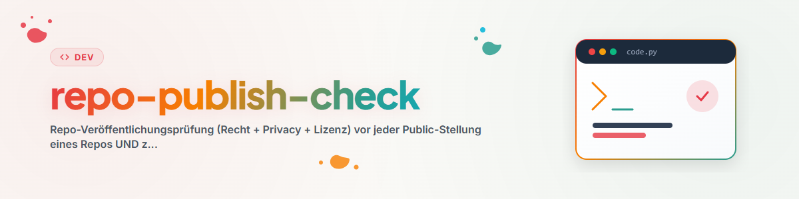

# রেপো প্রকাশ-পরীক্ষা (Repo Publish Check)

## উদ্দেশ্য

প্রথম প্রকাশের আগে বা পরবর্তী পুনঃপরীক্ষার সময় একটি রিপোজিটরি পরীক্ষা কর। নেতিবাচক ফল গ্রহণযোগ্য। দৃশ্যমানতা তখনই বদলাও, যখন রিপোজিটরির মালিক তা স্পষ্টভাবে অনুমোদন করেন।

এই স্কিল কোনো আইনি মতামত তৈরি করে না। আইনিভাবে সংবেদনশীল ক্ষেত্র বা অস্পষ্ট একক ঘটনায় সর্বজনীন স্কিল `law-checker` যুক্ত করা হয়। পেশাদার আইনি পরামর্শ এটিও প্রতিস্থাপন করে না।

## পরীক্ষা-প্রতিবেদনের গোপনীয়তা

পরীক্ষা-প্রতিবেদন ও ঝুঁকি-মূল্যায়ন পরীক্ষিত রিপোজিটরিতে কমিট করা হয় না। সেগুলো প্রকল্প থেকে আলাদা একটি ব্যক্তিগত পরীক্ষা-স্থানে রাখ, অথবা `<private-review-dir>`-এর মতো একটি gitignore-করা ফোল্ডার ব্যবহার কর। শুধু প্রয়োজনীয় সংশোধনগুলো সর্বজনীনভাবে প্রকাশ করা হয়, যেমন একটি লাইসেন্স-উল্লেখ, একটি গোপনীয়তা-বিজ্ঞপ্তি বা একটি আরও সুনির্দিষ্ট বিবরণ।

## পরীক্ষার ধাপ

1. **প্রকাশের পরিধি নির্ধারণ**
   - `git ls-files` দিয়ে প্রকৃতপক্ষে ট্র্যাক করা ট্রি পরীক্ষা কর।
   - অভ্যন্তরীণ নোট, প্রতিবেদন, পরীক্ষার ডেটা, স্থানীয় কনফিগারেশন ও লক-ফাইল বাদ দাও।
   - কমিটের আগে `.gitignore` এবং প্যাকেজ-অ্যালাওলিস্ট পরীক্ষা কর।
   - স্কিল-লাইব্রেরি থাকলে (`SKILL*.md`-ফাইল উপস্থিত): প্রতিটি ফ্রন্টম্যাটার অবশ্যই YAML হিসেবে পার্স হতে হবে। রিপোজিটরিতে `testing/skill_frontmatter_gate.py` থাকলে সেটি চালাও (`--fix` যান্ত্রিকভাবে কোট সংশোধন করে, মূল পাঠ অপরিবর্তিত রেখে); নতুবা `yaml.safe_load` দিয়ে নমুনা-ভিত্তিক পরীক্ষা কর।

2. **গোপনীয়তা ও গোপন তথ্যের স্ক্যান**
   - ওয়ার্কিং ট্রি এবং পুরো পৌঁছানো যোগ্য Git-ইতিহাস (`git log -p --all`) — উভয় জায়গাতেই ইমেইল ঠিকানা, ক্রেডেনশিয়াল, টোকেন, ব্যক্তিগত কী, স্থানীয় ব্যবহারকারী-পথ (`C:\Users\<name>`, `_Local_DEV`, `OneDrive`, `CREDENTIALS`) এবং ব্যক্তিগত তথ্য খোঁজ।
   - অনুসন্ধানের প্যাটার্ন অবশ্যই একটি ফাইল (`grep -f`) থেকে লোড কর, কখনো ত্রুটিপ্রবণ ইনলাইন স্ট্রিং হিসেবে নয়; আগে একটি পরীক্ষা-পথ দিয়ে পজিটিভ কন্ট্রোল চালাও।
   - প্রতিটি ফলাফলকে শ্রেণিবদ্ধ কর: উদ্দেশ্যমূলক, সরাতে হবে, অথবা নথিভুক্ত অবশিষ্ট ঝুঁকি।
   - প্রকাশের আগে সমস্যাযুক্ত ঐতিহাসিক বিষয়বস্তু পরিষ্কার কর: ইতিহাসে পাওয়া কিছু কখনোই একটি সাধারণ পরিষ্কার-কমিট দিয়ে সমাধান করা হয় না; এর জন্য ইতিহাস পুনর্লিখন (`git filter-repo`) বা নতুন তৈরি/ব্যবহারকারীর অনুমোদন প্রয়োজন।

3. **লাইসেন্স ও উৎস**
   - একটি উপযুক্ত `LICENSE`-ফাইল অবশ্যই থাকতে হবে।
   - নথিভুক্ত কর, লাইসেন্সটি কোড, প্রম্পট, ডকুমেন্টেশন ও মিডিয়া কভার করে কি না।
   - তৃতীয় পক্ষের উপাদান ও গৃহীত বিষয়বস্তুর তালিকা তৈরি কর, তাদের উৎস ও লাইসেন্সসহ।
   - তৃতীয় পক্ষের উপাদান শুধু তখনই প্রকাশ কর, যখন লাইসেন্স এবং তত্ত্বাবধানমূলক প্রকাশ-সিদ্ধান্ত তা অনুমতি দেয়।

4. **উদ্দেশ্য ও সংবেদনশীল ক্ষেত্র**
   - স্পষ্টভাবে বর্ণনা কর প্রকল্পটি কী করে এবং কী করে না।
   - আইন, স্বাস্থ্য, অর্থ, নিরাপত্তা বা ব্যক্তিগত তথ্যের ক্ষেত্রে: সীমাবদ্ধতা, ডেটা-প্রবাহ এবং বহির্ভূত ব্যবহার নথিভুক্ত কর।
   - আইনি প্রশ্নে `law-checker`-এর মাধ্যমে একটি সাম্প্রতিক প্রাথমিক মূল্যায়ন নাও।

5. **গোপনীয়তা ও ক্লাউড ব্যবহার**
   - প্রক্রিয়াকৃত ডেটা সর্বনিম্ন রাখ।
   - বাইরের সেবা ও ক্লাউড-প্রক্রিয়াকরণের বিষয়ে নির্দেশ দাও।
   - ব্যবহারকারীদের অনুরোধ কর, গোপনীয় কেসের ডেটা যেন জনসাধারণের Issue বা আলোচনায় না দেওয়া হয়।

6. **AI ও পণ্য-সংক্রান্ত নির্দেশনা**
   - AI-সংশ্লিষ্ট হলে উদ্দেশ্য, প্রদানকারীর ভূমিকা, প্রধান সীমাবদ্ধতা ও প্রাসঙ্গিক স্বচ্ছতা-নির্দেশনা নথিভুক্ত কর।
   - এমন কোনো অনুমোদন, সার্টিফিকেশন বা পরীক্ষার মান দাবি কোরো না, যা প্রমাণিত নয়।

7. **নাম, ব্যানার ও বাহ্যিক উপস্থাপনা**
   - স্লাগ ও প্যাকেজের নাম এবং সম্ভাব্য ট্রেডমার্ক-মিল পরীক্ষা কর।
   - সাধারণ ওয়েব- বা প্ল্যাটফর্ম-সার্চ সরকারি ট্রেডমার্ক-অনুসন্ধানের বিকল্প নয়।
   - README, বর্ণনা ও ব্যাজ অবশ্যই প্রকৃত কার্যকারিতার পরিধি প্রতিফলিত করবে।
   - **public-এ পরিবর্তনের আগে বাধ্যতামূলক ব্যানার-পরীক্ষা:**
     * পরীক্ষা কর, ব্যানার ইতিমধ্যে আছে কি না (`assets/banner*` বা রুটে `banner.*`) এবং `README.md`-এ সংযুক্ত আছে কি না।
     * ব্যানার না থাকলে: প্রকাশের আগে অবশ্যই তৈরি করতে হবে!
     * তৈরির পথ: Antigravity / Gemini (`generate_image` বা agy CLI — মানক নিয়ম: ব্যানার/আর্টওয়ার্ক agy-কে দেওয়া হবে; এটিই ডিফল্ট), বিকল্প পথ: Codex।
     * ফাইল `assets/banner.png`-এ (বা `banner.svg`-এ) রাখা হবে; ফাইলের অস্তিত্ব ও আকার সরাসরি ডিস্কে যাচাই কর (শুধু মডেলের সাফল্য-বার্তার উপর নির্ভর কোরো না)।
     * ব্যানার `README.md`-এর উপরে (কেন্দ্রে) সংযুক্ত কর।

8. **সমাপ্তি ও চাক্ষুষ পর্যালোচনা**
   - ব্যানার, লোগো এবং ওয়েব-ভিউ (যেমন রিপোজিটরির হোমপেজ বা Org-প্রোফাইল) সক্রিয়ভাবে ব্যবহারকারীর চাক্ষুষ পর্যালোচনার জন্য খোল (`Invoke-Item` বা `Start-Process msedge`), শুধু প্রতিবেদনে লিংক হিসেবে রেখে দিও না।
   - ব্যক্তিগত পরীক্ষা-প্রতিবেদনে ফলাফল, সংশোধন, খোলা ঝুঁকি এবং একটি ট্রাফিক-লাইট ফলাফল নথিভুক্ত কর।
   - চূড়ান্ত কমিট আবার যাচাই কর।
   - রিপোজিটরির মালিকের স্পষ্ট অনুমোদন নাও।
   - শুধু তারপরই একটি আলাদা, অনুমোদিত ধাপ দৃশ্যমানতা public-এ পরিবর্তন করতে পারে (`gh repo edit <org>/<repo> --visibility public`)।

## উদাহরণ ও প্রমাণ-ডেটা (টেলিফোন নম্বর, ট্রান্সক্রিপ্ট, ID) [C 2026-09-05]

পরীক্ষামূলক ও পরীক্ষার প্রমাণ-নথি হলো সেই সবচেয়ে সাধারণ পথ, যার মাধ্যমে আসল ডেটা একটি public রিপোজিটরিতে ঢুকে পড়ে — ক্রেডেনশিয়াল নয়। কোড, টেস্ট, ফিক্সচার, ডকুমেন্টেশন **এবং পৌঁছানো যোগ্য Git-ইতিহাসে** নিম্নরূপ পরীক্ষা কর:

- **টেলিফোন নম্বর:** শুধু সংশ্লিষ্ট দেশের মানকীকৃতভাবে সংরক্ষিত নাটকীয়/কাল্পনিক (ড্রামা/ফিকশন) নম্বর-ব্যাপ্তি (DE: Bundesnetzagentur-সংরক্ষণ; কোনো বাস্তবসম্মত মোবাইল বা ল্যান্ডলাইন ব্লক নয়)। **পজিটিভ কন্ট্রোল** সহ Regex-স্ক্যান চালাও (একটি প্রবেশানো উদাহরণ নম্বর স্ক্যানটিকে অবশ্যই খুঁজে পেতে হবে), নতুবা একটি নেতিবাচক ফলাফলের কোনো মূল্য নেই। মাস্ক করা রূপগুলো (`+49 17x XXXX`, `+491 ••• •`) অনুমোদিত।
- **ট্রান্সক্রিপ্ট ও কথোপকথনের অংশ:** শুধু স্পষ্টভাবে চিহ্নিত সিন্থেটিক পুনরুৎপাদন হিসেবে; কোনো আসল ট্রান্সক্রিপ্ট নয়, কোনো নাম নয়, কোনো সঠিক টাইমস্ট্যাম্প নয়, কোনো নম্বরের টুকরো নয়।
- **প্রদানকারীর ID:** কোনো Run-/Call-/Order-ID নয় (32-হেক্স প্যাটার্ন), কোনো ড্যাশবোর্ড-লিংক নয়।
- **ইতিহাস:** যদি এমন কিছু কখনো কমিট হয়ে থাকে, একটি পরিষ্কার-কমিট যথেষ্ট নয় — পুনর্লিখন (`git filter-repo`) এবং ঝুলন্ত (dangling) অবজেক্টগুলোর সাপোর্ট-পার্জ প্রয়োজন; এরপর পুরোনো কমিট-URL-গুলো লাইভ 404 কি না যাচাই কর। ফলাফল মান উল্লেখ না করে জানাও (ফাইল, লাইন, গণনা)।

ফলাফল-স্তর ক্রেডেনশিয়াল-স্ক্যানের মতোই: *ব্লক করা* (প্রকৃত ফলাফল) · *দেখুন* (সন্দেহজনক, সম্ভবত উদাহরণ) · *পরিষ্কার*। শিক্ষণীয় ঘটনা: CALL-E 2026-08-24/25 (মেইনটেইনার-রিভিউয়ের কারণে তিনটি ইতিহাস পুনর্লিখন বাধ্যতামূলক হয়েছিল)।

## public-এ পরিবর্তনের পরের বাধ্যতামূলক ধাপ

কোনো রিপোজিটরির দৃশ্যমানতা একবার `public`-তে সেট করা হলে (`gh repo edit <org>/<repo> --visibility public`), নিম্নলিখিত বাধ্যতামূলক ধাপগুলো সম্পন্ন করতে হবে:

1. **চূড়ান্ত রিলিজ/কমিটে ব্যানারের সম্পূর্ণতা যাচাই কর:**
   - GitHub-এ পরীক্ষা কর, ব্যানারটি README-তে সঠিকভাবে লোড হচ্ছে কি না (কোনো 404 না থাকে, ব্রাঞ্চ/অ্যাসেট-পথ পৌঁছানো যায়)।

2. **Org-প্রোফাইল-README আপডেট কর (ব্যানার + ডিরেক্টরি-এন্ট্রি):**
   - ব্যানারসহ প্রতিটি নতুন প্রকাশিত রিপো অর্গানাইজেশন-প্রোফাইল পৃষ্ঠায় (`<org>/.github/profile/README.md` এবং `profile/README_de.md`) তালিকাভুক্ত হতে হবে।
   - Org-প্রোফাইল-গেটের মাধ্যমে যান্ত্রিক পরীক্ষা:
     ```bash
     python testing/org_profile_gate.py --org <org>
     ```
   - এন্ট্রি না থাকলে স্ক্রিপ্ট একটি উপযুক্ত HTML/Markdown-স্নিপেট তৈরি করে। সেটি উপযুক্ত ক্যাটাগরির (যেমন Fachanwendungen (বিশেষায়িত অ্যাপ্লিকেশন), Module (মডিউল), Orchestrierung (অর্কেস্ট্রেশন)) ব্যানার-গ্যালারিতে যোগ কর এবং রিপোটি সংশ্লিষ্ট প্রোফাইল-README-এর টেবিলে অন্তর্ভুক্ত কর।
   - পরিবর্তনটি একটি ব্রাঞ্চ ও `<org>/.github`-এর বিরুদ্ধে একটি Pull Request-এর মাধ্যমে জমা দাও (এ বিষয়ে `github-repo-care`-এর ধাপ 14-ও দেখ)।

3. **নিজের স্টার দাও:**
   - প্রকাশের পর প্রতিটি নিজস্ব public রিপোর জন্য পরীক্ষা কর, অ্যাকাউন্টটি নিজে ইতিমধ্যে স্টার দিয়েছে কি না, এবং না দিয়ে থাকলে দাও (যেমন `.GITHUBBOT` `run.py --self-star --repo <org>/<name>` বা `gh api`-এর মাধ্যমে)। বিস্তারিত দেখ `github-repo-care`-এর ধাপ 14-এ।

## ইতিমধ্যে public রিপোজিটরির পুনঃপরীক্ষা

কমপক্ষে গোপনীয়তা ও গোপন তথ্য, লাইসেন্স-কভারেজ, তৃতীয় পক্ষের বিষয়বস্তু, disclaimer এবং বাহ্যিক উপস্থাপনা পরীক্ষা কর। ইতিহাসে পাওয়া গুরুতর ফলাফল সঙ্গে সঙ্গে রিপোজিটরির মালিককে জানানো হবে এবং নীরবে ওভাররাইট করা হবে না।

একটি অর্গানাইজেশন নিজস্ব ব্যক্তিগত অপেক্ষমাণ-সারি ও প্রতিবেদন-সংরক্ষণ পরিচালনা করতে পারে। সেগুলো public স্কিলের অংশ নয়। মেয়াদোত্তীর্ণ পুনঃপরীক্ষাগুলোকে ঝুঁকি, দৃশ্যমানতা এবং সর্বশেষ ব্যক্তিগত পরীক্ষা-প্রতিবেদনের বয়স অনুযায়ী অগ্রাধিকার দেওয়া যেতে পারে।

## ফলাফলের ফরম্যাট

```markdown
# Veröffentlichungsprüfung — <Repository>
- Stand: <Commit>
- Modus: vor Veröffentlichung | Nachprüfung
- Privacy/Secrets: grün | gelb | rot
- Lizenz/Drittinhalte: grün | gelb | rot
- Dokumentation/Außendarstellung: grün | gelb | rot
- Korrekturen: <Liste>
- Offene Risiken: <Liste>
- Freigabe: ausstehend | erteilt
```


## সীমাবদ্ধতা

- এই স্কিল নিজে কিছু প্রকাশ করে না।
- এটি আইনি পরামর্শ বা সরকারি ট্রেডমার্ক-অনুসন্ধানের বিকল্প নয়।
- একটি সবুজ সোর্স-কোড স্ক্যান এটা প্রমাণ করে না যে আগের public কপি, প্যাকেজ-রেজিস্ট্রি বা ক্যাশ পরিষ্কার হয়েছে।

## চেঞ্জলগ

বিস্তারিত দেখ [CHANGELOG.md](CHANGELOG.md)।
