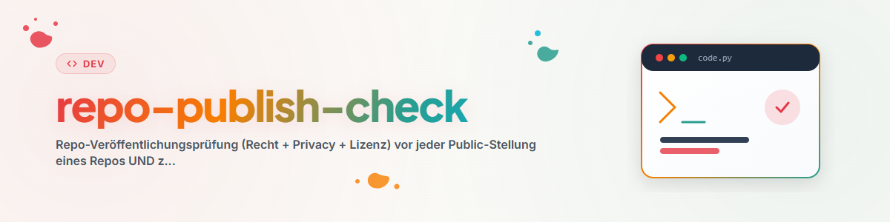

# Repo Publish Check

## Propósito

Revisa un repositorio antes de su primera publicación o en una revisión
posterior. Un resultado negativo es válido. Cambia la visibilidad únicamente
después de la aprobación explícita del propietario.

Este Skill no crea dictámenes jurídicos. Para dominios jurídicamente sensibles
o casos dudosos, usa el Skill público `law-checker`. Ninguno sustituye el
asesoramiento profesional.

## Privacidad de la revisión

No añadas informes ni evaluaciones de riesgo al repositorio revisado. Guárdalos
en un área privada externa o en un directorio ignorado como
`<private-review-dir>`. Publica solo las correcciones necesarias.

## Flujo de revisión

1. Define el contenido publicado con `git ls-files`, `.gitignore` y las listas
   de inclusión del paquete; excluye notas, informes, datos de prueba,
   configuración local y bloqueos. En una biblioteca de skills (archivos
   `SKILL*.md`): cada frontmatter debe analizarse como YAML -- ejecuta
   `testing/skill_frontmatter_gate.py` si existe en el repo (`--fix` corrige
   el entrecomillado mecánicamente sin cambiar el texto), si no,
   verifica con `yaml.safe_load`.
2. Busca en el árbol y en todo el historial credenciales, tokens, claves,
   rutas locales, datos de contacto y datos personales.
3. Verifica una `LICENSE` adecuada e inventaría código, prompts, documentación
   y medios de terceros con su origen y licencia.
4. Documenta el propósito y los límites. Para derecho, salud, finanzas,
   seguridad o datos personales, describe los flujos y usos excluidos. Envía
   preguntas jurídicas a `law-checker`.
5. Minimiza los datos, declara servicios externos y advierte que no se deben
   publicar casos confidenciales en Issues.
6. Revisa las afirmaciones sobre IA y producto; no sugieras certificaciones o
   calidad sin pruebas.
7. Comprueba nombres, posibles conflictos de marca, README, descripción y
   badges.
8. Registra hallazgos, correcciones, riesgos y semáforo en el informe privado;
   verifica el Commit final y obtiene la aprobación del propietario antes de
   un paso de publicación separado y autorizado.

## Límites

- El Skill no publica nada.
- No sustituye asesoramiento jurídico ni una búsqueda oficial de marcas.
- Un escaneo limpio no demuestra que copias públicas, registros o cachés
  anteriores hayan desaparecido.
