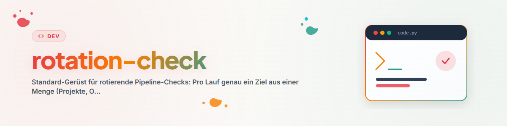

# রোটেশন-চেক — প্রতি রানে একটি লক্ষ্য, ন্যায্য কভারেজ, স্মৃতি

## উদ্দেশ্য

যে কেউ অনেক প্রজেক্ট সমন্বিত একটি পাইপলাইন পর্যায়ক্রমে পরীক্ষা করতে চায় (উৎস, স্টাইল, স্বাস্থ্য,
নিরাপত্তা, অনুবাদ, …), তাকে একটি বণ্টন-সমস্যার মুখোমুখি হতে হয়: প্রতি রানে সব প্রজেক্ট পরীক্ষা করা
খরচসাপেক্ষ; স্মৃতি ছাড়া প্রতিটি রান এলোমেলোভাবে একই জিনিস পরীক্ষা করে। রোটেশন-প্যাটার্ন দুটোই
সমাধান করে: **প্রতি রানে ঠিক একটি লক্ষ্য, নির্বাচন "সবচেয়ে বেশি সময় ধরে অপরীক্ষিত" অনুযায়ী, রেজিস্ট্রি
স্মৃতি হিসেবে কাজ করে।** এভাবে একটি বিরল ছন্দ (দৈনিক/সাপ্তাহিক) কয়েক সপ্তাহে পুরো পাইপলাইন ঢেকে
ফেলে — প্রমাণযোগ্যভাবে এবং ডুপ্লিকেট কাজ ছাড়াই।

একাধিক প্রজেক্ট-পাইপলাইন জুড়ে উৎপাদনশীল অটোমেশনের বিকশিত সংগ্রহের মেরুদণ্ড হিসেবে প্রমাণিত।

## উপাদানসমূহ

### 1. প্রতি পাইপলাইনে দুটি ফাইল (একবার তৈরি করুন)

| ফাইল | বিষয়বস্তু | চরিত্র |
| --- | --- | --- |
| `CHECKED-REGISTRY.md` | প্রতি চেকের জন্য একটি সংক্ষিপ্ত লাইন: লক্ষ্য, তারিখ, চেকের ধরন, ফলাফল, পরবর্তী ধাপ | অবস্থার সারসংক্ষেপ — প্রতিটি লক্ষ্য নির্বাচনের আগে পড়া হয় |
| `CHECKS-LOG.txt` | প্রতি রানের জন্য বিবরণ/প্রমাণসহ সংক্ষিপ্ত ইতিহাস-এন্ট্রি | জার্নাল — শুধু যোগ করা হয় (append-only) |

দুটিই পাইপলাইন-রুটে থাকে (একক প্রজেক্টে নয়), যাতে একটি রান একটি Read দিয়ে দুটোই পেতে পারে। রেজিস্ট্রি-লাইনের
ফরম্যাট:

```text
| <ziel> | <YYYY-MM-DD> | <checktyp> | <ok|befund|übersprungen> | <nächster schritt> |
```

### 2. নির্বাচন-নিয়ম

1. রেজিস্ট্রি ও লগ পড়ুন (বাধ্যতামূলক, নির্বাচনের আগে — নইলে ডুপ্লিকেট চেক হবে)।
2. প্রার্থী: যেসব লক্ষ্য এই চেকের ধরনের জন্য এখনও কখনো বা সবচেয়ে বেশি সময় ধরে পরীক্ষিত হয়নি।
3. লক্ষ্যটি সম্প্রতি একটি **ঘনিষ্ঠভাবে সম্পর্কিত** চেক দ্বারা স্পর্শ করা হলে সরে যান
   (যেমন উদ্ধৃতি-চেক সোর্স-চেকের ঠিক পরে কোনো লাভ আনে না) অথবা লক্ষ্যটি এখন লকড/প্রক্রিয়াধীন
   (লক মেনে চলুন)।
   **সহোদর-কুলডাউন:** একই লক্ষ্য-সেটের উপর একাধিক সম্পর্কিত চেক চললে (যেমন একই পাইপলাইনের উন্নয়ন, বাগ-
   খোঁজা ও রিভিউ), একটি অপেক্ষার সময় ঠিক করুন (অভিজ্ঞতালব্ধ মান: ~24 ঘণ্টা), যে সময়ে সহোদর-চেক
   দ্বারা প্রক্রিয়াধীন লক্ষ্য পুনরায় বাছা হবে না — সংঘর্ষ ও পরস্পরবিরোধী সমান্তরাল পরিবর্তন প্রতিরোধ করে।
4. শুধু যথাযথ কারণে ক্রম ভেঙে আগেভাগে নিন (যেমন শেষ চেকের পর বড় পুনর্লিখন) — কারণটি লগে উল্লেখ করুন।

### 3. চেক চালান — শুধু-পঠন (read-only) প্রস্থান সহ

প্রকৃত চেকটি (স্বাধীনভাবে সংজ্ঞায়িত করা যায়: উৎস-চেক, স্টাইল-চেক, সিকিউরিটি-অডিট, …) সেই একটি
নির্বাচিত লক্ষ্যে প্রয়োগ করুন। দুটি বৈধ ফলাফল:

- **সমস্যা পাওয়া গেছে:** যা স্কোপের মধ্যে পড়ে তা ঠিক করুন; বড় কিছু একটি ফলো-আপ টাস্ক হিসেবে প্রজেক্ট-স্থানীয়
  TODO/AUFGABEN ফাইলে যোগ করুন (চেককে সবকিছু নিজে সমাধান করতে হবে না)।
- **করণীয় কিছু নেই:** সংক্ষেপে নথিভুক্ত করে শেষ করুন। কোনো কাজ না থাকাও একটি ফলাফল, ব্যর্থতা নয় —
  "কিছু পেয়েছি" বলার জন্য কখনোই স্কোপ বাড়াবেন না।

### 4. নথিভুক্তকরণ

- রেজিস্ট্রি-লাইন যোগ করুন (সংক্ষিপ্ত), লগ-এন্ট্রি লিখুন (বিবরণ/প্রমাণ)।
- **লগ-স্বাস্থ্য:** রেজিস্ট্রি/লগ অগোছালো হলে (অভিজ্ঞতালব্ধ মান: কয়েকশো লাইন), পুরোনো অবস্থা
  `_archiv/`-এ সরান, একটি নতুন ফাইল তৈরি করুন, হেডারে পূর্বসূরিকে (পথ + তারিখ) উল্লেখ করুন।
- **পথ-বিচ্যুতি:** প্রত্যাশিত পথ ফাঁকা জায়গায় নির্দেশ করলে (লক্ষ্য সরানো/নাম বদলানো হলে) এটি নতুন করে
  তৈরি করবেন না — পাইপলাইনের প্রামাণিক স্ট্যাটাস-ফাইল/রেজিস্ট্রির মাধ্যমে সংশোধন করুন এবং ভুল পথটি
  একটি ব্যর্থতা-লগে রাখুন।

### 5. ছন্দ

পরীক্ষিত বিষয়ের পরিবর্তনের হারের সঙ্গে ফ্রিকোয়েন্সি মেলান: স্থিতিশীল সংগ্রহের উপর রোটেশন-চেক সপ্তাহে
একবার ভালোভাবে চলে (প্রায় ১২টি লক্ষ্যে প্রতি রানে একটি লক্ষ্য ≈ প্রতি ত্রৈমাসিকে পুরো পাইপলাইন);
দ্রুত পরিবর্তনশীল চেক (যেমন সক্রিয় কাজের উপর) প্রতিদিন। অনুশীলনের অভিজ্ঞতা: শুরুতে ঘণ্টাভিত্তিক চেক
প্রায় সবই দৈনিক/সাপ্তাহিকে কমানো হয়েছে — কভারেজ অটুট থেকেছে, খরচ কমেছে।

## প্রম্পট-টেমপ্লেট (শিডিউলার/অটোমেশনের জন্য)

```text
VORBEREITUNG: Lies <PIPELINE_ROOT>/<POLICY-DOKUMENTE> sowie <REGISTRY> und <LOG>.

AUFGABE: Wähle genau ein Ziel aus <ZIELMENGE>. Bevorzuge Ziele, die für den Check
"<CHECKTYP>" noch nie oder am längsten nicht geprüft wurden. Wurde ein Ziel kürzlich
von diesem oder einem eng verwandten Check geprüft oder ist es gesperrt: ausweichen
oder read-only mit Logeintrag enden.

CHECK: <konkrete Prüf-/Pflegeaufgabe und was bei Befund zu tun ist; Folgearbeiten in
die projektlokale TODO-Datei>.

Wenn keine Arbeit anfällt: kurz dokumentieren, Lauf beenden.

DOKUMENTATION: Registry-Zeile in <REGISTRY> (Ziel, Datum, Checktyp, Ergebnis, nächster
Schritt) + Verlaufseintrag in <LOG>. Bei Überlänge: alten Stand nach _archiv/ und
frische Datei mit Verweis.

ABSCHLUSS: Kurzbericht (Ziel | getan | Ergebnis | Folgeaufgaben).
```

## রেড ফ্ল্যাগ

| চিন্তা | বাস্তবতা |
| --- | --- |
| "আমি শুধু একটি আকর্ষণীয় প্রজেক্ট বেছে নেব" | নির্বাচন শুধু রেজিস্ট্রির মাধ্যমে — নইলে প্রিয়-প্রজেক্ট পক্ষপাত ও অন্ধ স্থান তৈরি হয়। |
| "রেজিস্ট্রি চেকের পরে পড়ব" | আগে। এটি নির্বাচনের মানদণ্ড, শুধু লগ নয়। |
| "প্রতি রানে একাধিক লক্ষ্য বেশি কাজ করবে" | একটি লক্ষ্য রানকে ছোট, ইডেমপোটেন্ট ও বাতিলযোগ্য রাখে; পরিমাণ আসে রোটেশন থেকে। |
| "ফাঁকা রান বৃথা গেল" | একটি নথিভুক্ত ফাঁকা রান স্মৃতি হালনাগাদ করে — এটিই সিস্টেমের অর্ধেক মূল্য। |

## সম্পর্কিত স্কিল

- `workflow-extract` — সেশন/বহিরাগত অটোমেশন থেকে অটোমেশন তৈরি করে; এই কাঠামোকে স্ট্যান্ডার্ড
  উপাদান হিসেবে ব্যবহার করে।
- `pipeline-optimizer` — পাইপলাইনের কাঠামোগত পুনর্গঠনের জন্য (রোটেশন-চেক রক্ষণাবেক্ষণ করে, Optimizer
  সংস্কার করে)।

## চেঞ্জলগ

### 1.1.0 (2026-07-03)
- নির্বাচন-নিয়ম হিসেবে সহোদর-কুলডাউন যোগ করা হয়েছে (একই লক্ষ্য-সেটের উপর সম্পর্কিত চেকের মধ্যে
  সংঘর্ষ-প্রতিরোধ; অটোমেশন-সংগ্রহের সম্পূর্ণ শ্রেণিবিন্যাস থেকে প্রাপ্ত অনুসন্ধান)।

### 1.0.0 (2026-07-03)
- প্রাথমিক সংস্করণ। Codex-অটোমেশন-সংগ্রহ থেকে বিমূর্ত করা হয়েছে (~৭৭টির মধ্যে ~৪০টি অটোমেশনে রোটেশন-
  প্যাটার্ন: CHECKED-REGISTRY/CHECKS-LOG সহ Research-/Software-/Roblox-চেক)।
