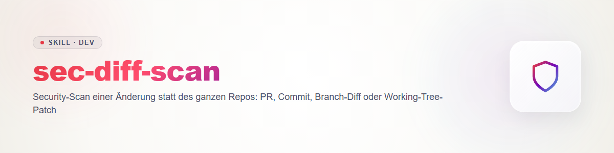

# sec-diff-scan

Wie `sec-scan`, aber der Scope ist eine **Änderung**. Vertrag, Dateiformate und Regeln: `sec-scan/references/contract.md`; Schemas und Validator in `sec-scan/schemas/` und `sec-scan/scripts/`. Preflight (Eigentum, Lock-Prüfung, Egress, Kosten), Kandidaten-Aufbau (`id` per `secfind.py id`, Geheimnisse maskieren) und Validierung laufen wie in `sec-scan` > Ablauf. Hier nur die Unterschiede.

## Scope auflösen

Eine der Quellen, immer mit dem exakten Vergleichspunkt:

- PR: Basis- und Head-Commit des PR (lokal `git diff <base>...<head>`, oder PR per `gh` holen; Egress beachten).
- Commit(s) oder Branch: `git diff <base>...<branch>`.
- Working-Tree: `git diff` und `git diff --staged` plus ungetrackte Dateien.

`findings.json` > `target.ref` = Head-Commit (oder `working-tree`), `target.scope` = die Diff-Dateien. Ist der Diff leer, abbrechen und das melden.

## Ablauf (statt sec-scan Schritte 3-5)

1. **Diff lesen**, nicht nur Hunks: jede geänderte Datei im Zusammenhang der betroffenen Funktion.
2. **Kontext nachziehen:** Aufrufer geänderter Funktionen (wer reicht Eingaben hinein?), Aufgerufene (wohin fließen die Daten?), Konfiguration und Tests, die Annahmen dokumentieren. `threatmodel.md` nutzen, falls vorhanden; sonst nur die berührten Vertrauensgrenzen kurz selbst bestimmen (kein vollständiges Modell, dafür `sec-threat-model`).
3. **Prüffragen für Änderungen:**
   - Neue Einstiegspunkte oder neue Senken (Shell, SQL, Dateisystem, Deserialisierung, HTTP-Client)?
   - Wurde eine Prüfung entfernt, abgeschwächt oder umgangen (Auth-Decorator, Validierung, Escaping, Rechteprüfung)?
   - Regression bekannter Muster: derselbe Fehlertyp wie in früheren Funden oder im Rest des Repos (`rule` aus vorhandenen `findings.json`, falls vorliegend).
   - Neue Abhängigkeit oder geänderte Version in Manifest/Lockfile; Secrets oder Tokens in der Änderung; weitere Konfigurationsöffnung (CORS, Debug, Berechtigungen).
4. **Befund nur, wenn der Pfad die geänderte oder berührte Stelle tatsächlich erreicht.** Vorbestehende Fehler im Kontext, die nicht mit der Änderung zusammenhängen, mit ihrer tatsächlichen Severity nach Vertrag 3 aufnehmen und in `description` "vorbestehend, nicht durch diese Änderung eingeführt" vermerken (nicht auf `info` herabstufen) oder, wenn nicht geprüft, nur in `coverage.limits` nennen; sie sind nicht der Gegenstand des Diffs.

## Coverage

`coverage.json`: `scanned` = die Diff-Dateien (Tiefe meist `read`) **und** die zusätzlich gelesenen Kontextdateien, `notScanned` = Diff-Dateien, die nicht gelesen wurden (binär, generiert, zu groß), mit Grund. `limits` nennt: "nur Änderung gescannt, Rest des Repos nicht". `complete` folgt der Regel aus Vertrag 5. Ein sauberer Diff-Scan ist keine Aussage über das Repo.

## Abgrenzung

Kein Voll-Repo-Scan (`sec-scan`), keine Laufzeitprüfung (`sec-validate`), kein Fix. Ausgabe: `findings.json`, `coverage.json`, Exitcode von `secfind.py validate`.

## Changelog

### 0.1.0 (2026-10-31)

- Erstfassung: Scope Änderung, Kontext-Nachzug, Regressionsfragen.
