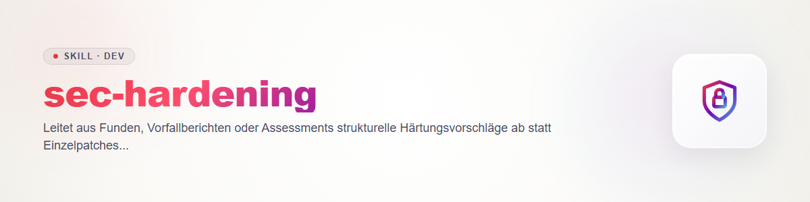

# sec-hardening - 一つずつではなく、構造から

同じ種類の所見が繰り返し現れるとき、原因は多くの場合構造にある（一元的なバリデーションがない、チェックされていない信頼境界、コード内のシークレット）。このスキルは、その水準での変更を提案する。コントラクト：`sec-scan/references/contract.md`（所見 §1/§2、ルール 4 シークレット、ルール 5 コスト）。

## 入力

`findings.json`（できれば `validated` 以降）、インシデントレポート、評価、`threatmodel.md`、コードに関する知識。根拠のある入力がなければ提案しない。前提は前提として明示する。

## 手順

1. **根本原因をまとめる：** 所見をファイル単位ではなく根本原因ごとにグループ化する。例：「すべてのルートが自前で SQL を組み立てている」「アクセスチェックが各ハンドラーで繰り返されている」「設定にシークレットが含まれている」。グループごとに所見の id を挙げる。
2. **現在のアーキテクチャを ASCII 図で描く：** 信頼境界、データフロー、チェックが現在どこで行われているか（いないか）。
3. **原因ごとの選択肢**（少なくとも 2 つ。「個別のパッチのみ」を含む）：説明、**工数**、**実装リスク**（回帰、移行）、**効果**（どの種類の所見がなくなり、どれが残るか）、依存関係。表にする。
4. **原因ごとの推奨案**に、理由と、現在の図と並べた**目標の図**（ASCII）を付ける。
5. **順序：** 複数の所見を一度に塞ぐ、または前提条件になるために先にやるべきこと。後回しにできること。単独でリリースできる中間ステップ。
6. **提案ごとの根拠：** 所見の id、コードの位置（`path:line`）、計測値。根拠のない提案は仮説と明記する。時間単位の工数をでっち上げない。相対的な表現（小／中／大）か、ユーザーが示したものだけを使う。

## 出力

1 つの文書（例：スキャンディレクトリの `hardening.md`、またはチャット内）。節：出発点、原因、現在／目標の図、選択肢、推奨、順序、未解決の問い。**コードは変更せず**、パッチも作らず、何もコミットしない（ルール 3）。個々のステップは `sec-fix` か通常の開発で実施する。文書にシークレットの値を含めない（ルール 4）。

## 変更履歴

### 0.1.0 (2026-10-31)
- 初版。
