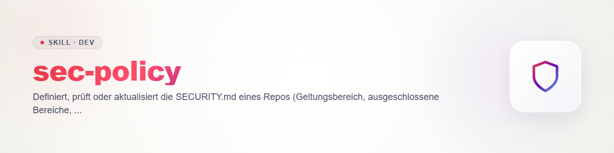

# sec-policy - SECURITY.md の定義とレビュー

ポリシーは、このリポジトリで何が脆弱性にあたるかを定める。`sec-triage` はそれに照らして所見を評価する（コントラクト `sec-scan/references/contract.md` §2：`triaged` = 重大度と優先度がポリシーに照らして決定されていること）。ポリシーがなければ、トリアージは推測になる。

## SECURITY.md の内容

| 節 | 答える問い |
|---|---|
| サポート対象バージョン | どのバージョンがセキュリティ修正を受けられるか。 |
| スコープ | どのコンポーネント、インターフェース、デプロイが対象か。 |
| 除外 | 明示的に対象外とするものは何か（テストコード、サンプル、既知の制約、ホストシステムへのアクセスを必要とする攻撃）。 |
| 必要なセキュリティ特性 | プロジェクトは何を保証しなければならないか（例：「リポジトリにシークレットがない」「ネットワークからの入力は検証される」「プラグインは X 以外のファイルにアクセスせずに動作する」）。トリアージはこれを基準に測る。 |
| 報告窓口 | どこに報告するか：プレースホルダー `<security-contact>`、またはリポジトリで有効化されていれば GitHub の非公開の脆弱性報告。**アドレスをでっち上げない。** |
| 応答時間 | 受領確認、評価、修正目標。値はメンテナーが決めるもので、スキルが決めるものではない。提案は提案として明示する。 |
| 開示 | 協調的開示。期限はメンテナーが決める。`sec-writeup` を案内する。 |

## 手順

1. **既存のものを読む：** 現行の `SECURITY.md`、README、依存関係とビルドのファイル、コード構造（エントリーポイント、認証、ファイルアクセス、ネットワーク、プラグインの仕組み）。
2. **主張と証拠の照合：** ポリシー中のあらゆる約束（「すべての入力は検証される」「テレメトリなし」「バージョン X.y は保守されている」）を、コードやリリースと照らして確認する。矛盾は所見（`sec-scan`）か、ポリシーの訂正であり、黙って見過ごしてはならない。確認できないものは未検証と記す。
3. **起草または差分作成：** 新しい SECURITY.md、またはメンテナーの判断を要する未解決点（`<...>` のプレースホルダー）付きの変更案。答えが欠けている場合は、推測せずに質問する。
4. **置き場所：** ドラフトはチャットまたはスキャンディレクトリに置く。リポジトリへの書き込みは、ユーザーの直接の指示があったときだけ（ロックを確認する、ルール 2。コミット・プッシュはしない、ルール 3）。ファイルには、シークレット、ホストのパス、個人の連絡先を決して含めない（ルール 4）。

## 境界

技術的な堅牢化の提案：`sec-hardening`。リポジトリの公開準備の確認：`repo-publish-check`。

## 変更履歴

### 0.1.0 (2026-10-31)
- 初版。
