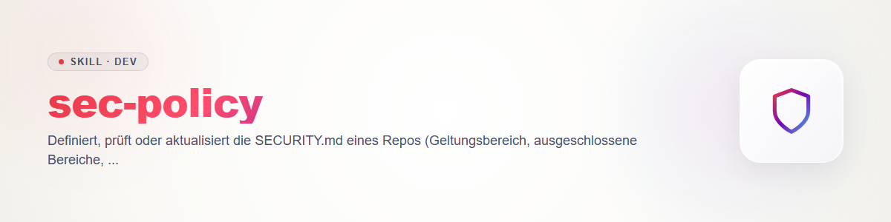

# sec-policy - 制定并审查 SECURITY.md

策略规定了在这个仓库里什么算漏洞。`sec-triage` 依据它来评定发现（契约 `sec-scan/references/contract.md` §2：`triaged` = 严重度与优先级已依据策略确定）。没有策略，分类就只能靠猜。

## SECURITY.md 的内容

| 章节 | 它回答的问题 |
|---|---|
| 受支持版本 | 哪些版本会收到安全修复？ |
| 范围 | 指的是哪些组件、接口、部署方式？ |
| 排除项 | 明确不算什么（测试代码、示例、已知局限、需要访问宿主系统才能实施的攻击）？ |
| 必须具备的安全属性 | 项目必须保证什么（例如「仓库中没有密钥」「网络输入经过校验」「插件运行时不能访问 X 之外的文件」）？分类以此为衡量标准。 |
| 报告渠道 | 向哪里报告：占位符 `<security-contact>`；或者，如果仓库已启用，则使用 GitHub 的私密漏洞报告。**不要编造地址。** |
| 响应时间 | 确认收到、评估、修复目标，这些数值由维护者给出，而不是由技能给出；建议值要标明为建议。 |
| 披露 | 协调披露，期限由维护者决定；指向 `sec-writeup`。 |

## 流程

1. **阅读现有内容：** 当前的 `SECURITY.md`、README、依赖和构建文件、代码结构（入口点、认证、文件访问、网络、插件机制）。
2. **声明与证据对照：** 把策略中的每一项承诺（「所有输入都经过校验」「无遥测」「维护 X.y 版本」）与代码或发布版本相核对。出现矛盾就是一个发现（`sec-scan`），或是对策略的更正，绝不能悄悄忽略。无法核查的内容：标记为未验证。
3. **起草或做差异：** 新的 SECURITY.md，或带有待定项（`<...>` 占位符）的变更建议，交由维护者决定。如果缺少答案，就询问，而不是猜测。
4. **存放位置：** 草稿放在聊天或扫描目录中。只有在用户直接下达指令时才写入仓库（检查锁，规则 2；不提交、不推送，规则 3）。该文件绝不包含密钥、主机路径或私人联系方式（规则 4）。

## 边界

技术层面的加固建议：`sec-hardening`。检查仓库是否具备公开发布的条件：`repo-publish-check`。

## 变更日志

### 0.1.0 (2026-10-31)
- 初始版本。
