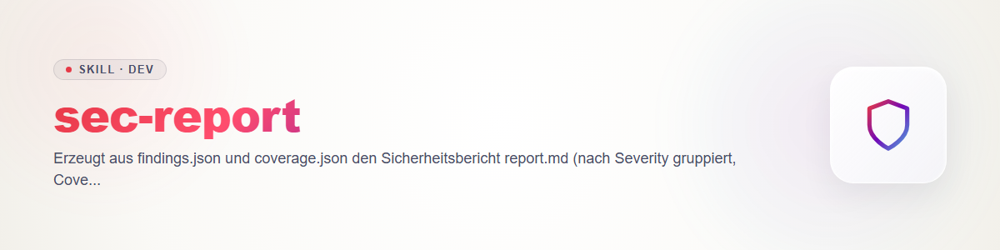

# sec-report

Letzte Phase der ellmos-Security-Familie. Vertrag: `sec-scan/references/contract.md` (Dateien 1, Severity 3, Coverage 5, Regeln 6). Das Skript importiert `seclib` aus dem Geschwisterordner `sec-scan/scripts` (im Repo `skills/dev/` und im flachen Deployment `~/.claude/skills/`; beide Ordner müssen nebeneinander liegen). Nur Standardbibliothek.

## Aufruf

```
python scripts/render_report.py FINDINGS COVERAGE OUTDIR [--lang de|en]
```

Interpreter ausdrücklich aufrufen. `OUTDIR` ist das Scan-Verzeichnis; Lock-Prüfung vorher wie `sec-scan` Schritt 2 (fail-closed). Ergebnis: `OUTDIR/report.md` und `OUTDIR/findings.sarif`. Exitcodes: 0 = geschrieben, 1 = Eingabe unlesbar oder ungültig (**nichts** geschrieben), 2 = Aufruf falsch. Exitcode und Ausgabe zeigen.

## Verhalten

- **Validiert zuerst** (`seclib.validate_findings`). Fehler werden gelistet, es entsteht kein Bericht aus kaputten Daten. Erst die Ursache beheben (`sec-scan`, `sec-validate`), dann erneut rendern.
- **report.md:** Kopf (Ziel, Ref, Scanner) · Zusammenfassung · Warnungen · Funde nach Severity (critical bis info) mit Ort, Konfidenz, Status, Validierer, Beleg, Beschreibung, Auswirkung, Empfehlung, Ticket · **abgelehnte Funde getrennt** mit Grund · Coverage (gescannt mit Tiefe, nicht gescannt mit Grund, Grenzen).
- **Ehrlichkeit (Vertrag 5, 6.9):** `complete: false` steht ganz oben als "PARTIELLER SCAN". Keine Funde plus unvollständige Abdeckung heißt "KEIN sauberes Ergebnis". Nur "Keine Funde bei vollständiger Abdeckung" darf wie ein sauberes Ergebnis lesen. Warnungen, etwa gleicher Anbieter bei Finder und Validierer, erscheinen im Bericht.
- **findings.sarif:** SARIF 2.1.0 aus `seclib.to_sarif`; abgelehnte Funde bleiben als `suppressions` im Log. Direkt als Code-Scanning-Upload verwendbar. Hochladen ist eine Veröffentlichung nach außen und braucht den Nutzerauftrag.

## Vor der Weitergabe

Bericht gegenlesen: keine Geheimniswerte (der Validator fängt nur gängige Muster; Vertrag 6.4), nur Fundorte. Berichte in Ticket-Systemen und Chats ebenfalls ohne Werte. Schwachstellen in öffentlichen Repos nicht als öffentliches Issue, sondern über privaten Meldeweg (SECURITY.md).

## Test

`python -m pytest tests -q -p no:cacheprovider` im Skillordner (Bericht, SARIF, partieller Scan, Backtick-Evidenz, Negativfall ohne Ausgabe).

## Changelog

### 0.1.0 (2026-10-31)

- Erstfassung mit `render_report.py`: report.md und findings.sarif aus validierten Daten.
